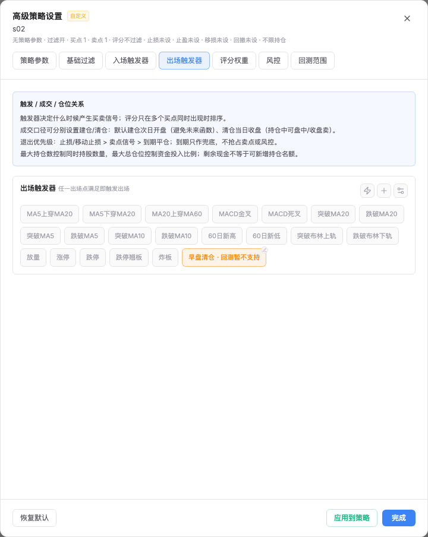
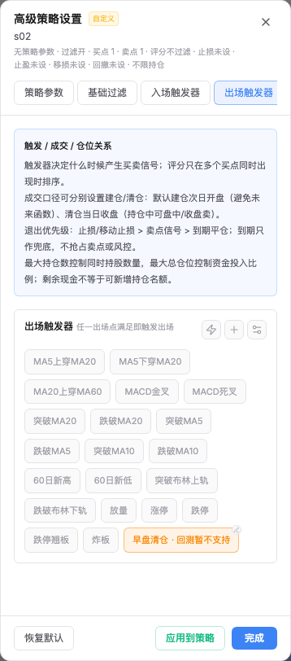

# Bug: 回测设置隐藏自定义s02已配置的早盘清仓

> Status: FIXED
> Mode: default
> Severity: functional
> Last updated: 2026-11-02

## Symptom

本地回测页选择自定义s02（`custom_mvxxcp88`），打开策略设置编辑页，
出场触发器中没有“早盘清仓”，虽然策略概览显示已配置1个出场触发器。

## Expected

已保存的出场引用应可见，并明确当前入口的能力限制，不能以隐藏代替“不支持收益回测”。
不改变信号定义、策略配置或后端收益回测支持范围。

## Reproduction

- 本地`http://127.0.0.1:3021/backtest`：自定义分组→s02→策略设置/编辑→出场触发器。
- 实际API返回`exit_signals=["csgi_morning_liquidation"]`；信号目录中该指标存在且启用。
- `SignalPicker.test.tsx`新增已选持仓出场回显测试，修复前连续3次失败。
- `StrategyBacktest.test.tsx`新增真实编辑页路径测试，修复前失败；反转过滤修复后两测试再次失败。
- Browser插件工具不可用，使用已有Playwright依赖。复现和页面验收只读，不保存配置、不提交回测。

## Hypotheses & diagnosis

| 假设 | 预测 | 结论 | 证据 |
| --- | --- | --- | --- |
| H1 信号未启用或策略引用丢失；prior 40%，confidence M | API缺信号或exit引用为空 | eliminated | 本地目录返回启用的intraday/exit模板，策略引用仍正确 |
| H2 前端按回测能力隐藏已配置项；prior 60%，confidence H | 目录及引用正确，编辑页仍没有按钮 | confirmed | `allowHoldingExit=false`进入共享SignalPicker，旧过滤不检查signals是否已选；单测与浏览器一致复现 |

## Root cause

`StrategyBacktest`为入/出场选择器设置`allowHoldingExit=false`，
因为早盘清仓后端明确不支持收益回测。`SignalPicker.customOptions`在构建选项时把
所有该模板都过滤掉，未保留已配置项，因此有效引用在设置页不可见。
根因在共享选择器的选项过滤，不是SQL配置、周期声明或指标丢失。

## Fix

- `frontend/src/components/screener/SignalPicker.tsx`：
  不支持持仓出场的入口仍隐藏未选项；已配置且符合周期/kind的指标保留显示。
- 已配置项显示选中状态和“回测暂不支持”，只读并提供去选股页修改引用的提示。
- 原通用分钟策略设置仍可选择/修改早盘清仓；裸信号监控仍隐藏它。
- 后端早盘清仓收益回测拒绝逻辑保持，不新增公开API、数据库结构或真实交易行为。

## Verification

- V-1：相关前端4个文件共16项通过，含组件及回测编辑页的新增回归。
- V-2：仅临时反转本次过滤修复，两新增测试重新失败；恢复后16项再次通过。
- V-3：`tests/test_morning_liquidation.py`30项通过，含收益回测明确拒绝、持仓/T+1及出场参数。
- V-4：受影响ESLint、匹配前端/Compute构建与镜像manifest通过。
- V-5：本地8个服务重启及ready/live健康通过，管理员登录通过；
  1440×1000和390×844均显示该按钮、能力提示及只读状态，无面板横向溢出。
- V-6：刷新页面后重新选择该策略，再次打开编辑页仍可见；策略详情与信号目录前后哈希相同，
  9组其他策略、监控及交易账本签名保持。
- V-7：浏览器无脚本错误，未发生策略/信号保存、收益回测或订单请求。
  本次不认证外部版本更新检查或其他浏览器。

关键命令：

```sh
pnpm exec vitest run src/components/screener/SignalPicker.test.tsx src/components/screener/StrategySettingsSignals.test.tsx src/components/screener/StrategySettingsClarity.test.tsx src/pages/backtest/StrategyBacktest.test.tsx
TICKFLOW_ENV_FILE=/dev/null SERVICE_ROLE=standalone MULTITENANCY_ENABLED=false python -m pytest tests/test_morning_liquidation.py -q
```

## Regression test

- `SignalPicker.test.tsx`：`keeps a configured holding exit visible with its backtest limitation`
- `StrategyBacktest.test.tsx`：`shows a saved custom minute holding exit in the settings editor with its backtest limitation`
- 原未选项隐藏、普通监控隐藏、通用分钟设置可选的测试继续通过。

## Pattern analysis

搜索`allowHoldingExit`发现2个回测调用点（入场和出场），共享选择器的同一过滤根因。
入场kind不接受该exit模板，出场已选项由本次修复覆盖；没有其他同类调用点需要扩展。
后端`StrategyBacktestService.run`对已选早盘模板明确拒绝，保留该边界。

## Local runtime

本地v0.4.42，基底`7b60562dd7fa5054f383319bbf0d706227dfabc1`；
Compute镜像`sha256:facd0881d3ac2dc90819fabbbc834b2e86924492d85da4bb8c1cb16430fe1a5e`。
仅应用1个前端源码文件及匹配静态产物，版本和受控环境保持。
未提交、推送、线上部署或运行新收益回测。只修改显示，源/覆盖/信号均保持。

## 页面证据

桌面：已配置的早盘清仓显示选中状态与回测能力提示。



手机：相同配置可见，面板宽度358px，无横向溢出。


