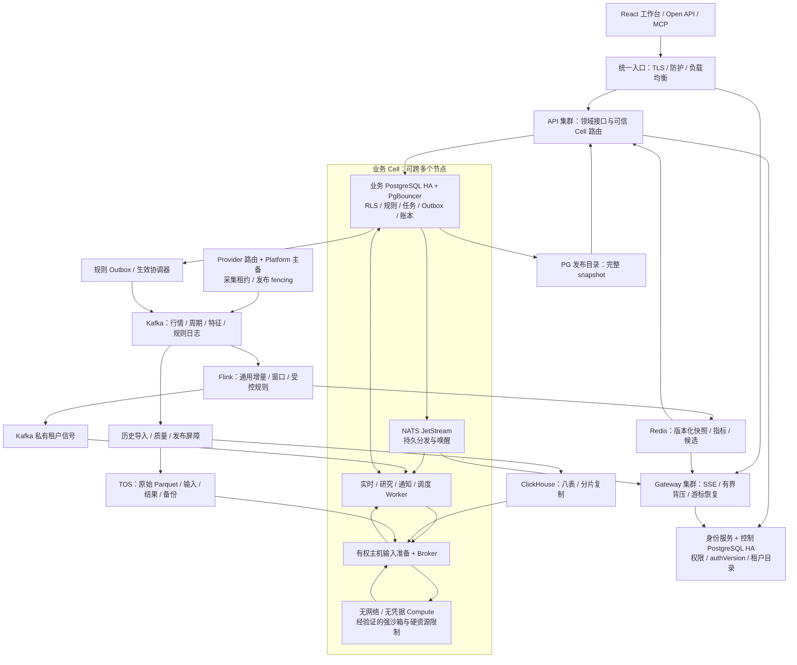
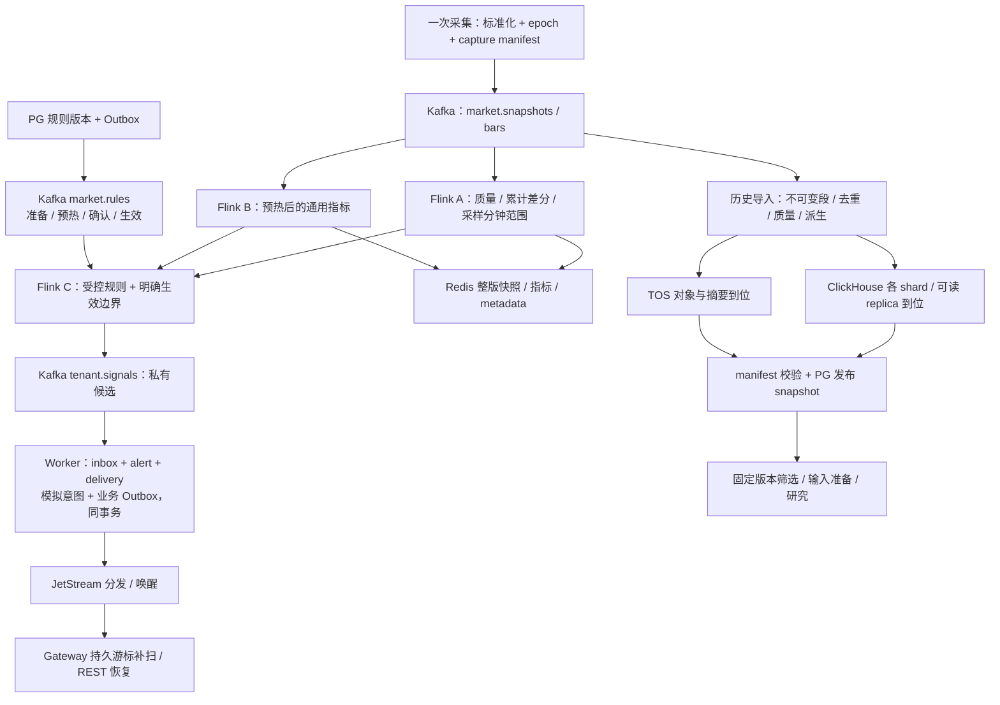
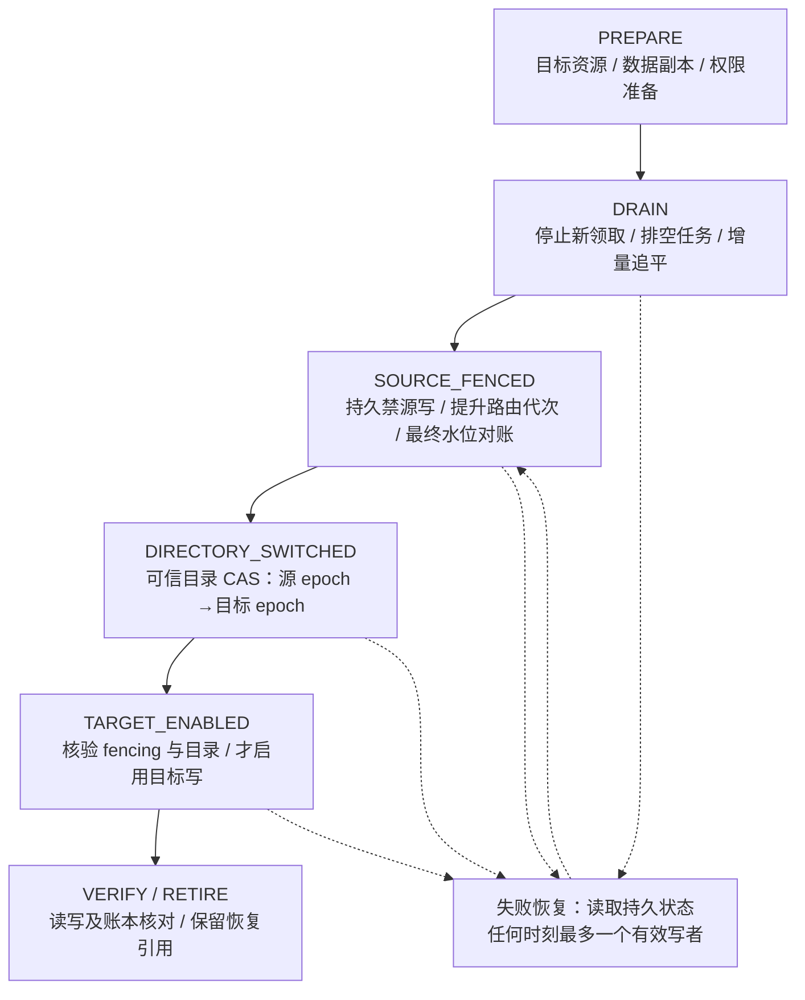
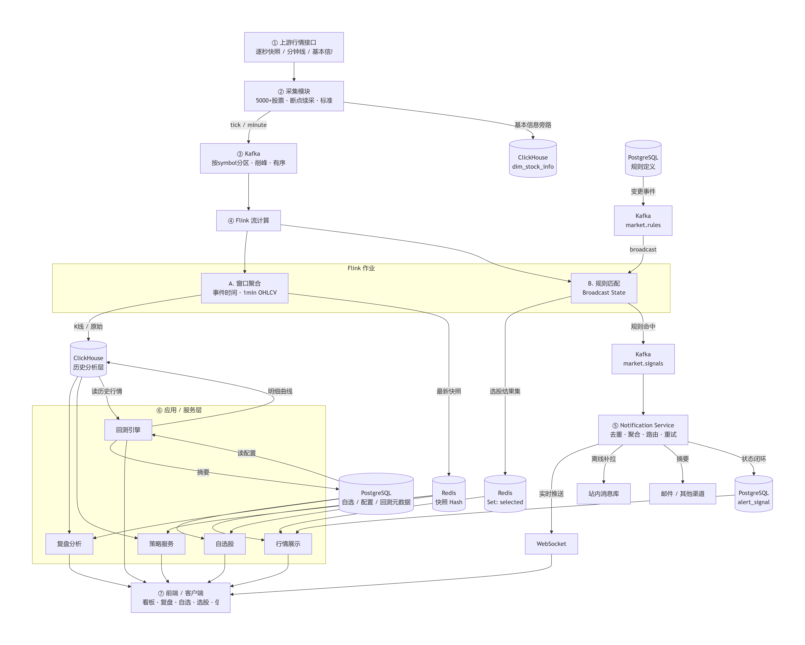

# TSP 系统技术方案

2026-10-26 K线画像由 `services/kline_periods.py` 集中六周期配置、取数、落盘和调度。
新增 `kline_5minute/kline_10minute/kline_15minute/kline_weekly`，前三张沿用分钟schema，
周K沿用日K schema并以周一日期作为周内幂等键。10分钟K仅扫描所需1分钟日期分区，
分别按09:30和13:00起算收盘标签，未知量额保持空值。取数按日期段及100标的块有界执行；
写盘沿既有分区锁与原子替换，刷新对应视图、画像及存储缓存，公共发布目录同步扩展。
六周期设置经 `/api/settings/kline-sync`，手工任务经 `/api/kline/sync_period`；
日K保留原复权/指标补齐流水线，1分钟实时保留既有增量服务，其余周期由调度检查。
此候选沿用分钟/日K独立能力路由，不新增第八个数据集或策略周期。

2026-10-25本批补入策略结果归档/全局资源准入、统一弹窗、两步向导、
目录与行情同步分离、盘后16:00默认及研究界面刷新；
工程目录及六类文档的对应关系见[生命周期追踪](reference/engineering.md#trace)，
本次实际验证与发布状态见[整合记录](../reports/current-state-release-20261025/verification.md)。

核对日期：2026-10-25。本手册集中记录当前实现与系统目标；
当前实现以源码和相邻测试为准，目标方案不代表已接入、验收或部署；
生产状态只在[版本基线](version-baseline.md)维护。

产品范围见[需求基线](requirements.md)，工程约束见[开发指南](../CONTRIBUTING.md)，部署恢复见[运维手册](operations.md)。

- [一、当前架构与运行契约](#current)
- [二、页面、能力与代码事实源](#capabilities)
- [三、统一系统目标](#target)

<a id="current"></a>
## 一、当前架构与运行契约

<a id="strategy-result-history"></a>
### 策略结果归档

结果以租户/数据目录、稳定策略ID、当时名称、逻辑版本、有效参数及覆盖配置、
标的池、资产、周期和实际日期隔离。加载时捕获代码/辅助模块版本，执行快照保留
运行中定义；注释和名称编辑不改变逻辑版本，名称本身仍是归档维度。
自定义因子/信号内容与入场政策纳入结果版本，计算时的行情generation和公共发布ID
作为来源信息保存。同一维度更新最近成功及曾命中并集，启动时间较早的任务不能倒写。

`services/strategy_results.py` 是权威仓库：完整多租户通过现有
`business.documents` 事务、租户绑定锁和RLS写入专用namespace；
不套用配置列表2000条上限，不新增生产schema。独立模式使用
`user_data/strategy_results.sqlite3`，WAL、FULL同步和事务保证并发写入。
记录JSON最多16MiB；历史按索引键分页，摘要查询不加载股票行。
内存仅缓存序列化明细，32MiB字节上限，读取前验证记录revision；
未提交事务不进入热缓存。清理旧`strategy_cache`不会删除归档。

单跑、阻塞批跑、渐进批跑及旧`/api/strategies`执行入口先保存成功结果。
`/api/screener/cached*`传`as_of/asset_type/timeframe`时查询当前定义的对应记录；
不带日期保持旧快照兼容。`result-history/{strategy_id}`分页列出旧快照，
按record ID读取明细，租户来自可信请求上下文。前端查询键含同样维度，
迟到执行响应不能切回旧日期；今日实时结果必须匹配加载版本与配置。
分钟缺指定日分区明确失败，不回退最新分区。操作和恢复见
[策略操作](../操作说明书.md#82-策略卡片)、[备份](operations.md#strategy-history-backup)。

<a id="current-1-架构摘要"></a>
### 1. 架构摘要

TSP 保留模块化单体的完整业务引擎，提供完整单机多租户与独立运行两种模式。

当前源码的完整单机多租户拓扑使用 `deploy/full/compose.yml`，启用
`MULTITENANCY_ENABLED=true`。保留完整前端与业务引擎，API 默认四进程；
独立实时网关负责 SSE、一次性票据和事件恢复；平台负责唯一行情写入，四类 Worker
分别负责研究、实时监控/模拟交易、通知和调度。
身份与租户业务持久化到 PostgreSQL v6，公共行情按不可变版本只读共享。
部署步骤见[完整单机多租户部署](../deploy/full/README.md)，
已完成的一期发布与 100 用户验收见[实施记录](../reports/document-consolidation-20261024/historical-evidence.md#phase1)。

以下单进程拓扑描述 `MULTITENANCY_ENABLED=false` 的独立运行模式：

- FastAPI 提供 Web、API、SSE、调度和业务编排。
- React 单页应用提供研究与管理界面。
- Parquet 保存主要分析数据，DuckDB/Polars负责查询和计算。
- Provider 层隔离外部数据源差异。
- 单个 API 主进程持有调度器、实时行情、事件总线和任务状态。
- Docker 生产形态将前端静态文件与后端打入一个容器。

初始化默认自动同步：`preferences.get_data_sync_auto_enabled()` 缺省为开启。
Standalone 与 Platform 记录待同步状态并通过 `start_initial_sync` 创建后台首次任务；
启动完整性修复、五档补跑、盘后管道及竞价采集/补发布默认允许执行。
已有总开关关闭时暂停这些行情数据任务，修改调度时间保留暂停状态。
个股维表独立于总开关：`start_scheduler` 启动后台官方目录任务，并在每天北京时间
09:00 执行，包含周末与节假日；复用持久化 JobStore 的 `instruments_sync` 任务类型，
同类单飞，不占行情重任务槽，下载失败不阻塞启动。
实时行情（含 ETF）、盘中分钟和分时图刷新、秒级归档、内置概念/行业自动拉取默认开启。
实时监控间隔由现有 preferences getter 提供行情 3 秒、分时图 5 秒、盘中分钟落盘 60 秒
缺省值，四页 SSE 刷新默认开启；已保存值优先，读取不改写文件。前端初始回退与 API
无行情服务时的返回值采用同一口径，实际轮询仍由数据源能力及成本限制。
财务调度在能力可用时默认启动，执行时检查总开关，通过
`asyncio.to_thread(run_now, "metrics")` 复用互斥、时间持久化和带仓库写锁的数据发布路径。
能力、权限、交易日/时段和任务单飞继续控制真正取数；首次全量初始化不要求当前在交易时段。
手动管道仍执行已配置的数据阶段并保留原发布与缓存刷新链路，已有显式配置优先。
菜单默认顺序由 `DEFAULT_NAV_ORDER` 提供，前端侧栏、菜单设置及租户显示默认一致；
已有排序和隐藏配置不被重置。参数与操作见[初始化默认值](operations.md#config-数据页初始化默认值)。
主题首屏脚本与 `getTheme()` 均默认亮色；浏览器保存 `tf-theme=dark` 时恢复暗色，
无有效偏好或存储不可用时使用白天模式，不改写已有主题选择。

```text
浏览器 / API 客户端 / MCP 客户端
                 |
          HTTP / SSE / Token
                 |
        FastAPI 模块化单体（单进程）
       /        |         |        \
  API 网关   领域服务   后台任务   事件总线
       \        |         |        /
        仓库与数据发布 / generation
                 |
        Parquet + DuckDB + JSON
                 |
 Provider 能力路由与外部数据源 / AI / 通知
```

<a id="current-2-系统边界"></a>
### 2. 系统边界

<a id="current-21-系统内部"></a>
#### 2.1 系统内部

- 数据源能力检测、标准化、同步和完整性检查。
- 指标与 enriched 数据构建。
- 策略、因子、回测、监控、模拟交易和复盘。
- 本地配置、用户数据、任务记录和认证状态。
- Web UI、开放 API、SSE 和 MCP 适配。

<a id="current-22-外部依赖"></a>
#### 2.2 外部依赖

- TickFlow、rustdx、fuyao 或自定义 Provider。
- 用户配置的 AI 兼容接口。
- 飞书、企业微信等通知端点。
- GitHub Actions、GHCR 和 GitHub Release。

外部服务的可用性、覆盖范围和授权不属于 TSP 自身可用性保证。系统负责在边界完成
能力检测、字段标准化和可诊断失败。

<a id="current-3-运行拓扑"></a>
### 3. 运行拓扑

<a id="current-31-完整多租户-compose"></a>
#### 3.1 完整多租户 Compose

```text
HTTPS Edge
  ├─ 普通 HTTP / 静态资源 -> API
  └─ /api/events*          -> Gateway

Platform -> 可写行情目录 -> 完整性校验 -> 公共不可变 releases/current
API / Research / Realtime / Notifications / Scheduled -> 双 PostgreSQL
API / Worker -> Unix socket -> Broker -> 无网络、无凭据的短生命周期 Compute
```

- Platform 是唯一行情写入者。公共发布在同一写锁内核对最新 stock/ETF/index
  原始日分区与 enriched 标的覆盖；失败保留旧 `current`。
- API 和 Platform 生产角色的公共日线读请求不调用 Provider 补数。缺少已发布历史时
  返回 `503 market_history_unavailable`；独立模式保留原请求内补数能力。
- API 到 Platform 的行情读代理使用 12 秒读超时和 5 秒连接超时；管理面仍保留
  300 秒长任务超时。Platform 内已有相同请求合并和 2 秒短缓存。
- 策略页的租户分钟数据健康检查读取 `/api/intraday/minute-refresh/status`，
  经行情读代理只返回 `available` 和 `healthy`。管理员继续使用
  `/api/settings/minute-refresh/status` 查看完整服务状态；该管理接口仍要求
  `settings:manage`，租户页面不轮询管理员配置。
- Research、Realtime、Notifications、Scheduled 的 Supervisor 与 API readiness
  共享按类型区分的 freshness 上限（120/420/120/660 秒）。
- Broker 健康检查实际启动一个同约束沙箱并缓存成功结果；执行槽和等待者均有界，
  并发满最多短时等待，失败诊断最多保留 8 KiB stderr 尾部。
- “系统设置 → 策略页 → 并发策略数”通过管理员管理面读写
  `/api/settings/strategy-concurrency`；复用原子全局偏好保存，Broker 只读同一
  配置文件，`resources` IPC 仅查询，不接受远程资源覆盖。
  `services/strategy_resources.py` 按执行主机内存/CPU 各 25% 计算推荐数与任务
  额度；共享准入同时核对任务数及已占用内存/CPU。Docker 按准入时额度施加硬限，
  配置降低时保留旧任务及其额度，单进程模式仅提供准入估算。自动为缺省，
  手工 1–16 受部署上限限制，估算结果不代表实测容量。
  API/Platform/Worker 共用一个主机 Broker；批量内部串行，普通租户固定一个槽；
  管理员由认证权限注入可信任务身份，在全局预算内按推荐/手工数并发。
  普通租户 GET 同一设置路径返回只读1，不转发平台或暴露主机预算；POST仍要求管理员。
  不扩展到跨节点调度。接线与生效排障见[运维配置](operations.md#strategy-concurrency)。
- `production-16g.env` 将 API 覆盖为两进程，七类应用角色限制为 8,704 MiB，
  单 Compute 为 2,048 MiB，
  六类数据库客户端的双库连接上界为 36；其余内存留给 PostgreSQL、Edge/Broker、
  内核、Docker 和文件缓存。

本地目标股票候选沿既有 `basic_filter` 保存 `target_mode`、`boards`、
`include_custom`、`watchlist_group_ids` 与 `exclude_st`。`strategy/targets.py`集中
校验、动态解析与引用检查；扩展只服务该领域，不新增通用候选插件。
执行时展开内部 `target_symbols`，不写回配置、不从详情API下发；
Polars与回测矩阵使用同一范围，目标关闭数值过滤仍生效，ETF资产中和股票目标。
PostgreSQL在同租户事务中批量读取成员，固定任务与子策略快照；成员进入归档身份，
新成员不覆盖旧历史。文件模式以mtime/size缓存成员并返回独立快照。
保存分组引用与删除共用租户绑定写锁；文件模式共用自选锁。分组列表携带
`referenced_by`，界面点击即解释禁止原因，所有删除入口仍由后端保护。
`POST /api/watchlist/groups/import-csv`复用CSV解析/主数据匹配，新建组与成员在SQL
事务中提交；文件写入失败恢复旧文件。CSV仅含代码即可，重复去重，空匹配拒绝建组，
已有笔记、加入日期和其他分组保留。该候选未发布到生产。

公共不可变发布加入变化检测、五分钟间隔和空闲容量保护。自动回收仅删除超过
六小时且不属于 current、最近 30 份或研究 input/metadata 引用的版本；
缺少业务库拒绝清理。空闲公共读者按标记及有界时间重新加载。

2026-10-25实测新ECS已运行v0.4.21/7823b84b/schema v6，七应用角色健康，
现有公共容量保护与周期回收保留。旧v0.4.11/092bd79c属于历史实例。
自选业务连接池获取超时的底层原因仍未确认；源码整合不替代生产验收，
见[本次生命周期基线](../reports/local-consolidation-20261022/verification.md#local-contract-2026-10-22-本地变更整合与生命周期基线)。

<a id="current-32-独立模式-docker"></a>
#### 3.2 独立模式 Docker

```text
主机端口（默认 3018）
          |
  TSP 单容器 / 单 Uvicorn worker
          |
  /app/data  <-> 主机持久化目录
```

镜像内包含构建后的前端静态资源和 FastAPI 服务。`docker-compose.yml` 将
`DATA_DIR` 固定为 `/app/data`，并使用 `restart: unless-stopped`。

<a id="current-33-dev-模式"></a>
#### 3.3 Dev 模式

```text
Vite :3011  --代理/API-->  FastAPI :3018  -->  ./data
```

`dev.sh` 或 `dev.ps1` 启动前后端开发服务。此模式适合开发，不代表生产拓扑。

非 Windows 默认 `MULTITENANCY_ENABLED=true` 且角色为 `api`；
完整开发环境需准备 PostgreSQL 双库、平台公共发布与四类 Worker。
上述单进程图仅用于显式旧独立模式；设置 `MULTITENANCY_ENABLED=false`
或 `SERVICE_ROLE=standalone` 时仍沿用旧调用链。Windows 保持单机管理员默认值。

所有模式的首次初始化共用 `app/bootstrap_defaults.py` 中的非秘密管理员
默认值。普通运行在无身份时创建哈希账号；完整多租户 API 使用已有 SQL 运行权限
幂等创建缺失管理员和默认注册口令 `天王盖地虎`，开放注册及找回密码，不执行 schema 迁移。
已有口令保持不变；口令初始化失败阻止 API 宣称初始化完成。
有效管理员默认继承全部租户业务权限；`AccountIdentity.bootstrap_admin_tenants`
为没有默认租户的管理员创建个人空间。复用注册的容量锁、owner 成员关系、
持久化 provisioning job 和 `business.initialize_tenant`，独立提交后激活默认空间。
已有默认租户、密码、系统角色和业务数据保留；并发启动只预留一个空间，中断可在
启动恢复或登录时重试。容量或初始化失败保留系统管理登录，私有业务仍校验租户就绪；
初始化完成不会恢复已停用账户，默认空间变更通知现有事件授权与账户范围检查。
SMTP 依次使用显式环境、已存平台配置、
完整多租户 Cell 配置；均未配置时邮件不可用，不随源码内置实际邮箱授权码。
通知与注册共用传输、收件人独立；不会因默认值替换已有配置。

<a id="current-34-桌面客户端"></a>
#### 3.4 桌面客户端

桌面入口在本机选择可用端口，在线程中启动仅监听回环地址的 Uvicorn，再由
pywebview 打开界面。桌面安装包与 Docker 镜像是不同发布产物。
macOS/Linux 冻结桌面默认同样使用多租户认证和注册/找回入口；显式关闭多租户时
保留旧本地免登录。完整多租户的数据库与平台依赖不会由桌面认证绕过。

原生 Windows 强制单机管理员模式，保留完整应用与本地业务存储；
身份只保存加盐密码哈希，改密撤销会话，文件损坏启动失败。源码与桌面入口均
采用同一资源预算，线程、DuckDB 和回测面板字节 LRU 有界；
其他平台及 Linux 容器多租户按既有模式运行，见[Windows 运行方案](operations.md#windows)。

<a id="current-4-独立运行模式的单进程约束"></a>
### 4. 独立运行模式的单进程约束

本节只适用于 `MULTITENANCY_ENABLED=false`；完整多租户 API 使用持久任务、
租户事件和数据库事务，可运行默认四个 HTTP 进程。

独立运行模式的 API 服务必须保持单实例、单 Uvicorn worker。原因是以下状态位于进程内：

- SSE 事件广播与 ticket。
- 部分任务管理器、缓存和并发控制。
- 调度器、实时行情和订阅状态。
- AI 操作确认等短生命周期状态。

使用多个 Uvicorn worker 会让请求、事件和任务状态落入不同进程，导致状态不一致。
回测等受控任务可以由主进程显式创建子进程或线程；这不等于启动多个 API worker。

当前没有 Redis、消息队列或分布式锁，因此也不支持多个容器同时写同一
`DATA_DIR`。扩容方式是提升单机资源或拆分离线研究任务，不能直接增加副本。

<a id="current-5-代码分层"></a>
### 5. 代码分层

完整源码、部署、测试、文档与运行数据目录见
[工程目录](reference/engineering.md#layout)。目录按发布单元和工程职责组织，
平台、网关与 worker 继续复用同一个后端包；目录归档不改变运行拓扑。

| 层 | 主要位置 | 职责 |
| --- | --- | --- |
| Web/API | `backend/app/api/`、`backend/app/main.py` | 认证、参数校验、HTTP/SSE 响应和依赖组装 |
| 业务服务 | `backend/app/services/` | 同步、行情、通知、调度、模拟交易等业务编排 |
| 数据源 | `backend/app/data_providers/`、`backend/app/plugins/` | 能力声明、Provider 选择和供应商字段标准化 |
| 数据访问 | `backend/app/tickflow/` 及仓库类 | Parquet、DuckDB、缓存和查询封装 |
| 指标 | `backend/app/indicators/` | enriched 流水线和指标计算 |
| 策略 | `backend/app/strategy/` | 策略注册、筛选、信号和统一执行 |
| 回测 | `backend/app/backtest/` | 信号消费、成交模拟、优化和 worker |
| 扩展 | `backend/app/custom/`、扩展配置 | AI 助手及受控扩展能力 |
| 前端 | `frontend/src/` | 页面、组件、查询缓存、API 类型和状态 |
| MCP | `mcp-server/` | 将开放 API 适配为 MCP 工具 |

API 层不应直接实现供应商协议或全量数据计算。前端不应复制后端能力注册表和金融
计算口径。

前端领域 API 仍统一由 `frontend/src/lib/api.ts` 导出；通用 Fetch、超时、错误
解析和 Toast 策略下沉到 `frontend/src/lib/api/client.ts`。领域入口保持稳定，
避免页面直接复制传输层逻辑。

<a id="current-6-核心数据流"></a>
### 6. 核心数据流

<a id="current-61-数据同步与发布"></a>
#### 6.1 数据同步与发布

```text
能力偏好
  -> Provider 路由
  -> 拉取外部数据
  -> 字段、单位、代码、时区标准化
  -> schema / 完整性校验
  -> 临时结果或新 generation
  -> 原子发布
  -> 缓存失效与事件通知
```

读取方只消费已经发布的 generation。enriched 采用逐分区原子替换, 不具备整个
目录的自动回滚: 中途失败可能留下不同批次的文件, 此时标记保持 `publishing`，
读取必须拒绝。属主进程退出、读请求或单日实时写入都不能解除该状态。
股票管道检测到中断会强制全量重建; ETF 同步先从全部本地 ETF 日线分批暂存、
校验日期覆盖并重建。全部分区提交后才发布新 generation。

稳定写入边界还会在 `DATA_DIR/data_releases/` 发布全局 release manifest：

- `current.json` 指向当前发布，`manifests/<release_id>.json` 保留不可变历史。
- manifest 记录各核心数据集的覆盖摘要、stock/ETF enriched generation 和七类
  Provider 生效路由。
- 盘后管道只有全部阶段成功才推进 release；维表、财务、竞价归档和清库使用各自
  的明确发布原因。
- manifest 是追溯元数据，不复制或冻结 Parquet 内容。实时增量导致 generation
  超前于当前 release 时，健康检查和回测 provenance 会标记不一致。
- 发布前后比较 stock/ETF generation, 最后在两个资产的发布锁内再次校验并写入
  manifest/current。中断、损坏或版本变动会拒绝发布并保留原 current。
  其他数据集仍是元数据摘要, 这不构成跨数据集的不可变数据快照。
- 读取 manifest 校验嵌套数据集类型、状态、日期、计数、generation 和 Provider
  映射。未完成 generation 属于 readiness 错误; 正常增量超前于 release 属于告警。

完整多租户的 `PublicPublisher` 还会发布独立的不可变文件版本。对于 stock、ETF
和 index，只要最新原始日线分区存在，就要求同日 enriched 分区存在，且原始标的
集合是 enriched 标的集合的子集。校验、清单、复制和最终世代复核均在平台写锁内；
任何失败都不会切换公共 `current`。

<a id="current-62-enriched-流水线"></a>
#### 6.2 enriched 流水线

```text
基础日 K + 除权因子 + 当前维表 + 证券状态历史/历史股本
  -> 价格与交易日对齐
  -> Polars 向量化指标和信号
  -> enriched Parquet
  -> 策略 / 回测 / 监控 / 分析
```

技术指标、交易所价格限制和历史可见性使用不同字段时，必须在边界显式区分。详细
单位和复权规则见 `CONTRIBUTING.md`。

当前证券目录仍写入 `instruments/instruments.parquet` 供实时查询；每次成功同步
同时把名称、ST/风险警示、上市状态和上市日期的变化写入
`instrument_status/history.parquet`。历史表采用 SCD2，`valid_to` 为开区间终点，
同日重跑覆盖当日观测，目录中消失的证券写入退市 tombstone。

个股目录由 `data_providers/official_stock_catalog.py` 访问上交所公开 JSON 查询及深交所
XLSX 下载，并核对各源总数、重复代码和四板覆盖；`services/instrument_sync.py` 标准化、
保留缺失元数据的来源与日期后写入快照。网络下载在目录锁和仓库写锁之外完成，官方提交
与管理员 CRUD 共用锁；当前快照写入失败恢复历史，避免虚假退市观测。
盘后管道、首次行情初始化和日K修正/补全只读取已有的完整维表快照，不下载或改写目录。
首次后台行情任务等待已经启动的独立目录任务完成；没有有效快照时明确失败，不隐式补同步。
`api/instruments.py` 的 `/api/data/instruments` GET/POST/PUT/DELETE 复用现有公共数据
管理转发，后端逐次检查管理员身份；前端复用 StatCard 管理入口、StockCatalogDialog、
API 类型和集中查询键。变更后刷新当前维表视图、名称与股票缓存、数据/总览/筛选缓存，
发布 data release 并失效前端相关查询；不清空 ETF/指数历史缓存。官方缺股本时保留旧值，
不从报价或首根行情日期推断上市日。
管理查询支持搜索、交易所与四板筛选组合，筛选先于分页并进入集中查询键；
管理页支持输入有效页码跳转，筛选变化回到第一页。

enriched 分区持久化 `is_risk_warning`、`is_listed` 和
`instrument_status_known`。回测和矩阵过滤优先使用交易日对应状态；首次启用历史
采集之前的日期标记为未知，并保留旧版兼容降级，不伪造历史状态。

<a id="current-63-策略与回测"></a>
#### 6.3 策略与回测

策略引擎负责生成候选或信号，回测引擎负责成交模拟。两者分离以明确：

- 信号何时形成。
- 最早何时可以成交。
- 使用哪一个价格。
- T+1、费用、滑点和涨跌停如何影响成交。

分钟策略逐交易日回放；数据不完整时不能退化成声称具备分钟精度的日线结果。

策略质量候选继续复用这条边界：

- 绝对价格、市值和入场申报数量使用原始价格；趋势、收益和指标沿用一致的复权尺度。
- 有权重的评分依赖缺失或单行非有限时，缺失候选不能作为零分入场。
- 日线成交按实际成交时点检查涨跌停、证券资格、费用和申报单位；下一根市场 K 线
  缺该证券行情时买单过期，退出意图继续保留。
- 组合按开盘风险、开盘卖出、开盘买入、日内/收盘卖出、收盘买入顺序处理，
  不使用未来日内卖出收入资助开盘买入。
- 期末无法成交的持仓保留估值和未实现盈亏，不强造平仓，也不计入已实现胜率、
  金额 PF 或单笔净期望。
- `EntryRiskPolicy` 在回测和模拟交易间共享成交溢价、冻结 ATR/信号低点及权益风险
  预算；政策只缩减原仓位，首笔成交后不被当前策略配置改写。

22 个公开策略 ID 和默认参数保持不变；19 项策略的 31 个可选入场主题及入场风险
政策属于显式研究配置，不因历史批次相对改善而自动晋级。详细契约见
[策略指南](reference/research.md#strategy)和[策略质量研究结论](../reports/strategy-optimization-20261019/analysis.md)。

信号、因子和策略回测结果统一携带 `provenance`：数据 release ID、读取时的
enriched generation、Provider 路由、配置哈希，以及策略回测的源码哈希。回测
配置继续保存参数、成交时点、费用、滑点和资产类型，二者共同构成复核证据。
`backtest_results/manifests/` 只持久化紧凑追溯清单和统计哈希，不重复保存大曲线。

<a id="current-64-策略组实时运行"></a>
#### 6.4 策略组实时运行

独立行情服务把逐快照通用规则与较重的策略规则分开：

```text
实时快照
  ├─ 价格/信号/异动等通用规则：行情线程逐快照同步求值
  └─ 策略规则：不可变快照 -> StrategyGroupCoordinator
                      -> 共享历史/矩阵 -> 每个唯一策略求值一次
                      -> 原子发布 -> 主线程通知/组合裁决/模拟交易
```

- 协调器只有一个活动任务和一个 latest-only 待处理快照，物理并发保持 1。
- 同资产同周期取最大历史窗口一次，共享同一历史 Panel；矩阵策略按唯一策略 ID
  构建一次矩阵。多条规则再独立应用作用域、评分区间、冷却和通知事件。
- 计算阶段不发送通知、不写账户、不下单；规则版本或策略 generation 改变时旧结果
  不能发布。主线程消费成功周期后才执行外部副作用。
- 快照开始前或完成后超过 15 秒视为陈旧；单策略异常或必要输入缺失标记
  `partial`。两种状态都只保留退出，不产生新开仓。
- 模拟交易按账户和 `(cycle_id, symbol)` 串行裁决：退出优先，同股多买只保留一个
  主策略并记录全部归因；持仓、待买和周期内最保守的持仓数/单股/总敞口限制共同约束。
  待卖成交前不释放额度，账务仍以既有台账和 `portfolio_budget` 为事实源。

当前已接入独立 `QuoteService` 的策略监控和模拟交易调用链。策略组配置/状态 API、
前端编组、多租户计算任务以及物理并发 2 的容量基准仍属于后续阶段，不能根据内部
协调器类推断已经可用。方案与实际阶段见
[五策略方案](../reports/five-strategy-parallel-20261019/plan.md)和
[实施记录](../reports/five-strategy-parallel-20261019/implementation.md)。

<a id="current-65-实时与事件"></a>
#### 6.5 实时与事件

实时行情服务按订阅池和 Provider 能力拉取标准化快照，驱动页面、监控和模拟交易。
独立运行模式的事件总线只做进程内广播。完整多租户模式由实时网关使用 60 秒
一次性票据建立 SSE：私有事件先持久化到 PostgreSQL，再通过 LISTEN 唤醒和游标补扫
恢复；公共行情只转发更新 marker，由 API 按 generation 按需刷新快照。慢消费者
收到 `events_reset` 后重读权威 REST 状态。慢网络通知通过受控执行器隔离，不应
阻塞行情回调。协议细节见[实时网关契约](reference/integrations.md#gateway)。

浏览器把 60 秒票据到期视为正常授权轮换：`access_revoked` 关闭旧流后立即重新
换票，并携带最后确认的事件 ID 续接，不清空查询缓存或重载页面。真正的账户、租户
或授权范围变化由 `AccountScopeBoundary` 处理：取消旧范围查询、删除旧范围缓存并
重挂载当前应用树。`events_reset` 只失效告警、策略缓存结果和复盘报告等可从 REST
恢复的权威查询，不扩散到无关页面。

<a id="current-7-provider-能力路由"></a>
### 7. Provider 能力路由

能力注册表是路由元数据的权威。当前源码包含七类能力：

| 能力 | 内部数据集 | 典型消费者 |
| --- | --- | --- |
| 实时行情 | `realtime` | 行情、自选、监控、模拟交易 |
| 五档盘口 | `depth5` | 封板和盘口分析 |
| 分钟K | `minute` | 历史分钟、分时、分钟策略、回测与盘中全市场落盘 |
| 日K | `daily` | 指标、策略、回测、图表 |
| 除权因子 | `adj_factor` | 复权和 enriched |
| 公司行为 | `corporate_actions` | 模拟交易分红、送转、配股及日期证据门禁 |
| 财务数据 | `financial` | 财务页面、因子和 AI 分析 |

注册表保留上述数据集契约。矩阵新增 `settings_groups` 定义设置页四类及顺序：
实时（`realtime`）、K线（`daily` + `minute`）、除权（`adj_factor`）、财务（`financial`）。
路由卡片、数据源能力标签与详情表共用此分组；五档和公司行为不显示为配置卡片。
K线候选取日K与分钟K声明的交集，一次偏好请求原子保存两个字段；旧分开选源如实显示，
打开页面不自动改写。部分适配在详情表说明，不计为完整类别服务中。
HTTP源编辑器按实时、K线、除权、公司、财务五组编排，K线保留独立日K/分钟子配置，
保存仍使用现有数据集键；财务预填映射沿用财务页面字段，试拉复用
`GenericHTTPProvider.get_financials("metrics", ...)`，自动传递表名。

每个能力独立路由。`usable` 表示当前生效源是否真正可用；套餐资格、已配置和可用
不是同一状态。`depth5` 等能力失败时不跨源静默补齐。
设置页在派生展示列表中移除 TickFlow 可选标签和配置卡片，并按 rustdx、fuyao、
其他源排序；可用与未就绪候选统一排序。后端能力矩阵、共享查询缓存和已有偏好
保持原契约，当前来源如实显示；“套用”仅更新页面四类字段，
K线要求同时声明日K与分钟K，其他未适配类别回到默认 rustdx。
分钟实时响应允许单行 OHLCV 尚未完整形成；API 类型保留这些空值，分时图只聚合
有限数值并把缺失项显示为未知，不用零值或前值伪造分钟行情。

核心四指数是产品级固定契约，不属于可配置能力清单。Provider 可以通过可选指数
快照方法提供实时数据，否则展示层使用已有合法降级路径。

<a id="current-8-数据存储"></a>
### 8. 数据存储

独立模式的 `DATA_DIR` 是运行数据根目录，包含：

- Parquet 数据集和 enriched generation。
- `instrument_status/history.parquet` 证券状态 SCD2 历史。
- DuckDB 或索引类本地文件。
- 用户配置、认证、策略、监控、模拟交易和任务记录。
- 日志、复盘、竞价快照和扩展数据。

完整多租户按归属拆开存储：Platform 可写原行情和独立平台配置；
API/Worker 读取公共不可变 `releases/<id>`；控制库保存身份/授权，
业务库保存租户文档、任务、事件、通知与模拟交易账本。
不能把 API 的只读 `DATA_DIR=/public/current` 当作全部私有数据备份入口。

公司行为另存 `corporate_actions/all.parquet`，先标准化与验证，再随盘后管道同步
并进入公共发布。新模拟账户以 `(action_id, stage)` 追加事实台账，分别处理登记、
除权、现金到账和股份上市；旧账户保留 `legacy_factor` 重放。
应收、上市锁定批次与可用现金分开；日期证据缺失或已入账事件修订时暂停相关撮合
和净值定版。数据源 `usable` 不等于日期可信，详见[公司行为账务](reference/trading-ai.md#corporate)。

具体子目录可能随模块演进，运维备份应把整个 `DATA_DIR` 视为一致性单元，不应只
挑选单个 Parquet 文件。`.env`、外部密钥和部署配置不一定在 `DATA_DIR` 内，需要
单独安全备份。

多个模块会使用 JSON 或 Parquet 保存状态。写入路径应采用临时文件、原子替换或
generation 发布；高风险迁移在失败时必须保留旧文件或备份。

扩展数据的完整快照发布会先完成分页或目录成员拉取，再在同源写锁内复核配置并
原子替换 Parquet。失败不发布部分结果，上一完整文件使用 `.bak` 后缀保存且不进入
查询视图。同一进程会拒绝同源并发拉取；部署仍要求公共数据只有一个采集写入者。
具体资源上限、状态字段和恢复步骤见[扩展数据拉取配方](reference/market-data.md#pull)。

<a id="current-9-缓存与一致性"></a>
### 9. 缓存与一致性

系统包含仓库缓存、实时快照、策略结果、回测矩阵、任务状态、SSE 和前端
TanStack Query。写操作必须同时考虑：

1. 持久化是否成功。
2. 新 generation 或版本是否已发布。
3. 进程内缓存是否失效或原子替换。
4. SSE 是否通知订阅方。
5. 前端查询键是否失效。

前端在刷新期间保留上一份有效数据，避免把短暂加载状态显示为业务零值。缓存键应
包含资产类型、日期、周期和参数等所有结果维度。

前端查询失效遵循最小影响范围：设置页只重拉当前活动查询，策略或因子写入只失效
对应策略清单和关联选项，应用内入口使用路由导航。行情未显式选择日期时，在实时
服务运行且处于交易时段时每 5 秒补拉一次，作为 SSE 漏事件或重连期间的有界兜底；
显式日期、休市和实时服务停止时不轮询。SSE 仍是主路径，兜底不改变后端采集频率。

股票 enriched 启动预热区分就绪、无数据、数据换代和读取失败。
仅后台遇到 generation 换代时最多尝试三轮重建；若发布标记仍未完成，
下一轮前等待 5 秒，不占用重计算槽。磁盘错误不重复计算，前台刷新仍为单次。
仅就绪后通知派生缓存刷新，所有结束路径均释放 warming 状态。

盘中板块切换与成分分时通过 `services/sector_minute.py` 共用单日分钟收益与
价格质量校验，复用分钟复权因子、历史证券状态和涨跌停规则。异常行保留时间点、
收益置空，避免前值填充掩盖异常；规则未知单独计数。两个结果缓存的键均包含数据目录，
现有管道失效入口与 TTL 保持不变；这不代表所有成分映射缓存均已实现跨目录隔离。

策略组周期的缓存身份额外包含规则版本和策略状态 generation。工作线程只使用
捕获时冻结的规则、名称、自选分组和 Polars Frame；发布前再次核对版本。入场政策
版本、矩阵缓存版本和回测任务键继续覆盖会改变价格、评分、费用、风险及窗口结果的
输入，旧回测记录不追溯重写。

<a id="current-10-调度与后台任务"></a>
### 10. 调度与后台任务

独立模式主进程在生命周期内启动和关闭调度及后台服务；完整多租户公共同步由
Platform 执行，租户研究/监控/通知/定时工作由对应 Worker 执行。当前主要任务包括：

- 交易日 09:25 后的竞价终态快照采集和窗口内重试。
- 默认交易日 16:00（北京时间）的盘后数据流水线；自定义时间精确保存并更新运行中的
  调度器，重启后保留。继续保持 15:35 下限和交易日证据门控，非法时间不覆盖原配置。
- 可选的 15:40 盘后复盘。
- 可配置的扩展数据拉取。
- 可选的每周因子挖掘。

任务时间来自用户偏好或默认值，运行结果应通过任务状态、页面或日志查看。应用停机
期间不会由外部调度系统自动补跑所有任务；恢复后应按
[运维手册](operations.md)检查并人工补齐缺口。

数据修正和完整性自愈通过线程本地写盘门闸接入 `QuoteService`。Provider 取数、
扫描和指标计算期间实时轮询保持运行；只有原子 Parquet 写入、发布提交和分区删除
进入短临界区时按可重入计数暂停，避免嵌套写操作提前恢复。仓库 merge/flush
自身只依靠写锁与原子替换，不额外进入暂停门闸；修正服务在其写入边界控制暂停。
门闸未安装时退化为空操作，不改变普通盘后管道和实时行情自身的写入语义。

竞价终态快照默认使用 rustdx，并要求当前 Provider 实现 `get_auction_snapshot`，不应仅凭
其他 Provider 声明了 `realtime` 就视为可用。

数据管道与因子挖掘的持久任务共享 `services/task_state.py` 状态机：

```text
queued -> running -> succeeded / failed
   |         |
   +----> cancelling -> cancelled
   |
   +----> interrupted / skipped_prerequisite
```

状态转换经过白名单校验。旧数据管道记录中的 `pending` 在读取时映射为 `queued`；
取消请求先持久化 `cancelling`，只有执行线程确认退出后才发布 `cancelled`；应用
重启发现的遗留活跃任务标记为 `interrupted`。数据任务额外记录 `kind`、`source`、
请求摘要和生命周期时间戳。

文件型JobStore在确认接受前提交queued；终态文件提交成功后才释放内存记录。
磁盘失败明确抛出持久化错误，保留实际终态与待提交标记，错误处理不得把已完成
结果改成业务失败。fsync完成的候选使用独立pending文件保留；重启优先恢复终态，
未提交的普通tmp不采用。该契约仅作用于Standalone/Platform同步任务，SQL研究任务
继续复用原事务和租约，不增加平行存储。

独立模式回测 SSE 的短期重连对象仍是进程内状态，不属于上述持久任务存储；将其持久化需要
同时设计大结果生命周期和清理策略，不能直接复用小型任务 manifest。

<a id="current-11-api认证与开放边界"></a>
### 11. API、认证与开放边界

系统有两条访问路径：

- 面板会话：用于浏览器登录和 UI。
- API Token：用于开放接口，按 scope 授权。

Tier A 的 69 个开放端点使用显式成功响应契约。普通 JSON 响应通过
`backend/app/api/contracts.py` 中的 Pydantic `response_model` 校验；SSE 显式
声明 `text/event-stream` schema。稳定字段被写入 OpenAPI，未冻结的扩展字段继续
允许透传，模型缺省值不会凭空扩张旧响应。

契约测试同时冻结方法/路径集合和 Tier A 可达请求、响应 schema 的 SHA-256 指纹。
新增、删除或修改 schema 都必须先判断兼容性，再有意识地更新快照；不能用宽泛
`dict` 响应绕过门禁。MCP 服务器作为独立包调用开放 API，不直接读取本地文件。
AI 助手的写动作必须经过短期确认流程；重启导致确认状态丢失时，应视为未执行。
助手历史按账户和租户保存在 `TenantDocuments`，单机使用按账户分区的 SQLite；
整组 revision 控制同步和删除冲突，浏览器保留离线草稿。历史足迹不能恢复执行中的
动作，容量、冲突处理与回滚见[会话同步](reference/trading-ai.md#sessions)。

AI Provider 显式区分 Chat Completions 与 Responses；报告、策略工具及助手的
Responses 路径共用适配器。原生 output 仅在本次生成任务内回传，关闭服务端会话
存储；完整响应校验通过后才执行本轮工具，取消会关闭连接。见[AI 协议](reference/trading-ai.md#ai)。

HTTP 观测中间件位于认证层外侧。它校验调用方传入的 `X-Request-ID`，非法或缺失时
生成新 ID，并把 ID 写入响应头和同一请求上下文的日志。进程内指标只按 HTTP 方法、
FastAPI 路由模板和状态码类别聚合请求数、5xx 数量、在途请求和耗时，不记录原始
URL、查询参数、请求体或认证头，避免高基数和敏感信息泄露。

`GET /api/observability` 返回当前进程快照。该端点遵循面板会话认证，不在公开白名单
和 Tier A Token 规则表中；指标随进程重启清零，不替代集中监控、跨实例聚合或外部
告警平台。
响应模型保留总计和逐路由的p50/p95/p99，无样本为null，现有sum/max/average保留。

完整多租户健康以数据库、公共文件和Platform判断基础API就绪，并按依赖报告
行情、研究、监控、模拟账务、通知和调度功能状态。后台依赖异常时保留诊断且
基础API可降级服务；核心依赖失败继续拒绝就绪。该区分不修改任务执行时的行情
有效性、授权、租约及账务保护，完整发布仍须验收全部启用功能。

公网部署必须在应用认证之外配置 HTTPS、网络访问控制和凭据管理。当前仓库不提供
完整的 WAF 或集中审计。完整多租户模式已有 RBAC 与强制 RLS；
二期安全与可靠性目标见[两期技术方案](#target)。

<a id="current-12-故障边界与降级"></a>
### 12. 故障边界与降级

| 故障 | 预期行为 |
| --- | --- |
| 单个 Provider 请求失败 | 标记该能力或任务失败，保留上一份有效数据 |
| Provider 不支持能力 | 页面明确显示不可用，上层不发起伪调用 |
| AI 或通知服务失败 | 核心数据和研究功能继续工作，记录可诊断错误 |
| 调度任务失败 | 任务状态和日志保留失败原因，不发布半成品 |
| Provider 路由漂移 | 健康检查暴露不可用能力；rustdx 与其他源混用时明确告警，不自动改写配置 |
| SSE 票据到期或断连 | 票据到期静默换票并从游标续接；重连失败按退避重试，只有 `events_reset` 精确重读权威查询，不重载整页 |
| 主进程重启 | 持久化状态恢复；纯内存 ticket、连接和短期确认失效 |
| 数据修正取数或计算缓慢 | 实时行情继续轮询；仅实际写盘和分区删除临界区短暂暂停 |
| 策略组部分失败或快照陈旧 | 成功策略结果可观察；拒绝本周期全部新开仓，继续推进持久退出意图 |
| 数据文件损坏 | 停止相关任务，使用备份恢复，不自动猜测修复金融数据 |
| 磁盘空间不足 | 写入失败并告警；不得删除旧数据后继续伪装成功 |

<a id="current-13-架构决策记录"></a>
### 13. 架构决策记录

| 决策 | 状态 | 理由 |
| --- | --- | --- |
| 模块化单体 | 已实现 | 本地部署简单，领域间共享统一数据和事务边界 |
| 独立模式单 API worker | 强制约束 | 进程内事件、调度、任务和缓存必须同属一个主进程 |
| 完整单机多租户角色拆分 | 已实现 | API 可多进程，Platform 单写，Gateway 单副本，四类 Worker 共享 SQL 任务/事件 |
| Parquet + DuckDB/Polars | 已实现 | 本地与公共行情的列式存储和计算 |
| PostgreSQL 双库 / schema v6 / RLS | 已实现于完整多租户 | 持久身份、租户事务与私有业务隔离 |
| Provider 能力路由 | 已实现 | 隔离供应商差异，避免上层绑定单一来源 |
| generation/原子发布 | 已实现于关键数据链路 | 防止读取半成品并支持稳定刷新 |
| 全局 release manifest | 已实现 | 关联跨数据集发布、Provider 路由和回测追溯 |
| 进程内 HTTP 观测 | 已实现 | 请求关联和低基数诊断，不引入额外部署组件 |
| 研究与实盘隔离 | 已实现边界 | 模拟交易不连接券商，避免把研究结果直接执行 |
| 策略组 latest-only 协调 | 已实现于独立行情链路 | 通用规则逐快照执行；策略共享输入并在发布后统一账户裁决 |
| 多主机/多 Gateway/分布式研究 | 后续目标 | 当前单主机协议不声明跨节点高可用；ClickHouse、Ray 与消息平台尚未接入 |

改变这些决策前，应先更新本文件，说明迁移、兼容、部署和回滚影响。

<a id="capabilities"></a>
## 二、页面、能力与代码事实源

以下页面和能力核对于2026-10-24本地候选，集成前源码为 `cc837b95f471e5b299bf5e8618332d500bff7e3a`。数量以链接的代码事实源为准，部署模式复用上一部分的运行拓扑。

<a id="capabilities-2-页面地图"></a>
### 2. 页面地图

基础业务菜单18个，另有设置入口，共19个；指数页保留隐藏路由。
完整多租户普通租户不显示“数据总览”，共17个业务菜单加账户设置；其余菜单仍可受个人隐藏设置
影响。扩展菜单数量不计入基础菜单。路由存在不表示当前数据或权限足够。
依据：[路由](../frontend/src/router.tsx)、[导航](../frontend/src/components/Layout.tsx)。

| 菜单 | 当前路径 | 核心操作与文档 |
| --- | --- | --- |
| 行情 | `/` | 市场摘要、布局编辑与 SSE 更新；[操作说明](../操作说明书.md#6-行情) |
| 自选 | `/watchlist` | 分组、表格/卡片、详情与 OCR 导入 |
| 策略 | `/screener` | 股票/ETF 筛选，内置、自定义、AI与叠加策略；[策略](reference/research.md#strategy) |
| 因子 | `/factors` | `inspect/library/editor/composite/mining` 五个 tab；[因子平台](reference/factor-system.md#factor-current) |
| 复盘 | `/review` | AI 流式报告、历史、下载与定时推送 |
| 回测 | `/backtest` | 策略与验证两视图，候选保存、复测和导出；[研究配置](reference/research.md#research) |
| 信号指标 | `/signals` | 日线/盘中条件、因子信号与触发器 |
| 持仓提醒 | `/lots` | 观察持仓及提醒；与模拟交易账本分开 |
| 异动 | `/abnormal` | 竞价、盘中、偏移三种口径 |
| 连板梯队 | `/limit-ladder` | 涨停候选与真实五档证据；[盘口契约](reference/market-data.md#depth) |
| 个股分析 | `/stock-analysis` | 日 K、关键价位与 AI 四维分析 |
| 概念分析 | `/concept-analysis` | 概念排名、轮动与成分分时 |
| 行业分析 | `/industry-analysis` | 行业统计、成分与分时质量 |
| 财务分析 | `/financials` | 本地财务报表、历史股本与 AI |
| 监控中心 | `/monitor` | 策略、信号、价格、异动规则与触发记录 |
| 环境 | `/regime` | 五档环境、六阶段情绪周期、主线；[口径](reference/market-data.md#phase) |
| 模拟交易 | `/paper` | 多账户、订单/成交/持仓/应收、自动跟单与对比；[账务](reference/trading-ai.md#paper) |
| 指数（隐藏入口） | `/indices` | 固定上证、深成、创业板、科创综指，日 K/分时联动 |
| 数据总览 | `/data` | 同步、修正、扩历史、数据画像与扩展源管理；需 `data:manage` |

设置路径为 `/settings?tab=...`，当前 tab 为 `account`、`data-sources`、`ai`、
`monitoring`、`timeout`、`menus`、`ext-pages`、`api-tokens`、`system`。
`ai` 显示为“模型设置”，`timeout` 显示为“超时设置”；扩展页面排在菜单设置后。
显示名称变化保留原 tab 标识和配置接口，已有链接继续有效。
普通租户仅显示账户设置；免登录桌面不显示账户 tab。
动态声明式页面为 `/analysis/:menuId`；`/dev` 为隐藏开发入口。

旧 `/overview` 回首页；`/mining`、`/backtest?tab=mining` 回
`/factors?tab=mining`；`/backtest?tab=factor` 回因子页。兼容跳转保留适用查询参数，
新文档应直接使用当前入口。

<a id="capabilities-3-数据能力与可信度"></a>
### 3. 数据能力与可信度

当前能力矩阵有七项，默认均为 rustdx，已保存的合法分钟选择同时控制历史与盘中落盘。
单一清单见[能力注册表](../backend/app/data_providers/capabilities.py)。

| 数据集 | 偏好字段 | 当前消费者与限制 |
| --- | --- | --- |
| `daily` | `daily_data_provider` | 日线、指标、研究；有日线不证明历史退市池完整 |
| `adj_factor` | `adj_factor_provider` | 价格复权；不能据此还原真实现金或股份权益 |
| `corporate_actions` | `corporate_actions_provider` | 分红/送转/配股账务；日期证据不足时暂停相关撮合 |
| `realtime` | `realtime_data_provider` | 公共报价、页面、监控；1 秒轮询偏好不保证源端新鲜度 |
| `minute` | `minute_data_provider` | 分时、分钟信号、回测与盘中股票全市场落盘；按本地覆盖及源历史深度判断，rustdx 落盘周期至少 60 秒 |
| `depth5` | `depth5_data_provider` | 同日五档封板验证；失败不跨源补齐 |
| `financial` | `financial_data_provider` | 财务/股本/因子；公告日期字段不认证原修订可得性 |

Python Provider 可声明七项；HTTP YAML 支持除 `depth5` 外六项。
盘中刷新复用 `_resolve_minute_provider`；批量方法缺失时调用 `get_minute` 当日窗口。
旧 `full_minute` 字段与 YAML 声明保留兼容读取，不控制选源或提升历史分钟能力。
刷新开关、间隔、日期分区与幂等合并保持原契约；TickFlow 批量端点仍按其真实权限门控。
`usable` 只表示当前提供方可用，不能认证历史覆盖、PIT 或公司行为日期。
TickFlow 暂无公司行为适配。接口和单位见[插件](reference/integrations.md#plugin)、
[HTTP 数据源](reference/integrations.md#http)及[公司行为](reference/trading-ai.md#corporate)。

默认初始化覆盖当前沪深四板有效股票的一年日线、对应复权、财务/股本、
配置窗口分钟、实时与盘口，详见[rustdx](reference/integrations.md#rustdx)。
2016 起日线回填是指定生产版本的历史记录；十年分钟/秒级与退市池完整仍未签收。

<a id="capabilities-4-研究交易和开放边界"></a>
### 4. 研究、交易和开放边界

| 能力 | 当前确认 | 明确限制 |
| --- | --- | --- |
| 内置策略 | 22 个公开策略；19 项另有 31 个可选入场主题 | 研究模板不进入选股清单；默认主题不自动替换 |
| 因子 | 77 项内置目录；25 个 DSL 算子；动态追加自定义/复合/合格扩展因子 | 目录数量随注册变化；无巡检 tab 或自动衰减任务 |
| AI 策略迭代 | 创建窗口可开启自动生成→回测→诊断→修改，UI 最多四轮 | 草稿必须显式保存；无三栏迭代工作台；Codex CLI 不支持该工具迭代 |
| 固定输入 | 单机版本副本；多租户公共 release + SQL 私有输入 | 当前网页无历史输入选择器；输入一致不等于历史可信 |
| 秒级研究 | 可选归档、质量/样本/回放/执行验证 API | 无独立主页面；31 天/200 证券/10 万样本行，执行限单日单连续竞价窗口 |
| 策略组 | 独立行情链路共享快照/历史/矩阵，同周期账户裁决 | 一个活动加一个最新待处理；无编组/状态页面，未接入多租户组计算 |
| 公司行为 | 新模拟账户用事件账务，旧账户兼容 `legacy_factor` | rustdx 日期未认证；无自动冲正、个人红利税或零碎股代售 |
| Open API | 六个 scope、69 个方法/路径契约；一次性 SSE 票据 | 管理、AI 迭代、助手会话和秒级研究不因路径存在而对 Token 开放 |
| MCP | 独立包提供 12 个工具，调用开放 API | 不包含模拟交易下单，`TSP_SCOPES` 不扩大服务端授权 |
| 大型研究目标 | S1–S3 需求已记录 | ClickHouse、对象存储、Ray、Kafka/Flink 未接入当前应用 |

数量依据：[策略目录测试](../backend/tests/test_builtin_catalog.py)、
[因子注册表](../backend/app/factors/registry.py)、[DSL](../backend/app/factors/dsl.py)、
[开放面快照](../backend/tests/test_openapi_contract.py)、[MCP 工具](../mcp-server/src/tsp_mcp_server/server.py)。
各项测试及失败路径见[测试指南](testing.md)，后续需求见[需求基线](requirements.md)。

<a id="target"></a>
## 三、统一系统目标

融合行情、流式统计、十年研究与二期第三步 DFX/万人活跃并发。本部分全部为目标设计；二期第一至第三步与 S0–S3 产品阶段分别追踪，实施状态只在[二期执行计划](planning/phase2-implementation-plan.md)维护。

<a id="target-1-目标基线融合关系与现状"></a>
### 1. 目标基线、融合关系与现状

<a id="target-11-文档职责"></a>
#### 1.1 文档职责

本文承接上一版融合技术方案的数据与研究设计，合并二期第三步 3.1–3.6 的完整 DFX 要求，作为当前系统目标架构入口。原融合方案和早期两期分析保留其日期与设计背景；发生目标差异时，以本文及当前二期实施计划为准。[1](#cite-1)[2](#cite-2)[3](#cite-3)

| 文档 | 职责 |
| --- | --- |
| 当前架构与实现索引 | 已实现组件、运行方式、源码与当前边界 |
| 本系统目标方案 | 目标组件、职责、数据/状态协议、规模和联合验收 |
| 需求基线 | 用户行为、范围、权限、非功能需求和需求编号 |
| 二期三步实施计划 | 第一至第三步的执行顺序、工作编号与签收状态 |
| 历史验证记录 | 特定版本、环境和窗口的实测结果，不能改写为新架构成绩 |

S0–S3 是数据、研究等产品能力的建设维度；二期第一至第三步是实施与规模维度。两者按工作包关联，不能把 S3 与二期第三步当成同一编号，也不增加新的产品期次。

<a id="target-12-现状与新增目标"></a>
#### 1.2 现状与新增目标

| 状态 | 内容与边界 |
| --- | --- |
| 已实现基础 | React/FastAPI 工作台；七类 Provider；Polars/DuckDB/Parquet；策略、因子、回测、监控、模拟交易、AI、Open API/MCP；PostgreSQL 多租户；独立 SSE Gateway；Worker/Broker/受限 Compute |
| 部分实现 | 秒级归档、公共快照、增量指标、固定输入、历史证券状态和短窗口秒级研究；仍需容量、可信度和恢复验证 |
| 纳入完整目标 | Kafka、Flink、ClickHouse 应用接入、Redis、TOS、NATS JetStream、PgBouncer；多节点 HA、强隔离、目录与迁移、发布治理及万人联合验收 |
| 条件扩展 | Ray、Iceberg、Spark、WebSocket、Kubernetes；由任务并行、湖表互操作、批处理、双向交互或编排需求触发 |
| 远期路径 | 50,000 →100,000 人活跃并发，按同一业务口径另行定容与签收 |

当前完整单机模式为 API、Gateway、Platform 和四类 Worker，API 默认四进程；16 GiB 配置为两进程。当前 Gateway 单副本、Platform 单写，独立模式仍是单 API 主进程。不能直接增加共享 `DATA_DIR` 的写副本来获得多节点能力。[4](#cite-4)

当前目录事实包括18个业务菜单加设置、22个公开策略、77项内置因子、25个DSL算子、69个开放方法/路径契约和12个MCP工具；普通租户不显示“数据总览”菜单。
本批升级前实测新ECS为0.4.21/7823b84b/schema v6，后续部署的完整SHA与产物
以[版本基线](version-baseline.md)和[本次记录](../reports/current-state-release-20261025/verification.md)为准。[4](#cite-4)

<a id="target-2-系统范围与设计原则"></a>
### 2. 系统范围与设计原则

<a id="target-21-同时完成的四个闭环"></a>
#### 2.1 同时完成的四个闭环

| 闭环 | 用户结果 | 系统完成条件 |
| --- | --- | --- |
| 全市场观察 | 基础行情、指标和统计按需可读，质量与时点清楚 | 共享采集，6,000 证券/1 秒规划负载，重任务不阻塞报价 |
| 历史研究 | 选择范围、精度与固定版本，筛选、复核、回测并复测 | 历史覆盖真实；发布完整；因果、预热、退出与成本可追溯 |
| 监控与模拟 | 规则命中、通知和模拟订单分别可追踪 | 规则生效明确；事件与副作用幂等；账户和权益正确 |
| 规模运营 | 10,000 独立用户同时使用完整产品 | 业务负载、最大故障域退出、安全、恢复与成本联合签收 |

用户数不等于连接数或研究并发；历史容量不等于已拥有历史数据。十年日线回填不能证明十年分钟/秒级、退市池或历史财务完整。数据许可、可得性和源时间认证必须逐项补证。[5](#cite-5)

<a id="target-22-不变的领域和产品边界"></a>
#### 2.2 不变的领域和产品边界

保留现有 Provider 路由、领域引擎、角色权限及完整前端。API 保持薄层，数据经过标准化与 Repository；新存储和执行器通过实际调用链接入，不复制金融口径或假设尚不存在的扩展 API。[6](#cite-6)[7](#cite-7)

价格、单位、交易日、T+1、资金占用、费用、滑点、涨跌停、未平仓和公司行为继续遵守现有契约。注册默认个人租户不意味着账户与租户永久一一对应；用户可属于多个租户，模拟资金账户与登录账户分开。

基础安全、RLS、同源保护、受限执行及备份贯穿各步，不能全部推迟至第三步。本文范围为研究、观察和模拟交易；券商下单、实盘 OMS、共址高频、逐笔队列推断、历史秒级补造和收益保证不纳入目标。

<a id="target-3-总体架构运行平面与故障域"></a>
### 3. 总体架构、运行平面与故障域

<a id="target-31-目标总体架构"></a>
#### 3.1 目标总体架构



图 1：目标总体架构。所有数据库、消息和对象访问由有权服务完成，Compute 只接收已准备的固定输入，结果由 Worker 复核后提交。

<a id="target-32-平面职责与故障范围"></a>
#### 3.2 平面职责与故障范围

| 平面 | 主要职责 | 资源和故障边界 |
| --- | --- | --- |
| 访问 | 入口、API、Gateway、身份核验、可信路由 | 短请求与长连接独立预算；实例退出分批重连 |
| 数据 | 唯一采集、Kafka、Flink、公共缓存、质量 | 采集单写；日志、计算和缓存分别恢复 |
| 业务状态 | 身份目录、规则、任务、通知、模拟账本 | 控制库与每 Cell 业务事实独立；按领域事务写入 |
| 研究 | 历史导入、CH/TOS、筛选、输入准备、Compute | 查询/回填/计算配额独立，保护在线流量 |
| 治理 | 观测、审计、密钥、发布、备份和恢复 | 失去监测不自动等于业务失败；治理依赖也需恢复 |

先使一个 Cell 跨节点安全工作，再按容量引入多个 Cell。一个 Cell 是资源、状态和故障隔离单元，可以跨节点；多节点和多 Cell 不机械一一对应。业务库、消息、Kafka/Flink、对象服务、密钥服务及其选主依赖都需要声明故障域。

实例存活、请求就绪、行情新鲜度和功能状态分别报告。某类研究/通知失败不应使可用看盘 API 全部摘流；关键账务不可提交时，停止相应副作用。

<a id="target-4-技术组件与产品选型"></a>
### 4. 技术组件与产品选型

<a id="target-41-目标组件清单"></a>
#### 4.1 目标组件清单

| 层 | 产品/技术 | 采用状态与用途 | 关键约束 |
| --- | --- | --- | --- |
| 前端 | React 18、TypeScript、Vite、TanStack Query、Tailwind CSS、ECharts、lightweight-charts | 复用 | 集中 API/查询键、批量读取、身份缓存隔离 |
| 后端 | Python 3.11+、FastAPI、Pydantic v2 | 复用领域服务 | 不在 API 热路径扫描历史或直连供应商 |
| 数据源 | rustdx 1.12.2/PyO3、TickFlow、自定义 Provider | 当前源与能力路由 | 所选源、限速、数据许可和时钟逐项认证 |
| 本地计算 | Polars、DuckDB、PyArrow、NumPy、Numba；回测边界 pandas | 复用 | 可选 vectorbt 不阻断主流程；向量化与范围读取 |
| 业务数据库 | PostgreSQL 16：控制库及每 Cell 业务库，HA | 现有事实基础，HA 为目标 | RLS、事务、WAL/PITR、同步确认与旧主隔离 |
| 数据库连接 | PgBouncer | 目标采用 | 普通事务池；LISTEN/会话特性专用直连或 session 池 |
| 行情日志 | Apache Kafka，KRaft 或经验证的兼容托管服务 | 目标采用 | 复制、确认、保留、重放和服务 ACL |
| 流计算 | Apache Flink | 目标采用 | checkpoint/savepoint、状态版本、connector 和受控规则等价 |
| 分析存储 | ClickHouse；自建复制形态使用 ClickHouse Keeper | 目标采用，复用八表设计 | 发布屏障、读副本完整性、分片/复制与扫描配额 |
| 热缓存 | Redis | 目标采用 | 可重建版本；独立/Sentinel/Cluster 形态经量测确定 |
| 文件与对象 | Parquet + 火山引擎 TOS | 文件复用，TOS 为目标采用 | 对象清单/摘要/引用/生命周期；权限及 API 兼容验证 |
| 业务分发 | NATS JetStream | 目标采用 | Outbox 投递/事件唤醒/撤权广播，SQL 保持事实权威 |
| 计算隔离 | Worker/Broker/Compute；gVisor 或 microVM 等效强沙箱 | 复用编排并增强隔离 | 无网络无凭据、硬限额、进程树退出；兼容性先验收 |
| 密钥与服务身份 | 受控 KMS/Secret 服务、内部 mTLS/服务身份 | 目标采用 | tenant+用途加密上下文、短授权、轮换与恢复 |
| 观测 | Prometheus、Grafana、OpenTelemetry | 目标采用 | 指标按服务/Cell/类别，明细日志受控查询 |
| 部署 | Docker/现有 Edge；多节点发布与 HA 控制 | 单机复用，多节点为目标 | 排空/灰度/回退；Kubernetes 仅在编排需要时采用 |
| 条件扩展 | Ray、Iceberg、Spark、WebSocket | 按明确需求评估 | 不成为默认轻量部署依赖，不替代业务正确性 |

<a id="target-42-版本连接与运维决策"></a>
#### 4.2 版本、连接与运维决策

新增组件试点前锁定补丁版本、镜像摘要、客户端、JDK、connector 和存储插件组合，形成兼容与回退矩阵。官方文档版本只解释语义，不表示已选定或部署该版本。

PgBouncer 事务池必须验证事务级租户上下文、回滚清理、驱动 prepared statement 和当前配置。LISTEN、会话锁、临时表或依赖会话状态的路径使用明确的 session/direct 连接；不能在事务池中假设同一请求一直使用同一数据库会话。

数据库连接总预算按各 API/Worker 副本、Pooler、专用监听、复制和管理预留求和，不能随进程扩容无限放大。数据库主从、选主协调/仲裁、负载入口与旧主 fencing 的产品组合在 HA 试点锁定，分别演练失去仲裁和网络分区；增加备库不自动实现可靠选主。

Kafka 与 JetStream 分别有自己的确认、复制和恢复范围。Redis Pub/Sub、PG NOTIFY 只可作非持久唤醒；数据丢失后由事实表/日志恢复，不以广播到达作为完成条件。

<a id="target-5-行情流式规则与质量契约"></a>
### 5. 行情、流式规则与质量契约

<a id="target-51-唯一采集与主备-fencing"></a>
#### 5.1 唯一采集与主备 fencing

七类 Provider 能力为 `daily`、`adj_factor`、`corporate_actions`、`minute`、`realtime`、`depth5`、`financial`；分钟历史与盘中落盘共用路由，固定四指数保留产品契约。Platform 主备对同一源/范围竞争持久租约，每次接管递增 `publisher_epoch`，发布端在日志入口、对象 manifest 和 current 指针提交时拒绝旧 epoch。[6](#cite-6)

仅检查租约时间不足以阻止网络分区后的旧主写入。旧主恢复不能继续发布；源切换、分区扩容和接管建立新路由代次，累计差分与连续穿越按证据重建基线。

迁移期一次来源采集双路输出，旧、新路径共享 capture ID 做对照。Kafka 确认前仍存在进程崩溃损失窗口；要求覆盖时新增可 fsync 的持久 spool，明确序号、重放、满盘和丢轮范围。当前异步归档队列不具备断电零丢失保证。

<a id="target-52-拟新增事件与全市场批次"></a>
#### 5.2 拟新增事件与全市场批次

| 字段组 | 拟新增内容 | 必须保留的语义 |
| --- | --- | --- |
| 版本与身份 | schema/event/capture/batch ID、publisher/routing epoch | 重试 ID 稳定，旧发布者被拒，浏览器 ID 按字符串 |
| 数据归属 | asset、instrument、symbol、trade_date、session、universe_version | 股票/ETF/指数、交易日及名单分别确定 |
| 来源 | provider、route_version、source_kind | 快照、可信分钟和逐笔不混用 |
| 时间 | received/observed/provider/source_at、source_time_verified | 来源未知保留未知；接收时间不冒充交易所时间 |
| 价量与单位 | 原始价格、日累计量额、unit_contract、price_basis | 金额元、比例小数/百分数、股/手显式映射，缺值为 NULL |
| 质量 | quality_mask/version、input_valid、输入截止 | 展示可用不等于严格研究合格 |

这是待评审的事件契约，当前代码没有相同字段并不构成已有 API。既有分钟 naive datetime 以北京时间解释后转换；输出旧 API 保持墙钟契约。盘口“手”转目标“股”只在边界乘 100，enriched 换手率为百分数值，不按大小猜单位。

每轮 capture manifest 保存预期名单、分批起止、实际/有效数量、缺失和源时间证据。Kafka 只保证分区内序，全市场分批采样不是同一毫秒的原子快照。停牌、无成交、未知时钟与源失败分别统计。

<a id="target-53-kafkaflink-数据链"></a>
#### 5.3 Kafka/Flink 数据链



图 2：数据、规则与副作用链路。Kafka 和 JetStream 承担传输，PG 事务和发布屏障决定业务事实及可读版本。

拟新增日志包含 `market.snapshots.v1`、`market.bars.v1`、`market.features.v1`、`market.rules.v1` 及 `tenant.signals.v1`。参考图的 signals 被明确划为公共派生和私有信号；共享 Kafka topic 的 ACL 不提供消息行级 RLS，只向有权服务开放，敏感边界需要独立 topic/集群。

Key 按证券/定义稳定路由；记录 topic、分区及 offset 向量。扩分区先定义路由代次、排空/状态重建；不能假设原 key 仍落在原分区。生产者幂等、稳定 ID 和必要确认配合消费者提交协议，“Exactly Once”只限已经证明的算子与 sink 范围。[10](#cite-10)

<a id="target-54-窗口规则和质量保护"></a>
#### 5.4 窗口、规则和质量保护

快照 last_price 只能给出已保存样本的分钟范围；日累计 high/low 不得作为分钟高低，采样 envelope 不进入严格 `bar_1m`。可信分钟来自独立能力和完整 OHLCV/时间证据。累计量额仅在同日、同源、连续且不回退的端点求差；断链后结果未知。

Flink 分为观测/统计、通用指标、受控规则、历史落地 Job。复杂 Python/AI/矩阵策略继续走领域引擎/Compute。当前 25 个 DSL 算子不是已经验证的 Flink 子集；逐项比较数值、缺口、时点、冷却和重启。当前 latest-only 策略协调器不能承担无损连续窗口。

认证来源时钟后才使用相应事件时间，否则明确标为观测窗口。Watermark、乱序、空闲、迟到、跨日午休、修订与定版均按定义验收。某证券无成交不直接证明整个分区 idle；暂定周期不得重复推进已完成指标状态。[11](#cite-11)

规则保存同事务写不可变版本与 Outbox。准备→预热→计算实例确认→选择 batch/offset 生效边界→记录生效状态；保存成功和全局生效分开显示。禁用/删除发墓碑，版本单调，广播更新确定；按租户/作用域/输入依赖分片，量测广播副本内存及实际语言状态 API 能力。[12](#cite-12)

迟到修订不覆写已通知或已成交事实。五档证据、原始价与收盘临时缓存保护保持原契约：临时收盘只影响展示，不能触发交易或覆盖权威日线。[8](#cite-8)

<a id="target-6-存储固定版本与跨系统发布"></a>
### 6. 存储、固定版本与跨系统发布

<a id="target-61-事实与派生归属"></a>
#### 6.1 事实与派生归属

| 数据 | 事实/恢复来源 | 派生与读路径 |
| --- | --- | --- |
| 身份、目录、授权 | 控制 PostgreSQL | 经可信身份服务取得短许可 |
| 规则、任务、事件、通知、账本 | 所属 Cell PostgreSQL | JetStream/缓存为派生；事务与持久游标恢复 |
| 行情输入 | 经确认的 Kafka 日志及归档，范围有证据 | Flink 状态、Redis、公共读模型可重建 |
| 原始归档与研究文件 | 不可变 Parquet/TOS + 清单/摘要 | CH 分析或主机输入准备 |
| 历史分析与派生 | 固定段、定义和 research manifest | CH 已发布 snapshot；旧版本不原位修改 |
| Compute 输出 | 暂存产物，复核后形成 PG/TOS 正式结果 | 过期/取消/迁移后的旧输出不得发布 |

<a id="target-62-clickhouse-八表与发布屏障"></a>
#### 6.2 ClickHouse 八表与发布屏障

复用既有 `instrument`、`instrument_state`、`quote_second`、`quote_1m_envelope`、`bar_1m`、`feature_1d`、`signal_event`、`research_manifest` 八张逻辑表。instrument ID 不复用；状态含有效期和修订可得时间；采样与可信 bar 独立。[9](#cite-9)

月物理分区、交易日逻辑段，排序按单证券明细或日期/定义筛选优化。CH PRIMARY KEY 是稀疏索引，业务唯一由导入台账和发布检查保证；不默认靠 `FINAL`、ReplacingMergeTree 或有界去重窗口取得永久正确性。[14](#cite-14)

发布次序为：冻结来源/分配段→导入→唯一/质量检查→派生构建→各 shard 和可读 replica 到位→对象及 manifest 到位→PG 发布。查询仅解析已发布 snapshot，不完整副本排除；缺分片时失败，不能返回部分数据为完整成功。CH、Redis、TOS 与 PG 没有天然跨系统事务。

失败段未发布，恢复查台账；无法证明幂等则重建新段。旧 snapshot 不变。增量物化视图按插入块触发，源修订/分区替换不会自动撤销旧聚合；严格派生从合格原始段重建后一起发布。[15](#cite-15)

指标修订按依赖图传播：MA 有后续窗口，EMA 可能更长；证券状态、财务公告/修订、历史股本、成分、复权锚点及日历纳入输入版本。`available_at` 的历史可知时点与当前 `published_at` 分开。

<a id="target-63-redistos-版本与引用"></a>
#### 6.3 Redis/TOS 版本与引用

Redis 保留 Hash/Set，但附不可变版本、metadata 和 current 指针。构建完整范围及一致输入后原子切指针；分页/详情固定同版。Cluster 多键脚本需同 slot，跨 slot 使用经验证的协议。Redis 丢失后读旧有效版本或明确不可用，重建完成后再切换；不能显示伪造的全市场零结果。

TOS 分开 raw/releases/research/checkpoints/backups，保存对象 ID/版本、格式、摘要、范围及保留政策。原始 Parquet 与 CH 对象层的 MergeTree part 格式和生命周期不同；冷归档先恢复，任务显示等待，不能当实时查询层。[18](#cite-18)

对象发布采用不可变对象+manifest+权威目录 CAS；对象存在不等于已发布。CAS 实施在权威数据库/目录或经验证的条件写服务，不能假设任意 TOS API 自带所需原子性。清理核对活动任务、旧研究、公共 release、备份及 checkpoint 引用；缺权威引用信息拒绝删除。

<a id="target-7-跨节点事件任务和持久配额"></a>
### 7. 跨节点事件、任务和持久配额

<a id="target-71-kafka-与-jetstream-的分工"></a>
#### 7.1 Kafka 与 JetStream 的分工

| 通道 | 责任 | 不承担的事实 |
| --- | --- | --- |
| Kafka | 行情/周期/特征/规则输入、分区重放、流式信号 | 不独立决定账户账务或任务最终态 |
| PG Outbox → JetStream | 租户业务事件、任务到期唤醒、撤权/目录变化分发 | 不替代 SQL 任务、事件和授权记录 |
| PG 专用 NOTIFY/本机通知 | 兼容单机低延迟唤醒 | 断线后仍必须补扫持久记录 |
| Redis Pub/Sub | 可丢失的缓存失效提示 | 不承担持久私有事件与撤权唯一来源 |

一个 Outbox 需要向两个目的地投递时，分别记录目的地与投递状态，重试用相同事件 ID；不让任一消息 ACK 替代另一路完成，也不引入两个任务裁决系统。消息保留覆盖补扫窗口，消费 ACK 在业务提交之后，重复、ACK 丢失和消息不可用时均可从 SQL/日志追赶。

租户私有事件保留范围和持久游标；没有事件时按有界 due 发现/唤醒工作，不对全部空租户高频轮询。流量按 Cell 和类别分发，跨 Cell 事件也需可信路由与 epoch。

<a id="target-72-任务领取执行和结果提交"></a>
#### 7.2 任务领取、执行和结果提交

拟新增跨节点执行上下文包括 task ID、tenant/cell、attempt、execution epoch、routing epoch、authVersion、输入版本、租约/截止、取消状态和配额占用。领取、续租、失败重试、取消和最终态用持久事务/CAS；重试递增执行代次。

执行许可不只在启动时检查。输入下载、续租、临时输出、正式 manifest/CAS 和业务结果提交分别验证当前 attempt/epoch、路由、权限与任务状态。旧执行器即使仍存活也不能提交；取消先 cancelling，执行体退出后 cancelled，异常重启与业务失败区分。

公平配额持久化，覆盖租户/Cell/任务类别的并发、CPU、扫描、暂存和最大积压；空租户不轮询，长研究不能饿死轻查询/通知。执行槽使用租约和原子占用，进程内 semaphore 不是跨节点全局配额。

<a id="target-73-业务副作用与模拟意图"></a>
#### 7.3 业务副作用与模拟意图

信号消费在同一事务保存 inbox 唯一键、alert、delivery、需要执行的模拟意图及业务事件 Outbox，再推进 Kafka offset。提交后崩溃重试命中唯一键，未执行的模拟意图仍为持久待办。

账户执行器用账户+事件+动作幂等键，在账户事务中创建订单并推进意图状态。通知投递另有 attempt、冷却、聚合事件 ID 和回执；外部渠道回执丢失可能不确定，不宣称所有邮件/Webhook 恰好一次。

消息恢复默认不重发历史通知/重建重复订单。各恢复 run_id 和账本隔离，测试通道不得制造真实收件人通知洪峰。

<a id="target-8-授权安全与强计算隔离"></a>
### 8. 授权、安全与强计算隔离

<a id="target-81-多实例身份票据与撤权"></a>
#### 8.1 多实例身份、票据与撤权

短期连接票据由可信身份服务签发，网关本地核验期限、scope、tenant/cell/路由和 authVersion。一次性票据多副本消费需可信跨实例消费登记，或经验证的签名与重放保护；不能复制单机进程内字典后声称支持多实例。

常规连接最坏撤权 ≤60 秒，含时钟容差、TTL 和广播故障；广播中断不能无限续期，续期重新核验权威状态。公开行情缓存可共享，私有许可和订阅不跨租户缓存。集中限流覆盖登录、换票、API 和高成本动作。

敏感写的授权有效时点必须写入契约。跨控制库先读权限、再写业务库不是原子授权保证；需要受控执行许可/版本检查和撤权写屏障，确保授权撤销与业务提交的先后可以判定。失去许可服务时限制敏感新写，不以旧缓存无限放行。

<a id="target-82-服务数据库和对象权限"></a>
#### 8.2 服务、数据库和对象权限

管理员 MFA、异常登录检测、内部服务身份/mTLS、最小网络出口和密钥轮换进入目标。内部租户/Cell 头由入口剥离后可信重建；客户端不能决定 Cell 或冒充 tenant。数据库使用强制 RLS 和事务级上下文；通用 Worker 不持 BYPASSRLS 全库访问权，管理迁移走独立受审计权限。

租户密钥使用 tenant+用途加密上下文；控制、Cell、采集、研究和 Broker 凭据分开。私有对象先鉴权再发短期授权，检查 tenant、对象版本、任务和用途；URL 不进入日志，不允许任意前缀读取。

浏览器、AI 和 Compute 不持数据库/Kafka/TOS 凭据。下载/导出及共享权限遵守源许可，公共对象目录不自动扩大数据权利。

<a id="target-83-强沙箱与硬限制"></a>
#### 8.3 强沙箱与硬限制

保留有权主机准备输入→Broker→无网络无凭据 Compute 路径。新增 gVisor/microVM 或等效强沙箱先验证 Polars、Numba、Arrow、文件共享、Unix socket、架构和性能，不先把 Compute 改成直接访问 CH/TOS。

硬限制包括 CPU、RSS、进程树、临时磁盘、输入/输出字节、时长、无网络及云元数据出口。验证超时/取消/强杀后子进程退出与资源回收。Python AST、普通子进程和数据库 RLS 不能作为恶意代码完整沙箱。

Ray 资源声明仅为逻辑调度限制；若启用，任务必须仍进入相同硬隔离执行边界，不能在普通 Ray Worker 中直接运行租户任意代码。[17](#cite-17)

<a id="target-9-cell-目录单写迁移与高可用"></a>
### 9. Cell 目录、单写迁移与高可用

<a id="target-91-可信目录和领域锁"></a>
#### 9.1 可信目录和领域锁

控制面持久目录保存 tenant→Cell/placement/routing epoch；API/Gateway 通过可信路由获取当前归属，目录短缓存与撤销/TTL 收敛。不可随机路由同租户写入不同状态 Cell；旧路由重试必须重新解析，避免在未知提交结果时重复业务。

缩小原租户绑定锁前，先列全写路径并建立账户/对象领域锁、RLS 和幂等验证。来源租户锁与领域锁的顺序明确；只改一条锁语句不能证明并发安全。

<a id="target-92-持久迁移状态机"></a>
#### 9.2 持久迁移状态机



图 3：Cell 迁移的强制顺序为源 fencing→目录 CAS→目标 enable。失败恢复依据持久状态和水位，不仅修改 cell_id。

迁移允许有界写暂停；PREPARE/追平阶段目标保持禁止写，DRAIN 停止新领取并处理活动执行，SOURCE_FENCED 禁用源 binding 且拒绝旧结果/旧许可。复制账本、任务、意图、事件游标、配额、私有对象及密钥引用，达到最终水位后才 CAS 切目录。

目录切换失败时目标仍禁写；切换完成而目标未启用时保持暂停并可恢复启用。源重启必须读取持久禁写状态。任一崩溃点都不得同时启源和目标。

目标已新写后，回退是携带增量的反向新迁移，epoch 单调增加；不能恢复旧源快照丢弃增量或回退 epoch。旧目录/代码/消息/计算结果都要通过边界拒绝验证。

<a id="target-93-数据库采集与依赖故障切换"></a>
#### 9.3 数据库、采集与依赖故障切换

关键账本 RPO=0 的条件是事务确认时要求同步副本落盘、可提升副本达到确认水位，并持久隔离旧主。失去同步确认时等待/拒绝，或明确进入较低承诺的受控模式；不能静默退异步仍宣称零丢失。

API、Gateway、身份与 Worker 跨节点；PG 选主、Pooler 重连、JetStream/Kafka 仲裁、Flink 恢复、CH Keeper、Redis、TOS、KMS 和发布协调均纳入演练。节点副本全部在同一宿主/AZ 不算跨故障域。

规划最大故障域退出后的可用容量。其他 Cell 有闲槽不意味着它能自动接管失败 Cell 的数据库、对象和权限；placement、状态恢复、路由和预留必须一起证明。

<a id="target-10-研究ai-与模拟盘领域闭环"></a>
<a id="target-10-研究ai-与模拟测试领域闭环"></a>
<a id="target-10-研究ai-与模拟验证领域闭环"></a>
<a id="target-10-研究ai-与模拟交易领域闭环"></a>
### 10. 研究、AI 与模拟交易领域闭环

<a id="target-101-分层筛选与固定输入"></a>
#### 10.1 分层筛选与固定输入

研究流程为固定范围/精度/snapshot→质量与成本计划→日频初筛→分钟 envelope 安全排除→原始秒级同一行联合复核→补齐预热与退出窗口→主机准备→Compute→保存结果及限制。

当日收盘特征不能裁掉当日上午本应入场的证券；一分钟内两个条件各自成立不证明同一秒联合成立。过程型策略保持连续顺序，shared-fund 组合按时间推进，不把证券独立收益拼成账户结果。

输入固定 snapshot/segment、定义/参数/数据摘要、Provider 路由、源码/依赖、日历、证券/财务可得性、复权及成交语义。固定版本保证复测一致，历史真实度仍依赖原始证据。

单任务计划明确证券/日期/时间/列、候选、预热、扫描行/字节、CPU/RSS/暂存、冷对象等待、超时和输出。超预算分块或拒绝；不直接扩大当前 31 日/200 证券/10 万样本行短接口，把海量结果塞入 HTTP。[5](#cite-5)

<a id="target-102-并行研究与账户连续性"></a>
#### 10.2 并行研究与账户连续性

独立参数组合/fold 可按计划并行，全部试验保存成功/失败/取消/中断统计；复跑最优组合不增加试验数。分块共享资金研究携带现金、持仓、订单、权益、退出意图和指标状态，边界一致且可恢复。

Ray 由独立实验吞吐瓶颈触发；Iceberg 由跨引擎表版本互操作触发；Spark 由批处理瓶颈触发。它们不能替代 CH/PG 发布屏障、PIT、任务最终态或组合资金正确性。

<a id="target-103-监控ai-和模拟账务"></a>
#### 10.3 监控、AI 和模拟账务

Flink 产生候选/意图，Realtime Worker 按账户和周期串行裁决。退出优先、同股多买保留主策略与归因、待卖不释放额度、陈旧/partial 结果不新开仓；Redis 候选集合没有资金权威。

公司行为独立于复权：登记、除权、到账、上市/缴款日期有证据；应收现金不可买入，未上市股份不可卖，T+1 可卖量和订单占用独立。缺日期认证或源修订冲突阻断相关撮合/账务；新事件账户与 legacy 模式不自动迁移。[6](#cite-6)

AI 使用同一授权工具与任务，生成/修改先为草稿，确认后执行并复查权限；历史会话不恢复未确认动作。Provider、扩展页及现有前后端注册入口继续复用，不假设通用 ScoringPolicy/RiskPolicy 等目标接口已存在。[7](#cite-7)

<a id="target-11-api实时网关与用户端恢复"></a>
### 11. API、实时网关与用户端恢复

API 通过适配层读取 Redis/CH/PG，响应保留输入版本、定义版本、输入截止、范围/有效分母、质量、结果完整性和固定页游标。完整、预算截断、待续、缺数据和失败分开；快照过期要求重新查询，不能混页。

Gateway 保留 SSE，公共行情推 marker，用户按可见证券/字段批量取数据；私有事件按持久游标补扫，慢消费者有界背压/合并，缺口发送 reset 后从 REST 恢复。公共最新值可合并，订单/成交/任务/告警不能静默覆盖。[13](#cite-13)

正常短票据轮换从已确认游标续接，不重载页面或清空所有 Query 缓存。真实身份/租户变化取消旧请求、清理旧范围并重挂载；迟到响应不得进入新身份。

前端复用 api.ts/queryKeys/shared queries，增加服务端筛选排序、大列表虚拟展示和按可见范围局部刷新。基础报价、指标和统计分别显示真实时点，保留上一份有效值。Open API scope 与 MCP 范围仍由后端决定，新接口不自动向 Token 开放。

网关副本数按连接、CPU/RSS、出口、消息量与最大故障域退出定容。登录/换票/首次快照/重连单独限流和分批恢复，不能让万人同时重连形成源端重复全市场采集。

<a id="target-12-容量slo成本与可观测性"></a>
### 12. 容量、SLO、成本与可观测性

<a id="target-121-数据容量"></a>
#### 12.1 数据容量

下列为固定证券数量的规划情景，实际历史按每日交易日和当时证券集合求和。

| 项目 | 规划公式 | 结果 |
| --- | --- | --- |
| 秒级输入 | 6,000 / 1 秒 | 6,000 行/秒；不是单股网络请求数 |
| 270 分钟观察 | 6,000 ×16,200 | 97,200,000 行/日 |
| 十年情景 | 97,200,000 ×2,500 | 243,000,000,000 行 |
| 240 分钟连续竞价 | 6,000 ×14,400 | 86,400,000 行/日 |
| 日频 | 6,000 ×2,500 | 15,000,000 行 |
| 分钟每表 | 6,000 ×240 ×2,500 | 3,600,000,000 行/表 |

观察窗口 09:15–11:30、13:00–15:15 合计 270 分钟，竞价/收盘观察不全为可成交时段。envelope 与可信 bar 分开计容量。

秒级主体存储=实际行数×实测压缩字节/行×数据副本数。另计索引、投影、派生、修订、合并临时空间、日志、checkpoint、TOS 原始文件、备份与研究暂存；未测字节/行，不填写磁盘/采购配置。

<a id="target-122-万人业务与-dfx-门槛"></a>
#### 12.2 万人业务与 DFX 门槛

数值继承二期第三步的设计/建议门槛，均需在固定版本和负载中实测。[2](#cite-2)

| 类别 | 目标或初始建议 | 签收边界 |
| --- | --- | --- |
| 独立活跃用户 | 10,000 人同时使用完整产品 | 有私有数据、订阅和业务操作；空账号/共享身份不计 |
| 连接余量 | 15,000 连接，初始建议 | 多标签页、高订阅、慢连接与重连实际量测 |
| HTTP | 2,000 RPS 稳态、5,000 RPS 突发，初始建议 | 固定比例、到达曲线/持续时间/后台配额，不能只测健康接口 |
| 集中轻查询 | 10,000 人同时发起，建议全部 ≤30 秒 | 有界排队，逐项成功率/尾时延；与稳态 SLO 分开 |
| 轻 API | P95 ≤300 ms、P99 ≤1 s；有效请求 5xx/超时 <0.1% | 拒绝、限流、排队、降级单列，不能从统计中隐藏 |
| 行情 | 6,000 证券/1 秒规划节奏；指标约1秒、统计1–5秒目标 | 分别测源、接收、计算、可读和展示；源时钟未知如实显示 |
| 撤权 | 常规连接最坏 ≤60 秒 | TTL/时钟容差/广播中断；敏感写另验提交有效时点 |
| 核心可用性 | 月可用性 99.95% 设计目标 | 定义功能/观察口径及错误预算；24小时压测不能证明月度 SLA |
| 节点/AZ 故障 | RTO ≤5 分钟设计目标 | 最大规划故障域退出下验证容量余量及恢复 |
| 关键账本 | 条件 RPO=0 | 同步落盘确认、提升水位、旧主 fencing；不静默降异步 |
| 区域灾备 | RPO ≤5 分钟、RTO ≤60 分钟设计目标 | 身份、目录、账本、任务、对象版本及密钥联合恢复 |
| 持续窗口 | 24 小时混合负载 + 完整交易日 | 开收盘/竞价/结算/备份/后台任务；72小时另行认证 |

PRD 的 20 个页面小档在线延迟用于分段试点，不能自动外推到万人。万人阶段需在同一混合负载中复测数据新鲜度/归档/研究与用户 DFX，报出未达目标的具体段。源端刷新、页面调度和内部延迟分别签收。

<a id="target-123-定容与成本"></a>
#### 12.3 定容与成本

负载按 100→1,000→3,000→10,000 人形成曲线，每个账号有代表性自选、规则、长台账和研究/通知数据；研究实际并发按固定配额，不能假设万人各同时跑一项全市场回测。先小规模验正确性和故障，再验压力下是否仍满足门槛。

单 Cell 安全容量 C 以完整业务和最大故障域退出的测量为准，按 ceil(10,000/C) 加预留规划，不能沿用每 Cell 200 人等旧假设机械采购。配置、placement 和恢复后状态决定余量，跨 Cell 空闲不能自动当故障接管能力。

行情纯载荷=活跃用户×实际订阅证券×更新频率×编码字节。例如 10,000 人、20 只/秒、96 字节/记录是假设 19.2 MB/s、153.6 Mbps；96 字节未量测，TLS/HTTP/SSE、首次快照、多标签页、压缩和重连另计。共享采集不会消除用户出口成本。

月成本计连接小时、出口、PG/复制/Pooler、Kafka、Flink 状态、CH 扫描/存储/merge、TOS 类型/请求/恢复/流量、Compute 分钟、暂存、日志/trace、备份及 AI/通知。16 GiB 单机的既有应用预算不能再默认容纳全部新增组件；大型底座采用独立资源预算。

<a id="target-124-可观测性与告警"></a>
#### 12.4 可观测性与告警

| 链路 | 必须记录 |
| --- | --- |
| 请求/身份/路由 | request/trace、Cell、授权版本、许可失败、撤权收敛、限流 |
| Provider/行情 | capture/epoch、轮次间隔、分批覆盖、源时间、缺轮、限速 |
| Kafka/Flink | 确认/lag/保留余量、watermark、checkpoint、状态量、规则生效 |
| Redis/CH/TOS | 版本年龄/混版拒绝、扫描行/字节/内存、replica 可读水位、merge、冷恢复 |
| PG/JetStream/Worker | 连接/锁/事务等待、Outbox/投递 lag、due/队列年龄、幂等、attempt/epoch |
| Compute/Gateway/渠道 | 资源峰值/取消退出、连接/reset/游标滞后、投递成功/失败/不确定 |
| 生命周期 | 灰度版本、停止推广、备份新鲜度/恢复、证书/密钥到期、费用增长 |

指标按服务/Cell/任务类别聚合；tenant/task ID 在受控日志/trace 中关联，不把每租户当无限指标标签。错误预算、队列年龄、数据新鲜度与资源增长设置阈值，并给出责任人与可执行 runbook。

<a id="target-13-二期第三步工作包与能力路线"></a>
### 13. 二期第三步工作包与能力路线

<a id="target-131-第三步-3136-统一任务"></a>
#### 13.1 第三步 3.1–3.6 统一任务

| 编号 | 工作包 | 融合后的建设内容 | 出口证据 |
| --- | --- | --- | --- |
| 3.1 | 观测与上线治理 | 请求/任务/capture/snapshot 关联；PG、Kafka/Flink/CH/Redis/TOS 指标；审计、灰度、排空、停止推广、schema 兼容 | 定位链路故障；新旧版本可共存；回退保留新写 |
| 3.2 | 多节点可靠性 | API/Gateway/身份/Worker 跨节点；PG HA/Pooler；采集主备和发布 fencing；所有依赖故障域 | 旧主拒写；节点/AZ 恢复和容量余量 |
| 3.3 | 安全与强隔离 | MFA/集中限流撤权/服务身份/KMS/私有对象；强沙箱兼容性与性能 | ≤60秒撤权、敏感写屏障、无越权/凭据逃逸 |
| 3.4 | 跨节点状态任务 | SQL/Outbox/JetStream；Kafka 信号消费；持久配额/attempt/epoch/租约；对象 manifest/CAS 和固定输入 | 消息丢/重仍恢复；旧结果拒绝；跨系统发布完整 |
| 3.5 | 按容量引入 Cell | 可信目录/placement、领域锁/RLS、持久迁移、源 fencing→目录 CAS→目标 enable | 任一故障点最多单写，迁移增量与账本一致 |
| 3.6 | 万人联合验收 | 数据/研究＋万人业务、登录/重连/查询洪峰、后台与故障、区域恢复及成本 | 各目标分别通过/未通过/未执行，完整容量与恢复报告 |

<a id="target-132-技术接入顺序"></a>
#### 13.2 技术接入顺序

| 能力范围 | 内容 | 与第三步的关系 |
| --- | --- | --- |
| S0 | 冻结当前契约/状态与现有完整功能回归 | 所有 3.x 的比较基线 |
| S1-A | 基础行情先发布、分频指标、归档/通知/研究隔离、Redis 版本读 | 3.1/3.2/3.4 的在线边界 |
| S1-B | Kafka schema、单采集双输出、ID/offset/manifest/spool | 采集 fencing、可重放输入与容量 |
| S1-C | Flink 受控统计/规则、Outbox 生效、checkpoint、signal inbox | 3.4 状态一致；3.6 压力及恢复 |
| S2-A | CH 八表/TOS、导入台账、质量与发布屏障 | 3.2/3.4/3.6 的数据副本和恢复 |
| S2-B | 分层筛选、范围预算、分块固定输入、用户任务界面 | 3.3/3.4 的执行与输入保护 |
| S3 | 独立实验并行、跨块状态、规模化执行资源池 | 与万人在线联合；Ray 等按瓶颈触发 |

第二步对应持续与交易日门槛签收后进入第三步规模扩展，基础正确性/安全/观测工作可以提前。第三步先单 Cell 多节点安全，容量需要时多 Cell；S2 历史底座可与 S1-C 并行，不要求为历史筛选先迁移全部规则。

完成单项 S 能力不自动签收万人 DFX，完成万人连接也不自动签收十年研究。最终同时给出产品能力范围、用户负载、数据覆盖及 DFX 证据。

<a id="target-14-联合验收故障发布与回退"></a>
### 14. 联合验收、故障、发布与回退

<a id="target-141-验收矩阵"></a>
#### 14.1 验收矩阵

| 域 | 必测内容 | 判定证据 |
| --- | --- | --- |
| 全功能与金融契约 | 角色全清单、单位/空值/原价、时区/T+1/费用、五档/收盘、公司行为 | 同输入现有参考实现对照，不只页面可打开 |
| 行情与规则 | 全市场批次、源陈旧/切换、乱序/迟到/缺口、连续过程、禁用/生效失败 | manifest、源证据、状态与规则边界 |
| 发布与历史 | 重复/半发布/缺副本、跨表/分片、修订、PIT、活动引用 | 不合格不可读、旧快照不变、扫描完整 |
| 研究与副作用 | 联合条件/预热/退出/跨块资金、任务取消/重试、提交后 ACK 丢失 | 全部试验终态、一次事实、意图恢复及投递不确定 |
| 权限与计算 | 跨 tenant/scope、旧缓存/票据、敏感写撤权、私有对象、强杀/逃逸探针 | 无越权、旧输出拒绝、执行体和资源回收 |
| 万人业务 | 独立数据、混合操作、长台账、高订阅、慢消费者、登录/重连/轻查询洪峰 | 身份及各请求/连接/规则/后台执行量、分位数与完整错误 |
| HA 与灾备 | 最大故障域、仲裁分区、旧主、消息/对象/KMS、迁移每个状态 | 确认水位/RPO/RTO、单写、恢复对账 |
| 持续与成本 | 24小时、完整交易日、结算/备份/回填/后台、增长和恢复余量 | 固定版本/配置/窗口，队列和资源有界，费用量测 |

压测前固定版本/镜像、硬件和配额、负载比例、到达曲线、台账分布、规则复杂度、研究配额、数据热/冷状态、源和隔离通知渠道。成功率、5xx/超时、拒绝/限流、排队与降级均报告。回放压测和真实交易日证据分开。

<a id="target-142-故障与预期行为"></a>
#### 14.2 故障与预期行为

| 场景 | 必须发生的行为 |
| --- | --- |
| Gateway 节点退出/万人重连 | 分批换票续游标；私有缺口 REST 重同步；不重复采集 |
| PG 主库退出/网络分区 | 同步水位内提升；旧主隔离；未知提交用幂等查询确认 |
| 身份/撤权广播中断 | 常规许可硬 TTL 收敛，不能无限续期；敏感写遵守许可屏障 |
| JetStream/Kafka 不可用/重复 | SQL/日志可补扫，提交后 ACK 重试不重建事实；缓冲满可识别 |
| 采集旧主恢复 | 旧 epoch 被日志/manifest/指针提交边界拒绝 |
| Flink 状态/规则恢复 | checkpoint/offset/规则版本对齐；重放不重复副作用 |
| Redis 丢失/CH 缺 replica 或 shard | 不混版/不伪空/不假完整；合格副本或明确受限 |
| Compute 租约过期/取消/强杀 | 旧结果不能发布，进程树退出，配额回收 |
| 冷对象失败/满盘/输入缺失 | 任务等候恢复或明确失败，保护有效版本和引用 |
| Cell 各迁移状态中断 | 从持久状态恢复，源 fencing 先于目录切换和目标写 |
| 最大故障域/区域失效 | 固定恢复版本、目录、账本、任务、对象与密钥，量测剩余容量和 RPO/RTO |

单次健康探测、SSE 连接数、隔离 SQL 夹具、历史百用户或日线回填成绩均不能替代此验收。月可用性、72小时与区域灾备未有对应窗口/演练不能声明通过。

<a id="target-143-发布和回退"></a>
#### 14.3 发布和回退

先同采集输入影子运行，关闭新路径通知/订单副作用，比对价格、指标、候选、事件、成交和净值；通过失败用例后按指标/规则/租户灰度，每个范围只有一个副作用执行者。

发布冻结规则生效边界、schema 兼容区间、任务/epoch、snapshot、缓存版、offset、账本水位及对象引用。采用 expand/contract，旧新版本共同读取期间不提前删除字段；排空后发布，指标超门槛停止推广。

查询可切回旧读路径的已支持范围，不能声称旧单机提供十年秒级容量。计算回退重建连续基线，已通知/已成交事实保留；有新写后回退必须携带增量，含新账本/schema 的代码与数据匹配。生产发布和采购按独立流程执行，文档完成不代表已切流。

交付工作包需容量/安全/故障/区域恢复/成本报告及可执行发布、排空、回退、恢复 runbook。版本仍由远程 main 集成后的 CI 递增，本次本地文档整合保持 0.4.17。

工程实现位置与开发闭环见[生产工程](reference/engineering.md#engineering)，
需求总纲/八模块及全本地变更见[生命周期映射](reference/engineering.md#trace)；
A–I、3.1–3.6和恢复目标见[联合验收](testing.md#acceptance)。
服务公告及运行反馈见[运营规范](release-operations.md#service-2-开通与用户生命周期)。
原离线交付冻结，正文/SQL/原图依据副本随仓库归档，避免依赖本地忽略目录。

<a id="target-15-待决证据交付与来源"></a>
### 15. 待决证据、交付与来源

<a id="target-151-实施前落定事项"></a>
#### 15.1 实施前落定事项

| 事项 | 当前方案决策 | 需要补齐的证据 |
| --- | --- | --- |
| 数据来源 | Provider 中立；6,000/1秒为目标 | 许可/限速/源时钟、完整交易日与十年各精度覆盖 |
| 组件规模与补丁版 | 完整目标采用 Kafka/Flink/CH/Redis/TOS/JetStream/PgBouncer | 客户端/connector/API 兼容、压缩/状态量、恢复/成本 |
| HA 选主与密钥产品 | 必须有仲裁、水位和 fencing；最小服务身份与 KMS | 具体产品组合/故障域/租约与密钥恢复验证 |
| 强沙箱 | gVisor/microVM 或等效方案 | Polars/Numba/Arrow、AMD64/ARM64、强隔离和性能 |
| Cell 数量与网络 | 依据安全容量/placement 和出口 | 最大故障域退出曲线，多标签页、编码大小及成本 |
| 查询/回测时限 | 按固定计划分别量测 | 谓词/命中率/冷热/并发、完整读取与实际执行 |
| Ray/Iceberg/Spark/WebSocket/Kubernetes | 条件扩展 | 业务需求或已定位瓶颈，不因参考图出现就默认安装 |

<a id="target-152-交付边界"></a>
#### 15.2 交付边界

系统目标规范正文与自包含 HTML/Markdown、三张 Mermaid/SVG、用户原图、容量计算器、来源索引和验证记录一起交付。应用新增能力验收在第14章定义，本次仅验证方案覆盖、链接、编号、数字、文档一致和报告浏览。

原图的仓库冻结依据副本：[用户架构参考图](../reports/design-inputs-20261023/fused/assets/reference-TSP.png)。



图 4：用户参考原图。此次目标增加完整业务平面、DFX、跨节点任务、单写迁移和恢复边界。

<a id="target-153-来源与依据"></a>
#### 15.3 来源与依据

以下本地资料为已读取的工程/设计依据；官方链接沿用前版技术语义依据，不表示本次重新实测产品或已集成。

1. <a id="cite-1"></a> TSP，2026-10-23 融合技术方案及用户 TSP.png。[原方案](../reports/design-inputs-20261023/fused/融合技术方案.md)
2. <a id="cite-2"></a> TSP，二期三步实施计划，第三步 3.1–3.6 和容量/DFX 门槛。[实施计划](planning/phase2-implementation-plan.md)
3. <a id="cite-3"></a> TSP，两期路线与二期架构分析，授权、Cell、fencing、任务与恢复；历史瓶颈不作为当前事实。[两期路线](#target)、[二期分析](../reports/phase2-architecture-20261016/architecture-analysis.md)
4. <a id="cite-4"></a> TSP，当前架构、能力与版本边界。[当前架构](#current)、[实现索引](#capabilities)、[版本基线](version-baseline.md)
5. <a id="cite-5"></a> TSP，0.4.17 需求基线，实时/历史/研究与阶段要求。[需求基线](requirements.md)
6. <a id="cite-6"></a> TSP，开发、金融数据、租户和版本规范。[贡献指南](../CONTRIBUTING.md)
7. <a id="cite-7"></a> TSP，已存在和按需新增的扩展边界。[二次开发](secondary-development.md)
8. <a id="cite-8"></a> TSP，秒级可信度、五档与收盘保护。[秒级研究](reference/market-data.md#second)、[五档](reference/market-data.md#depth)、[收盘](reference/market-data.md#closing)
9. <a id="cite-9"></a> TSP，ClickHouse 十年历史八表与发布设计。[设计说明](../reports/design-inputs-20261023/clickhouse/设计说明.md)
10. <a id="cite-10"></a> Apache Kafka，分区、offset 与消息语义。[官方文档](https://kafka.apache.org/41/documentation/#semantics)
11. <a id="cite-11"></a> Apache Flink，Time and Order in Streams。[官方文档](https://nightlies.apache.org/flink/flink-docs-stable/docs/concepts/time/)
12. <a id="cite-12"></a> Apache Flink，Broadcast State。[官方文档](https://nightlies.apache.org/flink/flink-docs-stable/docs/dev/datastream/fault-tolerance/broadcast_state/)
13. <a id="cite-13"></a> TSP，实时网关短票据、游标和 reset 契约。[网关契约](reference/integrations.md#gateway)
14. <a id="cite-14"></a> ClickHouse，Choosing a Primary Key。[官方文档](https://clickhouse.com/docs/best-practices/choosing-a-primary-key)
15. <a id="cite-15"></a> ClickHouse，Incremental Materialized View。[官方文档](https://clickhouse.com/docs/materialized-view/incremental-materialized-view)
16. <a id="cite-16"></a> PostgreSQL 16，NOTIFY 的事务语义；通知配合持久表。[官方文档](https://www.postgresql.org/docs/16/sql-notify.html)
17. <a id="cite-17"></a> Ray，Resources，逻辑资源不保证硬隔离。[官方文档](https://docs.ray.io/en/latest/ray-core/scheduling/resources.html)
18. <a id="cite-18"></a> 火山引擎，TOS，对象、生命周期及恢复能力须集成验证。[产品文档](https://www.volcengine.com/product/tos)

<a id="optimization-implementation"></a>
## 运行可靠性补强的实现边界

数据库启动沿用独立运行角色和强制RLS，同时检查全部迁移SQL的连续版本与字节
校验和。公网完整API在幂等初始化后执行只读凭据门槛；仅缺少管理员时使用显式
初始化密码，已有身份不重置。本地账户契约与数据schema未改变。

观测沿用进程内有界直方图，新增固定名称的身份/租户/定义加载及公共刷新/发布阶段；
锁等待和持锁执行分别计时，池水位由现有池公开统计提供。HTTP到Platform传播经
校验的请求ID，未更改私有因子加载、发布锁或行情一致性。

维护脚本复用双库dump、文件副本和随机临时库恢复；计划入口先停写复核，再备份，
完成前核对身份/路由、研究及模拟账务摘要，失败后尝试恢复原运行角色。
这些属于L3聚焦修改及L1部署模板；生产备份调度、告警、异地副本和业务恢复独立签收。
操作和测试见[运维门槛](operations.md#optimization-guards)与
[新增回归](testing.md#optimization-regression)。

数据画像复用已有表缓存、release和历史输入证据；`services/data_quality.py` 只读取
最新日K分区，最多64个文件/32MiB，超限或损坏保持未知。初始化状态取持久标记和
现有JobStore；最近成功时间只采纳`succeeded`，不把失败时间当成数据新鲜度。
普通租户只读公共质量摘要，不取得平台任务、凭据或内部存储路径。

研究继续复用现有`research_inputs`与公共不可变版本。独立模式SSE可指定已有
`input_snapshot_id`及独立试验ID；完整模式`jobs/{id}/replay`从RLS内原任务取得
完整私有输入，重新执行当前授权校验。Compute记录源码/依赖指纹并在原输入复测前
校验，缺证据/构建改变拒绝原输入复测。候选引用校验与删除保护在既有租户写事务内
串行化；本地副本仍全部保留，不新增自动清理。固定输入不认证原公告/PIT。

管道触发及关闭排空移至 `services/pipeline_runner.py`；API保留路由与兼容导出。
公共画像/总览/环境缓存及失效移至 `services/public_query_cache.py`，按不可变数据目录
及查询参数隔离，最多128项，失效代次防止慢计算重新安装旧缓存。仅缓存公共结果，
不用于私有定义或租户业务；原表级TTL/失效、长分钟表与独立storage TTL保持。
尚未迁移的历史扩展投影等API辅助依赖仍须逐边界处理，不宣称全层零反向导入。

全部模态弹窗复用 `Modal`，通过 portal 挂到 `document.body`，避免页面工具栏、
变换和滚动容器裁剪。`index.css` 的 `modal-*` 契约统一主题表面、12px圆角、
标题/内容/页脚与关闭按钮；`size` 为480/720/960/1200px四档，默认横向居中、
顶部80px，窄屏顶部16px并自动收缩。高度沿百分比链路兼容系统CSS缩放，
长内容内部滚动；`fillHeight` 用于表格工作区，`maximized` 仅由用户主动操作。
组件统一维护弹窗层级、背景滚动锁、焦点陷阱/归还与ESC，仅最上层响应关闭，
并支持提交期间关闭保护。对应需求为 `FR-UI-06`。
图表运行导入集中于 `frontend/src/lib/echarts.ts`，仅注册现用series/components及Canvas；
新增图表须显式补注册。按需导入只证明产物缩小，首屏和交互收益须另测。

AI用量与预算复用当前文件/SQL文档存储，模型调用前事务预留，网络请求期间不持有
数据库连接；结果写入也在线程池执行。模型层不保存提示词，不切换供应商或自动执行
未经确认的业务动作。默认预算关闭、usage缺失/价格缺证保持未知；
详见[运营配置](operations.md#ai-usage-budget)。
