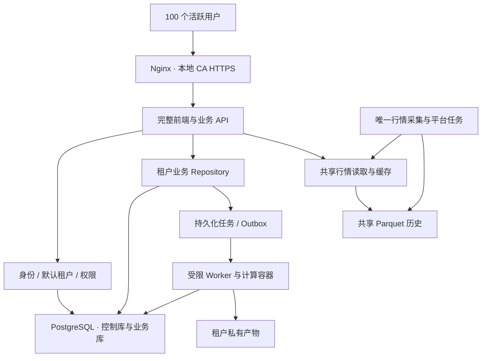
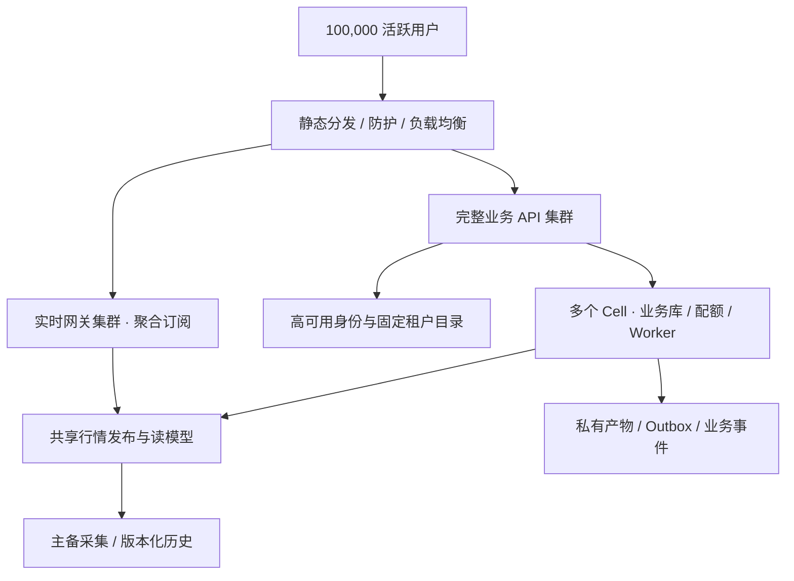

# TSP 多租户两期技术方案 v3.1（二期执行更新）

日期：2026-10-14；执行方案更新：2026-10-16。一期完整单机多租户已于 2026-10-14 完成生产切流和 100 用户验收，实际结果见[一期实施记录](phase1-implementation.md)。二期按最新安排拆为单机关键功能迭代、单机 100 个独立账号/100 人同时活跃、DFX 与万人并发三步，详见[二期实施计划](phase2-implementation-plan.md)。100,000 活跃用户及相关预算保留为远期扩展目标。

本次修订补入一期 RBAC、预置管理员 `admin/Admin123`、保留中文注册口令、租户功能限制及三个侧栏展示入口移除。修订以用户最新要求为准，替换 v3 中“注册口令可选”和“租户可访问数据/其他设置”的安排。

目标：一期交付完整产品的单机多租户版本，支持 100 人同时登录使用；二期先在单机完成关键迭代与百用户/百人活跃验收，再完善 DFX 并验收 10,000 人活跃并发，保留向 100,000 人扩展的路径。DFX 在本文包括容量与性能、可靠性、安全性、可观测性、可维护性、可部署性和成本管理。

本方案为当前两期设计基线。`app/cell` 中仍被完整产品使用的数据库、身份、权限、调度与投递基础继续保留；废弃的独立简化前端、API、Worker 和专属部署已删除。

## 1. 当前完整产品基线

一期沿用完整 `router.tsx + Layout + Dashboard` 和 `app.main`，保留原业务页面及
计算逻辑。API 默认四进程，平台为唯一行情写入者；研究、实时监控/模拟盘、通知
及调度分别运行。身份与业务库均为 v5，私有业务使用明确租户上下文与强制 RLS。

生产发布、镜像版本、迁移对账、HTTPS 与 100 个独立用户的验收记录以
[一期实施记录](phase1-implementation.md)为准。当前部署入口是
[deploy/full](../deploy/full/README.md)。源码清理不改变历史生产数据或迁移校验和。

### 固定设计原则

1. **授权业务持续可用。** 沿用原应用外壳、页面、导航和核心计算逻辑，按角色提供功能；本版明确限制租户的“数据”和非账户设置，不复制一套简化产品作为多租户版。
2. **普通用户开箱即可看盘。** 平台行情与初始化由平台维护，用户注册不承担数据源、SMTP、全市场采集和系统向导配置。
3. **功能与基础隔离一起完成。** 一期不能延期租户鉴权、缓存隔离、私有文件归属和敏感信息保护。
4. **容量用业务负载验收。** 独立账号、活跃页面、行情、监控、模拟盘和研究任务共同参与测试。
5. **一期接口为二期保留扩展边界。** 不提前部署大规模分布式组件，也不把单机数据和身份绑定到全局进程变量。

## 2. 两期范围

| 项目 | 一期：完整功能、单机多租户 | 二期：单机迭代与 DFX 扩展 |
| --- | --- | --- |
| 用户容量 | 100 个独立账号同时活跃使用 | 第二步支持 100 个独立账号、100 人同时活跃；第三步 10,000 人活跃并发；远期扩展至 100,000 人 |
| 产品 | 管理员保留 19 个主菜单和全部设置；租户保留 18 个业务主菜单及账户设置；全角色移除三个指定侧栏展示入口 | 保持一期角色权限和业务操作契约 |
| 权限 | RBAC：管理员 `admin` 与租户 `tenant`；服务端校验菜单、页面、API、数据范围 | 集中权限管理、撤销广播、细粒度权限和审计 |
| 注册登录 | 预置管理员 `admin/Admin123` 支持改密；租户必须通过中文注册口令、邮箱验证和注册后登录 | 身份服务横向扩容、集中撤销、登录洪峰防护、管理员 MFA |
| 首次登录 | 自动选择个人租户，直接进入根路径看盘首页 | 保持同一体验，租户所在资源组对用户透明 |
| 部署 | 一台服务器内分角色运行，Docker Compose | 前两步单机单 Cell；第三步多节点、多故障域与负载均衡，按容量需要扩展 Cell |
| 行情 | 单一共享采集、公共读缓存、按需批量读取 | 采集主备、版本化发布、订阅聚合与独立实时网关 |
| 数据 | PostgreSQL 租户业务与身份；共享行情 Parquet；私有产物独立目录 | 分离状态服务故障域、PgBouncer、对象存储、读模型 |
| 任务 | 持久化任务、有限并发、公平排队、租约和幂等 | 分任务类别扩容、故障接管、跨节点事件投递、强沙箱 |
| HTTPS | 已部署本地 CA/IP 证书，自动续签 | 自动管理与轮换；公网大规模开放前解决客户端信任分发 |
| 运维 | 基本健康、错误/队列监测、备份与恢复验证 | SLO、追踪、容量曲线、灰度、故障注入、跨区恢复 |

“单机版”指一台服务器承载完整 Web 产品和多个租户。服务器上的用户仍需正常认证。现有桌面免登录模式只适用于明确的本地部署模式。

## 3. 一期架构

### 3.1 部署与服务职责



这些角色在同一台服务器上运行。API、采集、研究、实时规则、通知分别配置资源预算；API 的进程扩容不得额外启动采集、平台定时任务或全局监控。

一期可复用现有 PostgreSQL 控制库和业务库。两库同实例属于同一故障域；跨库创建账号/租户使用可恢复初始化流程，不宣称具有跨库原子事务。Redis、NATS 和 Kubernetes 不作为一期前置依赖。

行情继续走当前统一采集链路，由平台管理源端连接预算。所有租户共享同一份公开行情和历史；每用户不建立数据源连接、不重采全市场、不启动常驻策略进程。[证据 S3、S4]

### 3.2 改造完整应用的数据边界

拟新增或扩展三个边界，具体接口需在实施中形成契约和测试：

| 边界 | 职责 | 约束 |
| --- | --- | --- |
| `MarketReader` | 公共行情、K 线、财务、平台市场分析 | 只读、按证券/窗口裁剪、带版本与有效日期 |
| `TenantRepository` | 自选、策略、因子、任务、告警、模拟盘、私有报告 | 显式 `TenantContext`，事务隔离，私有结果不跨租户复用 |
| `UserPreferences` | 主题、个人默认租户、显示布局等用户设置 | 与租户配置、平台配置分离 |

这些是拟定扩展边界，不是已经存在并完成接线的接口。完整业务 Service 与计算引擎尽量保留；必要时属于核心改造，不用线程全局变量、修改全局 `data_dir` 或复制整个页面规避租户化。

数据按实际归属分层：

- 平台：行情、交易日历、证券目录、公共财务、内置策略/因子定义、平台发布的公共市场结果。
- 租户：自选、策略参数与私有源码、自建因子、回测/挖掘任务、监控、告警、模拟账户、AI 私有报告与凭据。
- 用户：身份、个人显示偏好、默认租户与会话。

公开行情相同不代表私有策略、AI 报告或研究结果可以共享。平台数据桶/目录与租户产物目录分离，下载、导出和删除均校验归属。

### 3.3 一期功能覆盖清单

每一行都要形成“页面可进入 + 原关键操作可执行 + 数据归属正确”的验收记录，不能仅证明菜单存在。

| 原页面/路由 | 一期保留行为 | 数据与权限 |
| --- | --- | --- |
| 看盘首页 `/` | 市场指数、行情与市场组件、个股查看、布局操作 | 公共行情 + 隔离的布局与自选 |
| 自选 `/watchlist` | 添加/删除、分组、行情与详情 | 租户私有 |
| 策略 `/screener` | 原策略浏览、配置、筛选、生成和运行 | 公共模板 + 租户策略/结果 |
| 因子 `/factors` | 因子浏览、编辑、研究及原挖掘入口 | 公共定义 + 私有定义/任务 |
| 复盘 `/review` | 原市场复盘、查看与用户相关操作 | 公共发布结果与私有内容分离 |
| 回测 `/backtest` | 原参数、任务、结果、分析和导出 | 租户任务/产物；费用口径保持 |
| 信号库 `/signals` | 公共信号浏览及私有配置 | 公开结果与租户订阅分离 |
| 持仓提醒 `/lots` | 原持仓提醒与配置 | 租户私有 |
| 异动监控 `/abnormal` | 公共异动查看、原配置操作 | 共享市场结果 + 租户配置 |
| 连板梯队 `/limit-ladder` | 梯队与个股查看 | 公共行情/结果 |
| 个股分析 `/stock-analysis` | 原分析、图表、AI/报告功能 | 公共事实 + 私有生成内容 |
| 概念分析 `/concept-analysis` | 原分析与图表 | 公共结果，个人操作隔离 |
| 行业分析 `/industry-analysis` | 原分析与图表 | 公共结果，个人操作隔离 |
| 财务分析 `/financials` | 原查询、财务展示与分析 | 公共财务，私有计算隔离 |
| 监控中心 `/monitor` | 原规则、告警、渠道、启停与记录 | 租户隔离，状态持久化 |
| 市场环境 `/regime` | 原市场状态与历史查看 | 公共结果 |
| 模拟盘 `/paper` | 原账户、下单、撤单、持仓和分析 | 租户/账户隔离，事务与幂等 |
| 指数 `/indices` | 原指数、K 线及行情查看 | 公共数据 |
| 数据 `/data` | 管理员保留原功能；租户不提供菜单、页面和接口访问 | 仅管理员 |
| 设置 `/settings` | 管理员保留全部设置；租户仅账户信息、改密与退出 | 租户仅 `account`，其余设置仅管理员 |

个股详情、分时、日 K、旧链接重定向、移动端、菜单排序和原扩展入口也纳入回归。业务接口名称调整时通过薄适配保持页面契约；不向新租户转发未经租户化的旧私有全局接口。[证据 S1、S5]

系统角色与租户归属是不同维度。注册用户获得 `tenant` 系统角色和个人租户归属；该归属不授予系统管理权限。管理员具有系统最高权限，按明确的目标租户管理业务数据并记录审计。租户的受限页面不提供只读入口，直接访问按权限拒绝。

### 3.4 一期 RBAC 与管理员账号

一期对外提供两个系统角色。角色、权限、用户角色关联和角色权限关联集中维护；租户 membership 负责数据归属，不将原 Cell 的 owner/admin/member/viewer 当作四种系统角色继续展示。

拟在控制面维护 `roles`、`permissions`、`user_roles` 和 `role_permissions`，初始化两种角色及对应权限；`memberships` 单独保存用户与租户的归属。会话中的有效系统角色由服务端关联查询获得，前端权限信息只用于界面展示。

| 系统角色 | 登录方式 | 权限范围 |
| --- | --- | --- |
| 管理员 `admin` | 预置用户名 `admin`，初始密码 `Admin123` | 系统最高权限；所有业务、数据、设置、用户/租户及角色分配管理 |
| 租户 `tenant` | 注册口令校验、邮箱验证并注册成功后的邮箱/密码 | 授权业务功能与本人账户；私有数据限定所属租户 |

**管理员初始化与修改密码**

- 首次初始化时幂等创建 `admin`，设置系统角色 `admin`，密码为 `Admin123`；管理员无需通过租户注册，也不要求填写邮箱。
- 密码仅在服务端初始化时散列保存。管理员已存在时，重启、升级和重复初始化均不得将其密码恢复为 `Admin123`，也不得覆盖已有身份或静默提升其他账号权限。
- 登录表单支持“用户名/邮箱”：管理员输入 `admin`，租户输入注册邮箱。后端补充登录标识契约并兼容原邮箱登录；用户名不套用邮箱格式校验。
- “设置 → 账户”支持原密码、新密码与确认密码。成功后撤销该账号原会话、清理私有缓存并重新登录；管理员和租户均可修改本人密码。
- 账户信息展示用户名/邮箱及系统角色；管理员没有邮箱时显示其用户名，不生成虚构邮箱。
- 管理员可管理用户状态、租户及角色分配。注册请求固定创建 `tenant`，不能通过请求体、Header、Cookie 或前端状态指定管理员权限；旧租户内 `admin/owner` 关系不自动升级为系统管理员。

**功能与接口权限矩阵**

| 权限对象 | 管理员 | 租户 |
| --- | --- | --- |
| 看盘、自选、策略、因子、复盘、回测等 18 个业务菜单 | 可用 | 可用，私有操作限定所属租户 |
| 左侧“数据”菜单及 `/data` | 可用 | 不可用 |
| 账户信息、修改本人密码、退出 | 可用 | 可用 |
| 数据源、AI 设置、实时监控设置 | 可用 | 不可用 |
| 扩展页面、网络、菜单设置 | 可用 | 不可用 |
| 开放接口与 API Token 管理、系统设置 | 可用 | 不可用 |
| 用户/租户管理、角色分配、注册口令管理 | 可用 | 不可用 |
| 其他租户的私有资源 | 选择目标租户并审计后管理 | 不可用 |
| 侧栏数据源、大模型、实时行情展示/快捷入口 | 移除 | 移除 |

租户设置页仅允许 `account`。当前 `data-sources`、`ai`、`monitoring`、`ext-pages`、`timeout`、`menus`、`api-tokens`、`system` 八个标签全部只向管理员开放。租户通过 URL、旧链接、`highlight` 参数或直接 API 访问这些功能同样被拒绝；默认点击“设置”进入账户页。

前端按服务端返回的权限生成导航与标签，角色未确认时不展示管理员功能。服务端每个受限动作独立鉴权：未登录返回 401，租户访问管理功能返回 403；前端按权限拒绝展示，不把 403 误判为需要反复登录。

系统管理员的最高权限由应用授权实现。日常数据库角色仍为非超级用户、无 BYPASSRLS；涉及租户数据时生成包含目标 tenant ID 的显式上下文。管理员操作记录操作者、目标租户和对象，业务金额、幂等和事务约束继续生效。

### 3.5 侧栏精简与业务配置边界

对管理员和租户统一移除：

1. 数据源能力展示、状态卡、悬浮说明及前往数据源配置的侧栏入口。
2. 大模型/AI 配置展示、模型名称与前往 AI 设置的侧栏入口。
3. 实时行情展示、状态指示点、侧栏开关、设置按钮与相关侧栏浮层。

覆盖展开、收起、隐藏后唤出和移动端抽屉，不遗留图标、键盘焦点或侧栏专用请求。当前对应 `Layout.tsx` 的 `DataSourceHealthBadge`、`AIConfigBadge` 和全局行情开关区域。管理员通过正常设置页维护数据源、模型与实时行情；行情采集和业务页中的实时行情继续提供。

**避免限制设置后破坏看盘**

当前 `Layout`、`OnboardingGuard` 和业务页复用 `/api/settings`、preferences 与能力矩阵。实施时应拆出最小业务启动信息，而非让租户页面继续依赖被禁止的管理 API：

- 拟提供业务 bootstrap/用户显示偏好/市场状态契约，只返回当前身份、有效权限、默认租户、授权导航、个人看盘布局和必要的行情/业务可用状态。
- 源端、平台凭据、SMTP、模型配置、网络和系统管理参数仅由管理员接口读取或修改，不随 bootstrap 下发。
- 租户的“设置”页面只有账户；看盘页已有的组件布局等授权业务操作使用专属业务契约，不借此重新开放被禁止的菜单、数据源或系统设置。
- AI 生成与监控规则等业务继续按租户权限提供。平台模型、SMTP 和默认投递策略由管理员配置，租户调用受控业务服务；服务未配置时显示业务状态，不跳转到租户无权访问的设置页。
- 租户不能自行管理 SMTP、平台模型凭据、Webhook 渠道、开放接口 Token 或全局采集开关。已有相关配置由管理员管理，任务仍以租户归属和授权执行。

上述拆分属于一期必要接线；菜单移除与接口授权同时验收，确保新用户仍能正常使用看盘与其他授权业务。

## 4. 一期注册与首次看盘流程

### 4.1 正常用户路径

```text
邮箱 + 密码 + 中文注册口令
  → 校验注册口令后发送邮箱验证码
  → 校验邮箱验证码及本次注册授权
  → 创建用户与初始化作业
  → 分配 tenant 系统角色、创建个人租户与归属关系
  → 写入默认配置、默认租户和业务绑定
  → 激活账号/租户并建立会话
  → 根路径现有 Dashboard 看盘首页
```

保留已有中文“注册口令”字段、说明和交互，口令为租户注册的必填前置条件，支持既有中文内容。沿用现有配置的值及散列记录，不另设默认口令、不将其替换为可选邀请码。新用户不填写 Cell 地址或数据源参数。

已有 Auth 页、注册邮件与登录交互可以复用；当前 JSON 用户/验证码存储需迁移到 PostgreSQL。验证码按邮箱和用途绑定，哈希存储，设置有效期、重发间隔、错误次数及一次性消费；邮件地址归一化并由唯一约束防止并发重复注册。[证据 S6]

现有 `/api/auth/register/code` 在口令校验成功后才发送验证码；错误口令返回中文错误并拒绝发送，未配置口令保持注册关闭及明确提示。最终注册提交必须消费由正确口令授权的邮箱验证码，不能绕过发码流程直接创建账号。迁移保留 `registration_secret_hash` 与 `registration_secret_salt` 的语义及中文口令验证兼容性，日志与响应不下发口令明文。

### 4.2 自动建租户与失败恢复

保留 `User → Membership → Tenant` 模型，账号不等于租户。一位用户可以加入多个工作空间，但首次注册自动拥有一个个人租户。

两库初始化采用持久状态机：

1. 控制库事务核验注册口令授权并消费验证码，创建系统角色固定为 `tenant` 的待初始化用户、唯一初始化作业和固定 tenant ID。
2. 受限初始化服务幂等创建业务绑定、租户默认配置及必要记录。
3. 核验绑定与配置后，控制库激活用户/租户、设置个人默认租户。
4. 全部完成后才向前端返回已认证成功。短时初始化未完成可返回作业状态，前端等待/重试，不提前跳入空工作空间。

服务重启、数据库超时、重复提交均继续同一作业；不可重复创建个人租户。初始化服务只有必要的创建权限，日常 API 不持迁移 owner 或数据库超级用户凭据。

已有账号默认进入明确归属的 legacy 租户。新增账号不会自动加入 legacy。邀请加入既有租户必须有显式授权，邮箱相同不能推导共享数据权限。

管理员初始化与租户注册是独立流程。旧邮箱业务账号按 `tenant` 迁移并保留数据归属，预置 `admin` 单独初始化；不依据邮箱、旧 membership 名称或前端参数自动提升系统权限。管理员看盘可读取公共市场，访问私有业务时明确选择目标租户，避免依赖虚构的个人租户初始化。

### 4.3 看盘首页的默认可用状态

- 平台已有行情和公共市场组件立即可读；休市显示最近有效交易日与休市状态。
- 新租户自选为空时仍显示市场内容，提供清晰的添加入口；不把空自选作为整页无功能状态。
- 平台初始化与个人上手引导分离。新租户不会被原全局 `OnboardingGuard` 拦截去配置全站。
- 原内置策略、因子与可用模板可浏览；个人模拟账户和自动交易由用户显式创建/启用。
- SMTP 和投递策略由管理员维护；租户默认收件地址为已验证邮箱，业务前端不接收 SMTP 授权码，也不提供非账户设置入口。
- 后续登录可恢复合法的上次位置；首次登录固定看盘首页。过期或越权的 redirect 回到首页。

## 5. 一期必须完成的基础工程

### 5.1 鉴权与隔离

完整站点同源部署，浏览器沿用服务端会话，使用 `HttpOnly + Secure + SameSite` Cookie；会话存 PostgreSQL。修改操作校验 Origin/CSRF，登录防护同时覆盖 IP、邮箱、全局并发和密码计算预算。

系统 RBAC 与数据范围分别校验。服务端核验会话、系统角色、动作权限、租户归属/管理员目标选择、租户状态和路由版本后生成明确上下文；前端菜单、页签、路由守卫和后端策略使用同一权限定义。

API Token 保持单租户、权限、有效期和撤销版本绑定，管理功能仅管理员可用；Token 执行权限取已分配权限与持有人当前角色/数据范围的交集，不能绕开租户的设置禁令。角色或状态调整后更新权限版本并使旧会话/缓存/Token 按新权限生效，客户端任意身份头不作为授权依据。

租户表使用复合键、外键与 FORCE RLS；事务内 `set_config(..., true)`，缺上下文拒绝。控制库、业务库、初始化与离线迁移角色分离。新增私有表同步进入 RLS 覆盖测试。[证据 S3]

前端查询、持久缓存、组件状态和事件订阅按用户/租户/版本隔离。切换租户或退出时取消旧请求、清理旧私有缓存、断开旧订阅，并拒绝迟到响应；原固定缓存键不能直接沿用。公共行情缓存可按数据版本共享。

### 5.2 计算和状态

所有租户任务持久化，UI 提交后展示任务状态与排队情况；研究初始并发有限，避免 100 人同时启动回测拖垮看盘。每租户配额与全机配额一起校验，排队公平且有上限。

保留原策略/因子/AI 生成等产品能力。租户生成或导入代码在无平台凭据的受限任务容器执行，限制 CPU、内存、磁盘、进程、网络和时长；计算容器不挂载 Docker socket、其他租户文件或平台 `.env`。AST 检查仅作早期校验，不能作为唯一隔离。

模拟盘保持原费用、涨跌停、T+1、现金/持仓占用、撤单和幂等语义。任务提交、资金更新、告警与 Outbox 各自保持必要的事务边界。修复自然日前一日与前一交易日的冲突，周一和长假后的自动策略读取正确有效日期。[证据 S7]

一期保留 SQL 持久化调度，补 Worker 心跳、有界排空、超时和租约失效接管。不要为新增消息组件维护第二套任务事实。

### 5.3 HTTPS、备份与发布

沿用本地 CA/IP 证书、每日续期检查、到期前 30 天续签、配置验证与 reload。CA 私钥仅在服务器受控目录，客户端只导入公开 CA。续签失败和证书剩余天数纳入基本告警。

一期完成每日加密离机备份、发布前备份和至少一次隔离恢复。建议签收目标为 RPO ≤24 小时、RTO ≤2 小时；单机阶段不承诺节点故障不停机。恢复须同时核验身份、租户绑定、私有产物和加密密钥。

候选版本先在独立端口/受控环境验收。生产首页、完整功能和新用户流程没有通过前，不切公网。数据库采用新增迁移与兼容发布，不改旧迁移 checksum；原用户数据迁移需要明确归属和内容对账。

## 6. 一期 100 人验收

### 6.1 测试口径与目标

以下均为拟定验收条件，不是已经达到的性能。

| 维度 | 一期验收输入或目标 |
| --- | --- |
| 身份与隔离 | 100 个独立邮箱账号、100 个个人租户，同时保持前台使用 |
| 稳态使用 | 租户进行看盘、个股/历史、自选、策略、监控、模拟盘与账户操作；另叠加管理员数据/设置操作 |
| HTTP | 基线 100 RPS，短时 200 RPS；另验证 100 个同时在途的轻请求 |
| 实时业务 | 100 条单证券轻规则 + 20 个待撮合模拟订单；另测触发告警峰值 |
| 研究任务 | 100 用户均可提交；初始全机最多 2 个重计算任务并行，其余公平排队 |
| 轻 API 延迟 | 稳态 P95 ≤500ms、P99 ≤1.5s，排除显式异步重计算 |
| 首次看盘 | 已验证邮箱、CA 已信任情况下，从登录完成到主要看盘内容可用 P95 ≤3s |
| 登录 | 稳态 P95 ≤2s；100 个同时登录的突发单独记录排队与完成时间，目标全部 ≤30s |
| 行情展示 | 从平台有效行情发布到页面可见 P95 ≤3s；源端延迟另计 |
| 服务错误 | 有效业务请求 5xx/超时比例 <0.1%；权限/配额拒绝单独统计 |
| 持续运行 | 完整交易时段混合负载 + 至少 24 小时跨日运行，无持续资源增长 |

页面请求应聚合、批量、带取消和超时，隐藏页面降频/暂停。例：100 个活跃页面每两秒一次聚合请求产生 50 RPS，仅用于请求预算计算；实际还须叠加详情和业务操作测量。

容器 CPU/内存、数据库池总量、行情出口、磁盘和研究槽位写入运行配置。数据库连接按服务副本和任务槽位预算，不为每用户保留连接；采集、Worker 或邮件发送不能长期占用看盘请求预算。

实际容量结果以一期实施记录中的 100 个独立身份混合负载为依据；完整业务负载、资源配额、版本和错误率必须一起核对，不能用局部调度样本外推端到端容量。[证据 S8]

### 6.2 一期发布门槛

1. 使用预置 `admin/Admin123` 成功登录并验证最高权限；修改密码后新密码有效、原密码及原会话失效，重启和重复初始化不恢复初始密码。
2. 使用全新账号完成中文注册口令、真实邮箱验证、注册、自动建租户和首次看盘；错误/空口令、绕过发码、未注册登录和伪造管理员角色均被拒绝。
3. 第 3.3 节按角色完成关键操作回归：管理员 19 个主菜单及全部设置，租户 18 个业务主菜单及账户。租户访问 `/data`、八个非账户设置标签、旧链接和对应 API 均拒绝，禁止后台设置请求阻断看盘。
4. 两种角色的侧栏在展开、收起和移动端均无数据源、大模型、实时行情展示入口；保留业务行情与管理员正常设置功能。
5. 两个新租户及 legacy 租户互换资源 ID、Token、文件和任务参数，验证无越权与缓存污染；管理员按目标租户管理可审计，角色变化不遗留旧权限。
6. 100 用户混合负载满足指标；排队研究不影响基本看盘；正常和休市状态都可使用。
7. 重启 API/Worker、初始化中断、重复提交、邮件延迟和数据缺失有可恢复结果。
8. 原账号、历史数据、按角色授权的导航/设置及计算口径对账通过；发布/恢复步骤实际演练。

单一健康接口、局部 CRUD 或菜单截图均不能替代这些门槛。

## 7. 二期远期架构与容量模型

### 7.1 远期十万用户目标定义

以下保留原方案的远期十万用户目标；当前第二步与第三步规模以[三步实施计划](phase2-implementation-plan.md)为准。第二步验收 100 个独立账号全部同时活跃，第三步先签收万人活跃并发。

扩展至十万人时，必须验收 **100,000 个独立已登录用户，同时打开活跃前台并实际订阅行情/调用业务**。空会话、共享一个账号或仅维护租户元数据不计为达标。

在线用户、连接、RPS、同时在途请求、规则和研究任务分别计量：

| 指标 | 远期十万用户基线与验证 |
| --- | --- |
| 活跃用户 | 100,000，独立身份和租户归属 |
| 前台行情连接 | 至少 100,000；验证 150,000 连接余量及多标签页 |
| HTTP 稳态 | 20,000 RPS，明确行情、业务读写、目录与身份比例 |
| 短时请求 | 50,000 RPS；另验证 100,000 个同时发起的轻查询 |
| 同时轻查询洪峰 | 有界排队与容量余量，目标全部 ≤30s；单独记录成功率和分位数 |
| 登录/重连洪峰 | 至少 100,000 客户端参与；定义集中到达与分批恢复的两类曲线 |
| 行情基线 | 每活跃用户平均订阅 20 只证券、每秒 1 批；50 只为高订阅档 |
| 后台业务 | 规则、研究、模拟撮合、通知按真实复杂度和套餐限额分别定容 |

20,000 RPS 相当于 100,000 用户平均每五秒一次 HTTP 请求的预算，属于算术输入，不是现有吞吐成绩。行情推送替代频繁全量轮询，不能按十万用户各自拉取全市场。

行情纯载荷预算按 `用户数 × 订阅证券数 × 更新频率 × 编码字节数` 计算。若评估输入取每记录 96 字节，则 20 只/秒约为 192 MB/s、1.536 Gbps；50 只/秒约为 480 MB/s、3.84 Gbps。96 字节是待实际编码校准的设计输入；TLS、协议、首次快照、多标签页和恢复峰值另计，不能据此直接采购带宽。

一期继续使用本地 CA，当前不引入域名。二期若向十万普通公网用户开放，需在发布前确定可运营的证书信任方案：受管理终端可以统一分发私有 CA，普通公众终端优先采用公信证书。具体选择受信任 IP 证书或域名证书，作为二期接入决策，不阻塞一期。

实时规则与研究执行量不由在线用户数直接推出。配额、服务时间、CPU、RSS、数据扫描量、历史台账和通知供应商限额一起决定承载量；所有排队和限制在产品中可见。

### 7.2 目标拓扑



保留一个完整前端和统一公网入口。租户路由由可信目录决定，Cell 变化不要求用户更换产品页面；私有业务通过已授权 tenant ID 和固定 placement 路由。

Cell 是资源与故障隔离单元，不能按旧每 Cell 200 单位机械复制服务器。先测每 Cell 在完整混合负载、实例退出条件下的可用容量 `C`，再根据 `ceil(100000 / C)`、预留和故障接管容量规划数量。在线网关、规则分片和研究 Worker 各自定容，不与 Cell 数量机械一一绑定。

## 8. 二期 DFX 工作

### 8.1 容量与性能

- 独立高吞吐实时网关，聚合证券订阅并共享上游读取；批量增量编码、隐藏页降频、慢消费者合并/重同步、有界背压。
- 行情/公共读模型不逐请求访问控制库或扫描历史 Parquet。身份、业务读写与行情广播拆开资源预算。
- 控制面与各业务库配置 PgBouncer、小连接池和事务级上下文，先验证连接复用、回滚、prepared statement 与会话特性兼容。
- 规则按证券与表达式索引、共享公共特征、批量更新；冷却与告警归属继续按租户隔离。
- 将模拟持仓/资金投影事务化，成交账本保留为事实；历史列表分页，避免每次请求扫描账户全部成交。
- 研究/挖掘/AI/通知队列分别配置并发、公平性、最老任务告警、最大积压和单位成本。

### 8.2 可靠性与恢复

API、身份、网关、Worker 跨节点部署；数据库、消息与采集的故障范围明确。采集正常单写者，主备接管使用租约和递增 fencing epoch，发布端拒绝旧主。

PostgreSQL 仍是业务和任务事实源。Outbox 可靠投递；跨服务分发需要时接入 JetStream，作为分发/唤醒层逐步替换传输，不新增一套独立任务事实。至少一次投递通过稳定编号和业务幂等处理，不能承诺外部邮件绝无重复。

任务具有 attempt、执行 epoch、心跳、排空与旧结果拒绝。模拟订单/成交/资金更新保持账户级一致性。数据库 WAL/PITR、对象版本、私有密钥和租户目录共同参与恢复。

建议验收目标：核心业务月度可用性 99.95%；节点/AZ 故障恢复 RTO ≤5 分钟；已确认关键账本写入 RPO=0 以实际同步确认策略和演练为条件；区域灾难 RPO ≤5 分钟、RTO ≤60 分钟。源端行情故障独立记录新鲜度和影响，不用陈旧价格冒充正常行情。

### 8.3 安全与权限

加强管理员 MFA、身份限流与异常检测、短期授权票据、集中撤销、长连接权限复核、内部服务身份及网络策略。敏感写每次校验，常规连接撤权目标 ≤60 秒。

租户密钥使用用途与 tenant 绑定的加密上下文，接入受控密钥管理和轮换；私有对象下载先鉴权再发短期授权。控制面、Cell、采集和计算的凭据分离。

租户代码执行升级为经兼容性验证的 gVisor/microVM 或等效强隔离，限制出口和元数据访问；不将 Python 子进程、普通 AST 校验或数据库 RLS当作对恶意代码的完整沙箱。

### 8.4 可观测性、部署与生命周期

关联请求、租户、Cell、任务、数据版本和投递的日志与 trace；指标按服务/Cell/类别聚合，租户明细走受控查询，避免十万用户标签导致监测失控。

建立 API、首页、行情新鲜度、队列年龄、数据库等待、通知、证书、资源与备份告警。发布具备灰度、自动停止推广、回退和 expand/contract 数据库迁移。

租户搬迁采用持久化状态机：目标准备、源停写/排空、内容/账本对账、提升 epoch、禁用源 binding、目标接管、观测。任何时刻仅一处有效写入；部分提交可恢复，不能只改 `cell_id`。

定义会话、告警、任务、私有产物、账本与审计的各自保留期，覆盖导出、删除、孤儿产物和备份恢复后的删除清单。按连接小时、行情出口、计算分钟、对象存储和 AI 用量计量成本。

### 8.5 二期发布门槛

前两步继续单机：第一步完成关键功能与百人回归，第二步签收 100 个独立账号全部同时活跃的混合负载、持续运行和恢复。第三步完善 DFX，先签收 10,000 人活跃并发，具体门槛见[实施计划](phase2-implementation-plan.md)。

远期按相同业务口径形成 10,000 →50,000 →100,000 活跃用户容量曲线。扩展至十万人时再签收 100,000 独立用户、150,000 连接余量、混合请求、首次快照、登录/重连洪峰和后台负载；万人通过不代表十万人通过。

稳态轻 API 目标 P95 ≤300ms、P99 ≤1s；有效请求 5xx/超时比例 <0.1%。内部行情展示和源端采集延迟分开签收。至少覆盖完整交易日、72 小时连续负载及节点/数据库/消息/网络故障。

功能覆盖和隔离测试继续执行一期全清单；新增故障、租户迁移、权限撤销、备份恢复、任务重复、长台账和大户资源隔离测试。任何容量数字必须同时附身份、业务分布、硬件配额、版本与错误率。

## 9. 实施顺序与上线控制

只有两期交付；以下为各期内部工作包。二期当前执行顺序与阶段规模以[三步实施计划](phase2-implementation-plan.md)为准。

| 工作包 | 重点 | 完成标准 |
| --- | --- | --- |
| 一期 A：完整产品基线 | 固化角色权限、页面/操作、预置管理员、中文注册口令及旧数据基线 | RBAC 和角色功能清单、API/数据归属与回归样本齐备 |
| 一期 B：租户与全业务接线 | 管理员登录/改密、租户注册/首页、三个侧栏入口清理、业务 bootstrap、Repository 与隔离 | 按角色关键操作可用，权限拒绝正确且不破坏看盘 |
| 一期 C：100 人验收与发布 | 真实混合负载、基础恢复、HTTPS、迁移对账与候选发布 | 第 6 节通过后发布完整单机多租户版 |
| 二期第一步：单机关键迭代 | 实时网关、公共读模型、短期授权/撤权、前端接线与观测 | 百人功能回归、热路径前后基准与事件/撤权恢复通过 |
| 二期第二步：单机百用户/百人活跃 | 账户增量投影、研究 due 调度、公平配额、连接与资源预算 | 100 个独立账号全部同时活跃、长台账、完整交易日/72h 及联合恢复通过 |
| 二期第三步：DFX 与万人并发 | 多节点可靠性、安全、观测、消息/对象协议，按容量需要多 Cell | 10,000 人活跃混合负载、故障/安全/迁移/恢复演练与成本曲线通过 |
| 远期扩展：十万活跃用户 | 按相同业务口径形成五万/十万人曲线 | 达到对应规模后执行第 7、8 节远期签收，保持完整产品功能 |

一期已按 v3.1 的角色权限与完整功能基线完成，实际结果见[一期实施跟踪](phase1-implementation.md)。后续发布继续执行隔离候选、数据对账和完整业务验收。

任何下一次切流都需要提供新账号操作记录、全部页面关键操作结果、容量报告和数据对账。新版本已有业务写入后，回退要先停写并核对增量；禁止简单恢复旧快照丢弃新数据，或让两套系统同时接受同一租户写入。

## 10. 源码和已有证据

以下是本次实际核对的工程资料。新增接口、架构组件、SLO 和容量值是设计目标，引用不代表它们已经实现。

- **S1：前端启动与完整路由。** [main.tsx](../frontend/src/main.tsx)、[router.tsx](../frontend/src/router.tsx)、[Layout.tsx](../frontend/src/components/Layout.tsx)、[Dashboard.tsx](../frontend/src/pages/Dashboard.tsx)。
- **S2：完整产品与身份缓存。** [accountSession.ts](../frontend/src/lib/accountSession.ts)、[queryPersist.ts](../frontend/src/lib/queryPersist.ts)、[一期实施](phase1-implementation.md)。
- **S3：租户与数据库基础。** [identity.py](../backend/app/cell/identity.py)、[database.py](../backend/app/cell/database.py)、[admin.py](../backend/app/cell/admin.py)、[SQL 迁移](../backend/app/cell/sql/)。
- **S4：共享行情与部署角色。** [platform_market.py](../backend/app/cell/platform_market.py)、[main.py](../backend/app/main.py)、[完整 Compose](../deploy/full/compose.yml)。
- **S5：原完整业务与私有全局状态。** [API 目录](../backend/app/api/)、[preferences.py](../backend/app/services/preferences.py)、[secrets_store.py](../backend/app/secrets_store.py)、[queryPersist.ts](../frontend/src/lib/queryPersist.ts)。
- **S6：邮箱注册与首次路由。** [auth.py](../backend/app/api/auth.py)、[Auth.tsx](../frontend/src/pages/Auth.tsx)、[原认证 Service](../backend/app/services/auth.py)。
- **S7：完整监控与模拟盘。** [runtime.py](../backend/app/multitenancy/runtime.py)、[paper_storage.py](../backend/app/multitenancy/paper_storage.py)、[paper_auto.py](../backend/app/strategy/paper_auto.py)、[notifications.py](../backend/app/cell/notifications.py)。
- **S8：完整容量验收。** [一期实施记录](phase1-implementation.md)中的 100 个独立身份混合负载与生产发布记录；设计目标与实测结果分别记录。
- **S9：已部署本地证书与入口。** [edge README](../deploy/edge/README.md)、[issue-local-cert.sh](../deploy/edge/issue-local-cert.sh)、[https.conf](../deploy/edge/https.conf)。
- **S10：本次 RBAC 与侧栏接线依据。** [Settings.tsx](../frontend/src/pages/Settings.tsx) 当前仅按是否需要认证过滤页签；[Account.tsx](../frontend/src/pages/settings/Account.tsx) 已提供改密和退出；[useSharedQueries.ts](../frontend/src/lib/useSharedQueries.ts) 与 Layout/看盘守卫共享管理设置查询，限制接口前需拆出业务启动契约。

当前一期生产发布记录为 `91b8154`；共享 schema v1–v4 及其校验和是 v5 迁移链的一部分，不能删除。实际代码与验证结果见一期实施记录。
