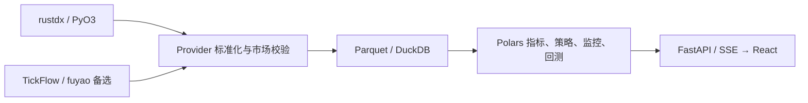

# 数据源与开放接口接入

本附录按领域维护实现方法、数据契约和可执行示例。通用开发要求只在[CONTRIBUTING](../../CONTRIBUTING.md)定义；需求与当前/目标边界见[需求](../requirements.md)和[系统方案](../architecture.md#current)。带日期的结果仅证明原版本、环境和窗口，不是本次重新执行的验证。

- [1. 声明式 HTTP 数据源](#http)
- [2. Provider 插件协议](#plugin)
- [3. rustdx 运行时与来源边界](#rustdx)
- [4. TickFlow Pro 共享限流](#tickflow-budget)
- [5. TickFlow Pro 有界探测](#tickflow-probe)
- [6. 开放授权与 Tier A 契约](#open)
- [7. SSE 网关、撤权与恢复](#gateway)

<a id="http"></a>

<a id="http-自定义数据源接入"></a>
## 1. 声明式 HTTP 数据源

本项目默认使用 rustdx。自定义数据源是一个可选扩展: 外部 HTTP 服务负责取数和整理, 本项目只把返回结果映射成内部标准字段, 然后复用现有存储、指标、enriched、策略和前端展示逻辑。

<a id="http-支持范围"></a>
### 支持范围

当前 YAML 声明式自定义源支持能力矩阵八类数据中的七类:

| 数据集 | 配置名 | 说明 |
| --- | --- | --- |
| 日K | `daily` | 批量返回一组股票在指定区间内的日K |
| 除权因子 | `adj_factor` | 批量返回一组股票的复权因子 |
| 公司行为 | `corporate_actions` | 分红、送转、配股事件；日期证据不足时不放行相关模拟账务 |
| 实时行情 | `realtime` | 返回全市场快照,用于盘中 enriched 增量计算 |
| 分钟K | `minute` | 返回 1m 分钟K(需映射出 symbol / datetime / OHLC / 量额) |
| 全量分钟 | `full_minute` | 与 `minute` 同形;声明后可被路由为「全量分钟」生效源,内置服务盘中按当日窗口全市场批量落盘(仅修复轮语义,节奏下限 60s) |
| 财务数据 | `financial` | 一个配置覆盖全部财务表,请求时把表名作为参数传给上游;字段由数据源决定,仅需映射出 symbol |

YAML 声明式源暂不支持深度盘口 `depth5`；该能力可由 TickFlow、rustdx 或实现
`get_depth_batch` 的 Python/Node Provider 插件提供。

`full_minute` 声明式源只提供修复轮(当日窗口批量);廉价增量端点
(`get_intraday_latest`)是 Python 插件契约,见
[plugin-development.md](#plugin)。

<a id="http-配置位置"></a>
### 配置位置

把 YAML 放到运行数据目录下:

```text
data/data_sources/*.yaml
```

Dev 模式下，默认位置是项目根目录的 `data/`；Docker 部署中，项目的 `data/` 会挂载为容器内的 `/app/data`。可通过 `DATA_DIR` 覆盖。
完整多租户由管理员在平台配置目录维护源定义；公共版本剥离拉取配置，
普通租户不能取得上游地址中的凭据或自行重载平台。

修改 YAML 后可在「设置 -> 数据源」点击「重新加载」,或调用:

```bash
curl -b cookies.txt -X POST http://127.0.0.1:3018/api/settings/data-sources/reload
```

`cookies.txt` 表示已经登录的受控会话文件；该管理接口不对 API Token 开放。

<a id="http-最小-yaml"></a>
### 最小 YAML

```yaml
name: mock_source
display_name: "Mock 自定义数据源"
auth:
  type: none

datasets:
  daily:
    url: http://127.0.0.1:3021/daily
    method: POST
    batch: 100
    rpm: 200
    response_path: data
    field_map:
      ts_code: symbol
      trade_date: date
      open: open
      high: high
      low: low
      close: close
      vol: volume
      amt: amount
    transforms:
      date: "parse_date(value, '%Y-%m-%d')"

  adj_factor:
    url: http://127.0.0.1:3021/adj_factor
    method: POST
    batch: 100
    rpm: 200
    response_path: data
    field_map:
      ts_code: symbol
      trade_date: trade_date
      factor: ex_factor
    transforms:
      trade_date: "parse_date(value, '%Y-%m-%d')"

  realtime:
    url: http://127.0.0.1:3021/realtime
    method: GET
    rpm: 60
    response_path: data
    field_map:
      ts_code: symbol
      name: name
      last: last_price
      pre_close: prev_close
      open: open
      high: high
      low: low
      vol: volume
      amt: amount
      pct: change_pct
      amount_change: change_amount
      amplitude: amplitude
      turnover: turnover_rate
```

<a id="http-字段契约"></a>
### 字段契约

<a id="http-daily-必填"></a>
#### daily 必填

| 内部字段 | 含义 |
| --- | --- |
| `symbol` | 标准代码,如 `000001.SZ` |
| `date` | 交易日 |
| `open` / `high` / `low` / `close` | 不复权 OHLC |
| `volume` | 成交量 |
| `amount` | 成交额 |

<a id="http-adj_factor-必填"></a>
#### adj_factor 必填

| 内部字段 | 含义 |
| --- | --- |
| `symbol` | 标准代码 |
| `trade_date` | 除权日期 |
| `ex_factor` | 复权因子 |

<a id="http-realtime-必填"></a>
#### realtime 必填

| 内部字段 | 含义 |
| --- | --- |
| `symbol` | 标准代码 |
| `last_price` | 最新价 |
| `prev_close` | 昨收 |
| `open` / `high` / `low` | 当日 OHLC |
| `volume` | 成交量 |

建议实时接口额外提供 `amount`、`change_pct`、`change_amount`、`amplitude`、`turnover_rate`、`name`。缺失时部分字段会由 pipeline 回算,但精度取决于可用输入。

`change_pct`、`amplitude`、`turnover_rate` 统一使用小数制,例如 `0.0366` 表示 `3.66%`。百分制单位必须在 realtime 数据集上**显式声明**,不做数值猜测(数值无法区分两种单位:`0.05` 既可能是 0.05% 也可能是 5%):

```yaml
datasets:
  realtime:
    url: https://api.example.com/snapshot
    pct_unit: percent   # 接口返回 3.66 表示 3.66%;小数制源声明 decimal 或省略
```

处理规则:

| 声明 | 行为 |
| --- | --- |
| `pct_unit: percent` | `change_pct` / `amplitude` / `turnover_rate` 无条件 `/100` |
| `pct_unit: decimal` | 三列原样透传 |
| 未声明 | 旧源兼容路径尝试截面归一 `change_pct`；`amplitude` / `turnover_rate` 置 `None` 后按价格与股本重算并记录 WARNING；不作为新源可接受的单位证据 |
| 列已配置 `transforms` | 视为用户已接管该列单位,原样透传 |

新接入必须显式设置 `pct_unit` 或精确转换，不能根据截面数值推断数据单位。

<a id="http-corporate_actions-契约"></a>
#### corporate_actions 契约

映射 `id`、`symbol`、`ex_date` 以及每股现金/送转/配股数量和相关业务日期。
Provider 注入当前 `source` 和请求资产类型，再逐行经 `CorporateAction` 校验；
批次错误拒绝整轮发布，不能用空表掩盖请求失败。
`record_date`、`cash_pay_date`、股份上市日和缴款期必须有真实证据，
`dates_verified` 与 `evidence` 不能仅凭除权日期推造。完整字段、旧账户兼容和
阻断规则见[公司行为契约](trading-ai.md#corporate)。

<a id="http-请求约定"></a>
### 请求约定

- `daily` / `adj_factor` 会按 `batch` 切分 symbols。
- POST 请求会发送 JSON body: `symbols`、`start_time`、`end_time`。
- GET 请求会发送 query 参数: `symbols=000001.SZ,600000.SH`。
- `realtime` 必须是全市场快照接口,不支持逐个 symbol 拉实时行情。

可通过这些字段改参数名:

```yaml
symbols_param: symbols
start_param: start_time
end_param: end_time
```

分钟数据源如果需要区分资产类型或周期，可继续配置：

```yaml
asset_type_param: asset_type
freq_param: period
```

配置后，分钟请求会分别传入 `stock` / `etf` / `index` 和 `1m`；留空时不向上游发送这两个参数，以兼容已有数据源。

<a id="http-请求超时"></a>
#### 请求超时

每个数据集可单独配置请求超时（秒），默认 30：

```yaml
timeout: 60
```

留空或省略时用默认 30 秒，可配置范围为大于 0 且不超过 300 秒；该值对数据同步与「试拉测试」均生效。在设置页编辑数据源时可在「超时」输入框修改（与 批量 / RPM / 响应路径 同行）。「试拉测试」直接使用当前表单内容，新建数据源或尚未保存的修改也可测试。

<a id="http-鉴权"></a>
### 鉴权

支持三种简单鉴权:

```yaml
auth:
  type: bearer
  token_env: MY_DATA_TOKEN
```

```yaml
auth:
  type: header
  header: X-Token
  token_env: MY_DATA_TOKEN
```

```yaml
auth:
  type: query
  param: token
  token_env: MY_DATA_TOKEN
```

Token 可以放在系统环境变量或项目 `.env` 中。

<a id="http-联调流程"></a>
### 联调流程

1. 启动 mock 数据源:

```bash
cd examples/custom-data-source
python mock_server.py
```

2. 复制示例配置:

```bash
mkdir -p data/data_sources
cp examples/custom-data-source/mock_source.yaml data/data_sources/mock_source.yaml
```

3. 在「设置 -> 数据源」点击「重新加载」。

4. 使用「试拉测试」选择 `mock_source` 和 `daily` / `adj_factor` / `realtime`。

5. 保存数据源选择:

- 日K: `mock_source`
- 除权因子: `mock_source` (或保持默认 `rustdx`)
- 实时行情: `mock_source`

6. 触发同步或开启实时行情。

<a id="http-常见错误"></a>
### 常见错误

| 现象 | 处理 |
| --- | --- |
| 列表里没有 custom 源 | 检查 YAML 是否放在 `data/data_sources/` 并点击重新加载 |
| errors 提示 missing mapped fields | `field_map` 没映射到必填内部字段 |
| 试拉 rows 为 0 | 检查 `response_path` 是否指向数组 |
| 日期列全为空 | 检查 `parse_date` 的格式是否和返回值一致 |
| 实时行情没刷新 | 确认实时数据源已保存为 custom,且返回全市场快照 |

<a id="http-用-ai-生成映射配置"></a>
### 用 AI 生成映射配置

如果你的数据源 API 文档比较复杂,可以把 API 文档和返回示例丢给 AI,让它帮你生成 `field_map` 和 YAML 配置。

<a id="http-操作步骤"></a>
#### 操作步骤

1. 从你的数据源获取 API 文档(接口地址、请求方式、返回字段说明)
2. 试拉一次,拿到返回的 JSON 示例
3. 把下面的 prompt 模板 + API 文档 + JSON 示例一起发给 AI
4. 把 AI 生成的 YAML 贴到 `data/data_sources/xxx.yaml`
5. 在设置页点「重新加载」,再「试拉测试」验证

<a id="http-prompt-模板"></a>
#### Prompt 模板

复制以下内容发给 AI(替换方括号部分):

```text
我在配置一个自定义数据源接入股票面板。请根据我的 API 文档和返回示例,生成 YAML 配置。

要求:
1. 输出标准 YAML 配置,包含 name / display_name / auth / datasets
2. 每个数据集的 field_map 把我的接口字段名映射到内部字段名
3. 日期类字段如果格式不是 YYYY-MM-DD, 加上 transforms 里的 parse_date
4. 只配置我能提供的接口, 不存在的数据集不要写

内部字段对照表:

日K (daily):
  symbol = 股票代码, 格式 000001.SZ / 600000.SH
  date = 交易日期
  open / high / low / close = OHLC
  volume = 成交量
  amount = 成交额

除权因子 (adj_factor):
  symbol = 股票代码
  trade_date = 除权日期
  ex_factor = 复权因子

实时行情 (realtime):
  symbol = 股票代码
  last_price = 最新价
  prev_close = 昨收价
  open / high / low = 当日 OHLC
  volume = 成交量
  amount = 成交额
  change_pct = 涨跌幅 (小数, 0.0366 = 3.66%)
  change_amount = 涨跌额
  amplitude = 振幅 (小数, 0.024 = 2.4%)
  turnover_rate = 换手率 (小数, 0.05 = 5%)
  # 上游若返回百分数值 (3.66 表示 3.66%), 在 realtime 数据集声明 pct_unit: percent,
  # 不要依赖数值自动识别; 逐列转换也可用 transforms: turnover_rate: "value / 100"

分钟K (minute) 与 全量分钟 (full_minute, 字段同 minute):
  symbol = 股票代码
  # datetime 必须是北京时间墙钟 (如 2026-08-28 09:35:00), 不要返回 UTC;
  # 入口守卫会自动纠偏 UTC 特征帧, 但契约仍要求源头写对
  datetime = 北京时间墙钟 (YYYY-MM-DD HH:MM:SS)
  open / high / low / close = OHLC
  volume = 成交量
  amount = 成交额

=== 我的 API 文档 ===
[把你的接口文档贴这里: URL / 请求方式 / 参数 / 返回字段说明]

=== 返回 JSON 示例 ===
[把试拉的 JSON 返回贴这里]
```

AI 会输出类似这样的结果:

```yaml
name: my_source
display_name: "我的数据源"
auth:
  type: bearer
  token_env: MY_API_TOKEN

datasets:
  daily:
    url: https://api.example.com/kline
    method: POST
    batch: 100
    rpm: 200
    response_path: data.list
    field_map:
      ts_code: symbol
      trade_date: date
      open: open
      vol: volume
    transforms:
      date: "parse_date(value, '%Y%m%d')"
```

把这段 YAML 保存为 `data/data_sources/my_source.yaml`,然后在设置页重新加载即可。

公司行为可配置独立的 `corporate_actions` 数据集，字段映射目标及日期证据要求见
[公司行为数据与模拟交易账务](trading-ai.md#corporate)。每股金额/股份比例在数据源边界
显式转换；整轮任一批次失败不发布部分事件，未知日期不得填成除权日。

<a id="plugin"></a>

<a id="plugin-数据源插件开发指南"></a>
## 2. Provider 插件协议

数据源插件是可选的行情数据来源(rustdx、fuyao 等),作为独立模块放在
`backend/app/plugins/` 下。services 层(kline_sync / quote_service / financial_sync)
通过各数据集的独立偏好分流。所选日K、除权或分钟源缺能力、加载失败或返回空数据时,
保持该来源并报告不可用或空结果, 不自动换用 TickFlow。
因此**一个合格的插件只需要正确实现契约,不需要改动任何 service / API 代码**;
反过来,插件也必须遵守内部数据契约(单位、代码格式、复权口径),框架不会替你转换。

> 无代码接入(纯 HTTP YAML 配置)请看 [custom-data-source.md](#http),
> 两种方式遵循同一套内部数据契约。
>
> rustdx 的安装、原生桥接、35 连接池、单位校准及覆盖限制见
> [rustdx 数据源](#rustdx)。

<a id="plugin-快速上手"></a>
### 快速上手

一个插件 = 一个目录 + 一个 `plugin.yaml` 清单:

```
backend/app/plugins/<your_plugin>/
├── plugin.yaml          # 清单(必需)
├── provider.py          # Provider 实现(必需)
├── ...                  # client/桥接/依赖文件(按需)
```

<a id="plugin-pluginyaml-字段"></a>
#### plugin.yaml 字段

```yaml
name: my_source                          # 唯一标识, 只允许 [a-z0-9_], 也是 provider name
display_name: "我的数据源"                 # 设置页显示名
runtime: none                            # 运行时类型: node | python | none
entry: app.plugins.my_source.provider:MyProvider   # provider 类的导入路径
check: app.plugins.my_source.bridge:availability   # 可用性检测函数(可选)
datasets: [realtime]                     # 可声明八项，含 corporate_actions；仅列真实实现的数据集
api_key_env: MY_SOURCE_API_KEY           # (可选)声明后设置页提供 Key 输入框
hidden: false                            # (可选)true = 已加载但对设置页隐藏,不注册不展示
description: "数据源描述"
install_hint: "pip install xxx"          # 未装依赖时显示的安装提示
homepage: "https://example.com"          # (可选)官网/申请地址, 显示在设置页 Key 配置说明中
```

只声明真实提供的数据集;未声明的数据集 `provider_has_dataset` 返回 False。
能力矩阵以 `usable` 表示当前是否可用。不要声明做不了的数据集。
股票当前维表固定使用沪深交易所官方目录，独立于八项行情能力路由；
指数和 ETF 标的维表继续跟随日K源，缺少标的接口时保留本地维表。
Provider 的 `get_instruments("stock")` 与元数据扩展方法保留兼容，但不再决定当前股票池。

<a id="official-stock-catalog"></a>
官方目录接入使用 `https://query.sse.com.cn/sseQuery/commonQuery.do`，
`sqlId=COMMON_SSE_CP_GPJCTPZ_GPLB_GP_L`，沪主板与科创板分别使用 `STOCK_TYPE=1/8`，
核对 `pageHelp.total` 与结果数；深交所使用
`https://www.szse.cn/api/report/ShowReport` 的 `CATALOGID=1110`、`TABKEY=tab1`、`SHOWTYPE=xlsx`，
并用 `/api/report/ShowReport/data` 的 JSON 元数据核对原始下载行数。请求带官网 Referer，
超时为 30 秒，全部板块成功且无重复代码才提交。深交所股本原值单位为股，不乘万。
该公开接口可能调整字段或限流；失败保留旧快照，不跨源拼接或发布部分目录。

<a id="plugin-api_key_env界面配置-api-key"></a>
##### api_key_env(界面配置 API Key)

声明 `api_key_env` 的插件可以在设置页的数据源卡片中直接填写 Key, 对齐
TickFlow 的「先探后存」语义:

1. entry 模块需提供模块级 `probe_api_key(key) -> (ok, reason)`,
   后端用候选 Key 实探一次, **无效不落盘**
2. 有效则写入 `data/user_data/secrets.json` 的 `{name}_api_key` 字段
   (0600 权限, 优先级高于 `.env` / 环境变量)
3. 保存后自动重载数据源注册表, 插件即刻变为可切换
4. 插件取 Key 用 `secrets_store.get_env_backed_secret("{name}_api_key", api_key_env)`,
   保证 secrets.json 与 .env 两条配置路径一致

<a id="plugin-runtime-字段说明"></a>
#### runtime 字段说明

| runtime | 含义 | 典型场景 |
|---|---|---|
| `python` | 纯 Python 依赖, `pip install` | akshare、tushare |
| `node` | 需要 Node.js 运行时, `npm install` | 使用 JavaScript SDK 的插件 |
| `none` | 无额外依赖 | 纯 HTTP API 源 |

`runtime` 字段当前仅用于 UI 展示, 实际依赖检测由 `check` 函数负责。

<a id="plugin-check-函数"></a>
#### check 函数

插件自己负责检测依赖/Key 是否就绪。后端启动时会调用此函数:

```python
# app/plugins/my_source/provider.py (或 bridge.py)
def availability() -> tuple[bool, str]:
    """返回 (是否可用, 原因)。不抛异常。"""
    if not get_api_key():
        return False, "未配置 MY_SOURCE_API_KEY(可在设置页数据源卡片中直接填写)"
    return True, "ok"
```

- **可用** → 插件注册进路由表, 设置页可切换
- **不可用** → 设置页显示插件卡片但灰显, 展示原因/`install_hint`

<a id="plugin-内部数据契约所有数据集必须遵守"></a>
### 内部数据契约(所有数据集必须遵守)

以下口径是全项目红线(详见 CONTRIBUTING §3)。金融数据错误往往不抛异常,而是生成
**看似合理的错误结果**——单位、代码格式、复权口径错了,页面照样能渲染,只是数字全错。
插件必须在 provider 内完成适配。

<a id="plugin-代码格式"></a>
#### 代码格式

- symbol 统一带交易所后缀: `600519.SH` / `000001.SZ` / `300750.SZ`; ETF、指数同格式。
- 接口返回裸代码(如 `600519`)或异构格式时,在 client 层实测一页并归一,不要直接透传。

<a id="plugin-单位制"></a>
#### 单位制

| 字段 | 契约 | 说明 |
| --- | --- | --- |
| `change_pct` | **小数制**, `0.0366` = 3.66% | 接口给百分数(3.66)时必须在 provider 内显式 /100 |
| `turnover_rate`(realtime 入口) | **小数制**, `0.05` = 5% | 下游 enriched 管道统一转百分数值存储 |
| `volume` | **手**, `436231` = 43,623,100 股 | 日K 与实时快照均以手计(1手=100股), 股票/ETF/指数一致(与上游 TickFlow 口径一致, 可用 amount÷volume÷100≈当日均价自验); 接口给股时必须在 provider 内显式 /100(参考 fuyao) |
| `amount` / `turnover` | 元 | |
| 日K OHLC | **不复权原始价** | 复权由 adj_factor + enriched 管道处理, provider 不得自行复权 |

<a id="plugin-缺字段与空数据"></a>
#### 缺字段与空数据

- 接口不提供的字段返回 `None`,禁止"数值小于 1 就乘 100"之类启发式补全——那会掩盖
  真实的数据错误。
- 可推导字段按固定口径推导: `change_pct = change_amount / prev_close`(小数制,不乘 100)。
- 接口结构整体变化(如所有行都识别不出 symbol)要打明确告警日志,不要静默返回空数据。

<a id="plugin-能力声明的粒度重要"></a>
### 能力声明的粒度(重要)

`datasets` 声明是**数据集级**的,不是资产类型级的:声明了 `realtime`,整个全市场实时
轮询周期(含指数与 ETF 部分)就全部路由给插件。若你的快照只覆盖 A 股股票:

- 指数行情自动降级为日线推导值(非实时),不报错;
- ETF 实时计数为 0。

这是当前框架的设计行为。要么在数据里尽量覆盖指数/ETF,要么接受降级并在
`description` 里向用户说明覆盖范围。

<a id="plugin-provider-接口契约"></a>
### Provider 接口契约

Provider 是普通 Python 类(无需继承基类),方法签名对齐 `GenericHTTPProvider`,
services 层零改动即可路由。只实现已声明数据集对应的方法,其余可缺省。

```python
class MyProvider:
    name = "my_source"
    builtin = True  # 标记为内置(不可被用户编辑/删除)

    def __init__(self):
        self.config = MyConfig()  # 需有 .datasets 属性(dict, key 是数据集名)

    def close(self) -> None:
        """清理资源(load_all 重建注册表时会调)。"""

    def get_daily(self, symbols, start_time, end_time, asset_type="stock",
                  on_chunk_done=None) -> pl.DataFrame:
        """日K: [symbol, date, open, high, low, close, volume, amount]; 不复权"""

    def iter_daily(self, symbols, start_time, end_time, asset_type="stock",
                   on_chunk_done=None) -> Iterator[pl.DataFrame]:
        """(可选)有界分批返回与 get_daily 同形的日K; 全市场历史同步优先消费。"""

    def get_adj_factors(self, symbols, start_time, end_time, asset_type="stock",
                        on_chunk_done=None) -> pl.DataFrame:
        """除权因子: [symbol, trade_date, ex_factor]"""

    def get_corporate_actions(self, symbols, start_time=None, end_time=None,
                              asset_type="stock") -> pl.DataFrame:
        """公司行为: CorporateAction 标准事件; 失败抛错, 无事件返回空帧。"""

    def get_minute(self, symbols, start_time, end_time, asset_type="stock",
                   on_chunk_done=None, freq="1m") -> pl.DataFrame:
        """分钟K: [symbol, datetime(北京墙钟), open, high, low, close, volume, amount(元, 可空)]"""

    def get_intraday_batch(self, symbols, count=300, asset_type="stock") -> pl.DataFrame:
        """(声明 full_minute 数据集时实现) 全量分钟修复轮: 给定标的当日 1 分钟K,
        canonical 8 列同 get_minute; 内部自行分块/限速。"""

    def get_intraday_latest(self, symbols=None, count=3) -> pl.DataFrame:
        """(可选, full_minute 稳态增量轮) 尽量单请求返回全市场每只最新 count 根;
        服务显式传入当日股票池 symbols; 空股票池不发请求。
        兼容旧的 count-only 方法, 返回结果仍限制在服务股票池内。
        symbols=None 仅供 provider 独立调用时使用其默认目录。
        未实现则服务降级为仅修复轮 (节奏下限 60s)。"""

    def get_realtime(self) -> list[dict]:
        """全市场实时快照 → list[dict]。失败软返回 [], 不抛异常(不阻断轮询线程)。"""

    def get_realtime_indices(self, symbols: list[str]) -> list[dict] | None:
        """(可选)指数实时快照 → list[dict], 行字段与 get_realtime 一致。
        A 股快照普遍不含指数(fuyao 的指数在独立端点); 声明 realtime 的源
        强烈建议实现本方法, 否则指数行情冻结在本地日K兜底。失败返回 None,
        成功但无数据返回 []。"""

    def get_depth_batch(self, symbols: list[str]) -> dict[str, dict]:
        """(声明 depth5 时实现)五档盘口, 返回以 symbol 为键的标准盘口字典。"""

    def get_financials(self, table, symbols, latest_only=False) -> pl.DataFrame:
        """财务数据(声明 financial 数据集时实现, table 见 financial_sync 调用)。"""

    def get_instruments(self, asset_type="stock") -> list[dict]:
        """(可选)标的维表: 返回 tickflow Instrument 形状的行。
        ETF/指数同步沿用本接口；股票当前目录固定官方源。"""

    def get_instrument_metadata(self, symbols: list[str]) -> list[dict]:
        """(可选, 保留兼容)股票元数据，不在实时名称查询中调用。
        行含 symbol、listing_date(真实上市日ISO日期)、total_shares/float_shares(股)，
        可选 tick_size。可只返回可用字段；不得用首根K线日期冒充上市日。
        当前官方股票目录同步不调用本方法。
        provider 应限制并发并缓存，不能将网络取数放入实时行情热路径。"""

    def test_dataset(self, dataset: str, symbols=None) -> dict:
        """(强烈建议)设置页"试拉"按钮。
        返回 {provider, dataset, rows, columns, preview, error?}; 未支持的数据集
        返回 error 字段说明当前数据集不可用。"""
```

`get_depth_batch` 返回结构如下。价格和数量数组均按一档到五档排列;数量单位为“手”,
`timestamp` 为毫秒 Unix 时间戳。服务层按 capability 的 `batch` / `rpm` 统一分片限速,
provider 不应自行切换或回退到其他数据源。

```python
{
    "600519.SH": {
        "bid_prices": [1500.0, 1499.9, 1499.8, 1499.7, 1499.6],
        "bid_volumes": [10, 20, 30, 40, 50],
        "ask_prices": [1500.1, 1500.2, 1500.3, 1500.4, 1500.5],
        "ask_volumes": [12, 22, 32, 42, 52],
        "timestamp": 1788505200000,
    },
}
```

<a id="plugin-get_minute-的-datetime-时区契约"></a>
#### get_minute 的 datetime 时区契约

`datetime` 必须是**北京时间墙钟**（naive，如 `2026-08-28 09:35:00`），与日K的
`date` 语义对齐；不要返回 UTC 或带时区的时间。前端分时图按交易时段时轴
（09:30–11:30 / 13:00–15:00）映射每根K线，UTC 口径的帧会导致全部点位落在时轴外、
分时图空白。

`amount` 单位为元；数据源无法提供可靠的分钟成交额时应返回 `null`，不得伪造。
成交额缺失后无法继续计算累计成交均价，前端会停止绘制后续均价线并显示 `—`。

入口守卫（`kline_sync._enforce_minute_beijing_wallclock`）对所有分钟源强制归一：
带时区 → 自动换算成北京墙钟；naive 但整体呈 UTC 特征（如 01:30）→ 自动 +8 纠偏并
记日志；完全无法识别的口径 → 拒收并保留本地数据。契约仍要求源头写对，守卫只是兜底。

可选类属性 `minute_history_days = 5` 声明 1 分钟历史深度（交易日）；未声明视为
深历史（TickFlow 基准）。浅源声明后，个股分时档位自动收窄为可行选项并默认
5 日，深源默认 20 日。

> **全量分钟 (full_minute) 数据集契约**:声明 `full_minute` 数据集并把
> `full_minute_data_provider` 路由到你的源,即接入「全量分钟」能力(盘中全市场
> 当日分钟K增量落盘,由内置服务 `minute_refresh` 调度,与 TickFlow Expert 同一
> 能力键 `intraday.universe`)。需实现:
>
> - `get_intraday_batch(symbols, count=300, asset_type="stock") -> pl.DataFrame`
>   — **必须**(或已有 `get_minute` 自动回退,但强烈建议实现批量端点)。
>   返回给定标的当日 1 分钟K,canonical 8 列
>   `[symbol, datetime(北京墙钟 naive), open, high, low, close, volume, amount]`,
>   内部自行分块/限速。服务在冷启动、覆盖断档、连续空轮时调用(修复轮)。
> - `get_intraday_latest(symbols=None, count=3) -> pl.DataFrame` — **可选**,
>   稳态增量轮专用:尽量单请求返回全市场每只标的最新 `count` 根。未实现时
>   服务自动降级为仅修复轮,节奏下限抬到 60s(全天批量打不住 1s 节奏)。
> - `intraday_min_interval_seconds` — 可选类属性，声明取数成本要求的最小轮次间隔。
>   服务取此值与用户偏好的较大值；rustdx 声明 60 秒，不修改已保存的间隔。
> - `get_intraday_latest_with_count(symbols, count=3)` /
>   `get_intraday_batch_with_count(symbols)` — 可选，返回 `(DataFrame, requests)`，
>   请求数统计本次调用的实际协议请求及重试；未实现时沿用既有估算。
>   协议失败必须抛异常，不能用部分帧表示成功；异常可携带 `requests` 保存已执行
>   的请求数。边界层转换为 `MinuteFetchError`，刷新服务保留错误和请求数，
>   不落盘、不增加成功轮数、不更新最后成功时间；完整成功轮后恢复健康。
>
> 两个方法的返回帧都过 `_enforce_minute_beijing_wallclock` 时区守卫(与
> `get_minute` 同纪律);失败抛异常或返回空 df 均按空轮处理,连续空轮触发
> 修复轮自愈。声明方式:插件在 `plugin.yaml` 的 `datasets:` 列表加入
> `full_minute`。YAML 声明式源同样支持(数据集配置与 `minute` 同形,仅提供
> 修复轮语义,见 [custom-data-source.md](#http))。

<a id="plugin-异常语义"></a>
#### 异常语义

| 方法 | 失败行为 |
| --- | --- |
| `get_realtime` | **软失败**: 返回 `[]` + warning 日志, 保证轮询线程不中断 |
| `get_realtime_indices` | **软失败**: 返回 `None` + warning 日志, 保留上轮有效缓存; 成功无数据返回 `[]` |
| `get_depth_batch` | 单批异常由服务隔离并保留其他批次; 不跨数据源回退 |
| `get_minute` | 异常隔离并记录日志, 返回空帧且不跨源回退 |
| `get_instruments` | 不完整目录不得作为完整快照发布; 异常或空列表保留原维表 |
| `get_instrument_metadata` | 可选补充；异常隔离并记录日志，有效目录和旧元数据仍可发布；首次缺字段保持未知，默认新股/市值过滤不放行 |
| `get_daily` / `get_adj_factors` / `get_financials` | 异常由上层同步流程捕获记录; 无数据返回空 DataFrame |
| `get_corporate_actions` | 请求/批次错误必须抛错，整轮拒绝发布；合法空帧仅表示范围内无事件 |
| `iter_daily` | 可选; 每批必须符合 `get_daily` 契约。流正常结束后才提交 staging; 未捕获异常会丢弃 staging。provider 内已定义的单标的软失败语义保持不变 |

`iter_daily` 用于避免大范围日K同步在 provider 内累积完整 DataFrame。实现该方法后,
`kline_sync` 会优先消费它; 未实现的 provider 继续调用 `get_daily`,保持兼容。批次大小应有
明确上界,不得先把全部结果放入列表再 `concat`。`on_chunk_done(cur, total)` 必须覆盖空批次,
确保最终 `cur == total`。

公司行为声明为 `corporate_actions`，标准 schema 位于
`backend/app/data_providers/corporate_actions.py`。金额和配股价为元，分红/送转/配股
数量为每股值；TDX 每十股字段必须显式转换。登记、到账、缴款和上市日期未知时
保留未知，不能复制除权日或声称 `dates_verified=true`。
事件来源冲突、批次重复 ID 与已入账事件修订须按[账务契约](trading-ai.md#corporate)处理。
这项能力与 `adj_factor` 分开路由，TickFlow 当前没有适配。

<a id="plugin-get_realtime-行字段"></a>
#### get_realtime 行字段

| 字段 | 必需 | 契约 |
| --- | --- | --- |
| `symbol` | ✅ | 标准代码带后缀 |
| `last_price` | ✅ | 最新价 |
| `prev_close` | ✅ | 昨收, 涨跌幅推导基准 |
| `open` / `high` / `low` | ✅ | 当日 OHLC |
| `volume` | ✅ | **手**(1手=100股) |
| `amount` | 建议 | 成交额(元) |
| `change_pct` | 建议 | **小数制**; 缺失时下游按 change_amount/prev_close 推导 |
| `change_amount` | 建议 | 涨跌额(元) |
| `timestamp` | 建议 | epoch 毫秒; 若使用本地接收时间，必须同时声明 `timestamp_basis=received` |
| `timestamp_basis` | 本地时钟必需 | `source_snapshot` / `source_event` / `received`；未声明的旧插件按源端快照契约兼容 |
| `request_started_at` / `received_at` | 建议 | 本地请求开始及响应接收的 epoch 毫秒，不作为源端日期或收盘证据 |
| `name` | 可选 | 快照无名称时置 None, 下游用标的维表关联 |
| `amplitude` / `turnover_rate` / `session` | 可选 | 缺失置 None, 不启发式伪造; turnover_rate 入口为小数制 |
| `source_time` | 秒级研究建议 | 源返回的时间原文；rustdx 为不带日期的单证券最后事件时间，不是批次时间 |
| `source_timestamp` | 可选 | 源显式返回的 epoch 毫秒；没有则留空，不填本地采集时间 |
| `provider_version` | 秒级研究必需 | 实际运行版本及固定源码提交；未知版本无法通过研究门禁 |
| `bid1` / `ask1` | 秒级执行必需 | 买一/卖一原始价格（元），与同轮 quotes 共用响应 |
| `bid1_volume` / `ask1_volume` | 秒级执行必需 | 一档挂单量（手），缺失不伪造 |

收盘确认逐条检查源端快照时间属于目标交易日且达到收盘边界。本地接收时间、
无日期事件时间和研究归档推断出的日期都不能确认定版；源端缺少证据时保留未确认状态，
交由盘后源端日线同步校正。盘中日线保留 `quote_time_basis`，完整性检查不能把
本地接收时间或未知时间当作权威历史。已有未带标记的历史分区仍按旧契约读取。

归档独立保留 `collected_at_ms`、源时间和源日期推断标记。详见
[秒级回测升级方案](market-data.md#second)。

<a id="plugin-configdatasets-的作用"></a>
#### config.datasets 的作用

`provider_has_dataset(name, dataset)` 通过 `dataset in provider.config.datasets` 判断。
这是 services 层能力检查的关键: 不可用与“已选择 TickFlow”是两种状态。
已知内置插件即使因依赖缺失不能加载, 读取偏好时仍保留选择, 避免重启后静默换源。

```python
class MyConfig:
    datasets = {"daily": ..., "realtime": ...}  # key 是数据集名, value 任意
```

<a id="plugin-限频与性能"></a>
### 限频与性能

- realtime 默认 1s 轮询一轮；Provider 声明或运行时限制的更高下限优先。确认服务端单次 limit 上限: fuyao 实测单页
  limit=6000 可一次拉完全市场(~5600 只), 1 请求/轮; 若服务端强制小页, 必须做
  页间隔/自限速(参考 fuyao 的 0.15s 页间隔兜底), 并建议用户把轮询间隔调大(15-30s)。
- 分页必须有页数上限(防 count 异常导致死循环)和空页终止条件。
- 拉取由 fetch 锁串行化, 慢不会并发重叠; 实际刷新周期 = 轮询间隔 + 拉取耗时,
  串行分页的全量快照本身就需要数秒, 不要按"1s 内必须完成"设计。

<a id="plugin-测试要求"></a>
### 测试要求

插件 PR 必须带契约测试(CONTRIBUTING §9), **不依赖真实网络与 API Key**——用假
Client/桥接注入。以 `backend/tests/test_fuyao_provider.py` 为范本, 至少覆盖:

1. 字段映射与单位转换: 百分数→小数制、volume 股→手、*ms 零点戳时区换算、缺失字段按口径推导、缺失字段置 None 不伪造
2. 接口响应结构变体: 实测结构 vs 官方文档示例双兼容(供应商文档与实际不一致是常态)
3. 分页: 多页合并、空页终止、页数上限
4. 软失败: 接口报错返回 []; 整页 schema 变化有告警而非静默空数据
5. 能力声明: 未声明数据集 `provider_has_dataset` 为 False
6. Key 语义: 先探后存(无效不落盘)、secrets.json > .env 优先级、availability 两态
7. loader 集成: 清单解析后正确注册(或 hidden 时正确跳过)

```bash
cd backend && uv run --extra dev python -m pytest tests/test_<your_plugin>_provider.py -q
uv run --extra dev python -m ruff check app/plugins/<your_plugin>/ tests/test_<your_plugin>_provider.py
```

<a id="plugin-现有插件参考"></a>
### 现有插件参考

- **`backend/app/plugins/rustdx/`** — 默认 Rust 数据源，覆盖核心行情/财务能力，并提供公司行为观察；
  PyO3 桥接 `rustdx-complete`，进程内最多 35 条连接，独立财务下载与解析。
  运行要求和数据边界见 [rustdx 数据源](#rustdx)。
  `corporate_actions` 独立声明、路由及返回 `CorporateAction` 标准字段；
  日期不明保留空值，不能由除权日推断登记或到账时间。契约见[公司行为](trading-ai.md#corporate)。
- **`backend/app/plugins/fuyao/`** — 同花顺官方 REST 数据源(runtime: none, 纯 HTTP 零依赖)
  - 提供 `realtime`(A 股全市场快照, 分页拉取)、`daily`(原始价日K三档: 近端窗口走 daily-k-10d dump, 深窗口走 daily-k 10 年全量 dump(172MB 一次下载、缓存复用、10d 补尾), 兜底单标的接口按 10 年自动分片)、`adj_factor`(事件 dump + 前收盘价从本地日K dump 一次取齐、缺价标的回退单标的接口, 按交易所公式推导单事件比值, 涨跌停自检; 全市场配价从逐标的 ~13 分钟降为秒级); Key 在设置页卡片直接配置(先探后存), 或 `.env` 配 `FUYAO_API_KEY`
  - `client.py` — httpx 客户端(X-api-key 认证 + 统一信封解包 + 分页 + 页间隔限频 + 单标的日K + dump 预签名下载, S3 下载不带 Key 头)
  - `provider.py` — Provider 实现(实测/文档双字段名映射、百分数→小数制、volume 股→手、上海零点戳 +8h 时区、dump 按 release 版本缓存、软失败、Key 探测)
  - `tests/test_fuyao_provider.py` — 73 个契约测试, 是新插件的测试范本

<a id="plugin-路由机制无需关心-仅参考"></a>
### 路由机制(无需关心, 仅参考)

后端启动时, `loader.py` 扫描 `plugins/` 目录:
1. 读每个子目录的 `plugin.yaml`
2. `hidden: true` → 跳过(不注册不展示); 否则调 `check` 函数检测可用性
3. 可用 → 动态 import `entry` 指向的 Provider 类 → 注册进 `_PROVIDERS`
4. 不可用 → 记录状态, 设置页显示但不可切换

注册后, 插件和用户 YAML 自定义源走**完全相同的路由路径**(services 层的
`provider_has_dataset` / `get_provider` 调用), 无需额外集成代码。

<a id="rustdx"></a>

<a id="rustdx-rustdx-数据源"></a>
## 3. rustdx 运行时与来源边界

rustdx 是内置默认数据源，当前八类能力的初始值和界面缺省值统一为 rustdx。
TickFlow 和 fuyao 是两种备选数据源，各能力仍可独立选择。已移除的旧源路由在读取
时自动恢复为 rustdx，下次普通保存时持久化；其他有效用户选择保持原值。

<a id="rustdx-沪深市场范围与升级"></a>
### 沪深市场范围与升级

股票范围仅含沪主板、深主板、创业板、科创板；沪深 ETF 与指数保留。采集、行情
聚合、导入、指标、回测和持久化边界统一过滤不支持的市场代码，包括错误附上
沪深后缀的旧代码。股票身份仍按交易所对应代码前缀校验，不把指数或 ETF 当作股票。

`DataStore` 在加载视图和启动任务前执行幂等迁移：混合 Parquet 按证券行清理，
只含旧市场的文件删除，JSON 中旧证券引用和板块选项清除。成功完成才保存迁移标记；
发生读写错误则停止初始化。旧策略只选已删除板块时保留空候选状态，选择合法板块后
恢复；原本未限制板块的空列表语义不变。矩阵和浏览器缓存版本同步递增。

本地安装版与线上部署版共用这些规则。桌面版安装即用，服务端继续保留认证。
沪深历史 ST、公告日期、卖出印花税、T+1、滑点和涨跌停成交约束保持有效。

<a id="rustdx-系统架构与调度"></a>
### 系统架构与调度



APScheduler 编排目录同步、竞价和盘后流水线。实时行情默认目标间隔为 1 秒；
rustdx 全市场分钟逐股取数，有效轮次间隔至少 60 秒，保留原有 1–120 秒偏好，
状态和设置页显示实际生效周期。扩展行业与概念默认使用内置接口按 1 分钟更新，
可独立配置上游或关闭自动拉取。盘中任务采用北京时间交易日
09:15–11:30、13:00–15:15 的半开窗口，午休暂停；其他固定任务以各自门控为准。

<a id="rustdx-支持能力"></a>
### 支持能力

- 日 K
- 除权因子
- 公司行为：分红、送转、配股数值；登记/到账/上市等日期尚无认证证据
- 实时行情
- 分钟 K
- 五档盘口
- 历史财务指标、三大报表和历史股本
- 全量分钟

行业、概念、龙虎榜和启用前的竞价历史不在这八类能力内，rustdx 当前不提供这些
数据。扩展分类使用内置默认 URL，可由 `EXT_*_DATA_URL` 或页面覆盖。历史 ST 治理与回测印花税
约束保持有效，当前证券目录不能代替历史状态。

公司行为将 TDX category=1 的每十股数值转为每股；未知业务日期保持为空，
新模拟账户不能仅凭除权日完成现金/股份结算。日期不足时暂停相关撮合和定版净值，
存量因子账户继续兼容；详见[公司行为](trading-ai.md#corporate)。

<a id="rustdx-原生运行时"></a>
### 原生运行时

后端通过 PyO3 原生扩展调用
[`jelven-rustdx-complete 1.12.2`](https://crates.io/crates/jelven-rustdx-complete/1.12.2)。
Cargo 使用精确版本 `=1.12.2`，锁文件保存发布包校验和，构建无需 GitHub 私有仓库凭据。
发布来源提交为 `9dfc024c9662fa5091099c1f17610569ee2eca8b`；
原固定提交 `904b33e514d4e368e633622c96a9e63af8a53d37` 仅追加发布文档，
两者的 Rust 源码和构建声明一致。`tsp-rustdx-native` 已纳入后端默认依赖，
普通 `uv sync --frozen` 会自动构建安装，后续同步也不会因遗漏 extra 移除桥接。
旧命令中的 `--extra rustdx` 保留兼容，但不再是安装前提。源码环境需要 Rust toolchain：

```bash
rustc --version
cargo --version
cd backend
uv sync --extra dev --frozen
uv run --frozen --no-sync python -m app.plugins.rustdx.client
uv run --frozen --no-sync pytest tests/test_rustdx_provider.py tests/test_rustdx_contracts.py tests/test_rustdx_sync.py tests/test_rustdx_financial.py tests/test_rustdx_native_pool.py -q
```

未安装 Rust 时，先按 [Rust 官方安装说明](https://www.rust-lang.org/tools/install)
安装工具链。固定 Git 源需要授权时，使用已有 Git 凭据并设置
`CARGO_NET_GIT_FETCH_WITH_CLI=true`，让 Cargo 通过 Git CLI 获取源码。
不要将凭据写入 Cargo 依赖 URL，也不要切换旧提交绕过版本校验。

Docker 镜像和桌面安装包会在构建阶段编译并包含原生扩展，运行目标机器不需要安装
Rust。开发启动脚本每次同步后端依赖；脚本启动、Docker 构建、CI 和桌面打包均
检查实际安装模块的依赖版本、来源提交、池接口和连接上限。检查不连接行情服务器；
缺失或不匹配时停止启动或构建，避免生成缺少默认源的产物。

源码环境遇到旧桥接时，在 `backend` 目录执行
`uv sync --frozen --reinstall-package tsp-rustdx-native`，然后重新运行上面的检查。

<a id="rustdx-首次启动初始化"></a>
### 首次启动初始化

Standalone 和多租户 Platform 在数据目录没有股票日线时记录待同步状态，
默认通过既有后台管道自动创建首次任务，不阻塞页面；管理员点击「立即同步」可重试。
`data_sync_auto_enabled` 缺省开启，允许启动补跑与定时同步，已保存关闭值优先。
多租户 API、Gateway 和 Worker 不触发公共数据初始化。
已有日线和已保存的合法配置保留。

实时行情及 ETF 范围、分时图/全量分钟刷新、盘后 ETF、秒级归档和内置概念/行业
自动拉取缺省开启；各服务仍检查能力和执行窗口。财务能力可用时默认启动周期任务，
启动后 60 秒首轮、随后约每周同步 metrics，执行时检查总开关并复用后台线程、
互斥与公共发布路径；首次任务仍拉取全部五张历史财务表。

任务先刷新并校验完整四板股票池，再依次同步历史财务与股本、一年官方日线、
对应除权因子、enriched 指标、配置窗口内的分钟线，以及当前实时和五档快照。
首次同步强制拉取股票日线和分钟线，不受日常拉取开关影响；分钟默认参数为 5，
强制回溯沿用现有休市余量换算。股票池覆盖沪主板、深主板、创业板、科创板；
停牌或新上市证券仅保存供应商真实提供的数据，不补造历史。

rustdx 目录可能提前包含待上市证券。仅对前收盘价为协议空值的候选记录检查
最近日线和上市信息；日线为空且上市日期、总股本、流通股本均明确为零时，
才从有效股票池排除。已上市停牌股和字段缺失的证券保留；核验请求失败则保留
上一份目录，不能把不完整核验当成完整股票池。证券开始提供上市或交易证据后，
下一次目录刷新会重新纳入。

实时和盘口分别保存到 `market_snapshot/quotes.parquet` 与
`market_snapshot/depth.parquet`，附接收时间和数据源，并纳入数据发布。它们是
当前观测，不代替历史逐笔、秒级归档或官方历史日线。

`initial_sync.json` 在任务开始前持久化 pending，完整管道及数据发布成功后才
写 completed。部分运行即使已写日线，重启仍会重新调度初始化；手动运行盘后
管道也会重试。初始化复用原有任务单飞、容量限制、行情暂停及进度日志。
缺依赖、日线覆盖不完整、财务表为空、分钟请求失败或行情盘口缺股票均明确失败，
保留 pending；未就绪源仍能保存路由，但不会显示为可用或“服务中”。

运维验收需同时核对数据页任务终态、四板股票池、各阶段行数和 completed 标记。
缺少原生桥接时先按上文安装依赖，确认能力矩阵可用后再运行管道。

<a id="rustdx-全市场连接池"></a>
### 全市场连接池

全市场实时、竞价和盘口请求按每批最多 60 只标的拆分，由一个进程级持久连接池
调度。默认和硬上限均为 35 条连接：

```env
RUSTDX_QUOTE_CONNECTIONS=35
RUSTDX_WORKERS=35
RUSTDX_BACKGROUND_CONNECTIONS=12
RUSTDX_MAX_PAGES=64
RUSTDX_SERVER=117.34.114.13:7709
RUSTDX_FINANCIAL_SERVER=120.76.152.87:7709
RUSTDX_TIMEOUT=8
```

- `RUSTDX_QUOTE_CONNECTIONS`：全市场行情连接池大小，范围 `1..35`。
- `RUSTDX_WORKERS`：日 K、分钟 K、除权等按标的并行任务数，范围 `1..35`。
- `RUSTDX_BACKGROUND_CONNECTIONS`：共享池中 bars、财务等后台请求的并发**保底下限**，
  默认 12，范围 `1..连接总数`（内部钳制在池容量之下，确保报价始终有可用槽）。
  后台始终可占用到该下限的并发，即使报价在排队；高于下限才让路。报价占用其余所有
  槽。这是请求预算，不创建第二个连接池。离线单节点压测下 12 使全市场分钟一轮降到
  约 36s、报价 P95 约 548ms（见采集建议文档性能验收），交易时段仍需复测。
- `RUSTDX_MAX_PAGES`：单标的 K 线最大翻页数，范围 `1..80`。
- `RUSTDX_SERVER`：行情主站，格式为 `IP:PORT`。
- `RUSTDX_FALLBACK_SERVERS`：逗号分隔的备选行情节点。未显式设置主站时默认使用
  两个备选；显式设置主站后只有该节点，除非同时配置备选。总尝试最多三次，
  释放故障连接后才切换，成功节点继续复用。财务专用节点不沿用行情备选。
- `RUSTDX_FINANCIAL_SERVER`：财务归档主站。行情站可能提供目录但不提供 ZIP，
  因此独立选择归档节点；切换节点时先释放槽位中的旧连接，不增加连接池上限。
- `RUSTDX_TIMEOUT`：连接与协议请求超时秒数，范围 `2..60`。

即使环境变量设置超过 35，Python Provider 和 Rust 原生桥接也会分别钳制到 35。
同一进程中的并发调用共享连接池，不会为每次请求再创建一组 35 条连接。
新建连接错峰，复用连接无需等待；失败最多尝试三次，关闭后旧池拒绝新请求。
统计包含槽位等待、后台活跃/峰值、重试、失败和实际分钟协议请求数。
分钟增量与修复按有界窗口提交逐股任务；同分区读、合并、替换受线程和进程锁保护。
计数接口的协议错误会终止本轮，排空已提交窗口以统计请求和重试数，并停止提交
后续窗口。失败轮不提交部分分钟数据，不增加成功轮数、不更新最后成功时间；
错误保留在服务状态中，健康立即变为 false，后续完整成功轮恢复。成功无数据
仍按空轮处理，连续失败或空轮触发全天修复。
本次桥接包为 `tsp-rustdx-native 0.1.1`、接口为 `POOL_API_VERSION=2`；
源码升级后依赖同步会重建原生扩展，旧接口明确显示不可用。

<a id="rustdx-日历与研究复现"></a>
### 日历与研究复现

2026 年公布日历沿用版本 `SSE-2026-20251222`，研究追溯记录版本、覆盖年份和
SHA-256。未公布年份不能按工作日冒充权威日历；历史日历缓存按日线数据源隔离，
仅在覆盖范围内作休市推断。未来年度需在交易所公布安排后维护。

财务原始归档按内容 SHA-256 保留于 `cache/rustdx/financial/revisions/`；
标准化财务表的观察快照和观察记录保留于 `financials/revisions/<table>/`。
内容未变不复制快照，A→B→A 仍保留三次观察。研究端可用
`financial_sync.get_financial_revision(data_dir, table, observed_at)` 按带时区的观察时刻
读取已知快照，读取时校验文件摘要。首次观察前返回空，不倒填历史修订版本。
`read_financials_as_of(data_dir, table, observed_at=None)` 为统一读入口：不传观察时刻
读当前生效文件（默认实时视图不变），传入时回放那一刻可见的观察，无观察时回退当前文件。
回测追溯 `backtest_provenance` 的 `financial_revisions` 字段按表绑定运行时可见的最新观察
（内容哈希 + 观察时刻），使一次回测可复现其所见的财报重述；该绑定按观察时刻存证，
不改写股本/换手率的 `announce_date` 时点口径。

数据发布和回测追溯记录维表、历史证券状态、五张财务表及日历指纹；
严格研究检查辅助输入与 release 是否一致。既有 release 可读取，但缺指纹时不能通过
该检查。文件摘要和观察保留不能证明历史公告版本完整，也不能补造退市和历史 ST 数据。
日 K 按有限窗口流式产出，分钟增量只请求最新几根真实分钟 K。1 秒调度是目标
轮询间隔，实际完成时间受标的数量与公开节点性能约束，不承诺全市场 1 秒内完成。

固定股票池的 8–30 连接 P95 压测脚本、验收口径和结果文件见
[`rustdx 行情连接数压测`](../testing.md#rustdx-benchmark)。

秒级回测新增可选的不可变快照归档、质量门禁和执行验证 API，复用既有轮询结果及
买卖一档数据，不增加行情请求。启用方法、时间语义和分阶段验收见
[`秒级行情回测优化与实施方案`](market-data.md#second)。
该能力保存采样快照；1.12.2 的成交查询时间精度仍不足以补齐历史真实秒级逐笔数据。

<a id="rustdx-数据口径"></a>
### 数据口径

rustdx Provider 在边界转换为项目统一契约：

- 代码：`600519.SH` / `000001.SZ`
- 日 K：不复权原始价格，成交量单位为手，成交额单位为元
- 分钟 K：北京时间墙钟，成交量单位为手
- 实时涨跌幅：小数制
- 五档数量：手
- 财务：原始 FINVALUE 字段映射，金额为元、股本为股；公告日期缺失的记录不进入历史计算

一分钟 K 接受北京时间 `09:30–11:30`、`13:00–15:00` 的边界时标。实时协议可能
返回 `09:30`、`13:00` 开盘时标，历史数据通常从 `09:31`、`13:01` 开始；
保留供应商真实时间，不统一平移，也不丢弃 `11:30`、`15:00` 收盘记录。
时段外量额均为零的停牌占位记录忽略；时段外其他记录仍报错并拒绝整批提交。
历史半日分区需按原价格基准重新拉取真实缺失记录，经分区锁合并后发布公共版本。

历史财务目录和文件均通过原生 rustdx TCP 下载，按目录声明的大小和 MD5 校验，
原子保存到 `data/cache/rustdx/financial/`。独立解析器限制解压大小、检查报告日期
与数据偏移。Python Provider、协议异常、财务解析均独立实现，运行不依赖旧数据源包。

历史 ST 采集命令为 `scripts.operations.backfill_rustdx_st_history`，固定使用 rustdx，并保存到
`data/governance/st_history/rustdx_f10_latest.parquet`。已有历史证据的来源标签保持
真实记录；脚本执行仍需明确指定治理截止日。研究脚本按通用 F10 隔离标签后缀识别
未知状态，兼容此前的历史治理数据。

<a id="rustdx-回滚"></a>
### 回滚

每项能力独立路由。rustdx 出现异常时，可在设置页切到 fuyao 或声明相应能力的自定义源，
并重新加载数据源。旧 TickFlow 部署仍可通过原偏好API及环境Key维护，但设置页不提供其可选入口。
不需要转换或删除已有 Parquet 数据。备选源不具备的能力
会明确显示不可用，失败不会自动跨源获取数据。

<a id="tickflow-budget"></a>

<a id="tickflow-budget-tickflow-pro-限频安全预算进程内--跨产品错峰"></a>
## 4. TickFlow Pro 共享限流

<a id="tickflow-budget-决策经-gptcodex-评析修订"></a>
### 决策（经 GPT/Codex 评析修订）
- `backend/app/tickflow/rate_limits.py` 提供**单 Python 进程内**的 rpm 槽位限速与 `SAFETY_RPM_FACTOR=0.8`。
- **不要**把「各进程各扣 80%」当成账户级共享限频：Gold Shadow 容器与 A 股面板进程状态独立，理论聚合可达 160%。
- Stage A 期间跨产品靠**错峰**，不在 Gold 上部署分布式限频重构。

<a id="tickflow-budget-预算表示例pro单进程-80"></a>
### 预算表示例（Pro，单进程 80%）
| capability | 套餐 rpm | 进程内 80% |
|---|---:|---:|
| quote.batch | 120 | 96 |
| quote.pool | 60 | 48 |
| kline.daily.batch | 60 | 48 |
| kline.minute.batch | 30 | 24 |
| depth5.batch | 30 | 24 |
| adj_factor | 60 | 48 |

<a id="tickflow-budget-错峰stage-a"></a>
### 错峰（Stage A）
- 盘中：优先 Gold Shadow 观察与 legacy `gold-monitor`。
- A 股 Pro 探测/大批量同步：建议 **16:00 后**。
- 禁止全市场一年分钟一次性回填。

<a id="tickflow-budget-实现要点"></a>
### 实现要点
- `resolve_limit(..., apply_safety=True)` 默认对 rpm 做 `floor(rpm * 0.8)`。
- `sleep_between_batches`：`index=0` 只占槽不 sleep（首批突发；**并发多个 index=0 仍可能超 rpm**）；后续 batch 按槽位等待。
- Phase 1 / Stage A：**不要并发**启动多个 probe 或大批量 sync。
- 诊断可传 `apply_safety=False`；跨容器账户预算需另设（Stage A 不做）。
- 任一 429 / fallback 应记入证据链，禁止静默混源。

<a id="tickflow-probe"></a>

<a id="tickflow-probe-tickflow-pro-phase-1-probe"></a>
## 5. TickFlow Pro 有界探测

Process-local rate-limit safety (80% RPM) is already on branch `cursor/tickflow-pro-rate-limit-p0`.

<a id="tickflow-probe-dry-run-safe-anytime"></a>
### Dry-run (safe anytime)

```bash
cd backend
python3 scripts/diagnostics/probe_tickflow_pro.py
```

Writes sanitized plan under `reports/tickflow_pro_probe/<timestamp>/` with status `DRY_RUN_OK`
(gates/plan only — not proof of SDK methods, network, or auth).

<a id="tickflow-probe-live-probe-off-peak"></a>
### Live probe (off-peak)

Uses real SDK namespaces aligned with the app: `tf.klines.batch` and `tf.quotes.get`.
Do not start multiple Phase 1 probe/sync processes concurrently.

Requirements:

- `TICKFLOW_API_KEY` in the environment (never commit the key)
- Prefer after **16:00 Asia/Shanghai** (Stage A off-peak vs Gold)
- Before 16:00 only with `--force`

```bash
cd backend
TICKFLOW_API_KEY=... python3 scripts/diagnostics/probe_tickflow_pro.py --live
```

Golden symbols: `000403.SZ`, `600489.SH`, `300059.SZ`.

<a id="tickflow-probe-out-of-scope"></a>
### Out of scope

- Full-market backfill
- Gold Shadow deploy / Telegram ownership
- Claiming cross-product shared rate limits (still process-local)

<a id="open"></a>

<a id="open-核心能力开放与插件化改造说明"></a>
## 6. 开放授权与 Tier A 契约

> 状态: V1/V2 已实现，当前版本的 Tier A 包含 6 个 scope、69 个端点、
> Token 限流、`/api/openapi.json?tier=a` 契约视图、设置页 Token 管理和
> SSE 一次性票据。V3 的通用运行钩子与模拟交易插件化拆分仍为设计，模拟交易
> 业务本身已在核心仓库实现。使用说明见
> [features.md → 开放接口](../../操作说明书.md#25-开放接口与-mcp)。
> 遵循 [CONTRIBUTING.md](../../CONTRIBUTING.md) 的数据口径、插件化与测试矩阵要求; 扩展机制现状见 [secondary-development.md](../secondary-development.md)。

<a id="open-1-目标与非目标"></a>
### 1. 目标与非目标

**目标**

- 项目自身保留**核心域能力**（数据、策略/回测、监控推送、扩展数据存储）, 并以稳定 HTTP API 对外开放, 二次开发者不修改本项目源码即可在其上构建应用。
- 外围能力**扩展域化**: 通过既有插件机制（数据源 plugin.yaml / 前端插槽 / 后端 custom / 扩展数据表）接入, 而不是长在核心里。
- 开放有护栏: Token + scope 授权、按 Token 限流；当前自托管部署允许跨域，
  读能力开放、写能力受控。

**非目标**

- 独立模式以多个 Token 和 scope 管理调用权限；完整多租户模式将 Token 绑定目标租户、账户权限版本、策略/路由版本与有效期。Token 管理仅管理员可用，具体实现见[一期记录](../../reports/document-consolidation-20261024/historical-evidence.md#phase1)。
- 不做前端运行时插件（remote module/微前端）与第三方代码沙箱——等真实第三方插件作者出现再立项。
- 不做热更新; 桌面版更新走「下载安装包 + 静默覆盖安装 + 重启」路径。

<a id="open-2-核心域--扩展域边界"></a>
### 2. 核心域 / 扩展域边界

**划线原则**: 按「数据与语义的归属 + 依赖箭头方向」划分, 不按页面外观划分。核心域 = 被多个模块消费其数据/语义、且自身不依赖外围的; 扩展域 = 只消费核心接口、可整体替换或移除而不伤核心的。

<a id="open-21-核心域保留在主程序-代码不拆出"></a>
#### 2.1 核心域（保留在主程序, 代码不拆出）

| 域 | 内容 | 现有承载 |
|---|---|---|
| **数据底座** | 日K/除权/分钟/实时/财务的同步管道、TickFlow 与数据源插件路由、enriched 存储、复权与单位口径 | `services/kline_sync` `services/financial_sync`、`plugins/*`、DuckDB/parquet |
| **订阅锚点** | 自选与分组（监控范围、持仓提醒、行情的数据订阅范围锚点） | `api/watchlist`、`data/watchlist` |
| **策略与回测引擎** | 策略注册/运行、回测矩阵引擎、优化器、挖掘运行时、**环境过滤语义**（regime_filter 的 T-1 掩码）、回测候选缓存 | `strategy/`、`backtest/*`、`api/strategies` `api/screener` `api/backtest` |
| **环境数据生产** | regime_builder 的市场状态计算与盘后增量（回测/挖掘/因子归因/AI 四处消费同一口径） | `services/regime_builder`、盘后管道 |
| **监控与推送管道** | 规则引擎、SSE/语音/系统通知/Webhook/留痕五通道 | `services/quote_service`、`api/monitor-rules` `api/alerts` |
| **扩展数据存储** | 扩展表 CRUD、时序分区/快照、市场级表(market_level)、rows/values 查询出口 | `services/ext_data` `ext_pull`、`api/ext-data` |
| **认证与配置** | 访问密码（本机/内网 UI）、**API Token 与 scope（本方案新增）**、secrets | `services/auth`、`api/settings` |

<a id="open-22-扩展域通过既有机制接入-核心只暴露契约"></a>
#### 2.2 扩展域（通过既有机制接入, 核心只暴露契约）

| 能力 | 接入机制 | 状态 |
|---|---|---|
| 第三方行情数据源 | `backend/app/plugins/<name>/plugin.yaml` + Provider | ✅ 已有 |
| 无代码 HTTP 数据源 | `data/data_sources/*.yaml` | ✅ 已有 |
| 用户自注册数据表（含市场级时序） | 扩展数据配置 + 上传/拉取/回补 | ✅ 已有（本方案补齐市场级与查询出口） |
| 自定义声明式页面 | `analysis_menus` 配置 + 三模板 | ✅ 已有 |
| 前端页面/导航/插槽 | `frontend/src/custom/<ns>/extension.tsx` | ✅ 已有（AI 助手即范例） |
| 后端路由/启动钩子/通知格式化 | `backend/app/custom/<module>.py` | ✅ 已有 |
| 自定义/AI/叠加策略 | `data/strategies/` 目录 | ✅ 已有 |
| AI 分析、大盘复盘、概念/行业/个股/财务分析、监控中心/异动/连板/持仓提醒、模拟交易、品牌页等**展示与外围业务页** | 核心数据的消费端; 二开可用扩展页面平行实现替代 UI | 页面可替换; 模拟交易拆分为官方插件的候选（见 [§6](#open-6-分期路线) V3） |

<a id="open-3-对外开放形态总览"></a>
### 3. 对外开放形态总览

```
┌─ 二次开发者的应用 ────────────────────────────────┐
│   浏览器 SPA / 脚本 / 自建服务                     │
└──────────────┬────────────────────────────────────┘
               │  HTTPS + Bearer Token (scope 授权)
               ▼
┌─ 开放网关层（新增, 薄） ────────────────────────────┐
│  Token 认证 → scope 校验 → 限流(按 Token) → CORS    │
├─ 核心 API（Tier A 稳定契约, 见 §5） ────────────────┤
│  行情数据 / 扩展数据 / 策略与回测 / 监控事件 / 模拟交易 │
├─ 管理接口（Tier B, 永不开放给 Token 的写 scope） ────┤
│  数据同步、扩展表 CRUD、配置、密码                   │
└────────────────────────────────────────────────────┘
```

<a id="open-4-认证授权与护栏"></a>
### 4. 认证、授权与护栏

<a id="open-41-token-体系"></a>
#### 4.1 Token 体系

- 存储沿用 secrets 模式: `data/user_data/api_tokens.json`（chmod 0600）:
  `{id, name, token_hash, scopes, created_at, last_used_at, revoked}`；明文 Token
  只在创建响应中出现一次（前缀 `tsp_` + 32 字节随机 hex）。
- 浏览器账户会话与 `Authorization: Bearer tsp_...` 并行；有 Bearer 时走 Token
  校验/权限/限流，不把 UI 会话当作该 Token 权限。
- 上述文件存储用于独立模式。完整多租户 Token 保存于控制库，绑定目标租户、
  账户授权版本、策略/路由版本与有效期；管理入口仅管理员可用。

<a id="open-42-scope-矩阵最小够用-宁少勿滥"></a>
#### 4.2 Scope 矩阵（最小够用, 宁少勿滥）

| Scope | 允许 | 默认签发 |
|---|---|---|
| `read:market` | 行情/指数/标的搜索/分时/日K 读取 | ✅ 新 Token 默认 |
| `read:analysis` | 策略列表与运行结果、回测报告与候选、环境、监控事件读取 | ❌ 显式勾选 |
| `read:ext` | 扩展数据 rows/values/schema 读取 | ❌ 显式勾选 |
| `write:ext` | 扩展表**行数据**程序化写入（`POST /api/ext-data/{id}/ingest`, 0.3.2 增） | ❌ 显式勾选 |
| `run:backtest` | 触发选股、策略/单标的回测与因子检验（受重活并发器约束） | ❌ 显式勾选 |
| `paper:trade` | 模拟交易下单/撤单/建户（写操作, 最高敏感级） | ❌ 显式勾选 |
| `admin` | 管理接口 | ❌ **永不签发给 Token**, 仅 UI 会话可用 |

结构管理端点（扩展表建表/字段/上传/拉取/回补/删除、数据同步、设置）一律不进 Token scope —— 外部可读 + 三类受控写（扩展表**行数据**、回测任务、模拟交易）; 行数据写入复用管理端同一校验与落盘路径, 表结构不可被外部改写。

<a id="open-43-限流与-cors"></a>
#### 4.3 限流与 CORS

- 按 Token 滑动窗口: 默认 120 req/min; 触发 429 + `Retry-After`。重活端点
  （回测、选股和因子检验提交）另受既有并发约束。
- CORS: 当前自托管模式允许所有来源，不携带跨域凭据；公网部署应在反向代理
  进一步限制 Origin、TLS 和访问边界。
- 响应头: `X-RateLimit-Remaining` / `X-RateLimit-Limit`。

<a id="open-5-核心-api-清单tier-a-契约"></a>
### 5. 核心 API 清单（Tier A 契约）

**稳定性分层**: Tier A = 对外承诺稳定（字段只增不改, 破坏性变更需 v2 前缀 + 一个大版本过渡期）; Tier B = 内部实现细节, 随时变化, 不出现在开放文档。以 OpenAPI `x-stability: stable` 标注 + `/openapi.json` 过滤视图 `?tier=a` 实现, 不搬迁路由前缀。

<a id="open-51-行情数据readmarket"></a>
#### 5.1 行情数据（read:market）

| 端点 | 说明 |
|---|---|
| `GET /api/kline/instruments/search` | 标的搜索（代码/名称/拼音首字母, 含 ETF/指数） |
| `GET /api/kline/daily?symbol=&start_date=&end_date=` | 日K（前复权/不复权口径参数） |
| `GET /api/kline/minute` `/minute-range` | 单日或区间分钟 K |
| `GET /api/intraday/status` `/indices` | 实时服务状态与核心指数快照 |
| `GET /api/index/daily` `/minute` | 核心指数日 K 与分钟 K |
| `GET /api/overview/market` | 市场行情聚合 |
| `GET /api/screener/market-snapshot` | 全市场当日快照 |

<a id="open-52-扩展数据readext"></a>
#### 5.2 扩展数据（read:ext）

| 端点 | 说明 |
|---|---|
| `GET /api/ext-data/{id}/rows` | 明细查询五件套: date 单日 / start_date+end_date 范围（自动行级 date 列）/ filter 等值 / sort / offset+limit; columns 裁剪 |
| `GET /api/ext-data/{id}/values?field=` | 字段取值枚举（filter 下拉配套） |
| `GET /api/ext-data/schema/{id}` | 表结构 |
| `GET /api/ext-data`（列表） | 只返回 id/label/mode/market_level/字段名, 不含拉取配置等管理细节 |

市场级表（market_level）通过同一组端点消费 —— 这是「环境类数据发布为扩展数据」的出口。

<a id="open-53-策略与回测readanalysis--runbacktest"></a>
#### 5.3 策略与回测（read:analysis / run:backtest）

| 端点 | 说明 |
|---|---|
| `GET /api/strategies` / `GET /api/strategies/{id}` | 策略清单与详情（参数定义、数据依赖） |
| `POST /api/screener/run` `/run_preset` `/run_all` | 运行策略选股 |
| `GET /api/screener/cached` | 可选as_of/asset_type/timeframe读取当前定义的指定日持久结果；省略日期保持旧当前快照语义 |
| `POST /api/backtest/run` | 单标的回测 |
| `POST /api/backtest/strategy/run` | 提交策略组合回测，进度经 SSE 流返回 |
| `POST /api/backtest/factor/run` `/factor/batch` | 因子检验与批量检验 |
| `GET /api/backtest/status` | 回测任务状态 |
| `GET /api/backtest/candidates` | 持久化回测候选摘要 |
| `GET /api/regime/history` `/latest` `/states` `/coverage` `/phases` `/mainline` | 环境与主线读取 |

2026-10-25开放契约仅为`cached`追加上述可选查询字段，资产缺省stock、周期缺省1d，
返回包络及69个Tier A端点集合不变。旧调用方无需修改；传日期时缺记录返回空结果，
不自动重算。历史归档的分页/record明细及cached-summary/cached-result属于登录态
页面接口，不因此新增API Token权限。指纹与兼容验证在
`test_openapi_contract.py`和`test_screener_history_api.py`，本次证据见
[最新整合](../../reports/current-state-release-20261025/verification.md)。

<a id="open-54-监控与事件readanalysis"></a>
#### 5.4 监控与事件（read:analysis）

| 端点 | 说明 |
|---|---|
| `GET /api/alerts` | 告警/事件留痕查询 |
| `POST /api/events/ticket` | Bearer Token 换取 60 秒一次性 SSE 票据 |
| `GET /api/events?ticket=...`（SSE） | 按票据 scope 过滤的实时事件流 |
| Webhook 订阅注册 | **未实现**；当前 Webhook 由管理页面统一配置，不向 Token 开放注册接口 |

<a id="open-55-模拟盘papertrade"></a>
<a id="open-55-模拟测试papertrade"></a>
<a id="open-55-模拟验证papertrade"></a>
<a id="open-55-模拟交易papertrade"></a>
#### 5.5 模拟交易（paper:trade）

| 端点 | 说明 |
|---|---|
| `GET /api/paper/account` `/accounts` `/overview` `/positions` `/nav` `/stats` `/compare` | 账户与账务读取 |
| `POST /api/paper/orders` `DELETE /api/paper/orders/{id}` | 下单/撤单（写） |
| `GET /api/paper/trades` | 成交台账（append-only 事实源） |
| `POST /api/paper/account` `/settings` `/freeze` `/rebuild` | 建户、费用/撮合设置、冻结和账务重建 |
| `GET/POST/DELETE /api/paper/auto_rules...` | 自动跟单规则查询、新建、启停和删除 |
| `GET /api/paper/auto_skips` `/rounds` | 自动跟单跳过原因与完整交易往返记录 |
| `GET /api/paper/corporate-actions` | 公司行为、证据状态和账务阻断读取 |
| `POST /api/paper/corporate-actions/subscribe` | 在登记权益和缴款期内认购配股 |
| `POST /api/paper/arena/batch_create` | 批量创建同口径对比账户 |

<a id="open-56-系统"></a>
#### 5.6 系统

| 端点 | 说明 |
|---|---|
| `GET /api/health` | 探活（无鉴权, 白名单已有） |
| `GET/POST/DELETE /api/settings/api-tokens...`（UI 会话） | Token 管理: 列表/创建/吊销（管理页, 不属于开放面） |
| `GET /api/openapi.json?tier=a` | Tier A 契约视图（机器可读） |

<a id="open-57-通用约定"></a>
#### 5.7 通用约定

- **分页**: 支持分页的端点按各自 OpenAPI 参数使用 `offset` + `limit`；并非所有
  列表端点都提供分页，调用方应以机器可读契约为准。
- **错误**: 当前沿用 FastAPI `{detail}`；尚未统一业务错误码。
- **日期**: 全部 `YYYY-MM-DD` / ISO 时间戳, 北京时间口径（与内部一致, 不做时区换算）。
- **单位**: 金额为元；比例按具体字段契约判断，例如实时入口 `change_pct`
  是小数、enriched `turnover_rate` 是百分数值，不能对全部比例统一乘除 100。
  公司行为数量为每股，盘口/行情成交量沿用手；见[贡献规范](../../CONTRIBUTING.md#3-不可混用的数据契约)。

Tier A 数量为方法/路径模板组合，不是网关前缀规则数。当前 69 项由
`test_openapi_contract.py` 冻结；AI 迭代、助手会话同步、秒级研究和管理设置
没有因实现存在而自动进入开放面。SSE 分独立广播和多租户持久游标，
完整契约见[实时网关](#gateway)。

<a id="open-6-分期路线"></a>
### 6. 分期路线

<a id="open-v1-开门token--护栏--最小契约-已实现"></a>
#### V1 开门（Token + 护栏 + 最小契约）— 已实现

- ✅ Token 存储/创建/吊销 + 设置页管理 UI（「设置 → 开放接口」，`services/api_tokens.py`）。
- ✅ 中间件: Bearer 识别 → scope 校验 → 限流（`services/api_gateway.py`，CORS 原本已全开）。
- ✅ Tier A: 当前覆盖全部六个 scope（`api_gateway._RULES` 规则表）。
- ✅ 测试矩阵: `backend/tests/test_api_gateway.py`（401/403/429/吊销即拒/前缀混淆防护）。

<a id="open-v2-契约化--示例仓库"></a>
#### V2 契约化 + 示例仓库

- ✅ Tier A 已含策略/回测/监控事件/模拟交易; `GET /api/openapi.json?tier=a` 契约视图（规则表单源）。
- ✅ 示例脚本（0.3.2）: `examples/open-api/` 四个零依赖可运行示例（行情 / 写入扩展数据 / 回测 / 事件流）+ README; 独立示例仓库待有真实用户再拆。
- ✅ SSE 短期票据落地（0.3.2）: `POST /api/events/ticket` 换 60s 一次性票据 → `GET /api/events?ticket=…`（`services/event_tickets.py` + `api/events.py`, 事件源已接告警触发）。

<a id="open-v3-钩子契约--模拟盘拆分试点--设计中"></a>
<a id="open-v3-钩子契约--模拟测试拆分试点--设计中"></a>
<a id="open-v3-钩子契约--模拟验证拆分试点--设计中"></a>
<a id="open-v3-钩子契约--模拟交易拆分试点--设计中"></a>
#### V3 钩子契约 + 模拟交易拆分试点 — 设计中

- 模拟交易现已具备多账户、自动跟单、对比、盘中撮合和盘后结算，但仍直接挂在
  `quote_service` 与 `daily_pipeline`。后续若要拆成官方插件，应先提供稳定的
  `盘中快照钩子` 和 `盘后结算钩子`，再迁移现有实现。

<a id="open-v4-市场级过滤契约按需"></a>
#### V4 市场级过滤契约（按需）

- 引擎把 regime_filter 泛化为「date 对齐的市场级扩展表过滤」: 官方 regime 表迁移为第一个实现, 第三方择时数据集（市场级扩展表）可直接选入回测过滤。触发条件: 第一个真实的第三方择时数据集出现。

<a id="open-7-风险与守住的边界"></a>
### 7. 风险与守住的边界

- **Token 泄漏 = 面板数据泄漏**: 默认只读 scope、可随时吊销、创建时明文只显一次; paper:trade 永不默认。
- **契约演进**: Tier A 当前由 69 端点快照测试冻结；新增、移除或改方法必须
  显式更新契约快照，破坏性变更需提供版本迁移。
- **限流误伤本机 UI**: Token 限流只作用于 Bearer 路径; UI 会话不受 Token 桶约束。
- **不因开放破坏内部演进**: 开放面是「视图 + 网关」, 不重写内部路由; 内部 API 与开放 API 解耦, 由标注层衔接。

<a id="gateway"></a>

<a id="gateway-单机实时网关契约"></a>
## 7. SSE 网关、撤权与恢复

日期：2026-10-16。适用范围：完整产品单机多租户部署。

<a id="gateway-1-服务边界"></a>
### 1. 服务边界

实时网关是单进程、单副本的 SSE 入口，只开放以下路由：

| 路由 | 用途 |
| --- | --- |
| `POST /api/events/ticket` | 使用当前 Cookie 会话或开放 API Token 换取一次性流票据 |
| `GET /api/events?ticket=...` | 消费票据并建立租户事件流 |
| `/health`、`/health/live`、`/health/ready`、`/api/health` | 存活与分项就绪状态 |

其他 `/api/*` 路由在网关返回 `404 gateway_route_not_found`。普通 HTTP API 继续由 API 服务处理。Edge 必须使用精确路径将上述两个事件路由转发至网关，并关闭 SSE 代理缓冲。

网关不挂载公共行情目录、平台配置目录或计算 Broker socket。它只持有：

- 控制库和业务库的最小运行凭据；
- 平台行情 marker 内部 Token；
- 与 API 服务一致的流票据 HMAC 密钥。

<a id="gateway-2-换票与消费"></a>
### 2. 换票与消费

客户端先调用 `POST /api/events/ticket`。服务完成权威身份、账号状态、租户成员关系、策略版本和路由 epoch 校验后，签发 `tss_` 前缀的 HMAC 票据。

票据载荷包含：

| 字段 | 约束 |
| --- | --- |
| `aud`、`jti` | 固定 audience 与随机一次性标识 |
| `sub`、`tid`、`cid` | 用户、租户与 Cell 绑定 |
| `role`、`perms` | 当前租户角色和业务权限 |
| `tok`、`scopes` | 开放 API Token 标识与原始 scope；浏览器会话为空 |
| `av`、`pv`、`re` | 账号授权版本、租户策略版本、路由 epoch |
| `prn` | `session:<会话摘要>` 或 `api:<token_id>` |
| `iat`、`exp` | 签发与到期时间 |

硬性规则：

- TTL 最大 60 秒，当前固定为 60 秒；
- 票据只能成功消费一次；
- audience、签名、时间、角色和 principal 绑定任一不合法即返回 401；
- API Token 票据必须保留原 `token_id` 和完整 `full_scopes`，不能提升权限；
- URL、响应和代理均设置 `Cache-Control: no-store`，日志不得记录完整票据。

前端每次连接或重连都重新换票，并携带最后已确认的私有事件游标。票据过期不影响已建立连接的最长授权边界：网关持续检查 claims 到期时间，超过 60 秒时发送 `access_revoked` 并关闭本次流，客户端再执行权威换票。

浏览器把这个 `access_revoked` 视为正常票据轮换，不调用
`window.location.reload()`，也不因换票失效查询缓存。换票失败进入既有指数退避；
成功后从最后事件 ID 续接。账户、租户或授权范围确实变化时，由应用的账户范围边界
取消旧请求、清理旧范围缓存并重挂载，不依赖整页刷新完成隔离。

<a id="gateway-3-api-token-事件权限"></a>
### 3. API Token 事件权限

浏览器 Cookie 会话按当前租户权限接收全部已定义的租户私有事件。开放 API Token 采用失败关闭规则：

| 私有事件 | 必需 scope |
| --- | --- |
| `strategy_alert` | `read:analysis` |
| `strategy_results_updated` | `read:analysis` |
| `review_progress` | `read:analysis` |
| 未知私有事件 | 不发送 |

`events_reset` 不携带业务数据，可发送给任意有效订阅者，要求客户端通过其已有权限重新读取权威 REST 状态。公共 `quotes_updated` 和 `depth_updated` marker 不含行情明细，所有有效流都可接收；实际数据读取仍经过原 API scope 与租户权限校验。

当前浏览器只为 `events_reset` 失效告警列表/计数、策略缓存结果和复盘报告查询。
行情、设置、账户、历史 K 线等无关查询不随该事件重拉；新增可恢复事件时必须同步
扩展查询根白名单和前端回归测试。

增加新的私有事件类型时，必须同时：

1. 指定开放 API scope；
2. 更新网关白名单映射；
3. 增加允许、拒绝和未知类型失败关闭测试。

<a id="gateway-4-撤权与恢复"></a>
### 4. 撤权与恢复

账号停用、密码变更、租户切换、成员关系或路由变更、API Token 吊销会在控制库事务内发送 `tsp_access_revoked` 通知。网关使用 PostgreSQL 专用 direct/session `LISTEN` 连接更新本地高水位：

- principal 撤权只影响对应会话或 API Token；
- user 撤权影响该用户已有流；
- tenant 撤权影响该租户已有流；
- 通知早于或等于票据签发时间时，流立即结束；
- 广播中断时由 60 秒票据硬 TTL 收敛，不能无限续期。

私有业务事件先写入 `business.full_events`，再发送 `tsp_full_events` 租户唤醒。SQL 是事实源，通知只负责唤醒：

- 同一 API 进程内，相同租户的多个标签页共用一次 SQL 读取；
- 正常情况只读取收到通知的租户；
- 每 30 秒全量补扫一次活跃订阅租户，恢复丢失通知或监听重连；
- 慢消费者队列满时丢弃排队副本并发送 `events_reset`，客户端重新读取权威 REST 状态；
- 私有游标按数据库 `sequence` 去重，公共行情 marker 只表示“有新值”，允许合并。

两个 LISTEN 连接必须直连 PostgreSQL，或经过支持 session pooling 的连接入口；不得经过 PgBouncer transaction pooling。

<a id="gateway-5-单机部署限制"></a>
### 5. 单机部署限制

一次性消费记录保存在网关进程内。因此当前部署必须保持一个网关副本；进程重启会清空已消费集合，但旧票据的 HMAC 仍可能有效至原到期时间。Edge、网关与密钥的单机发布必须满足以下之一：

- 停止接收新连接，等待 60 秒后重启；
- 轮换 HMAC 密钥并同时重启签发端与网关，使旧票据立即失效。

扩展到多网关前，必须将一次性消费改为共享原子存储或粘性签发/消费协议，并重新验证重放、撤权和故障切换。当前契约不声明节点高可用。

<a id="gateway-6-就绪与回退"></a>
### 6. 就绪与回退

`/health/ready` 分别报告：

- 控制库和业务库；
- 私有事件 LISTEN；
- 撤权 LISTEN；
- 平台公共行情 marker。

任一项失败时网关不就绪，但 `/health/live` 仍可用于判断进程存活。回退时先把 `/api/events` 和 `/api/events/ticket` 两个精确路由恢复至兼容 API upstream，验证并 reload Edge，再停止独立网关。普通 API、数据库 schema 和业务数据不因该回退而改变。
