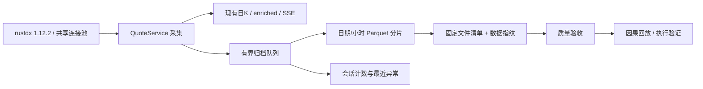

# 行情质量与扩展数据契约

本附录按领域维护实现方法、数据契约和可执行示例。通用开发要求只在[CONTRIBUTING](../../CONTRIBUTING.md)定义；需求与当前/目标边界见[需求](../requirements.md)和[系统方案](../architecture.md#current)。带日期的结果仅证明原版本、环境和窗口，不是本次重新执行的验证。

- [1. 收盘展示与权威日线](#closing)
- [2. 五档封板证据](#depth)
- [3. 市场阶段与主线](#phase)
- [4. 扩展数据的完整拉取与恢复](#pull)
- [5. 秒级归档、质量与执行验证](#second)
- [6. 官方个股目录与管理员维护](#catalog)

<a id="closing"></a>

<a id="closing-收盘价冻结根因与修复契约"></a>
## 1. 收盘展示与权威日线

<a id="closing-根因"></a>
### 根因

调用链为：

```text
RustdxProvider._quote_rows
  -> QuoteService._process_full_market_records
  -> KlineRepository 最新 enriched 缓存
  -> full_snapshot / PublicQuoteBridge
  -> 页面
```

rustdx 实时协议只提供无日期的单票事件时间。Provider 正确地将本机接收时间标为
`timestamp_basis=received`，不伪造源端快照时间。`confirms_boundary` 因此无法
确认最终收盘，符合现有时间契约。

错误发生在 `_process_full_market_records`：未确认分支提前返回，仅更新请求
元信息和指数缓存，未更新股票或 ETF 的 enriched 展示缓存。注释与测试宣称
“只更新展示缓存”，但测试只断言广播次数，没有断言实际价格。因此行情请求
成功、刷新时间前进，股票价格却停在最后一次收盘前写入值。

<a id="closing-长期修复方案l3"></a>
### 长期修复方案（L3）

核心行情编排行为需要变化，现有扩展插槽无法表达，应直接修复现有链路。
保留 Provider 标准化接口、原始价与复权价契约、北京时间及现有收盘证据校验。

1. **最新观测与最终收盘分别处理。** 未确认收盘的有效行情继续通过现有 enriched
   计算更新临时展示缓存，保留实际时间及来源口径；不得落盘为最终日线，
   不得触发交易或监控评估，不修改历史指标缓存。
2. **权威数据优先。** 盘后管道继续以已配置的日线 Provider 校正日线和 enriched；
   日线定版后，未确认快照不得覆盖同日权威缓存。盘后手动刷新和进程重启也遵守
   同一规则，不能靠重试、延时或伪造时间戳证明定版。
3. **完整性与失败隔离。** 部分返回、重复证券、跨日、空数据和停牌不能截断有效
   全市场缓存；不能因单个不可信时间戳而冻结其他有效行情。缺失与未知继续明确
   保留，不能填零或把接收时间变成源端时间。
4. **缓存切换可见。** 只在新缓存可用后替换，随后通知行情订阅者。盘后缓存刷新
   必须触发已有查询失效链路，公共快照和 API 读到同一结果。
5. **测试验证业务值。** 回归测试重现 rustdx 接收时间情形，断言展示价格更新、
   未确认数据不写盘、权威数据不被改回、原始价及复权价一致。既有定版、行情、
   仓库、公共桥接及缓存相关测试一并回归。

<a id="closing-实现"></a>
### 实现

- `QuoteService` 对未确认或不完整快照复用既有 enriched 计算，使用
  `persist=False` 合并展示缓存；不返回监控评估输入。重复证券保留上一份有效
  状态，跨日、停牌及无效价格逐行过滤，其余证券继续更新。
- `KlineRepository.update_provisional_enriched_asset` 仅更新同日内存缓存，
  保留未返回的证券；沿用现有完整性契约保护无快照时钟的 batch 日线及同日
  15:00 后的源端快照，同时拒绝时间倒退的观测。计算在写锁外进行，提交时
  检查缓存是否已切换，盘后计算期间的新权威缓存优先。
- 股票、ETF、指数的冷加载保留 `quote_ts` 和 `quote_time_basis`，防止重启后
  把接收时间行情误判为无时间戳的权威历史。无需迁移存量 Parquet schema。
- 收盘确认移除“可提前 5 秒”的负向容差，源端时间必须真正达到同日 15:00，
  与盘后完整性检查和权威缓存保护使用同一收盘边界。
- 行情广播失效公共全量快照缓存；盘后仓库刷新完成后调用既有行情广播，再调度
  矩阵预热。页面与租户公共桥接通过原有 SSE / 查询失效链路读取新缓存。

<a id="depth"></a>

<a id="depth-五档封板快照判定"></a>
## 2. 五档封板证据

价格涨跌停名单由 enriched 的价格信号确定。五档服务只叠加封板状态，不修改
`signal_limit_up` / `signal_limit_down`。

五档修正必须使用未复权的 `raw_close`，且买卖一价格、数量、采集时间均有效，
采集日期与指标日期一致。缺失、负数、非有限数和未返回的候选股均为待确认。
数据源额外返回的标的不进入本次候选快照。

- 真封板需要对手盘量为零，封单量大于零，封单价格与候选价格一致。
- 未封板需要有效双边盘口，以及连续竞价期间与候选价格明确不一致的盘口价格。
  09:30–11:30、13:00–14:57 之外的双边盘口不能证明炸板或翘板。
- 盘中未封板判定在收盘集合竞价开始后失效，不能覆盖最终收盘价格信号。

快照原子写入 `depth5/date=YYYY-MM-DD/part.parquet`。新增可选列
`ask1_price`、`bid1_price`、`reference_price`、`validation_version` 保存判定证据。
历史文件缺少这些列时仍可读取；旧 `false` 因缺少证据而降为待确认，旧 `true`
保留兼容显示。

市场总览和连板梯队仅扣减当前方向候选名单中逐条就绪、已验证的未封板记录。
涨停、跌停明细分别统计；缺失记录计入待确认。梯队 `status`、计数和封板明细
必须使用同一次读取结果，避免名单与显示总数不一致。

回归测试：`backend/tests/test_depth_snapshot_validation.py`，包含
2026-10-20 `301030.SZ` 的历史快照数据、盘后双边盘口、时间窗口、原始价与
复权价分离、缺失响应、磁盘恢复、旧记录及 API 一致性。

<a id="phase"></a>

<a id="phase-市场阶段情绪周期与主线识别"></a>
## 3. 市场阶段与主线

本文说明环境页的阶段体系与主线识别的口径、阈值来源、持久化设计、已知偏差与运行方式。它与原有的 5 档环境 state 并存，不替代任何既有消费方。

<a id="phase-功能边界"></a>
### 功能边界

阶段体系回答"市场处于情绪周期什么位置"，主线识别回答"当前/某阶段内什么板块概念在领涨"。两者都只用本地已存储数据（`consecutive_limit_ups`、`amount`、概念映射快照），不依赖扩展数据源，2020-08 起全历史可回算。

明确不做的：

- 挖掘、回测环境过滤、因子 regime 统计仍用原 5 档 `state`，本期不切换到阶段体系。
- 概念成分是当前快照，不改成 timeseries 积累模式（见「快照回填偏差」）。
- 不生成任何交易信号；阶段与主线仅供研究分析。

<a id="phase-与-5-档-state-的关系"></a>
### 与 5 档 state 的关系

| | `state`（原有） | `phase`（本期新增） |
|---|---|---|
| 驱动量 | 赚钱/投机/抗跌/趋势 4 维综合分 | 连板梯队：高度、宽度、晋级率、梯队完整度 |
| 档位 | 强势/偏强/震荡/偏弱/弱势（5 档） | 冰点/启动/主升/高潮/退潮/修复（6 阶段） |
| 消费方 | 回测环境过滤、挖掘、策略页 | 环境页分析与主线识别 |
| 持续性 | 日频打分，切换频繁（历史 76.6% 天数发生切换，平均段长 1.1-1.5 天） | EMA 平滑 + 2 日确认，平均段长 9.7 天 |

`state`/`score` 列原样保留，新列（`phase`、`first_board`、`ge2_count`、`ge3_count`、`ge5_count`、`ladder_completeness`、`promo_rate`、`promo_pool`）对既有消费方透明。

<a id="phase-每日梯队指标"></a>
### 每日梯队指标

全部由已存储的 `consecutive_limit_ups` 列向量化派生，实现在 `backend/app/services/market_phase.py`：

- `first_board`：首板（1 连板）家数。
- `ge2_count` / `ge3_count` / `ge5_count`：N 板以上家数（宽度）。
- `promo_rate` 晋级率：昨日连板池今日继续封板的比例。昨日连板数用 `consec.shift(1).over("symbol")` 按个股前一日连接（跨批次边界也正确，`_compute_batch` 在 warmup 截断前计算）；池不足 10 家记 `null`（小样本噪声），不填 0。
- `ladder_completeness` 梯队完整度：2..height 档位中非空档位占比；height < 3 时为 `null`。
- 高度（`max_consecutive`）与封板率（`seal_rate`）沿用 regime 已有列。

<a id="phase-阶段规则"></a>
### 阶段规则

词汇与优先级：`climax 高潮 > rally 主升 > ebb 退潮 > ignite 启动 > ice 冰点 > repair 修复（兜底）`。冰点排在退潮前判定——长期死市不应被标成"自高位退潮"。

阈值标定自 2020-08~2026-08 全市场 1454 个交易日的 p10/p60/p90 分位数，全部集中在模块顶部常量，调整只改那里：

| 阶段 | 核心条件（EMA 平滑后） |
|---|---|
| 高潮 climax | ge2 ≥ 50（p90 的 2 倍）或首板 ≥ 220（p90 的 2.5 倍），历史占比 <2% |
| 主升 rally | 高度 ≥7 且 ge2 ≥15 且晋级率 ≥0.23（全中位以上）；或晋级率 ≥0.30（p85+）配合高度 ≥5、ge2 ≥12 |
| 退潮 ebb | 晋级率 <0.15（p20）且宽度自 5 日前高位（ge2>12 或高度>6）回落；或晋级率 <0.13 且封板率 <0.57 双弱 |
| 启动 ignite | 宽度/高度自低位扩张（ge2 较 5 日前 +3 且 ≥8，或高度抬升且 ≥5）且晋级率恢复到 ~0.19-0.20 |
| 冰点 ice | 高度 ≤4、ge2 ≤6、首板 ≤24 同时贴地（均 ~p10） |
| 修复 repair | 兜底 |

**持续性设计**：驱动量先做 EMA 平滑（alpha=1/3，约 5 日），原始标签出来后再做 2 日确认（切换需连续 2 日出现新标签才生效）。

**弱档否决**：5 档 `state ∈ {weak, lean_weak}` 时，正向阶段（主升/高潮/启动）一律降为修复。这修复了一类错标：连板梯队强但大盘崩的交易日（如 2024-01 微盘流动性危机）会被梯队指标误判为主升/启动——涨停生态与大盘背离时，以大盘弱势为准。

**回填验收**（1454 天真实数据）：平均段长 9.7 天（对比原 5 档的 1.1-1.5 天）。抽查：2024-09-24→10-08 为启动→主升→高潮（九二四行情）；2024-01/02 微盘崩为退潮/冰点；高潮 6 年仅 2 段（2024-10-08、2024-10-31 ST 重组潮 17 板），均为真实极端期。

已知特性，如实说明：退潮/冰点天然是短段（平均 2.8/2.5 天）——恐慌释放本身快于趋势形成；修复是占比最高的兜底段（~74% 天数），A股大部分时间没有处于可辨认的周期位置。

<a id="phase-主线识别"></a>
### 主线识别

实现在 `backend/app/services/market_mainline.py`。复用 `rps_rotation` 的概念映射加载，窄扫描 `kline_daily_enriched` 的 symbol/date/consecutive_limit_ups/amount 四列，按 (date, 概念/行业) 聚合：

- `limit_up_count` 涨停家数、`ge2_count` 二板以上家数、`max_boards` 最高板、`boards_sum`、`rungs_filled` 梯队档位数、龙头股（按连板数、成交额排序取第一）。
- 主线分 = 当日截面 rank 归一后 `0.35*涨停数 + 0.25*最高板 + 0.25*梯队档位数 + 0.15*二板宽度`。这是"同板块涨停越多、梯队越完整越是主升主线"判据的直接量化。
- 每概念当日涨停 <3 家不参与排名；每日持久化 top30 到 `data/mainline_history/part.parquet`（upsert 按 date+kind 整日替换）。
- 行业维度取前两级（如 `计算机-软件开发`），作为概念维度的交叉验证。

<a id="phase-宽基风格标签过滤"></a>
#### 宽基/风格标签过滤

融资融券（~7700 家）、沪深股通（~3300 家）这类超大概念会垄断 top1，需要过滤。配置存于用户偏好（`preferences.json`），环境页「过滤」面板可改：

- 成员数上限：默认 600，超过视为宽基/风格标签不参与排名（夹取范围 50-5000）。保留华为概念（2006）、人工智能（2166）等真主题。
- 成员数下限：默认 4（夹取 1-200）。
- 名称黑名单：手动屏蔽任意概念，支持逗号/分号/空格分隔。

修改保存后自动触发全量主线重算（`POST /api/regime/mainline/recompute`，秒级）。API 层为 `PUT /api/preferences/mainline-filter`。

<a id="phase-快照回填偏差"></a>
#### 快照回填偏差

概念成分为**当前快照回看历史**（本地自 2026-07 起留存，无历史版本）。新纳入指数或改名的个股会出现在旧时段、成分调整会错归属，因此早年主线存在归属漂移，越近越准。此口径限制以 `membership_note` 字段随 API 返回并在页面展示。若后续把 ext 概念同步改为按月累积快照，主线历史精度会逐月自然提升。

<a id="phase-api-与运行"></a>
### API 与运行

- `GET /api/regime/phases?start&end`：连续阶段段列表（阶段、区间、天数、高度/宽度/晋级率/封板率均值、段内 top 主线）。
- `GET /api/regime/mainline?start&end&top&kind`：窗口内主线排行（top1 天数、日均分、最高板）与每日明细。
- `POST /api/regime/mainline/recompute`：过滤配置变更后的全量重算（两类维度）。
- `POST /api/regime/recompute`：扩展为重算 regime 后自动重标 phase 并回填主线。
- daily pipeline 在 regime 步骤后追加主线增量（复用 `pipeline_regime_enabled` 开关，软失败不阻塞）。

阶段标签由 `regime_builder.refresh_phase_labels` 在每次 regime upsert 后对全量历史重标（1454 行，开销可忽略）——因为 EMA 与 2 日确认依赖完整序列。

<a id="phase-测试"></a>
### 测试

- `backend/tests/test_market_phase.py`：梯队聚合、晋级率（池不足记 null）、梯队完整度、阶段序列规则、弱档否决、持续性（噪声下不出现 1 日翻转）、refresh 往返。
- `backend/tests/test_market_mainline.py`：概念/行业聚合、宽基过滤、黑名单、最少涨停家数、同日 upsert 替换、增量补齐、偏好读写与夹取。

<a id="pull"></a>

<a id="pull-扩展数据来源与完整快照"></a>
## 4. 扩展数据的完整拉取与恢复

扩展概念、扩展行业仍提供默认 URL。管理员可在「数据」的拉取配置中替换
URL、鉴权、响应路径和字段映射；已有配置不会因升级而重置。
这是 L3 的通用拉取链路扩展，复用原有标准化、Parquet 和缓存失效流程。

单级源返回已标准化行时选择「已标准化行」，避免套用默认源的
`concepts` / `industries` 数组转换。分页参数通过配置 API 保存，
空页或短页才确认完成；到达 `max_pages` 仍无法确认终页则拒绝写入。
日期检查覆盖每一行并在转换前执行，接口返回的日期不能与请求日期冲突。

<a id="pull-目录与成员两级配方"></a>
### 目录与成员两级配方

上方 URL / 响应路径 / 分页读取目录，下列 JSON 读取每个目录的成员：

```json
{
  "member_url": "https://api.example.com/members",
  "id_field": "id",
  "member_param": "sector",
  "member_path": "data.rows",
  "inject_fields": {"name": "所属概念"},
  "group_by": "symbol",
  "join_fields": {"所属概念": ";"},
  "concurrency": 4,
  "min_interval_seconds": 0.1,
  "retries": 2,
  "backoff_seconds": 1,
  "timeout_seconds": 300
}
```

目录行例如 `{"id":"BK001","name":"人工智能"}`。每个成员请求附加
`?sector=BK001`，参数值经过 URL 编码，目录内容不能指定请求主机。
成员响应行例如 `{"symbol":"600000.SH","股票代码":"600000.SH","股票简称":"示例"}`
会注入分类名称。配置里已声明的所有字段必须能够由映射生成。
两级输出只应用通用字段映射；之后 `join_fields` 将同一标的多项分类按目录顺序
去重合并。`group_by` 和 `join_fields` 使用映射后的字段名。

成员分页使用 `member_page_param`、`member_page_size_param`、
`member_page_size`、`member_page_start`、`member_max_pages`。
目录与成员均只支持 GET，必须同协议同主机同端口，共用请求头、密钥和日期参数。
默认不开重定向，不执行任意表达式或脚本。

并发 1–8，目录最多 5,000 项、整轮最多 200,000 行，整轮时限最多 900 秒。
网络错误、429 和 5xx 最多补拉 3 次，已成功的成员不重复请求；429/5xx 的
`Retry-After` 作用于整轮共享等待，超过整轮时限则取消。4xx 非限流错误不重试。
取消会等待固定数量的 worker 释放。失败状态列出目录 ID 和脱敏原因。
空目录失败；合法空成员可以成功，但整轮无有效行不能发布。
若服务端提供分页却未配置分页，本系统无法证明源端完整性，应按接口契约配置。

<a id="pull-写入备份与状态"></a>
### 写入、备份与状态

`snapshot_policy=auto` 对内置概念/行业及两级配方完整替换快照；
普通自定义源沿用合并语义。可显式选 `replace` 或 `merge`。
完整替换前检查声明字段和有效数据，上一份保存为
`ext_data/<id>/previous-complete.parquet.bak`，仅保留一份，不参与分析视图。
HTTP 失败、成员失败、日期不符、分页截断、字段缺失或空数据都不会覆盖当前快照。
普通上传 / ingest 仍沿用原有合并语义。

`last_attempt` 表示本轮目录/请求完成度及失败清单；此覆盖率不代表全市场股票。
`last_complete` 记录最后成功的接收时间、源端日期、来源（不含查询参数）、
行数、文件 SHA256、当前本地标的维表覆盖率；缺少完整源日期或本地维表时为未知。
接收日期不能作为源端更新日期证明。合并模式的最后成功记录不保证完整替换。
`previous_complete` 仅在上一份文件仍匹配记录哈希时保留，避免把中途上传的
文件误标为上一认证快照。

同一数据源同进程只允许一轮拉取，写入与配置保存互斥；请求期间更换来源、
字段或标的映射会拒绝旧请求结果。部署仍使用公共行情单写者，不能让多个
独立采集进程同时写同一目录。Parquet 和 JSON 各自原子写入，跨文件不是事务；
进程在两次原子替换之间中断后需重跑，并以文件哈希核实状态记录。

恢复旧快照前停止该源调度、备份当前文件，并核对 `previous_complete.sha256`；
由维护者将 `.bak` 恢复为 `part.parquet` 后重启数据服务以失效缓存。
界面不会自动回滚或丢弃新结果。多租户来源配置和密钥仍受管理员权限控制，
公共发布剥离整个 `pull` 配置，普通租户不能获得出站凭据。

<a id="second"></a>

<a id="second-秒级行情回测优化与实施方案"></a>
## 5. 秒级归档、质量与执行验证

原实施核验：2026-10-11。当前文档同步：2026-10-23。
原生桥接使用发布包 `jelven-rustdx-complete =1.12.2` 与锁文件校验和；
来源提交及旧 Git 基线关系见[rustdx 运行时](integrations.md#rustdx-原生运行时)。
归档、回放和执行验证已实现；完整交易日 1 Hz 与十年全市场研究未签收。
独立模式保持单 API worker；完整多租户由 Platform 唯一采集，API 按其角色配置运行。
共享最多 35 条连接，保留日K/分钟K/监控/SSE。

<a id="second-1-数据能力与目标"></a>
### 1. 数据能力与目标

当前可实现：持续记录 rustdx 轮询快照，按当时可获得的信息回放信号，并验证提交信号之后
的后续快照是否满足保守成交条件。采样目标 1 秒，实际间隔必须实测并报告，不保证每秒都有
新行情。全市场分批采集不是同一交易所时点的原子快照。

不能声称：完整逐笔成交、交易所委托队列、真实排队成交概率、历史秒级数据补齐。
1.12.2 的 `transaction` / `history_transaction` 仍把协议时间解码为 HH:MM；
当前 PyO3 桥接也未暴露这两项能力。禁止把同一分钟的多条成交均匀摊成秒级数据。
`quotes.servertime` 是不带日期的服务器时间，不是经过验证的交易所事件时间。

本次升级分为以下可验收批次：

| 批次 | 交付 | 验收条件 |
| --- | --- | --- |
| A：数据契约 | 源版本、采集时间、源时间原文、推断日期标记、资产类型、累计量额、买卖盘 | 时间/单位测试；无源时间不伪造；版本可追溯 |
| B：持久化 | 有界异步队列、不可变 Parquet、原子发布、会话诊断汇总、停机排空 | 满队列/磁盘故障/发布失败不重复、不无限积压；既有行情链路正常 |
| C：回放与质量 | 固定文件清单及摘要、按采集可见时间回放、区间覆盖和证券覆盖检验 | 午休不报缺口；漏整日/头尾缺失/重复/倒序/陈旧行情可检出 |
| D：执行验证 | 信号后下一有效快照、延迟/陈旧过滤、买卖盘、T+1、历史证券状态、历史卖出印花税 | 不同轮才成交；缺数据拒绝；费用及状态边界有固定样本验证 |
| E：交易时段验收 | 小标的池→全市场→混合分钟负载，连续交易日观测 | 实测吞吐、间隔分位数、覆盖率、积压、磁盘增长；阈值不达标不宣称 1Hz |

批次 A–D 可离线实施、自动化验证。E 需要市场开盘后的真实数据，不以周末测试代替。

<a id="second-2-采集与存储设计"></a>
### 2. 采集与存储设计



目录：`data/quote_second/date=YYYY-MM-DD/hour=HH/part-*.parquet`。
默认每 10 轮或 10 秒封片，Zstd 压缩；不读取旧文件合并，不刷新日K generation。
分片先写 `.tmp`，完成后原子重命名。写线程单写，回放只读已发布文件。
原子重命名保护文件完整性；内存队列与未封片缓冲在强制杀进程/断电时可能丢失，
这不是零丢失 WAL。研究校验通过时间覆盖发现缺口，不补零、不前向填充。

生产默认归档关闭，显式开启。保留期默认 0（不自动删除研究原始数据），需要滚动删除时
显式设置 1–365 个自然日；可用空间低于 1 GiB 时写线程拒绝该批写入并记录丢轮。
队列最多 30 轮，封片缓冲默认 10 轮；满队列时新一轮立即计为丢失，不阻塞行情线程。
归档失败隔离日K与实时展示，在状态、服务日志和会话 JSON 汇总中可见，不以之后
一次写入成功抹掉历史丢轮计数。磁盘无法写入时诊断 JSON 本身也可能写入失败。

全市场按 5,000 标的 × 14,400 秒估算约 7,200 万行/连续交易日；
包括竞价/收盘观察窗口会更多。容量应以真实压缩后 bytes/row 乘行数和保留天数计算，
不能把行情请求压测结果当作全链路性能。初期先短时开启观察磁盘增长；当前归档跟随
既有行情拉取范围，尚无独立归档证券池开关。

<a id="second-3-时间单位与来源契约"></a>
### 3. 时间、单位与来源契约

- `collected_at_ms`：整轮行情对 Python 消费方可见的 epoch 毫秒，回放主时间轴。
- `capture_id`：轮次标识；不当作交易所序号，也不通过 ID 相减估算缺轮数。
- `provider_ts_ms`：provider 原来的 timestamp，只保留其事实；rustdx 当前为本地时间。
- `source_time`：服务器时间原文；`source_ts_ms`：结合采集日期推断或由源显式给出的时间。
- `source_date_inferred`：是否推断日期。日期推断不满足严格交易所事件时间回测。
- `provider_version`：记录 rustdx 版本与固定提交，避免升级后历史输入无从区分。
- `asset_type` 明确区分股票/ETF/指数；价格均为未复权人民币元。
- `volume` 为当日累计手数，`amount` 为当日累计元；不作为单秒成交量。
- 买卖一档价量用于保守执行验证。累计量额增量只能在同日、同源、连续观测且未回退时使用；
  首轮、隔夜、断档、重置不制造正向成交量。

当前归档不增加网络请求；买卖盘利用同一个 quotes 响应。原生按批接收时间和连接等待
分位数属于后续精度升级，不把整轮时间冒充每只证券的接收时间。

<a id="second-4-质量与研究门禁"></a>
### 4. 质量与研究门禁

校验分两种：未给出完整窗口/证券集合时，只报告已观察样本质量，不能认定全天完整；
给定回测起止毫秒与预期证券集合时，检查起点、终点、轮间和证券缺失。
跨日查询必须明确预期交易日，使用实际交易日历；不得把自然日缺失当作休市。

午休和非交易时间不计入秒级采样缺口。源时间不能解析、未来时间、源时间倒退、
重复/倒序轮次、同轮重复证券、非法价格/量额均显式报告。源时间长时间不动和数据完全
重复是不同指标；停牌或无交易可以没有成交，但不能被撮合器当成流动性。

文件列表在一次回放开始时固定，保存相对路径、大小和 SHA-256 指纹。校验和执行共享同一
清单，新增分片不混入运行；原文件被清理/修改则失败，不能静默跳过。
`session-*.json` 保存会话丢轮总数、最近错误和停机状态，不是逐事件缺口日志；
质量门禁以分片内容和窗口覆盖为依据。未知来源版本也不能获得 `ready`。

<a id="second-5-回测语义"></a>
### 5. 回测语义

先支持“既有信号序列的执行验证”，输入信号发生时间、股票代码、方向、数量。
验证器只使用严格晚于信号且达到延迟要求的后续快照，并要求累计量增量区间的两个
端点都不早于订单到达；跨越下单时点的增量不按比例分摊。买入参考卖一、卖出参考买一，
价量不可用、源时间陈旧、跨越断档、涨跌停封板等情况拒绝/等待。
无法证明排队成交，不模拟在涨停价排队抢板的成功率。

股票执行必须保留历史 ST/上市状态、T+1、最小交易数量与现金/持仓约束；证券历史状态
未知时严格模式拒绝。卖出成本调用现有按成交日计算印花税函数，并包含佣金与滑点。
不能把当天收盘后的 enriched 或当前 instruments 当作盘中已知数据。

当前执行窗口限定一个交易日的一个连续竞价时段（09:30–11:30 或 13:00–14:57），
收盘竞价时段不参与成交。支持沪深股票整百股订单（科创板买入至少 200 股），
暂不覆盖科创板逐股申报、零股卖出或部分成交。订单按信号时间和 ID 排序，共享该轮
成交参与率预算（默认 1%，最大 10%）和同方向盘口量，不能重复消费同一批流动性。
默认佣金万二、最低 5 元，滑点 5 bps；其他费用需并入显式成本假设，目前无独立过户费项。
初始持仓需声明实际取得日期，信号后的同日买入不可用于当日卖出。历史状态还必须在
信号发生前已知（`available_at`）；当前目录和盘后补写记录不能倒填为历史已知信息。

这不是对任意现有日线策略自动升级到秒级的承诺。策略信号仍需声明当时可获得的输入；
跨日资金曲线、复权和企业行为继续由既有回测能力与专门的后续适配处理。

<a id="second-6-验收发布与回滚"></a>
### 6. 验收、发布与回滚

每批执行对应 provider、归档、回放、API 和已有行情回归；检查 Ruff 新增告警及 diff。
真实交易时段报告采集完整率、轮次间隔 P50/P95/P99、丢轮数、写入耗时、队列峰值和
压缩后磁盘增长。以同一负载比较开启/关闭归档，才可报告性能影响。

开关关闭后排空已接收缓冲，历史分片仍可回放。禁用归档不改变既有日K/分钟数据格式；
回滚代码保留 `quote_second`，不得默认删除研究样本。独立模式保持单 API worker；
完整多租户的采集/归档仍只有 Platform 写入者，不随 HTTP worker 增加。

<a id="second-7-操作入口"></a>
### 7. 操作入口

接口沿用应用现有认证。下列示例使用本地后端默认端口 3018；启用认证的部署请附带
当前面板会话；这些设置/秒级研究端点不在 Tier A Token 规则中。
完整多租户还需对应权限与平台可用性。开启归档前，实时行情应已开启并选择 rustdx；归档开关只控制
保存现有轮询结果，不会主动开启行情或在休市期间抓取历史秒级数据。
初始化时实时行情和秒级归档均默认开启，已保存的关闭设置优先；保留期默认 0。

```bash
curl -X PUT http://127.0.0.1:3018/api/settings/preferences/second-quote-archive \
  -H 'Content-Type: application/json' \
  -d '{"second_quote_archive_enabled":true,"second_quote_archive_retention_days":0}'

curl http://127.0.0.1:3018/api/backtest/second-quotes/status
```

停止归档时将 `second_quote_archive_enabled` 改为 `false`，接口等待已接收数据排空。
若仍在排空则返回 409，保持关闭；历史文件保留。
状态中的 `dropped_rounds`、`queued_rounds`、`pending_rounds`、`last_write_ms`、
`queue_peak`、`last_error` 用于现场观测。计数是本进程会话口径，重启后查看旧 session JSON。

查看数据样本（日期与代码应替换为实际已采集数据）：

```bash
curl -X POST http://127.0.0.1:3018/api/backtest/second-quotes/sample \
  -H 'Content-Type: application/json' \
  -d '{"start":"2026-10-12","end":"2026-10-12","symbols":["600519.SH"],"limit":100}'
```

样本接口单次最多 31 个自然日、200 个代码、10 万行，超过行数返回 `truncated=true`；
`capture_id` 为字符串，前端不可转换成 Number。前端统一客户端已提供
`api.updateSecondQuoteArchive`、`api.secondQuoteStatus`、`api.sampleSecondQuotes`、
`api.validateSecondQuotes` 和 `api.validateSecondExecution`，本批未增加独立页面。

质量校验和执行验证可以按北京时间构造毫秒窗口，避免手工填错时区：

```python
from datetime import datetime
from zoneinfo import ZoneInfo
import requests

base = "http://127.0.0.1:3018"
day = "2026-10-12"  # 替换为已采集交易日
def ms(clock):
    return int(datetime.fromisoformat(f"{day}T{clock}")
               .replace(tzinfo=ZoneInfo("Asia/Shanghai")).timestamp() * 1000)

window = {"start": day, "end": day, "symbols": ["600519.SH"],
          "start_ms": ms("09:30:00"), "end_ms": ms("09:35:00"),
          "trading_dates": [day], "expected_interval_s": 1}
quality = requests.post(f"{base}/api/backtest/second-quotes/validate",
                        json=window, timeout=300)
quality.raise_for_status()
print(quality.json())

# 仅示范输入形状：应换成由当时已知数据生成的真实信号。
payload = {"day": day, "start_ms": window["start_ms"], "end_ms": window["end_ms"],
           "orders": [{"order_id": "signal-1", "symbol": "600519.SH",
                       "signal_ms": ms("09:30:10"), "side": "buy", "shares": 100}],
           "opening_lots": [], "config": {"initial_cash": 100000, "latency_ms": 300}}
result = requests.post(f"{base}/api/backtest/second-quotes/execution-validate",
                       json=payload, timeout=300)
result.raise_for_status()
print(result.json())
```

`ready` 只表示请求窗口与所列证券满足采样数据门禁，`exchange_event_time_verified=false`
仍成立。执行接口单次最多 1000 笔订单、200 只股票；数据门禁失败或输入损坏返回 409，
参数不合法返回 422。证券历史状态缺失则返回逐订单 `historical_status_unknown`。
输出包含每笔成交/未成交原因、期末现金/持仓、历史状态文件哈希、输入配置哈希和分片清单；
`exchange_fill_guaranteed=false`，不输出虚构收益率或成交概率。

<a id="catalog"></a>
## 6. 官方个股目录与管理员维护

固定官网目录覆盖沪主板、科创板、深主板、创业板；仅接收当前未退市 A 股。
上交所 JSON 校验结果总数，深交所 XLSX 校验 JSON 元数据总数，再统一证券代码、
名称、上市日期和股本（股），拒绝重复代码或缺板快照。来源字段为 `sse` / `szse`，
目录整体来源为 `official_exchanges`；管理员保存标记为 `manual`。
接口参数见[官方目录接入](integrations.md#official-stock-catalog)。

每次启动及每天北京时间 09:00 自动同步，不判断交易日、不依赖行情自动模式或源密钥。
先完成全量网络下载再进入写锁，失败不动原快照与历史；成功替换当前目录并记录 SCD2。
当前快照写入失败时恢复上一份历史，同日新增后删除也保留最后已知名称的 tombstone。
退市整理证券沿用当前池的排除规则；此目录不能作为首次采集前的历史股票池。

管理员 GET `/api/data/instruments` 支持 `q`、`exchange=SH/SZ`、`page`、`page_size`
（默认 50，最大 200）；POST 新增，PUT/DELETE `/api/data/instruments/{symbol}` 修改或删除。
只接受沪深 A 股代码，名称非空，上市日不晚于今天，股本为正且流通不大于总股本；
无权限返回 403，重复返回 409，不存在返回 404，输入错误返回 422。
股票缓存、名称映射、数据与总览缓存、筛选缓存和 release 在变更后更新；
前端失效名单、数据状态、股票搜索、自选、总览及维表字段查询。
下次官方同步重新核对名单、名称和上市日期；官方缺失的股本保留原值及采集来源，
管理员删除不清除行情，仍在官方名单中的证券会重新加入。
