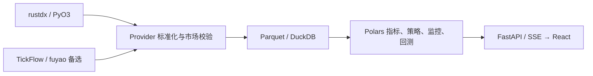

# rustdx 数据源

rustdx 是内置默认数据源，七类核心能力的初始值、重置值和界面缺省值统一为 rustdx。
TickFlow 和 fuyao 是两种备选数据源，各能力仍可独立选择。已移除的旧源路由在读取
时自动恢复为 rustdx，下次普通保存时持久化；其他有效用户选择保持原值。

## 沪深市场范围与升级

股票范围仅含沪主板、深主板、创业板、科创板；沪深 ETF 与指数保留。采集、行情
聚合、导入、指标、回测和持久化边界统一过滤不支持的市场代码，包括错误附上
沪深后缀的旧代码。股票身份仍按交易所对应代码前缀校验，不把指数或 ETF 当作股票。

`DataStore` 在加载视图和启动任务前执行幂等迁移：混合 Parquet 按证券行清理，
只含旧市场的文件删除，JSON 中旧证券引用和板块选项清除。成功完成才保存迁移标记；
发生读写错误则停止初始化。旧策略只选已删除板块时保留空候选状态，选择合法板块后
恢复；原本未限制板块的空列表语义不变。矩阵和浏览器缓存版本同步递增。

本地安装版与线上部署版共用这些规则。桌面版安装即用，服务端继续保留认证。
沪深历史 ST、公告日期、卖出印花税、T+1、滑点和涨跌停成交约束保持有效。

## 系统架构与调度



APScheduler 编排目录同步、竞价和盘后流水线。实时行情默认目标间隔为 1 秒；
rustdx 全市场分钟逐股取数，有效轮次间隔至少 60 秒，保留原有 1–120 秒偏好，
状态和设置页显示实际生效周期。扩展行业与概念默认使用内置接口按 1 分钟更新，
可独立配置上游或关闭自动拉取。盘中任务采用北京时间交易日
09:15–11:30、13:00–15:15 的半开窗口，午休暂停；其他固定任务以各自门控为准。

## 支持能力

- 日 K
- 除权因子
- 实时行情
- 分钟 K
- 五档盘口
- 历史财务指标、三大报表和历史股本
- 全量分钟

行业、概念、龙虎榜和启用前的竞价历史不在这七类能力内，rustdx 当前不提供这些
数据。扩展分类仍由 `EXT_*_DATA_URL` 显式配置。历史 ST 治理数据和回测印花税
约束保持有效，当前证券目录不能代替历史状态。

## 原生运行时

后端通过 PyO3 原生扩展调用
[`jelven-rustdx-complete 1.12.2`](https://crates.io/crates/jelven-rustdx-complete/1.12.2)。
Cargo 使用精确版本 `=1.12.2`，锁文件保存发布包校验和，构建无需 GitHub 私有仓库凭据。
发布来源提交为 `9dfc024c9662fa5091099c1f17610569ee2eca8b`；
原固定提交 `904b33e514d4e368e633622c96a9e63af8a53d37` 仅追加发布文档，
两者的 Rust 源码和构建声明一致。`tsp-rustdx-native` 已纳入后端默认依赖，
普通 `uv sync --frozen` 会自动构建安装，后续同步也不会因遗漏 extra 移除桥接。
旧命令中的 `--extra rustdx` 保留兼容，但不再是安装前提。源码环境需要 Rust toolchain：

```bash
rustc --version
cargo --version
cd backend
uv sync --extra dev --frozen
uv run --frozen --no-sync python -m app.plugins.rustdx.client
uv run --frozen --no-sync pytest tests/test_rustdx_provider.py tests/test_rustdx_contracts.py tests/test_rustdx_sync.py tests/test_rustdx_financial.py tests/test_rustdx_native_pool.py -q
```

未安装 Rust 时，先按 [Rust 官方安装说明](https://www.rust-lang.org/tools/install)
安装工具链。固定 Git 源需要授权时，使用已有 Git 凭据并设置
`CARGO_NET_GIT_FETCH_WITH_CLI=true`，让 Cargo 通过 Git CLI 获取源码。
不要将凭据写入 Cargo 依赖 URL，也不要切换旧提交绕过版本校验。

Docker 镜像和桌面安装包会在构建阶段编译并包含原生扩展，运行目标机器不需要安装
Rust。开发启动脚本每次同步后端依赖；脚本启动、Docker 构建、CI 和桌面打包均
检查实际安装模块的依赖版本、来源提交、池接口和连接上限。检查不连接行情服务器；
缺失或不匹配时停止启动或构建，避免生成缺少默认源的产物。

源码环境遇到旧桥接时，在 `backend` 目录执行
`uv sync --frozen --reinstall-package tsp-rustdx-native`，然后重新运行上面的检查。

## 首次启动初始化

Standalone 和多租户 Platform 在数据目录没有股票日线时，自动通过既有后台
管道创建首次同步任务，不阻塞页面启动。多租户 API、Gateway 和 Worker 不触发
公共数据初始化。已有日线的存量部署继续采用日常同步方式。

任务先刷新并校验完整四板股票池，再依次同步历史财务与股本、一年官方日线、
对应除权因子、enriched 指标、配置窗口内的分钟线，以及当前实时和五档快照。
首次同步强制拉取股票日线和分钟线，不受日常拉取开关影响；分钟默认参数为 5，
强制回溯沿用现有休市余量换算。股票池覆盖沪主板、深主板、创业板、科创板；
停牌或新上市证券仅保存供应商真实提供的数据，不补造历史。

rustdx 目录可能提前包含待上市证券。仅对前收盘价为协议空值的候选记录检查
最近日线和上市信息；日线为空且上市日期、总股本、流通股本均明确为零时，
才从有效股票池排除。已上市停牌股和字段缺失的证券保留；核验请求失败则保留
上一份目录，不能把不完整核验当成完整股票池。证券开始提供上市或交易证据后，
下一次目录刷新会重新纳入。

实时和盘口分别保存到 `market_snapshot/quotes.parquet` 与
`market_snapshot/depth.parquet`，附接收时间和数据源，并纳入数据发布。它们是
当前观测，不代替历史逐笔、秒级归档或官方历史日线。

`initial_sync.json` 在任务开始前持久化 pending，完整管道及数据发布成功后才
写 completed。部分运行即使已写日线，重启仍会重新调度初始化；手动运行盘后
管道也会重试。初始化复用原有任务单飞、容量限制、行情暂停及进度日志。
缺依赖、日线覆盖不完整、财务表为空、分钟请求失败或行情盘口缺股票均明确失败，
保留 pending；未就绪源仍能保存路由，但不会显示为可用或“服务中”。

运维验收需同时核对数据页任务终态、四板股票池、各阶段行数和 completed 标记。
缺少原生桥接时先按上文安装依赖，确认能力矩阵可用后再运行管道。

## 全市场连接池

全市场实时、竞价和盘口请求按每批最多 60 只标的拆分，由一个进程级持久连接池
调度。默认和硬上限均为 35 条连接：

```env
RUSTDX_QUOTE_CONNECTIONS=35
RUSTDX_WORKERS=35
RUSTDX_BACKGROUND_CONNECTIONS=12
RUSTDX_MAX_PAGES=64
RUSTDX_SERVER=117.34.114.13:7709
RUSTDX_FINANCIAL_SERVER=120.76.152.87:7709
RUSTDX_TIMEOUT=8
```

- `RUSTDX_QUOTE_CONNECTIONS`：全市场行情连接池大小，范围 `1..35`。
- `RUSTDX_WORKERS`：日 K、分钟 K、除权等按标的并行任务数，范围 `1..35`。
- `RUSTDX_BACKGROUND_CONNECTIONS`：共享池中 bars、财务等后台请求的并发**保底下限**，
  默认 12，范围 `1..连接总数`（内部钳制在池容量之下，确保报价始终有可用槽）。
  后台始终可占用到该下限的并发，即使报价在排队；高于下限才让路。报价占用其余所有
  槽。这是请求预算，不创建第二个连接池。离线单节点压测下 12 使全市场分钟一轮降到
  约 36s、报价 P95 约 548ms（见采集建议文档性能验收），交易时段仍需复测。
- `RUSTDX_MAX_PAGES`：单标的 K 线最大翻页数，范围 `1..80`。
- `RUSTDX_SERVER`：行情主站，格式为 `IP:PORT`。
- `RUSTDX_FALLBACK_SERVERS`：逗号分隔的备选行情节点。未显式设置主站时默认使用
  两个备选；显式设置主站后只有该节点，除非同时配置备选。总尝试最多三次，
  释放故障连接后才切换，成功节点继续复用。财务专用节点不沿用行情备选。
- `RUSTDX_FINANCIAL_SERVER`：财务归档主站。行情站可能提供目录但不提供 ZIP，
  因此独立选择归档节点；切换节点时先释放槽位中的旧连接，不增加连接池上限。
- `RUSTDX_TIMEOUT`：连接与协议请求超时秒数，范围 `2..60`。

即使环境变量设置超过 35，Python Provider 和 Rust 原生桥接也会分别钳制到 35。
同一进程中的并发调用共享连接池，不会为每次请求再创建一组 35 条连接。
新建连接错峰，复用连接无需等待；失败最多尝试三次，关闭后旧池拒绝新请求。
统计包含槽位等待、后台活跃/峰值、重试、失败和实际分钟协议请求数。
分钟增量与修复按有界窗口提交逐股任务；同分区读、合并、替换受线程和进程锁保护。
计数接口的协议错误会终止本轮，排空已提交窗口以统计请求和重试数，并停止提交
后续窗口。失败轮不提交部分分钟数据，不增加成功轮数、不更新最后成功时间；
错误保留在服务状态中，健康立即变为 false，后续完整成功轮恢复。成功无数据
仍按空轮处理，连续失败或空轮触发全天修复。
本次桥接包为 `tsp-rustdx-native 0.1.1`、接口为 `POOL_API_VERSION=2`；
源码升级后依赖同步会重建原生扩展，旧接口明确显示不可用。

## 日历与研究复现

2026 年公布日历沿用版本 `SSE-2026-20251222`，研究追溯记录版本、覆盖年份和
SHA-256。未公布年份不能按工作日冒充权威日历；历史日历缓存按日线数据源隔离，
仅在覆盖范围内作休市推断。未来年度需在交易所公布安排后维护。

财务原始归档按内容 SHA-256 保留于 `cache/rustdx/financial/revisions/`；
标准化财务表的观察快照和观察记录保留于 `financials/revisions/<table>/`。
内容未变不复制快照，A→B→A 仍保留三次观察。研究端可用
`financial_sync.get_financial_revision(data_dir, table, observed_at)` 按带时区的观察时刻
读取已知快照，读取时校验文件摘要。首次观察前返回空，不倒填历史修订版本。
`read_financials_as_of(data_dir, table, observed_at=None)` 为统一读入口：不传观察时刻
读当前生效文件（默认实时视图不变），传入时回放那一刻可见的观察，无观察时回退当前文件。
回测追溯 `backtest_provenance` 的 `financial_revisions` 字段按表绑定运行时可见的最新观察
（内容哈希 + 观察时刻），使一次回测可复现其所见的财报重述；该绑定按观察时刻存证，
不改写股本/换手率的 `announce_date` 时点口径。

数据发布和回测追溯记录维表、历史证券状态、五张财务表及日历指纹；
严格研究检查辅助输入与 release 是否一致。既有 release 可读取，但缺指纹时不能通过
该检查。文件摘要和观察保留不能证明历史公告版本完整，也不能补造退市和历史 ST 数据。
日 K 按有限窗口流式产出，分钟增量只请求最新几根真实分钟 K。1 秒调度是目标
轮询间隔，实际完成时间受标的数量与公开节点性能约束，不承诺全市场 1 秒内完成。

固定股票池的 8–30 连接 P95 压测脚本、验收口径和结果文件见
[`rustdx 行情连接数压测`](rustdx-quote-benchmark.md)。

秒级回测新增可选的不可变快照归档、质量门禁和执行验证 API，复用既有轮询结果及
买卖一档数据，不增加行情请求。启用方法、时间语义和分阶段验收见
[`秒级行情回测优化与实施方案`](second-level-backtest-upgrade.md)。
该能力保存采样快照；1.12.2 的成交查询时间精度仍不足以补齐历史真实秒级逐笔数据。

## 数据口径

rustdx Provider 在边界转换为项目统一契约：

- 代码：`600519.SH` / `000001.SZ`
- 日 K：不复权原始价格，成交量单位为手，成交额单位为元
- 分钟 K：北京时间墙钟，成交量单位为手
- 实时涨跌幅：小数制
- 五档数量：手
- 财务：原始 FINVALUE 字段映射，金额为元、股本为股；公告日期缺失的记录不进入历史计算

一分钟 K 接受北京时间 `09:30–11:30`、`13:00–15:00` 的边界时标。实时协议可能
返回 `09:30`、`13:00` 开盘时标，历史数据通常从 `09:31`、`13:01` 开始；
保留供应商真实时间，不统一平移，也不丢弃 `11:30`、`15:00` 收盘记录。
时段外量额均为零的停牌占位记录忽略；时段外其他记录仍报错并拒绝整批提交。
历史半日分区需按原价格基准重新拉取真实缺失记录，经分区锁合并后发布公共版本。

历史财务目录和文件均通过原生 rustdx TCP 下载，按目录声明的大小和 MD5 校验，
原子保存到 `data/cache/rustdx/financial/`。独立解析器限制解压大小、检查报告日期
与数据偏移。Python Provider、协议异常、财务解析均独立实现，运行不依赖旧数据源包。

历史 ST 采集命令为 `scripts.backfill_rustdx_st_history`，固定使用 rustdx，并保存到
`data/governance/st_history/rustdx_f10_latest.parquet`。已有历史证据的来源标签保持
真实记录；脚本执行仍需明确指定治理截止日。研究脚本按通用 F10 隔离标签后缀识别
未知状态，兼容此前的历史治理数据。

## 验证记录与实施顺序

2026-10-10 在 macOS arm64、同一公开行情节点测得：沪深股票目录 5,226 只，
全市场第一轮 2.069 秒，三次连接复用分别 0.313 / 0.282 / 0.508 秒，
各轮覆盖 5,226 只、池内连接均为 35。这是当次盘后测量，不代表交易日高峰 SLA。
股票、ETF、指数共 6 个样本的日线和分钟 OHLC、量额与此前 Python 协议源逐字段一致。
真实历史财务四期下载约 98 秒，校验通过后成功映射平安银行与贵州茅台的报表、
股本和公告日期；最新空报表不会生成虚假记录。

移除旧源后的本地验证：

- 后端全量回归：`2767 passed, 7 skipped`。
- 卸载旧依赖后的 rustdx、财务、原生连接池、配置和路由重置专项：`101 passed`。
- 历史 ST 治理专项：`10 passed`。
- 前端：`113 passed`，生产构建通过，ESLint 无错误；保留既有 77 条警告。
- 已卸载旧协议包，真实股票、指数、ETF 行情及日线读取成功；构建产物无旧源入口。
- 当前变更未增加 Python 静态检查诊断，`git diff --check` 通过。

上线按以下顺序进行：

1. 构建目标平台原生 wheel，执行原生协议、路由、财务、竞价和并发回归。
2. 发布包含原生扩展的后端和桌面包；确认能力矩阵七项均可用。
3. 新环境自动使用 rustdx；存量环境自动恢复已移除源的路由，核对其他有效选择。
4. 对固定股票、指数、ETF 样本运行只读对账，核对时间、价格、量额和除权事件。
5. 检查交易日门控、全市场覆盖率、耗时、池统计和财务缓存；按单项能力回滚。

Docker 与 Windows/Linux 的原生扩展由各平台构建流程生成，不能直接复用 macOS
wheel。当前本地验证不等同于这些平台的安装和容器运行验证。

## 回滚

每项能力独立路由。rustdx 出现异常时，可将备选源具备的能力手动切到 TickFlow 或
fuyao，并重新加载数据源；不需要转换或删除已有 Parquet 数据。备选源不具备的能力
会明确显示不可用，失败不会自动跨源获取数据。

## 沪深范围调整验证

2026-10-10 本次市场范围变更的后端全量回归为 `2777 passed, 7 skipped`；最终
导入、市场迁移和 Provider 专项 `132 passed`。前端 `113 passed`，生产构建通过，
ESLint 无错误并保留既有 77 条警告。新增迁移模块及测试 Ruff 通过，
`git diff --check` 通过。

本地约 1.5GB 数据扫描及迁移完成，未发现需删除的旧市场证券行；两份历史报告的
旧市场说明已清理。真实 rustdx 读取沪深目录 5226 只，核心指数行情及股票日线成功。
浏览器桥接两次超时，页面交互验证未完成。该记录不代表已发布安装包或已部署线上。

## Git 仓库版本验证

2026-10-10 将 `rustdx-complete` 从 crates.io `1.11.0` 切换为
`jelven007/rustdx` 提交 `fac771a18cd218c90852254e59b040874d156722`，该提交
crate 版本为 `1.12.0`。Cargo 依赖和锁文件均固定完整提交号，原生模块同时暴露并
校验版本及来源提交，避免旧二进制被误识别为当前版本。

- 上游库测试：排除会遍历全部公网节点的慢速网络测试后，`140 passed`；该慢速测试
  运行超过 60 秒后主动停止。
- TSP rustdx、原生连接池、同步、财务、竞价和路由专项：`112 passed`。
- TSP 后端全量回归：`2792 passed, 7 skipped`。
- `cargo fmt --check`、`cargo check --release --locked`、Ruff 和
  `git diff --check` 通过。
- 本机 CPython 3.12 release 扩展构建安装成功；真实读取股票行情、日线、分钟线、
  除权、当前财务和 5226 只沪深股票目录成功。
