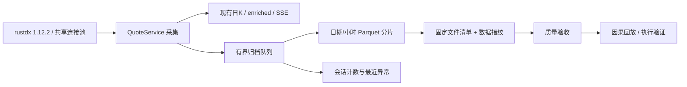

# 秒级行情回测优化与实施方案

基线核验：2026-10-11。项目原生桥接实际安装 `jelven-rustdx-complete 1.12.2`，
源码固定 `904b33e514d4e368e633622c96a9e63af8a53d37`。本方案是对现有系统的
L3 聚焦扩展：保留单 API worker、共享最多 35 条连接、现有日K/分钟K/监控/SSE。

## 1. 数据能力与目标

当前可实现：持续记录 rustdx 轮询快照，按当时可获得的信息回放信号，并验证提交信号之后
的后续快照是否满足保守成交条件。采样目标 1 秒，实际间隔必须实测并报告，不保证每秒都有
新行情。全市场分批采集不是同一交易所时点的原子快照。

不能声称：完整逐笔成交、交易所委托队列、真实排队成交概率、历史秒级数据补齐。
1.12.2 的 `transaction` / `history_transaction` 仍把协议时间解码为 HH:MM；
当前 PyO3 桥接也未暴露这两项能力。禁止把同一分钟的多条成交均匀摊成秒级数据。
`quotes.servertime` 是不带日期的服务器时间，不是经过验证的交易所事件时间。

本次升级分为以下可验收批次：

| 批次 | 交付 | 验收条件 |
| --- | --- | --- |
| A：数据契约 | 源版本、采集时间、源时间原文、推断日期标记、资产类型、累计量额、买卖盘 | 时间/单位测试；无源时间不伪造；版本可追溯 |
| B：持久化 | 有界异步队列、不可变 Parquet、原子发布、会话诊断汇总、停机排空 | 满队列/磁盘故障/发布失败不重复、不无限积压；既有行情链路正常 |
| C：回放与质量 | 固定文件清单及摘要、按采集可见时间回放、区间覆盖和证券覆盖检验 | 午休不报缺口；漏整日/头尾缺失/重复/倒序/陈旧行情可检出 |
| D：执行验证 | 信号后下一有效快照、延迟/陈旧过滤、买卖盘、T+1、历史证券状态、历史卖出印花税 | 不同轮才成交；缺数据拒绝；费用及状态边界有固定样本验证 |
| E：交易时段验收 | 小标的池→全市场→混合分钟负载，连续交易日观测 | 实测吞吐、间隔分位数、覆盖率、积压、磁盘增长；阈值不达标不宣称 1Hz |

批次 A–D 可离线实施、自动化验证。E 需要市场开盘后的真实数据，不以周末测试代替。

## 2. 采集与存储设计



目录：`data/quote_second/date=YYYY-MM-DD/hour=HH/part-*.parquet`。
默认每 10 轮或 10 秒封片，Zstd 压缩；不读取旧文件合并，不刷新日K generation。
分片先写 `.tmp`，完成后原子重命名。写线程单写，回放只读已发布文件。
原子重命名保护文件完整性；内存队列与未封片缓冲在强制杀进程/断电时可能丢失，
这不是零丢失 WAL。研究校验通过时间覆盖发现缺口，不补零、不前向填充。

生产默认归档关闭，显式开启。保留期默认 0（不自动删除研究原始数据），需要滚动删除时
显式设置 1–365 个自然日；可用空间低于 1 GiB 时写线程拒绝该批写入并记录丢轮。
队列最多 30 轮，封片缓冲默认 10 轮；满队列时新一轮立即计为丢失，不阻塞行情线程。
归档失败隔离日K与实时展示，在状态、服务日志和会话 JSON 汇总中可见，不以之后
一次写入成功抹掉历史丢轮计数。磁盘无法写入时诊断 JSON 本身也可能写入失败。

全市场按 5,000 标的 × 14,400 秒估算约 7,200 万行/连续交易日；
包括竞价/收盘观察窗口会更多。容量应以真实压缩后 bytes/row 乘行数和保留天数计算，
不能把行情请求压测结果当作全链路性能。初期先短时开启观察磁盘增长；当前归档跟随
既有行情拉取范围，尚无独立归档证券池开关。

## 3. 时间、单位与来源契约

- `collected_at_ms`：整轮行情对 Python 消费方可见的 epoch 毫秒，回放主时间轴。
- `capture_id`：轮次标识；不当作交易所序号，也不通过 ID 相减估算缺轮数。
- `provider_ts_ms`：provider 原来的 timestamp，只保留其事实；rustdx 当前为本地时间。
- `source_time`：服务器时间原文；`source_ts_ms`：结合采集日期推断或由源显式给出的时间。
- `source_date_inferred`：是否推断日期。日期推断不满足严格交易所事件时间回测。
- `provider_version`：记录 rustdx 版本与固定提交，避免升级后历史输入无从区分。
- `asset_type` 明确区分股票/ETF/指数；价格均为未复权人民币元。
- `volume` 为当日累计手数，`amount` 为当日累计元；不作为单秒成交量。
- 买卖一档价量用于保守执行验证。累计量额增量只能在同日、同源、连续观测且未回退时使用；
  首轮、隔夜、断档、重置不制造正向成交量。

当前归档不增加网络请求；买卖盘利用同一个 quotes 响应。原生按批接收时间和连接等待
分位数属于后续精度升级，不把整轮时间冒充每只证券的接收时间。

## 4. 质量与研究门禁

校验分两种：未给出完整窗口/证券集合时，只报告已观察样本质量，不能认定全天完整；
给定回测起止毫秒与预期证券集合时，检查起点、终点、轮间和证券缺失。
跨日查询必须明确预期交易日，使用实际交易日历；不得把自然日缺失当作休市。

午休和非交易时间不计入秒级采样缺口。源时间不能解析、未来时间、源时间倒退、
重复/倒序轮次、同轮重复证券、非法价格/量额均显式报告。源时间长时间不动和数据完全
重复是不同指标；停牌或无交易可以没有成交，但不能被撮合器当成流动性。

文件列表在一次回放开始时固定，保存相对路径、大小和 SHA-256 指纹。校验和执行共享同一
清单，新增分片不混入运行；原文件被清理/修改则失败，不能静默跳过。
`session-*.json` 保存会话丢轮总数、最近错误和停机状态，不是逐事件缺口日志；
质量门禁以分片内容和窗口覆盖为依据。未知来源版本也不能获得 `ready`。

## 5. 回测语义

先支持“既有信号序列的执行验证”，输入信号发生时间、股票代码、方向、数量。
验证器只使用严格晚于信号且达到延迟要求的后续快照，并要求累计量增量区间的两个
端点都不早于订单到达；跨越下单时点的增量不按比例分摊。买入参考卖一、卖出参考买一，
价量不可用、源时间陈旧、跨越断档、涨跌停封板等情况拒绝/等待。
无法证明排队成交，不模拟在涨停价排队抢板的成功率。

股票执行必须保留历史 ST/上市状态、T+1、最小交易数量与现金/持仓约束；证券历史状态
未知时严格模式拒绝。卖出成本调用现有按成交日计算印花税函数，并包含佣金与滑点。
不能把当天收盘后的 enriched 或当前 instruments 当作盘中已知数据。

当前执行窗口限定一个交易日的一个连续竞价时段（09:30–11:30 或 13:00–14:57），
收盘竞价时段不参与成交。支持沪深股票整百股订单（科创板买入至少 200 股），
暂不覆盖科创板逐股申报、零股卖出或部分成交。订单按信号时间和 ID 排序，共享该轮
成交参与率预算（默认 1%，最大 10%）和同方向盘口量，不能重复消费同一批流动性。
默认佣金万二、最低 5 元，滑点 5 bps；其他费用需并入显式成本假设，目前无独立过户费项。
初始持仓需声明实际取得日期，信号后的同日买入不可用于当日卖出。历史状态还必须在
信号发生前已知（`available_at`）；当前目录和盘后补写记录不能倒填为历史已知信息。

这不是对任意现有日线策略自动升级到秒级的承诺。策略信号仍需声明当时可获得的输入；
跨日资金曲线、复权和企业行为继续由既有回测能力与专门的后续适配处理。

## 6. 验收、发布与回滚

每批执行对应 provider、归档、回放、API 和已有行情回归；检查 Ruff 新增告警及 diff。
真实交易时段报告采集完整率、轮次间隔 P50/P95/P99、丢轮数、写入耗时、队列峰值和
压缩后磁盘增长。以同一负载比较开启/关闭归档，才可报告性能影响。

开关关闭后排空已接收缓冲，历史分片仍可回放。禁用归档不改变既有日K/分钟数据格式；
回滚代码保留 `quote_second`，不得默认删除研究样本。保持单 API worker 部署。

## 7. 操作入口

接口沿用应用现有认证。下列示例使用本地后端默认端口 3018；启用认证的部署请附带
当前会话或有效 Token。开启归档前，实时行情应已开启并选择 rustdx；归档开关只控制
保存现有轮询结果，不会主动开启行情或在休市期间抓取历史秒级数据。

```bash
curl -X PUT http://127.0.0.1:3018/api/settings/preferences/second-quote-archive \
  -H 'Content-Type: application/json' \
  -d '{"second_quote_archive_enabled":true,"second_quote_archive_retention_days":0}'

curl http://127.0.0.1:3018/api/backtest/second-quotes/status
```

停止归档时将 `second_quote_archive_enabled` 改为 `false`，接口等待已接收数据排空。
若仍在排空则返回 409，保持关闭；历史文件保留。
状态中的 `dropped_rounds`、`queued_rounds`、`pending_rounds`、`last_write_ms`、
`queue_peak`、`last_error` 用于现场观测。计数是本进程会话口径，重启后查看旧 session JSON。

查看数据样本（日期与代码应替换为实际已采集数据）：

```bash
curl -X POST http://127.0.0.1:3018/api/backtest/second-quotes/sample \
  -H 'Content-Type: application/json' \
  -d '{"start":"2026-10-12","end":"2026-10-12","symbols":["600519.SH"],"limit":100}'
```

样本接口单次最多 31 个自然日、200 个代码、10 万行，超过行数返回 `truncated=true`；
`capture_id` 为字符串，前端不可转换成 Number。前端统一客户端已提供
`api.updateSecondQuoteArchive`、`api.secondQuoteStatus`、`api.sampleSecondQuotes`、
`api.validateSecondQuotes` 和 `api.validateSecondExecution`，本批未增加独立页面。

质量校验和执行验证可以按北京时间构造毫秒窗口，避免手工填错时区：

```python
from datetime import datetime
from zoneinfo import ZoneInfo
import requests

base = "http://127.0.0.1:3018"
day = "2026-10-12"  # 替换为已采集交易日
def ms(clock):
    return int(datetime.fromisoformat(f"{day}T{clock}")
               .replace(tzinfo=ZoneInfo("Asia/Shanghai")).timestamp() * 1000)

window = {"start": day, "end": day, "symbols": ["600519.SH"],
          "start_ms": ms("09:30:00"), "end_ms": ms("09:35:00"),
          "trading_dates": [day], "expected_interval_s": 1}
quality = requests.post(f"{base}/api/backtest/second-quotes/validate",
                        json=window, timeout=300)
quality.raise_for_status()
print(quality.json())

# 仅示范输入形状：应换成由当时已知数据生成的真实信号。
payload = {"day": day, "start_ms": window["start_ms"], "end_ms": window["end_ms"],
           "orders": [{"order_id": "signal-1", "symbol": "600519.SH",
                       "signal_ms": ms("09:30:10"), "side": "buy", "shares": 100}],
           "opening_lots": [], "config": {"initial_cash": 100000, "latency_ms": 300}}
result = requests.post(f"{base}/api/backtest/second-quotes/execution-validate",
                       json=payload, timeout=300)
result.raise_for_status()
print(result.json())
```

`ready` 只表示请求窗口与所列证券满足采样数据门禁，`exchange_event_time_verified=false`
仍成立。执行接口单次最多 1000 笔订单、200 只股票；数据门禁失败或输入损坏返回 409，
参数不合法返回 422。证券历史状态缺失则返回逐订单 `historical_status_unknown`。
输出包含每笔成交/未成交原因、期末现金/持仓、历史状态文件哈希、输入配置哈希和分片清单；
`exchange_fill_guaranteed=false`，不输出虚构收益率或成交概率。

## 8. 本地验证与后续验收

本轮验收记录：

- 后端全量回归：`2867 passed, 7 skipped`。
- 收尾修正后，秒级归档/回放/执行/API、rustdx Provider、指数兼容与日K定版专项：
  `99 passed`。覆盖类型损坏、未知 ST 标记、信号后完整采样区间、收盘竞价排除、低磁盘丢轮。
- 前端 `pnpm build` 通过；构建仍提示既有大 chunk。
- 新增 Python 文件 Ruff 通过；已修改既有文件相对 HEAD 无新增诊断，既有诊断 138 → 136。
- `git diff --check` 通过。交易时段验收 E 仍待真实开盘数据。

离线合成基准（不访问行情节点，临时数据在结束后清除）：

```bash
cd backend
.venv/bin/python -m scripts.benchmark_second_archive --symbols 5000 --rounds 30
```

该基准测量复制入队、规范化、压缩、写盘和回放校验；输入生成耗时计入写入总时间。
合成证券与价量分布不等于真实市场，输出不能外推为全市场 1Hz 或实际压缩容量承诺。

2026-10-11 本机 macOS 合成基准记录（当时另有回归任务运行，非隔离压测）：

| 指标 | 实测 |
| --- | --- |
| 输入 | 5,000 个合成代码 × 30 轮，共 150,000 行 |
| 生成输入至写盘排空 | 2.452 秒 |
| 复制入队 P50 / P95 | 2.219 / 8.084 毫秒 |
| 输出 | 3 个分片，1,923,529 字节 |
| 校验用时 | 0.295 秒 |
| 进程峰值 RSS | 319.17 MiB（包含运行时与回放） |
| 丢轮 / 排空后积压 | 0 / 0 |

合成输入价格分布固定且重复度较高，12.824 字节/行不能用于正式容量预算；
应使用交易日真实变动数据重新测量。队列峰值 19 轮来自无间隔突发提交，不代表真实 1Hz 积压。

开盘验收依次进行：固定小样本核对来源时钟与量额单位、全市场短窗口归档、同时运行分钟
增量刷新，再观察连续交易日。对照开启/关闭归档的相同负载，记录 P50/P95/P99 间隔、
证券覆盖率、丢轮、进程内存和磁盘增长。新建 1Hz 研究数据窗口要求覆盖率 100%、
无大于 1.5 秒的采样缺口、无不合格源时间与累计量额回退；不达标窗口保留原始记录，
报告原因并拒绝用于严格执行验证。

以上为离线批次完成时的记录。2026-10-11 已按用户要求开启本机归档，并安排以下开盘
并行验收；升级后的真实交易时段结果仍待采集，历史秒级数据不可通过分钟或日K补造。

## 9. 已启用的开盘并行验收

本机持久偏好已生效：`second_quote_archive_enabled=true`、保留期 `0`（不自动删除）、
`realtime_quotes_enabled=true`、`realtime_pull_stock=true`、行情间隔 `1s`、
`minute_refresh_enabled=true`、分钟刷新间隔 `1s`。行情和全量分钟均路由 `rustdx`。
配置的 1s 是目标节奏，实际结果由采样间隔与分钟更新观测决定。

日常秒级采集与归档固定按北京时间每个交易日 **09:15 开始、15:15 结束**：
09:15–11:30、13:00–15:15 运行，11:30–13:00 午休暂停，周末及已公布休市日不运行。
时间区间左闭右开，15:15 起不接收新快照，已入队数据继续封片落盘。
09:15–09:30 的竞价观察和 15:00–15:15 的收盘观察数据均保存；
这两段数据不能直接按连续竞价规则验证成交。每日自动复用上述时间门控，无需逐日开启。
下述 15 分钟并行验收结束后，日常归档继续运行至当日 15:15。

本次观测窗口为北京时间 **2026-10-12 09:30:00–09:45:00**，结束后等待至少 20 秒封片再
生成报告。10 月 12 日是下一候选工作日；是否交易仍由现有服务门控决定。若当天没有行情，
验收会记录缺数据失败，不会凭工作日推定已开市，也不会顺延后冒充原定窗口已完成。

观察器：`backend/scripts/observe_second_acceptance.py`。只读既有归档、分钟分区、必要偏好和
公开 `/api/health`，没有行情客户端、额外连接池或第二套采集任务。交易窗口每 5 秒观测，
健康检查每 30 秒一次；分钟探测仅读 Parquet footer，结束时才做完整证券覆盖检查。
观察器限制 Polars 线程为 2，并以 `nice 10` 降低进程优先级。

本次运行目录（相对仓库根）：

```text
data/research/second_quote_acceptance/20261012-open/
  status.json             # 当前状态和心跳，休市时 queued / waiting_for_market
  launch.json             # 本次后台启动方式、PID 和启动时间
  telemetry.jsonl         # 开盘后的观测记录
  universe.json           # 开盘时冻结的沪深 A 股名单及维表指纹
  manifest.json           # 验收回放固定分片清单及 SHA-256
  minute_quality.json     # 分钟末端覆盖及缺失/滞后证券列表
  report.json             # 完整结果、检查项、指标及限制
  report.md               # 可读结果摘要
  observer.stdout.log
  observer.stderr.log
```

若缺少证券维表、必需开关关闭或错过整个窗口，状态为 `skipped_prerequisite`；执行中断后
重启标记 `interrupted`，不补造遥测。运行异常详情写入 `status.json.error`，此时可能没有
最终报告。正常完成则写入 `succeeded` / `failed` 和报告。验收结束不关闭归档或分钟任务。

验收标准和观测边界：

- 秒级窗口固定完整沪深 A 股名单，单轮覆盖要求 100%，包括停牌证券，不自动剔除问题标的；
  采样间隔超过 1.5 秒、源时间缺失/陈旧/未来、累计量额回退等按既有回放门禁判失败。
- 分钟分区在窗口内必须发生写入变化；窗口结束时至少 99% 的预期证券最新分钟不早于
  09:43，缺失/滞后名单完整保存。重复键、异常未来分钟也判失败。
- 观察器迟到超过 10 秒、观测断档超过 15 秒、运行配置变化、后端不就绪、读盘异常、
  会话报告丢轮或归档错误均不能通过。
- 报告含采集间隔 P50/P95/P99、覆盖率、会话丢轮增量、观测到的写盘耗时分位数、
  队列/缓冲积压及窗口相交分片字节数。会话峰值可能包含窗口外活动，
  每 5 秒采样的写盘耗时不是每次写入的完整耗时序列。
- 本次只测「归档开启 + 全市场行情 + 分钟刷新」场景，没有关闭归档的对照，
  不归因性能开销，不把快照完成间隔当作网络请求耗时或交易所事件时间。

本机以当前工作区已获目录访问权限的进程启动独立后台观察器，启动 PID 为 `27541`，
准确启动记录见 `launch.json`。进程与启动终端脱离，待机时每 30 秒更新心跳。
先前尝试的 LaunchAgent 因 macOS Documents Folder 权限等待未能进入脚本，
已卸载并删除其 plist；没有修改系统隐私权限，也没有保留无效的登录任务。

电脑需保持唤醒、3018 后端需运行；观察器不负责启动后端或唤醒电脑。
关机/退出登录/进程终止后不会自动重启，需要在已有目录权限的终端或工作区恢复。
若仍在窗口前，恢复后继续等待；若窗口已错过或执行中断，按前述状态规则记录。

查看后台任务：

```bash
cat data/research/second_quote_acceptance/20261012-open/launch.json
cat data/research/second_quote_acceptance/20261012-open/status.json
ps -p 27541 -o pid,ppid,stat,etime,comm
```

停止本次观察器（先核对 PID 对应上述脚本；保留归档开关与历史文件）：

```bash
kill -TERM 27541
```

恢复已停止的待命观察器（从 backend 执行；已经运行时不要重复启动）：

```bash
POLARS_MAX_THREADS=2 .venv/bin/python -m scripts.observe_second_acceptance \
  --run-dir ../data/research/second_quote_acceptance/20261012-open
```

终态任务再次启动直接退出，不重复验收。重新安排新窗口须使用新运行目录，不能覆盖旧结果。
独立手动创建待命任务示例（从 backend 执行）：

```bash
.venv/bin/python -m scripts.observe_second_acceptance \
  --arm --data-dir ../data \
  --run-dir ../data/research/second_quote_acceptance/20261012-open \
  --date 2026-10-12 --minutes 15
```

该目录本次已创建，重复 `--arm` 会拒绝覆盖。`--once` 可只执行一次状态推进；不要对运行中
任务另起观察器，同一目录有进程锁。新增观察器及归档/回放/分钟/任务状态专项回归共
`62 passed`，新增 Python 文件 Ruff 检查通过；这些离线检查不代表实盘验收通过。
