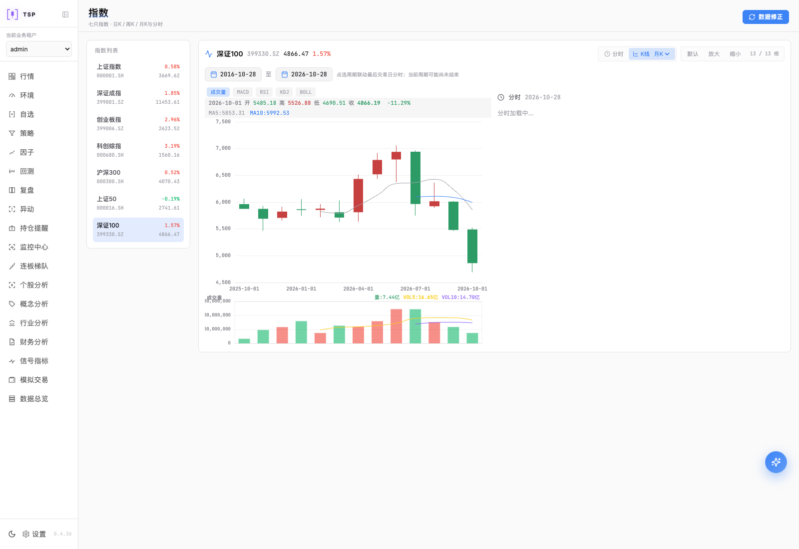
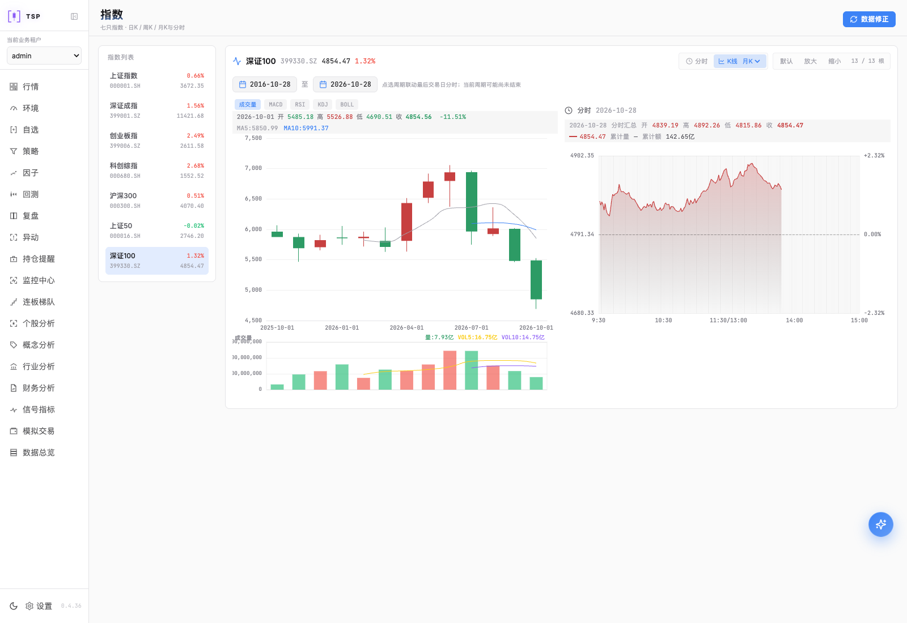

# 主线整合与两端升级验收

验收时间：2026-10-28T05:48:53.964426+00:00。
**已按要求完成主线集成、分支删除、本地升级及线上升级，两端均为v0.4.36。**

固定源码与标签：`1c630cc2d13cf3e2ed545b9a4d9ff5b340d224af`；镜像索引：`sha256:52538c6d70969f49bb222aa96c86865cc779dab54daf45cdd3e53a0ccb48d69e`。
[PR #32](https://github.com/jelven007/TSP/pull/32)已合并，应用版本由main CI自动递增。

| 环境 | 地址 | 实际版本 | 功能就绪 | 自选/分组 |
| --- | --- | --- | --- | --- |
| 本地 | [http://127.0.0.1:3021](http://127.0.0.1:3021) | v0.4.36 | 6项ready | 16/2 |
| 线上 | [https://server.example.com](https://server.example.com) | v0.4.36 | 6项ready | 16/2 |

主线后端4795 passed、9 skipped，前端84文件/451 passed，工具134 passed，
Rust原生6 passed；HTTP流程和自动标签通过，Docker build-and-push成功。
附属质量任务使用已通过的主线CI；promote-latest被工作流跳过后，
已按当前main与确切索引字节完成提升并独立核验。
ARM/AMD压缩层、config、rootfs及应用build-manifest均核对。
本地和线上Runtime/Compute分别携带同一源码，Compute无网络及vectorbt验证通过。

两端升级前完成双库备份、真实恢复、逐表数量及业务摘要对账。
行情原位保留，升级后行数不减少；账号、自选、分组、策略、数据源、
扩展拉取配方、用户已保存的并发和同步时间、注册/找回及SMTP配置保留。
没有重新初始化或用旧数据库覆盖本次期间写入。
本次修复分支的本地和远程引用均已删除；780个其他工作区文件哈希保持，
原报告与修改另存stash及Git bundle。

浏览器验收采用已安装Chrome与Playwright（Browser plugin not available）。
验证实际登录、数据页控件、自选导出/排序、策略页、50%资源预算、
七只指数×日/周/月周期、修正弹窗、浅深色及390px窄屏。
六页只保持一个行情连接，自然换票及关闭持有页后的接管通过；
并发数据状态请求正常，截图与完整读回计数保留。

补采协作退出后按原5222只集合和固定日期区间续采，已有数据保留：

- 本地：`3f4e554afc`，running，2026-08-09～2026-09-09，补遗漏模式。
- 线上：`83de9259fc`，running，2026-04-18～2026-05-18，补遗漏模式。

这些任务状态不代表全部历史行情已初始化完成。本次浏览器记录中的外部GitHub自动更新相关错误为
本地0条、线上0条。
此前独立探测曾返回403；本次固定提交升级已独立核验，自动更新全流程未签收。
9个跳过用例、Windows桌面产物及完整历史覆盖不在本次签收范围。

本地备份：`/path/to/home/.cache/tsp-dev/TSPP/backups/complete-release-20261028-2/local-pre-1c630cc2d13c`。
线上备份：`/opt/tsp-full/backups/pre-v0.4.36-1c630cc2d13c`。
受控完整证据：`/path/to/home/.cache/tsp-dev/TSPP/release-20261028-2`。本报告为部署后本地签收，不另行推送触发版本递增。

