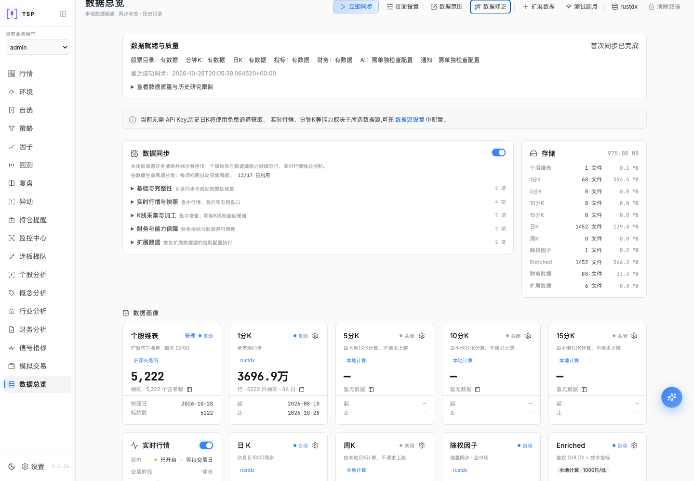
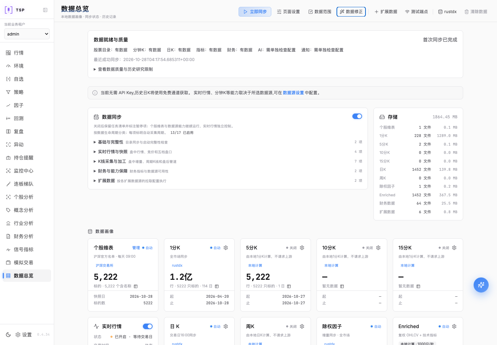

# 本次升级取消与运行环境回滚

核验时间：2026-10-28T04:27:26.187144+00:00。
**本地和线上均为v0.4.34，六项功能ready，管理员实际登录与数据页交互通过。**

本地恢复升级前的源码运行目录、Compute镜像、前端入口和原始Python可编辑包元数据；
所有其他Python包版本保留。线上始终运行原v0.4.34，本次没有进行线上提升。
数据库及行情文件保留当前数据，没有用旧数据库备份覆盖本次期间的写入；
本地日K、画像、分钟及其余行情画像行数均与回滚前比对不减少，配置与秘密哈希核对保留。

| 环境 | 运行版本 | 自选/分组 | 已恢复的分钟任务 |
| --- | --- | --- | --- |
| 本地 | v0.4.34 | 16/2 | 3c3ba6f154（running） |
| 线上 | v0.4.34 | 16/2 | 9e4308689c（running） |

两项因部署准备暂停的手工分钟任务均已在v0.4.34重新开始，
本地区间2026-08-09至2026-09-09，线上区间2026-04-18至2026-05-18。
两端5222只股票集合的哈希与原任务匹配，使用固定原日期区间及补遗漏模式保留已完成记录。
原任务取消记录保留，续采使用新的任务ID；历史补采仍在运行，不代表全部初始化完成。

先前已归并到main的新源码和分支备份保留，仓库源码HEAD为700d25dad13b7b12c678e4443a893886299117a8。
本次回滚恢复的是运行环境；升级执行已停止，暂存源码及镜像文件未被激活。

浏览器验收使用本机Chrome与Playwright（Browser plugin not available），1440×1000；
检查实际登录、页面版本、非空内容、错误覆盖层及打开/退出修正弹窗，没有提交新的修正表单。
首次冒烟脚本未在登录跳转后重新进入数据页，定位断言失败，记录已保留；
修正验收脚本的导航后，两端检查通过。工作区已有代码和文档修改均保留。

末轮线上任务读取曾返回一次503；独立检查确认所有服务容器健康、没有OOM或重启，
随后任务读取和最终签收检查正常，两端续采任务均为running。这不代表历史数据已补齐。

