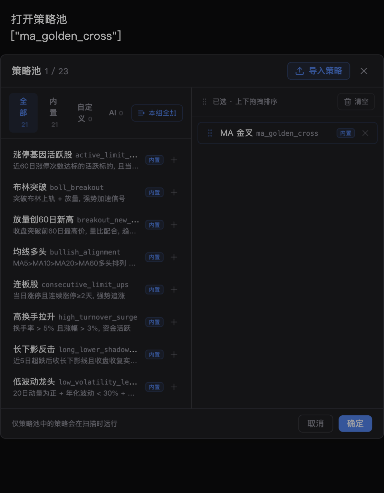
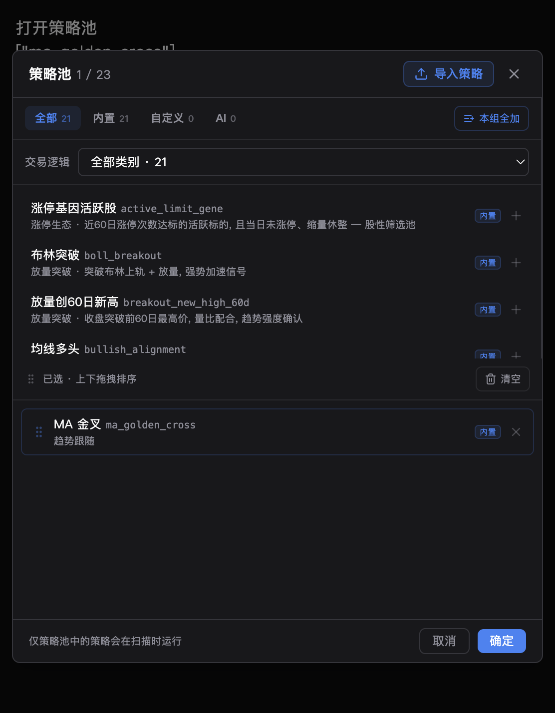
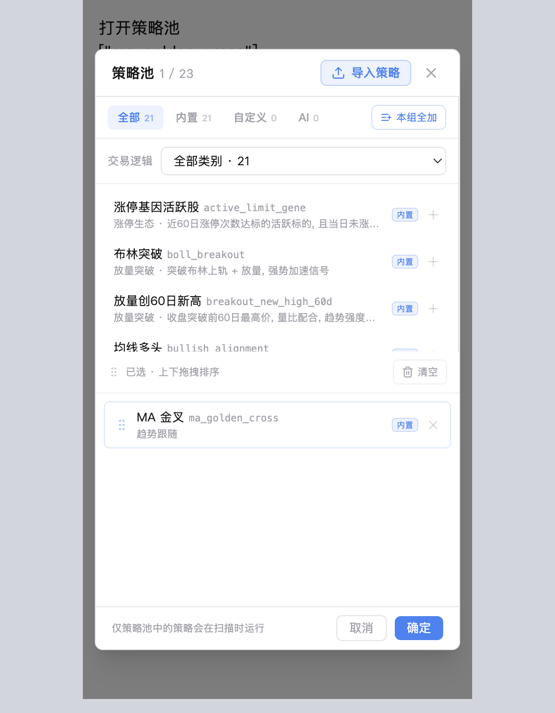
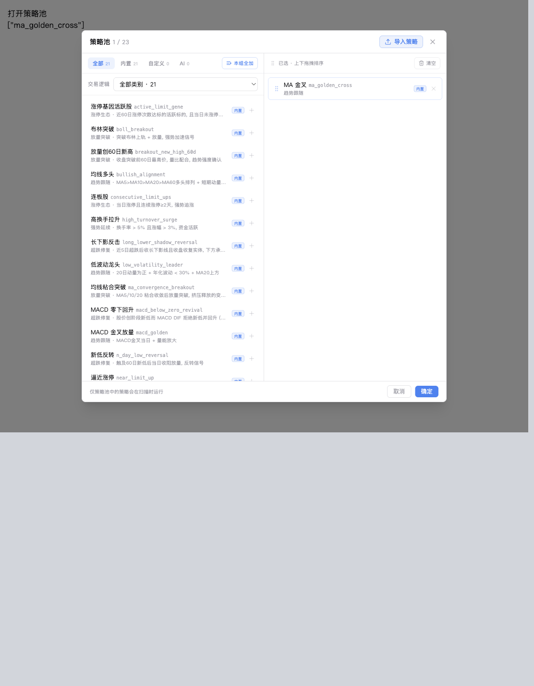

# 验证记录与复现

日期：2026-10-17。源码基线`a95cc9d`，研究分支`research/default-strategies-five-year`。
版本保持0.4.2。本记录的“通过”指对应执行项，不能外推为严格PIT或实盘验证通过。

## 1. 已完成的实际验证

| 执行项 | 结果 |
| --- | --- |
| 元数据阻断复现 | 修复前新增用例2项失败；缺接口、同步未调用补全 |
| Provider及元数据相关回归 | 修复后此前91项通过；最终适用回归再次包含相关模块 |
| 共用计算与MA过滤 | 固定阈值、空RSI、开关、单位兼容、原ID、资产范围及API契约通过 |
| 最终后端适用回归 | **351 passed**，12.44秒；2条存量Polars弃用提示 |
| 前端组件 | **18 passed**，3个文件，含策略池、策略卡、默认参数弹窗 |
| 前端构建 | **pnpm build通过**；存量ECharts大chunk提示仍在 |
| 原22策略/候选研究 | 155份有效结果：训练70、验证39、留出23、连续五年23 |
| 元数据覆盖 | 上市日期、总股本、流通股本均为5224/5224 |
| 快照一致性 | 155份结果记录相同快照SHA256，与当前封存快照一致 |
| 异常价格影响 | 13条标记事件与终审已平仓持仓区间交集0；待退出仓位均0 |
| 逐笔实现一致性 | 6组五年成交列表、净收益、回撤、待退出仓位完全相同 |
| 成交抽查 | 对3笔T+1止损案例核对对应日线OHLC，符合引擎规则；不是全部成交审计 |
| Ruff | 变更文件原有29条、当前29条，按文件/规则/消息比对，**新增0条** |
| 空白与补丁检查 | `git diff --check`通过 |

完整聚合记录与源码哈希见[evidence.json](evidence.json)，155份结果哈希见
[result-hashes.csv](result-hashes.csv)。原始数据、完整逐笔、无信号失败结果和本地
测试日志留在隔离研究目录，不提交Git。

最终后端执行命令（从仓库根目录，`PYTHON`指向已安装项目依赖的解释器）：

```bash
PYTHON=backend/.venv/bin/python
PYTHONPATH=backend POLARS_MAX_THREADS=4 NUMBA_NUM_THREADS=4 "$PYTHON" -m pytest \
  backend/tests/test_rustdx_provider.py \
  backend/tests/test_rustdx_contracts.py \
  backend/tests/test_rustdx_sync.py \
  backend/tests/test_instrument_metadata_preservation.py \
  backend/tests/test_instrument_history.py \
  backend/tests/test_instrument_stock_pool.py \
  backend/tests/test_builtin_strategy_families.py \
  backend/tests/test_strategy_required_history.py \
  backend/tests/test_strategy_saved_params.py \
  backend/tests/test_strategy_param_normalize.py \
  backend/tests/test_screener_builtin_params.py \
  backend/tests/test_strategy_cache.py \
  backend/tests/test_strategy_registry.py \
  backend/tests/test_strategy_realtime_refresh.py \
  backend/tests/test_strategy_scoring.py \
  backend/tests/test_strategy_overlay.py \
  backend/tests/test_composite_strategy.py \
  backend/tests/test_composite_strategy_api.py \
  backend/tests/test_strategy_detail_signals.py \
  backend/tests/test_backtest_etf.py \
  backend/tests/test_backtest_warmup.py \
  backend/tests/backtest/test_matrix_strategy.py \
  backend/tests/backtest/test_strategy_backtest_correctness.py \
  backend/tests/backtest/test_engine_portfolio.py \
  backend/tests/backtest/test_cost_model.py \
  backend/tests/backtest/test_historical_stamp_tax.py \
  backend/tests/backtest/test_limit_down_close_exit.py \
  backend/tests/backtest/test_limit_up_close_fill.py \
  backend/tests/backtest/test_full_simulation_tail.py \
  scripts/test_research_default_strategies.py -q
```

前端实际执行：

```bash
cd frontend
pnpm test -- \
  src/components/screener/StrategyPoolDialog.test.tsx \
  src/components/screener/StrategyCard.test.tsx \
  src/components/screener/DefaultStrategyParamsDialog.test.tsx
pnpm build
```

Ruff对全部变更Python文件逐一执行，并使用`git show a95cc9d:<path>`经
`ruff check --stdin-filename <path> - --output-format json`取得同配置旧诊断，
按文件、规则、消息计数比较。完整检查仍返回29条存量问题，主要在API与标的同步
旧代码，不将其描述为全文件零告警，也未夹带无关格式化。

## 2. 界面与API联调

使用真实`StrategyPoolDialog`、项目样式、Vite代理和真实`strategy.router`。
测试服务只挂该路由，独立临时配置目录与当前内置策略注册表替代运行时依赖，
没有启动全应用生命周期或触发行情同步。对照组件来自`a95cc9d`。
测试页面不提交，测试服务已停止。

实际浏览器操作：

1. 首次请求赶在测试API启动前失败，显示重试提示，“确定”禁用；
   API可用后点击重试，真实列表恢复，已选MA金叉仍在。
2. 下拉出现六类，选择“超跌修复”后只展示该族5个待选策略。
3. 点击“本组全加”，已选变成原MA金叉加5个超跌ID，该族待选归零，批量按钮禁用。
4. 确认回调收到完整原ID数组；重新打开后草稿从已确认值初始化。
5. 清空草稿后取消，已确认的6个ID保留，未发生保存。
6. 390px宽、700px高的浅色页面没有横向溢出，分类、滚动区域和底部操作可见；
   1100px宽桌面为双列、无横向溢出。390/1100检查用固定视口iframe呈现，
   桌面截图按0.5比例展示；交互操作在556px宽直接页面完成，未直接操作iframe。

旧响应缺分类、自定义切换、加载中/失败/重试、空目录和草稿取消另有组件测试。
联调没有覆盖整站登录、真实用户配置持久化或生产部署。

| 修改前，深色556px | 修改后，深色556px |
| --- | --- |
|  |  |

| 浅色390px | 浅色1100px桌面（缩放展示） |
| --- | --- |
|  |  |

## 3. 研究复现

脚本为[scripts/research_default_strategies.py](../../scripts/research/research_default_strategies.py)。
需要可用的rustdx原生桥接和项目Python依赖。一次只运行一个全市场研究进程，
避免矩阵与指标计算争抢内存。以下相对路径均从仓库根目录执行。

优先复用已封存快照；若重新拉取，先将同日导出的以下三个文件放入只读源目录
`.tools/research-source/`，不能将该目录与研究输出嵌套：

```text
instruments/instruments.parquet
instrument_status/history.parquet
financials/shares/part.parquet
```

研究目录只允许新建，或重用带匹配`research_snapshot.json`标记的研究快照；
供应商修订、股票池和采集日期变化可能使新快照无法逐值复现2026-10-17结果。
`enrich-metadata`只对研究目录执行，会检查补齐前后股票池一致，不倒填历史ST状态。

```bash
export PYTHONPATH=backend
export POLARS_MAX_THREADS=4 NUMBA_NUM_THREADS=4
PYTHON=backend/.venv/bin/python
D=.tools/research/default-strategies-five-year
R=reports/default-strategies-five-year-20261017
O="$D/results-v2-metadata"

"$PYTHON" scripts/research_default_strategies.py prepare \
  --source .tools/research-source --data "$D" --provider rustdx --batch-size 160
"$PYTHON" scripts/research_default_strategies.py enrich-metadata --data "$D"
"$PYTHON" scripts/research_default_strategies.py audit --data "$D"

# 必须在第一轮run之前冻结原策略，不能用已优化源码重新冒充基准。
# 对已封存目录不重复提取，先核对evidence.json中的源码哈希。
mkdir -p "$D/_baseline_strategy_code"
git archive a95cc9d backend/app/strategy/builtin \
  | tar -x -C "$D/_baseline_strategy_code" --strip-components=4

"$PYTHON" scripts/research_default_strategies.py run \
  --data "$D" --output "$O" --phase train
"$PYTHON" scripts/research_default_strategies.py run \
  --data "$D" --output "$O" --phase validation
"$PYTHON" scripts/research_default_strategies.py candidates --output "$D/candidates.json"
"$PYTHON" scripts/research_default_strategies.py run \
  --data "$D" --output "$O" --phase train --trials "$D/candidates.json"
"$PYTHON" scripts/research_default_strategies.py select \
  --output "$O" --phase train --target "$D/validation-candidates.json"
"$PYTHON" scripts/research_default_strategies.py run \
  --data "$D" --output "$O" --phase validation --trials "$D/validation-candidates.json"
"$PYTHON" scripts/research_default_strategies.py select \
  --output "$O" --phase validation --target "$D/validation-survivors.json"

# 重放本轮已经登记的邻域与最终名单，不用未来信息重新挑名单。
for PHASE in train validation; do
  "$PYTHON" scripts/research_default_strategies.py run \
    --data "$D" --output "$O" --phase "$PHASE" --trials "$R/neighbors.json"
done
"$PYTHON" scripts/research_default_strategies.py stability \
  --output "$O" --trials "$R/validation-survivors.json" --target "$D/stability.json"
for PHASE in holdout five_year; do
  "$PYTHON" scripts/research_default_strategies.py run \
    --data "$D" --output "$O" --phase "$PHASE" --trials "$R/finalists.json"
done
"$PYTHON" scripts/research_default_strategies.py summarize \
  --output "$O" --report "$D/reproduced-report"
"$PYTHON" scripts/research_default_strategies.py audit-trades \
  --data "$D" --output "$O" --report "$D/reproduced-report"
"$PYTHON" scripts/research_default_strategies.py verify-implementation \
  --data "$D" --output "$O" --target "$D/reproduced-report/implementation-parity.json"
```

上述`run`按快照、参数、源码哈希校验断点结果，拒绝覆盖不同口径文件。终审只接受
`finalists.json`。同一快照重放应核对成交和资金统计；完整JSON还包含运行耗时与
运行标识，新运行文件不要求与原始结果SHA完全相同。哈希主要用于核验留存证据。

## 4. 作者自检与兼容性

- L3范围：显式Provider元数据补全、内置策略小粒度共用计算、MA过滤、
  API分类字段、真实策略池筛选与必要研究工具；没有复制撮合引擎。
- 元数据从Provider进入同步服务，经已有原子写入和SCD2记录，再由既有流水线生成
  enriched。没有把网络请求放入实时名称查询；rustdx复用已有有界并发和财务缓存。
  首次补全增加显式同步工作量，没有声称本次提高同步性能。
- 策略过滤不保存研究期间的用户配置。参数默认与已有override合并，关闭新过滤
  可恢复原规则；策略缓存、参数签名、重载、实时刷新及ETF回归已覆盖。
  公共辅助文件沿用现有本地依赖加载及定义哈希机制。
- API分类可空，不改ID、历史策略文件或参数单位。前端分类不增加列表请求；
  加载失败时保留旧列表并禁确认，避免依据失败响应确认空草稿。
- 没有改应用版本、锁文件或真实用户目录，没有推送、合并和生产发布。
- 已检查完整变更及调用链；适用测试通过，未发现本次改动的阻断回归。
  后续合并仍应复核同时修改的策略注册/校验与API契约；本次未执行跨平台打包、
  全仓全量测试、真实租户端到端或实盘交易验收。

回滚：MA过滤可通过参数关闭；Provider补全为可选方法，失败沿用旧有效元数据。
需要完整回滚时撤回相应提交，不删除现有用户文件、不逆向修改已积累的历史状态。
生命周期文档已更新`docs/strategy.md`与`docs/plugin-development.md`。
