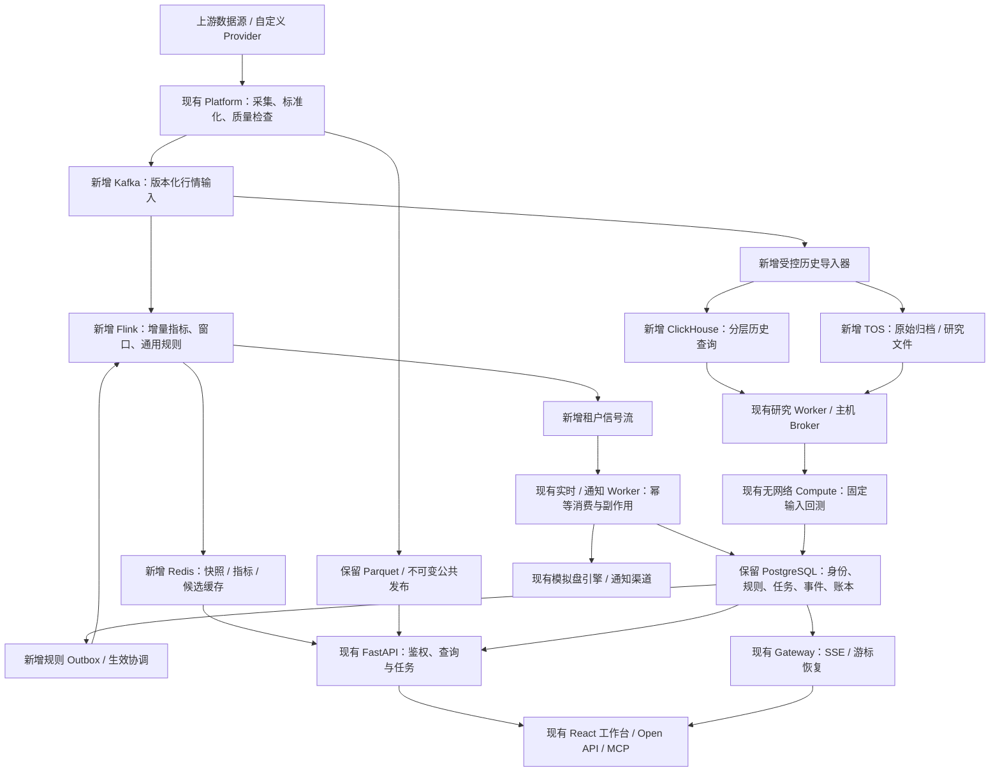
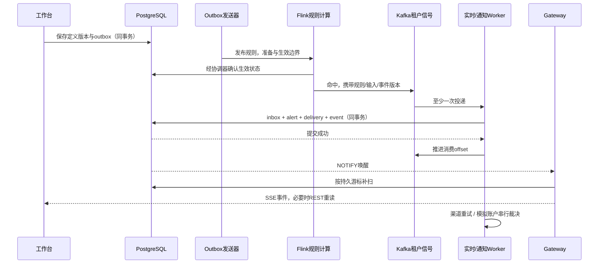
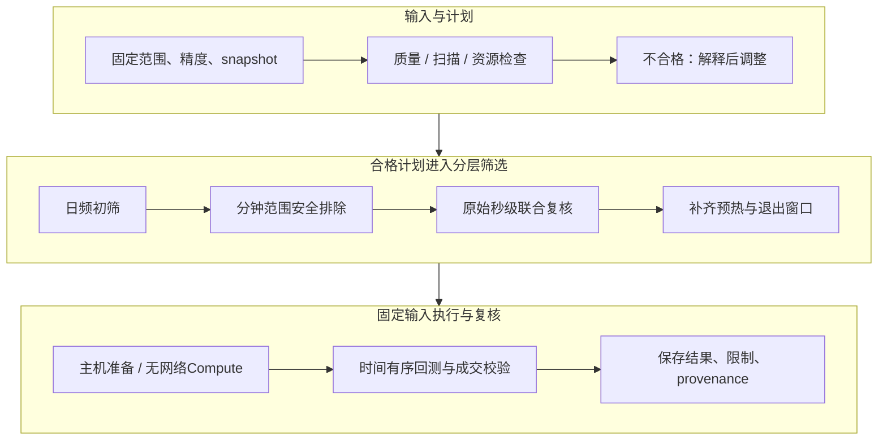

# TSP 融合技术方案

**融合现有量化工作台与 Kafka / Flink / ClickHouse / Redis 实时数据架构**

方案日期：2026-10-23。当前应用基线：0.4.17；源码：`cc837b95f471e5b299bf5e8618332d500bff7e3a`。本文面向产品负责人、架构师、研发与运维，作为后续实施的技术设计输入。

**推荐采用“保留业务引擎、升级数据底座、按阶段切换”的融合路径。** 沿用 TSP 的 Provider、指标、策略、因子、回测、监控、模拟盘、AI、租户及开放 API；以 Kafka 承接可重放输入，Flink 承接适合流式执行的增量计算，ClickHouse 承接历史分析，Redis 承接可重建热缓存，TOS 承接原始归档和研究文件。PostgreSQL 继续保存身份、规则、任务、事件与模拟盘账务。

本文中的新增主题、字段、发布协议和部署形态均为**目标设计**，不表示当前代码已有相应 API，也不表示已经部署或通过真实负载验收。

## 1. 决策结论、范围与状态

### 1.1 建设目标

融合方案服务三个业务闭环：全市场秒级观察与监控；十年历史筛选与可复现研究；监控结果驱动的模拟盘前向观察。用户上传的参考图提供采集、队列、流计算、查询存储、缓存和通知主链路，当前 TSP 提供成熟的领域引擎与产品入口。[1](#cite-1)[2](#cite-2)[3](#cite-3)

具体建设目标是：采集结果由多用户共享；基础行情更新不被复杂指标、磁盘写入、研究和通知拖慢；历史数据按版本发布并可追溯；规则修改有明确生效边界；故障和缺口可以识别；已有工作流在新底座不可用时仍有清楚的降级路径。

### 1.2 推荐架构决策

| 决策 | 推荐方案 | 解决的问题 |
| --- | --- | --- |
| 业务引擎 | 保留现有模块化领域服务，按职责运行 | 避免重写策略、因子、回测、公司行为和模拟盘规则 |
| 输入日志 | 目标采用 Apache Kafka | 为独立消费者、削峰、重放与故障追踪建立统一边界 |
| 流计算 | 目标采用 Apache Flink，先迁移通用增量和受控规则 | 行情聚合、窗口与过程监控独立运行 |
| 历史查询 | 目标采用 ClickHouse，复用已交付八表设计 | 用日频、分钟索引与秒级明细分层查询十年数据 |
| 热缓存 | 目标采用 Redis，版本化发布 | 快照、指标和候选池快速读取且可以整体重建 |
| 私有事实 | 保留 PostgreSQL 双库、租户隔离与事务 | 规则、任务、告警、通知、事件和模拟账本保持一致 |
| 文件与归档 | 保留 Parquet；目标增加火山引擎 TOS | 低成本保存原始文件、研究输入、结果和备份 |
| 推送 | 保留 SSE 和 REST 恢复；WebSocket 为条件扩展 | 复用当前票据、权限轮换和游标续接契约 |
| 研究扩展 | 先复用 Worker / Broker / Compute；Ray 按需求引入 | 批量实验扩容，同时保持资源和执行隔离 |

### 1.3 当前事实与目标边界

| 状态 | 本方案中的内容 |
| --- | --- |
| 已实现 | React / FastAPI 工作台；八类 Provider 能力；Polars / DuckDB / Parquet；策略、因子、回测、监控、模拟盘；多租户 PostgreSQL；SSE；受限研究 Compute |
| 部分实现 | 公共快照共享、秒级归档、增量指标、固定研究输入、证券状态历史和短窗口秒级研究，仍有规模、可信度或恢复边界 |
| 目标新增 | Kafka、Flink、ClickHouse 应用接入、Redis、TOS、大规模快照发布与统一质量治理 |
| 条件扩展 | Ray、Iceberg、WebSocket、Kubernetes、多主机高可用、秒级宽表额外投影 |
| 本次交付 | 技术设计、架构图、组件清单、阶段任务、验收与回滚条件；未实施新增组件 |

当前有 19 个基础菜单、22 个公开策略、77 项内置因子、25 个 DSL 算子、69 个开放方法／路径契约及 12 个 MCP 工具。数量是本次源码基线的目录事实，不是新增架构的性能指标。普通租户不显示“数据”菜单。当前应用不能据此被描述为已提供十年全市场秒级研究。[2](#cite-2)

系统范围继续覆盖研究、监控和模拟交易。券商接入、实盘 OMS、共址高频、逐笔队列推断及历史秒级数据补造不在本方案范围。最后已知生产记录为 0.4.11 / `092bd79c` / schema v6；本次未重新探测生产，不能将本地方案视作线上状态。

## 2. 参考方案与现有 TSP 的融合映射

### 2.1 参考图的真实结构

参考图从秒级快照、分钟 K 和基本信息进入采集层；Kafka 按证券组织输入；Flink A 聚合分钟，Flink B 用 Broadcast State 匹配规则；PostgreSQL 经 `market.rules` 提供规则；ClickHouse 保存原始／K 线与维表；Redis Hash 保存最新值，Set 保存筛选结果；`market.signals` 驱动通知、去重、聚合、重试、告警持久化和 WebSocket；应用提供回测、复盘、策略和自选。[1](#cite-1)

图 1：用户提供的 TSP 技术架构参考图，原始分辨率 6331 × 5070。

### 2.2 融合后的职责调整

| 参考图 | 当前 TSP 对应能力 | 融合处理 |
| --- | --- | --- |
| 采集与标准化 | Platform / QuoteService / Provider 能力路由 | 保留唯一采集职责及八类能力，增加版本化事件出口与质量证据 |
| Kafka 行情输入 | 进程内传递、文件归档、公共 marker | 新增可重放日志；迁移期一个来源采集后双路输出，避免重复拉源 |
| Flink 分钟聚合 | 分钟 Provider、增量指标与策略协调器 | 区分快照分钟统计和可信分钟 K；逐项验证后迁移可流式指标 |
| Flink Broadcast 规则 | 现有监控配置和规则求值 | 规则由业务库事务发布；版本、生效边界和消费确认独立设计 |
| ClickHouse 原始／分析表 | Parquet / DuckDB 与已有八表方案 | 新增分析路径，保持 Repository 接口及固定输入语义 |
| Redis Hash / Set | 后端内存缓存、公共快照、前端 Query 缓存 | 新增可重建的不可变缓存版本及指针，不保存唯一事实 |
| 通知与 alert_signal | Notifications Worker、租户事件与通知记录 | 沿用事务和隔离，增加输入幂等及渠道重试证据 |
| WebSocket | Gateway / SSE / REST 游标恢复 | 保留 SSE；出现双向需求后单独设计 WebSocket |
| 回测／复盘／策略／自选 | 当前工作台及研究引擎 | 复用业务定义与成交语义，替换数据访问底座 |
| 基本信息维表 | 当前目录、SCD2 状态、财务／股本 | 增加历史可得性检查；当前维表不直接用于十年前回测 |

融合的关键增补是**数据质量、历史可得性、租户隔离、版本一致性和副作用幂等**。这些要求直接影响金融结果正确性，需要进入数据与执行协议，不能只作为运维说明。[4](#cite-4)

## 3. 目标总体架构与运行平面

### 3.1 总体架构

图中标为“新增”的组件均属于目标；已有模块继续复用领域代码。各平面可以分阶段接入。

图 2：融合总体架构。研究 Worker／Broker 在主机侧准备输入，Compute 不直接访问数据库或对象存储。

### 3.2 四个运行平面

**在线数据平面**负责采集、输入日志、快照、增量指标和通用监控，优先保护行情新鲜度。**业务控制平面**负责身份、授权、规则版本、任务状态、通知和模拟账本，以 PostgreSQL 事务为事实边界。**历史研究平面**负责归档、版本发布、筛选、回放和实验，使用独立队列、资源预算与数据读取限额。**访问平面**由 API、Gateway 和前端组成，按权限与版本读取结果。

平面之间使用有界接口。研究不能直接抢占实时执行槽；浏览器不能直接持有 Kafka、ClickHouse、TOS 或 PostgreSQL 凭据；Flink 计算结果不能直接绕过模拟盘引擎写资金。

### 3.3 当前七类角色如何演进

| 当前角色 | 保留职责 | 新底座接入后变化 |
| --- | --- | --- |
| Platform | 唯一行情写入、同步和公共发布 | 增加统一事件出口，继续管理 Provider 与授权 |
| API | 认证、领域接口、任务提交、结果查询 | 经适配层读 Redis / ClickHouse，保留版本和错误语义 |
| Gateway | 一次性票据、SSE、租户事件恢复 | 公共数据仍推 marker；私有事件仍走持久游标 |
| Research Worker | 固定输入与研究编排 | 增加范围计划、分块读取、对象文件准备 |
| Realtime Worker | 租户监控、模拟盘裁决 | 消费已验证流式结果，复杂策略继续受控计算 |
| Notifications Worker | 渠道路由与投递 | 消费事务 delivery 记录、幂等重试和回执 |
| Scheduled Worker | 盘后管道、复盘与定时任务 | 调度导入、校验、归档、重建与引用清理 |

完整模式默认 API 四进程，16 GiB 配置覆盖为两进程；Gateway 单副本，Platform 单写。独立模式仍是单 API 主进程，不能直接增加共享 `DATA_DIR` 写副本。新增分布式底座不会自动解除这些现有运行约束。[2](#cite-2)

## 4. 技术组件产品选型与版本策略

### 4.1 产品清单

| 层 | 产品／技术 | 状态与用途 | 选择理由／约束 |
| --- | --- | --- | --- |
| Web | React 18、TypeScript、Vite | 现有页面与构建 | 保持页面、路由和领域 API 契约 |
| Web 状态与图表 | TanStack Query、Tailwind CSS、ECharts、lightweight-charts | 现有缓存与行情图 | 批量查询、按范围失效；不重复实现金融计算 |
| API 与领域 | Python 3.11+、FastAPI、Pydantic v2 | 现有后端 | 继续保持薄 API 与统一服务层 |
| 行情接入 | rustdx 1.12.2、PyO3；TickFlow／自定义 Provider | 当前源及能力路由 | 源能力、限速和时间证据分别验证 |
| 本地计算 | Polars、DuckDB、PyArrow、Numba；回测边界 pandas | 现有向量化与文件计算 | 热路径不扫描全历史；可选依赖不阻断主流程 |
| 业务数据库 | PostgreSQL 16，控制库＋业务库，schema v6 | 已有事实与 RLS | 新表通过幂等迁移增加，不手工宣称 schema 已升级 |
| 输入队列 | Apache Kafka，KRaft 部署或兼容托管服务 | 目标，行情与规则日志 | 核实消息语义、保留、授权、客户端和运维能力 |
| 流处理 | Apache Flink | 目标，状态／窗口／受控规则 | Kafka connector、状态恢复与 UDF 语义联合验收 |
| 分析数据库 | ClickHouse，单节点或复制分片形态 | 目标，八表历史模型 | 自建复制形态另需 ClickHouse Keeper；托管形态不套用自建 DDL |
| 热缓存 | Redis，独立实例起步 | 目标，可重建缓存 | 不用 Pub/Sub 承担持久事件恢复 |
| 对象存储 | 火山引擎 TOS；通过受控兼容适配访问 | 目标，Parquet、结果、备份与 checkpoint | 区域、API 兼容、权限、费用和恢复行为实测 |
| 研究调度 | 现有 Worker / Broker / Compute；Ray 可选 | 现有＋条件扩展 | Ray 只并行独立实验，硬限制仍由进程隔离执行 |
| 交付部署 | Docker Compose、现有 Edge；Kubernetes 可选 | 当前单机＋后续扩展 | 先职责与预算隔离，再按证据增加编排复杂度 |
| 可观测性 | Prometheus＋Grafana；OpenTelemetry 可选 | 建议新增 | 优先接入核心时延、积压、质量和资源指标 |

### 4.2 版本如何落定

现有依赖以源码锁文件和镜像为准。新增组件在阶段试点时锁定具体补丁版、镜像摘要、客户端和 connector 组合，生成兼容矩阵与回滚清单。本文采用官方文档解释语义，**不把文档版本当作已经选定的生产版本**。

Kafka、Flink、JDK、connector 与 checkpoint 存储需要一起验证；ClickHouse 自建复制版与托管版需要采用各自支持的部署契约；Redis 若改用 Cluster，脚本的多键原子性必须检查同一 hash slot。TOS 的 S3 生态兼容不能替代所需 API 的实际验证。[10](#cite-10)[11](#cite-11)[18](#cite-18)

Iceberg 暂不作为默认依赖。只有跨引擎表级版本管理、开放湖表互操作或目录治理成为明确需求时才增加，避免同时维护 Parquet manifest、ClickHouse snapshot 和湖表三套未经验证的发布机制。

## 5. 采集事件契约、时间与数据质量

### 5.1 唯一采集与统一事件出口

所有通用访问继续经过 Provider 能力路由，不在 Flink、API、策略或浏览器硬编码供应商协议。八类能力为 `daily`、`adj_factor`、`corporate_actions`、`minute`、`full_minute`、`realtime`、`depth5`、`financial`；固定四指数保留产品级契约。[4](#cite-4)

Platform 在完成代码、单位、日期、资产和字段校验后生成事件。迁移期同一轮采集同时输出旧路径和新日志，使用共同 `capture_id` 对照，不能让两套采集器各自轮询来源后声称输入一致。

Kafka 接受确认之前的数据仍处于采集进程故障风险中。若要求覆盖此窗口，需新增本地持久 spool，并定义 fsync、重放、序号与磁盘满行为；当前有界秒级归档队列不能当作断电零丢失日志。

### 5.2 建议的行情事件字段

以下是**拟新增标准事件**，需经 Schema、Provider 与消费者契约评审后实现。

| 字段组 | 建议字段 | 语义 |
| --- | --- | --- |
| 身份 | `schema_version`、`event_id`、`capture_id`、`capture_batch_id` | event_id 重试稳定；capture_id 是采样标识，浏览器按字符串接收 |
| 数据归属 | `asset_type`、`instrument_id`、`symbol`、`trade_date`、`session` | 股票、ETF、指数和交易时段显式区分 |
| 来源 | `provider_id`、`provider_route_version`、`source_kind` | 区分接收快照、可信源快照、可信分钟和逐笔 |
| 时间 | `received_at`、`observed_at`、`provider_at`、`source_at`、`source_time_verified` | 记录接收与实际观测；来源时间保留证据与未知状态 |
| 原始价量 | `last_price`、`prev_close`、`day_open/high/low`、`cum_volume_shares`、`cum_amount_yuan` | 未复权价格；日内累计量额；未知保持 NULL |
| 口径 | `unit_contract_version`、`price_basis` | 比例小数、金额元、股数；与 enriched 百分数口径显式转换 |
| 质量与范围 | `quality_mask`、`universe_version`、`input_valid` | 质量位图版本化；输入有效不等于历史 PIT 合格 |

盘口现有内部数量为“手”，导入新事件若用股则在边界乘 100 并校验；不能改旧接口后让前端再乘一次。enriched 的换手率为百分数值，目标比例列显式除以 100；不能根据数值大小猜单位。

新事件用带时区瞬间；既有分钟 naive datetime 明确解释为北京时间后转换，输出旧 API 时继续遵守墙钟契约。所有窗口明确左闭右开、交易日和午休边界。

### 5.3 全市场采样不是原子瞬间

一次批量采集可能分多批、耗时不同，Kafka 也只提供分区内顺序。每轮保存预期证券集合、起止时间、批次数、实际／有效证券、缺失项和源端覆盖证据，形成 `capture_manifest`。市场统计引用该范围版本及输入截止，不宣称所有证券在同一毫秒完成。

行情轮询节奏、源时间新鲜度与证券是否有成交分别度量。停牌、无成交和 Provider 失败不能混为一个状态。源时间未知时可提供接收快照观察，但不能标为已认证的交易所事件时间。

### 5.4 快照分钟、可信分钟与累计量

Flink 对每分钟采样的 last_price 可以计算“已保存样本的开／高／低／收范围”，但无法恢复采样间真实价格。快照的 `day_high/day_low` 是日累计值，不能作为分钟高低点。由快照得到的分钟结果进入 `quote_1m_envelope` 或采样统计，不进入严格 `bar_1m`。

可信分钟 K 来自声明相应能力、满足时间与 OHLCV 覆盖契约的源。严格分钟回测只读取已完成、已可得且质量合格的 `bar_1m`。缺失分钟不能靠前填变成可信输入。

累计成交量／额的短窗增量只在同日、同源、连续且非回退的端点之间计算。断链、重启、源切换或累计回退时重建基线，缺口标记为未知；不能把每秒的累计额直接累加成市场成交额。

## 6. Kafka 输入与 Flink 增量计算

### 6.1 主题、分区和日志语义

| 拟新增主题 | 内容 | Key 与隔离 | 消费与保留原则 |
| --- | --- | --- | --- |
| `market.snapshots.v1` | 标准化公共采样快照 | 资产＋证券稳定 key | 实时计算、归档和重放；保留覆盖最大恢复窗口 |
| `market.bars.v1` | 已声明口径的分钟／日线事件 | 资产＋证券＋周期 | 可信与采样类型显式字段，不混用 |
| `market.features.v1` | 已版本化公共指标与统计 | 定义＋范围／证券 | 可从输入重建，带输入截止及质量 |
| `market.rules.v1` | 已授权规则更新／禁用墓碑 | scope＋规则 ID | 保留版本；支持快照重建与单调更新 |
| `tenant.signals.v1` | 租户监控命中与证据 | 租户＋账户／规则 | 私有流，服务鉴权；不进入公共行情流 |
| `tenant.events.v1` | 可选业务事件转发 | 租户＋事件序号 | PostgreSQL 事实的派生转发，不能替代恢复表 |

参考图的 `market.signals` 在融合后明确区分公共派生结果与私有租户信号。共享 topic 的 Kafka ACL 通常不能按消息行执行租户 RLS，因此消费者只能是有权内部服务；浏览器与租户不能直接订阅。敏感隔离要求提升时采用独立 topic／集群边界。

Key 只保证相同分区内排序，不保证全市场总序。批次完整性依赖 manifest；历史输入记录 topic、分区、起止 offset 向量和采集版本。扩分区会改变 key 路由，需定义路由代次并排空／重建状态；源切换同样不能直接沿用旧累计与穿越基线。[10](#cite-10)

生产者采用稳定事件 ID、幂等配置、批量发送与必要确认；消费者在持久结果提交后推进 offset。Kafka 日志与外部 PostgreSQL／Redis／通知不是一个跨系统事务，“Exactly Once”必须限定具体算子和 sink，不能作为整条业务链路的笼统承诺。

### 6.2 Flink Job 分工

| Job | 输入与输出 | 执行边界 |
| --- | --- | --- |
| A：观测与统计 | 快照 → 最新观测、质量、累计差分、分钟样本范围、市场统计 | 每证券 keyed state；交易时段、源切换、覆盖分母明确 |
| B：通用指标 | 合格行情／完成周期 → 增量指标与状态 | 定义、参数、预热版本冻结；暂定柱不能反复推进已完成周期 |
| C：规则监控 | 行情／指标＋规则控制 → 信号候选 | 仅受控阈值、穿越、连续窗口及验证过的 DSL 子集 |
| D：历史落地 | 行情日志 → 尚未发布的历史段与原始归档 | 有界批写、重试台账；发布由独立屏障控制 |

复杂矩阵策略、自定义 Python、AI 生成策略与回测仍在现有领域引擎／Compute 中执行。迁移某项规则需要旧、新引擎在同一输入上验证数值、时间、缺口、冷却和重启行为；不能直接将现有 25 个 DSL 算子视作全部具备 Flink 等价实现。

过程型规则需要完整顺序和状态。当前 StrategyGroupCoordinator 是一个活动任务加一个 latest-only 待处理快照、物理并发 1；它适合合并重复工作，不保证消费每个观测。因此无损连续窗口不能直接复用其丢旧快照语义。

### 6.3 事件时间、watermark 与迟到

来源时间经过证据认证时，Flink 可使用该事件时间；否则采用观测时间窗口并在结果中明确“采样统计”。Watermark 需要处理各输入分区的乱序和空闲状态，不能用某个证券长时间无成交直接认定整个分区 idle。[11](#cite-11)

迟到容忍、窗口结束、修订和输出定版按指标定义配置并验收。实时输出可以是暂定值，严格研究发布只接受定版和完整质量证据。迟到数据若修订旧信号，进入新的修订版本；不静默重写已通知记录或模拟盘已成交事实。

### 6.4 规则发布与明确生效边界

规则编辑先在 PostgreSQL 事务中保存不可变定义版本及 outbox。发送器投递更新后，计算器按单调版本处理；删除／禁用也使用墓碑。Broadcast State 的消息到达顺序在并行实例间可能不同，更新函数必须确定且能拒绝旧版本。[12](#cite-12)

**规则保存成功与全局计算生效分开显示。** 新协议依次执行：准备规则 → 必要预热 → 计算实例确认 → 选择可验证采集边界 → 生效。边界可以是批次与分区 offset 向量；按证券分片时记录各 key 生效证据。协调器在确认后记录生效状态，失败保持准备／未生效，而不是声称 Broadcast 瞬时切换全部实例。

规则量按租户、作用域、输入依赖与计算分片有界分发，避免广播每个租户的全部规则。Flink Broadcast State 在每个并行实例中占有内存，需量测规则数量和更新频率。涉及已有 keyed state 的重置／迁移时，核实实际语言 API 与 connector 能力；官方文档指出部分 keyed-state 操作在 PyFlink 中并非全部支持。[12](#cite-12)

## 7. ClickHouse、TOS 与十年研究发布

### 7.1 数据归属和事实边界

| 数据 | 主存储 | 派生／缓存 | 修订方式 |
| --- | --- | --- | --- |
| 身份、授权、规则、任务、告警、账本 | PostgreSQL | API 缓存、可选事件转发 | 业务事务、追加事实和版本 |
| 在线最新行情／指标／候选池 | 可重放输入＋计算状态 | Redis、现有公共快照 | 重建新缓存版本 |
| 原始秒级及历史导入文件 | TOS Parquet / 现有文件归档 | ClickHouse 明细 | 新不可变数据段，保留输入证据 |
| 日频特征、分钟索引、历史信号 | ClickHouse | 受控查询结果缓存 | 按依赖重建新段并发布 |
| 固定研究输入与结果 | manifest＋TOS／受控本地文件＋PG 元数据 | Compute 暂存 | 固定版本，不原位覆写 |

### 7.2 复用八张逻辑表

复用现有《ClickHouse 十年历史数据表设计》的八表模型及查询契约；本次不再生成平行 DDL。[6](#cite-6)

| 表 | 粒度与用途 |
| --- | --- |
| `instrument` | 稳定证券 ID 与代码映射，ID 不复用 |
| `instrument_state` | 有效期与修订可得时间下的证券状态 |
| `quote_second` | 每证券实际采样，保留质量与采样顺序 |
| `quote_1m_envelope` | 已保存样本的分钟范围与覆盖，用于安全排除 |
| `bar_1m` | 已完成、可信分钟 K |
| `feature_1d` | 版本化日频特征，用于小表初筛 |
| `signal_event` | 固定定义的稀疏历史信号 |
| `research_manifest` | 快照到表、变体、日期与 segment 的固定映射 |

事实表采用月物理分区、交易日逻辑段，按查询模式设置排序键。单证券秒级读取以 segment／证券／观测时间排序，全市场筛选优先读日期／分钟及定义索引。ClickHouse PRIMARY KEY 是稀疏索引，不提供 PostgreSQL 式唯一约束；导入与发布检查负责业务唯一性。[14](#cite-14)

### 7.3 发布屏障与修订

新段经历“分配 ID 与冻结来源 → 导入 → 去重与质量检查 → 派生数据构建 → shard／可读 replica 到位 → manifest 到位 → PG 发布”。查询只接受 PG 已发布的 snapshot；数据或清单不完整的副本从可读集合排除。ClickHouse 插入确认、Distributed 队列和 PG 状态不能当作跨系统原子事务。

失败段保留不可读状态；恢复时核对导入台账，无法证明重试幂等则以新段重建。旧快照仍指向旧段。后台去重和插入去重窗口不能替代永久唯一校验，也不默认依赖 `FINAL` 或 ReplacingMergeTree 获得研究正确性。

增量物化视图按插入块触发，源修订、分区替换和去重不会自动撤销旧聚合。严格历史派生结果先从合格原始段完整构建，再与原始段一起发布；实时物化视图如采用，另行定义重复、迟到和重建语义。[15](#cite-15)

日频修订影响后续 MA 窗口，EMA 等递推指标可能影响更长区间；修订范围由依赖图决定。历史证券状态、股本、成分、财务公告和复权锚点纳入版本。`available_at` 表示历史时点何时可知，`published_at` 表示当前研究版本何时发布，二者不能互换。

### 7.4 TOS 前缀、冷热与引用保护

建议分别设置 `raw/`、`releases/`、`research/`、`checkpoints/`、`backups/`，每类对象保存清单、校验摘要、格式与保留政策，分配最小权限。对象上传完成与研究发布分开，不能仅凭某个前缀存在文件就开放查询。

TOS 原始 Parquet 与 ClickHouse 对象存储中的 MergeTree part 属于不同格式和生命周期，不直接共用同一批文件。冷归档对象先恢复再进入查询／计算准备，恢复期间任务显示等待恢复；冷归档不能被描述为实时在线查询层。[18](#cite-18)

清理依据活动任务、研究快照、公共 release、备份和 checkpoint 引用。不能仅按对象年龄删除被引用文件，也不能因月分区中的一个旧版本过时就删除整个分区。目标快照引用新建资源目录，与现有文件 generation／release 不混为同一种不可变保证。

## 8. 监控、通知与模拟盘闭环

### 8.1 从规则到外部副作用

图 3：规则生效、告警持久化和副作用时序。计算器的状态确认通过受控协调服务写库。

### 8.2 幂等、冷却与通知

候选信号携带租户、规则定义版本、证券、方向、窗口／采样边界、输入版本和稳定 event_id。实时 Worker 在同一事务写入 inbox 唯一键、alert、delivery 和租户事件 outbox，提交后推进 Kafka offset。进程在事务提交后、offset 提交前崩溃，重试命中唯一键即可恢复，不形成第二条告警。

“本次命中事件”“规则冷却”“渠道投递尝试”分别建模。聚合通知保存包含的事件 ID，重试不重新求值规则，不更改触发时点。外部渠道可能已接收而回执丢失，应传递支持的幂等键并保留不确定状态；不承诺任意邮件／Webhook 端到端恰好一次。

PostgreSQL NOTIFY 只用于唤醒，提交后的持久事件表用于恢复。Redis Pub/Sub 是 at-most-once，断线丢消息，不能替代持久游标。[13](#cite-13)[16](#cite-16)

### 8.3 模拟盘继续使用既有领域事实

Flink 输出候选或意图，Realtime Worker 按账户和周期串行裁决，再调用现有模拟盘引擎。同股多买保留主策略及全部归因，退出优先；待卖未成交不释放额度。共享资金、持仓、待成交单、风险预算和公司行为以业务库事实为准，Redis 候选 Set 不具备账务权威。

目标消费协议将需要执行的模拟盘意图与 inbox 同事务保存为持久待办；执行器以账户、信号事件和动作类型组成幂等键，在账户事务中完成订单创建与待办状态推进。这样即使告警已入库、执行订单前进程退出，恢复仍可续跑；重复消费也不会重复创建订单。该接线需要新增实现，不能仅以告警 inbox 已存在就跳过未完成的模拟动作。

价格、T+1、涨跌停、数量单位、手续费、滑点、可卖量与未平仓口径保持一致。陈旧／partial 策略结果保留退出约束，不产生新开仓。公司行为日期证据不足、源修订冲突或权益未核对时暂停相关账务／撮合；不能用复权因子替代现金和股份权益。[4](#cite-4)[9](#cite-9)

已成交事实不因迟到指标或规则改版重算。回放验证与实时模拟使用不同 run_id 和隔离账本；恢复重放默认不重新发送渠道通知或重复创建订单。

## 9. API、Redis、租户与前端契约

### 9.1 Redis 版本化缓存

参考图的 Hash 与 Set 保留，但新增不可变版本和 metadata。建议 key 包含租户／公共范围、定义版本、输入版本、资产和结果版本，例如 `pub:{scope}:snapshot:<version>`、`tenant:{scope}:selected:<definition>:<input>:<version>`。这是设计示例，不能据此推断当前代码已有该键。

构建完整 Hash／Set 与 meta 后验证证券覆盖、规则版本和输入截止，最后原子切换 current 指针。读取方先获取版本，后续分页与详情携带同一版本，避免 Hash 已新、Set 仍旧的混合结果。采用 Redis Cluster 时，多键 Lua／事务必须处于同一 slot；跨 slot 采用受控元数据协议，不假定天然原子性。

缓存失效或丢失时优先保留现有有效快照并显示版本与陈旧状态，再从日志／权威结果重建。无法取得一致版本时返回明确不可用，不能把空缓存显示成全市场零结果。Redis 不存储唯一告警、唯一模拟账本或唯一研究输入。

### 9.2 API 适配与响应

继续由 FastAPI 统一鉴权和领域服务访问。新 Repository 适配器负责将 ClickHouse／Redis 数据映射为现有类型；涉及新增查询范围、快照解析与研究任务的接口单独版本化设计，不虚构已存在的扩展 API。[5](#cite-5)

目标响应增加或明确：输入 snapshot／generation、定义版本、输入截止、范围／有效分母、质量状态、结果完整性及分页游标。预算截断、完整结果、待续、缺数据和失败不能都返回相同空列表。页间使用固定快照，快照过期时通知用户重新查询，而非继续混页。

已有 Open API scope 与 MCP 范围保持服务端权威；新路径存在不自动对 Token 开放。管理员访问私有业务仍需明确目标租户；服务侧拦截未授权 scope，缓存 key 和持久任务均带租户上下文。

### 9.3 前端和 SSE

前端继续使用集中 `api.ts`、`queryKeys.ts` 和共享查询。目标支持服务端筛选／排序、大列表虚拟展示、按可见证券与字段批量读取；基础报价、指标、统计分别展示真实输入截止，保持上一份有效值。

保留 60 秒一次性 SSE 票据及确认游标。正常授权轮换换票续接；真实身份／租户变化取消旧请求、清理旧范围缓存并重挂载应用树。慢消费者收到 `events_reset` 后只重读受影响的权威 REST 查询。公共行情推更新 marker，由 API 按版本按需读取，不向每名用户全量广播 6,000 行。[7](#cite-7)

WebSocket 仅在双向订阅控制、操作协同或额外协议需求得到确认后设计；需要复用相同授权与恢复证据，不因参考图采用 WebSocket 就替换现有 SSE。

## 10. 历史研究、AI 与执行隔离

### 10.1 分层研究流程

图 4：分层历史研究。优化可以减少读取，不能改变策略因果语义。

日频初筛只适用于与决策时间相容的条件；不得以当日收盘特征筛掉当日上午本应可入场的证券。分钟 envelope 只能安全排除不可能命中的范围，联合条件最终在同一原始采样行验证。涨幅和换手率在一分钟各自超过阈值，不证明它们在同一秒共同成立。

连续窗口、均线穿越和退出策略保留完整预热与后续时间过程。共享资金组合按时间推进，分块携带现金、持仓、订单、权益、退出意图及指标状态，不能将证券独立收益简单拼成真实组合。

### 10.2 固定输入与执行计划

研究记录固定 snapshot、segment 清单、数据／定义／参数哈希、源路由、源码、依赖、日历、复权及执行语义。首次采集前未知证券状态、历史财务修订缺证据和退市池不完整继续作为研究限制；固定输入保证复测一致，不单独证明历史真实。

运行前生成计划：证券／日期／时间窗口、列、预热、候选范围、预估读取、CPU／内存／磁盘、对象恢复与超时。超预算时分块或让用户调整范围；不能简单扩大当前 31 天／200 证券／10 万样本行的短窗口 API，把海量结果装进 HTTP 响应。[3](#cite-3)

### 10.3 Worker、Broker、Compute 与 Ray

有权 Research Worker／主机侧输入准备器从 ClickHouse／TOS 读取、校验并暂存固定输入；Broker 通过 Unix socket 创建无网络、无数据库／对象存储凭据的短生命周期 Compute。输出通过受控目录和协议返回；计算完成、取消、超时、身份变化后复核任务状态，迟到输出不能发布到其他租户。

Ray 仅在独立参数实验、fold 或互不共享资金状态的任务需要多机调度时引入。CPU／memory 等资源声明是逻辑调度约束，不是物理隔离；硬 CPU／内存／网络／进程约束仍由 cgroup、容器及 Broker 执行。[17](#cite-17)

当前已有 Broker 受限沙箱不意味着未来 Ray 任务自动获得相同约束。新增执行器必须验证进程树、取消、磁盘配额、退出回收和无凭据边界。

### 10.4 AI 与扩展

AI 继续调用已授权工具与研究任务，不直接访问基础设施凭据。策略生成、回测、诊断与修改形成草稿，用户显式保存后进入策略池；AI 无法替代样本外检验或历史数据质量认证。历史会话只恢复记录，不恢复未确认动作。

Provider 扩展、声明式分析页、现有前后端注册入口继续复用。目标 Repository 或任务执行器如需新接口，按实际调用链提取小粒度协议；不能假设当前已有通用 `ScoringPolicy`、`RiskPolicy` 或 `MonitorConditionEvaluator` 插槽。[5](#cite-5)

## 11. 部署、容量、成本与可观测性

### 11.1 三种部署形态

| 形态 | 组件与资源边界 | 使用条件 |
| --- | --- | --- |
| A：轻量／当前完整单机 | 现有七角色、PG 双库、公共文件、Broker / Compute；Redis 可先试点 | 当前规模及盘中隔离优化；不要求默认安装全部大数据组件 |
| B：在线与研究分离 | 业务／在线主机＋独立 ClickHouse／历史导入／对象存储；Kafka / Flink 按阶段增加 | 历史扫描和回填已影响在线负载，或固定研究容量需要扩展 |
| C：分布式目标 | Kafka 复制、Flink 可恢复部署、CH 分片复制、业务与研究资源池、PG／网关对应 HA | 有真实容量与恢复目标，完成全依赖故障演练和运维接管 |

Kafka／CH 复制不能单独使业务高可用。Platform 写主、Gateway 票据、PG、Broker、规则协调与发布控制也需要各自故障切换协议。当前单主机七角色并不等于跨主机 HA，本文不声明未经演练的 RTO／RPO。

16 GiB 现有配置将七类应用角色限制为 8,704 MiB，单 Compute 为 2,048 MiB，API 两进程；不能把剩余内存全部分给 Kafka、Flink、CH 和 Redis。新增组件先部署独立资源池，再按实测预算评估同机方案。

### 11.2 容量规划公式

以固定 **6,000 证券、每日 270 分钟观察、1 秒采样、2,500 交易日**作为规划输入，不代表历史每天都有相同证券数量或完整数据。

| 数据粒度 | 规划公式 | 结果 |
| --- | --- | --- |
| 秒级，270 分钟观察 | 6,000 × 16,200 ÷ 1 | 97,200,000 行／日 |
| 秒级，十年规划 | 97,200,000 × 2,500 | 243,000,000,000 行 |
| 秒级，仅 240 分钟连续竞价 | 6,000 × 14,400 ÷ 1 | 86,400,000 行／日 |
| 日频特征 | 6,000 × 2,500 | 15,000,000 行 |
| 分钟，每日 240 根 | 6,000 × 240 × 2,500 | 3,600,000,000 行／表 |

现有观察范围为 09:15–11:30、13:00–15:15，合计 270 分钟。分钟 envelope 与可信 bar 是两张表，若均存完整范围则分别计费；后者的分钟数量按可信交易时段契约计算。历史容量最终用实际交易日与当时证券集合逐日求和。

秒级主体存储 = 行数 × **实测压缩字节／行** × 数据副本数。另加索引、投影、派生表、修订保留、合并临时空间、Kafka 日志、Flink 状态、TOS 原始副本、备份与研究暂存。字节／行须用代表性真实样本量测，未填实测值时不输出磁盘数字。

Kafka 原始写入约为 N ÷ 采样间隔条／秒；吞吐字节按实测消息大小计算，磁盘按保留秒数、压缩和副本测量。Flink 内存按证券状态、窗口、规则数、并行广播副本和 checkpoint 测量；Redis 内存按实际 key／字段／Set 与版本重叠测量。

### 11.3 更新目标与成本

PRD S1 的规划目标是：价格／常用指标按秒、统计按 1–5 秒、已完成分钟指标按分钟；这些是待验证的刷新目标，不能当作端到端 p99 时延承诺。[3](#cite-3)

从源返回、标准化、Kafka 确认、Flink 输出、缓存切换、API 响应到浏览器分别记录耗时。只有在实际 6,000 证券、代表性规则、在线用户、并发研究、归档和盘后导入混合负载下签收，才能给出硬件规格和吞吐承诺。

月成本按计算实例、块存储、对象存储类型／请求／恢复／流量、数据库、备份和运维分别估算。云产品报价、压缩率、持久性宣传数字不能直接转为 TSP 成本或 SLO。先取得真实用量与当期区域价格，再填预算表。

### 11.4 核心指标

| 链路 | 必须观测的指标 | 结果用途 |
| --- | --- | --- |
| Provider／采集 | 轮询间隔、源／接收时间差、批次耗时、覆盖率、限速、错误与缺口 | 区分源陈旧与内部积压 |
| Kafka | 生产确认、分区 lag、保留余量、失败重试、磁盘、重放范围 | 判断恢复窗口与输入损失风险 |
| Flink | 输入／输出速率、watermark lag、checkpoint 耗时／失败、状态量、规则确认 | 判断状态恢复和规则生效 |
| Redis／API | 缓存版本年龄、混版拒绝、重建、响应时间、返回行数、查询完整性 | 判断展示是否来自一致输入 |
| ClickHouse／TOS | read_rows／bytes、查询内存／耗时、part／merge、导入队列、恢复等待 | 限制扫描、回填与冷热成本 |
| PG／Worker | 连接等待、事务耗时、outbox／delivery lag、幂等冲突、RLS 拒绝 | 避免数据库池拖垮业务 |
| 研究／Compute | 排队、资源峰值、暂存、取消退出、任务中断与输入版本 | 验证隔离和复现 |
| Gateway／通知 | SSE 连接／reset、游标滞后、渠道成功／失败／不确定 | 验证恢复与外部副作用 |

## 12. 故障恢复与降级策略

| 故障 | 必须发生的行为 | 恢复证据 |
| --- | --- | --- |
| Provider 失败／源时间未知 | 保留有效展示并标陈旧／未知；停止缺证据的新信号 | 源恢复后建立新连续基线，缺口范围留档 |
| Kafka 不可写 | 明确缓冲／spool 状态；满容量时记录损失，不静默丢弃 | 重放 stable event_id；覆盖检查证明接续范围 |
| Flink 重启／checkpoint 失败 | 未完成结果不发布；延迟／质量可见 | 从 checkpoint 与 offset 恢复，规则／副作用幂等复核 |
| Redis 丢失／缓存混版 | 读旧有效版本或明确不可用，不返回伪造空结果 | 从固定输入重建整版后切指针 |
| ClickHouse replica／shard 缺数据 | 从可读集合排除；无法完整查询则失败 | 数据及 manifest 均到位后再纳入 |
| 发布中断／导入重复 | snapshot 保持未发布，旧 snapshot 继续可用 | 唯一性、跨表、覆盖及副本检查通过 |
| PG 不可用 | 私有触发与账务无法提交时停止副作用 | 数据库恢复后按 inbox／outbox 续跑 |
| 外部通知失败／回执丢失 | 保留已持久信号，delivery 独立重试或标不确定 | 渠道回执与幂等键，而非重新生成信号 |
| SSE 断线／慢消费者 | 换票游标补扫或 reset 后 REST 重读 | 不漏租户权威状态、不串租户 |
| Compute 超时／取消／强杀 | 释放资源，禁止迟到成功发布 | 执行体退出、任务最终态及输出清理 |
| 磁盘满／低空闲／冷对象未恢复 | 暂停受影响写入／任务，保留当前有效发布 | 空间、引用、恢复状态确认后受控续跑 |

备份覆盖 PG 双库、公共数据版本、规则／任务元数据、对象清单、账本、配置与必要密钥管理材料。RTO／RPO 由业务要求及实际恢复演练落定；需验证数据库、输入日志、对象、Flink 状态和代码版本之间的匹配，不能只测试单个数据库 dump 成功。

## 13. 分阶段实施、验收与回滚

### 13.1 阶段任务及依赖

S0–S3 与当前 PRD 的建设阶段对应，内部子阶段是技术任务顺序，不对应预先增加的应用版本。应用版本按远程 main 集成后的 CI 规则推进。[3](#cite-3)[4](#cite-4)

| 阶段 | 实施内容 | 前置与出口 |
| --- | --- | --- |
| S0：现状与契约 | 冻结基线；采集／时间／单位／质量审计；实时与研究混合基准 | 明确源能力、历史缺口和成本；现有工作流可复核 |
| S1-A：在线隔离 | 基础热快照先发布；指标预热和分频；归档／通知／研究隔离；Redis 可重建试点 | 慢计算和慢写盘不拖慢基础行情；版本一致 |
| S1-B：输入日志 | Kafka 与事件 schema；单采集双输出；稳定 ID、offset、覆盖和重放 | 故障／磁盘满损失可识别；旧、新输入一致 |
| S1-C：流式规则 | Flink 通用统计与规则；outbox、生效协调、checkpoint、信号 inbox | 逐项等价；乱序／缺口／重启／禁用边界验证后切换 |
| S2-A：历史底座 | CH 八表接入、TOS、导入台账、版本与副本发布屏障 | 半发布不可读；修订不改旧输入；真实历史范围签收 |
| S2-B：分层研究 | 范围／预算计划、日频→分钟→秒级、分块固定输入、UI 与任务 | 候选完整性、因果、复现、成本和取消验证 |
| S3：规模扩展 | 批量实验、多主机资源池；Ray、CH 扩分片、HA 按触发条件建设 | 全链路混合负载与故障演练，运维可接管 |

S2 可以先于 S1-C 建设，不要求为了历史查询先迁移全部实时规则。Kafka 全量切换依赖 S1-B；Flink 规则切换依赖已验证日志与生效协议；大规模任务依赖 S2 发布与输入计划。

### 13.2 关键验收矩阵

| 验收域 | 必须覆盖的用例 | 通过证据 |
| --- | --- | --- |
| 数据契约 | 比例／百分数、股／手、原价／复权、跨日午休、空值与累计回退 | 固定样本数值、时点和质量断言；新旧语义一致 |
| 采集与覆盖 | 6,000 规划池、分批缺证券、源陈旧、限速、源切换 | 每轮 manifest、实际节奏／覆盖，源未知不冒充新鲜 |
| 窗口与规则 | 乱序、迟到、idle、缺口、连续 N 秒、版本乱序、删除、准备失败 | 同输入旧新结果对照，明确规则生效边界 |
| 缓存与 API | 发布中读取、Hash／Set 混版、失效重建、固定分页、预算截断 | 完整性和版本断言，无漏／重页或伪空结果 |
| 研究发布 | 半批插入、重复、断点、不可用副本、manifest 缺日、修订传播 | 不合格段不可读，旧 snapshot 不变 |
| 因果与回测 | 联合条件、日频未来信息、预热、退出、共享资金、T+1、公司行为 | 参考实现逐项对照，未平仓和证据不足明确 |
| 租户与执行 | 缓存串读、跨 scope、迟到响应、取消、强杀、凭据／网络访问 | 无越权，执行体回收，迟到结果不发布 |
| 副作用与恢复 | 提交后未提交 offset、重复信号、通知回执丢失、SSE reset | 一次业务事实、可解释投递尝试、游标恢复 |
| 性能与资源 | 归档慢盘＋研究扫描＋实时规则＋并发用户＋盘后导入 | 分段 p50／p95／p99、峰值资源、积压与质量记录 |
| 收盘与盘口保护 | 暂定收盘、源权威定版、同日五档缺证据、缓存切换 | 临时展示不触发交易、不覆盖权威日线 |

本矩阵是后续实施的验收要求，**不是本次已执行的应用测试清单**。此前百用户、回填、SQL 小夹具和文档测试只作为有日期的历史证据，不能代替新增架构签收。

### 13.3 切换与回滚

新旧引擎先在同一采集输入上影子运行，新的通知／模拟交易副作用保持关闭；比较数值、时间、质量和事件集合。达到约定窗口和失败用例标准后，按指标／规则／租户范围切换，任一范围仅有一个副作用执行者。

切换前记录当前规则版本、生效边界、任务、缓存版本、数据 snapshot、消费者 offset 与账务状态。回滚在线查询可以切回旧读路径；回滚计算需重新建立连续基线；已经通知／已成交的事实保留，不能通过回滚代码抹除。含新账本或新 schema 的回退必须恢复匹配代码与数据。

历史查询适配器故障时可退回已有范围的 Parquet／DuckDB 工作流，但不能伪装提供旧路径没有的十年秒级容量。退回只读旧 snapshot 后停用新写入任务，保留证据和引用，清理另行执行。

## 14. 证据、开放决策与交付说明

### 14.1 实施前需要补齐的证据

| 决策项 | 当前方案默认 | 落定所需证据 |
| --- | --- | --- |
| 秒级来源与历史覆盖 | rustdx／自定义 Provider 能力中立 | 源端授权、实际节奏、时间认证、退市池与历史精度覆盖 |
| 秒级明细入库范围 | 按查询需求选择 CH 范围；原始文件独立归档 | 热／冷查询比例、真实压缩字节、预算及保留政策 |
| Kafka／Flink 规模 | 独立资源试点，版本锁定 | 消息大小、规则状态量、峰值输入、恢复窗口 |
| Flink 语言与规则子集 | 通用受控规则先行 | DSL 等价、状态 API、connector、UDF 与恢复验证 |
| HA 与硬件 | 不预设未经实测的规格或 RTO／RPO | 混合负载、故障演练、容量与运维成本 |
| Ray／Iceberg／WebSocket | 条件扩展 | 独立实验并发、湖表互操作或双向交互的真实需求 |

这些项目可以在阶段试点中落定，不阻止当前方案作为技术评审输入。每项新证据需记录日期、数据规模、环境、版本和结果。

### 14.2 交付与验证边界

交付含同正文 Markdown 与自包含 HTML、用户参考原图、三张融合图的 Mermaid 源与导出 SVG、容量计算器、来源索引与交付验证记录。运行脚本、字体和资源均在包内；外部来源链接用于查证，报告浏览不需要外部运行资源。

容量计算器只计算规划行数及输入实测字节后的秒级主体容量，不生成硬件承诺、云费用或数据覆盖结论。本次文档验证结果见 [交付验证记录](交付验证.md)；当前架构事实文档和应用版本保持原基线。

### 14.3 来源与依据

官方技术文档查阅日期为 2026-10-23；文档说明产品语义，不构成 TSP 已集成证据。仓库证据路径、摘要与 SHA-256 记录在 [本地证据索引](evidence/baseline.md)。

1.  用户提供，TSP.png 技术架构参考图。对应采集、Kafka、Flink、CH、Redis 与通知结构。[原图](assets/reference-TSP.png)
2.  TSP，当前架构与当前实现索引。对应技术栈、部署角色和已实现能力。[证据索引](evidence/baseline.md#current)
3.  TSP，0.4.17 需求基线。对应 S0–S3、实时、研究、质量和范围。[证据索引](evidence/baseline.md#requirements)
4.  TSP，贡献、数据与版本规范。对应标准化、成交、缓存、测试及版本规则。[证据索引](evidence/baseline.md#contracts)
5.  TSP，二次开发指南。对应实际扩展点和目标 API 边界。[证据索引](evidence/baseline.md#extensions)
6.  TSP，ClickHouse 十年历史八表设计。对应分层查询、日段与发布屏障；此前小夹具验证不作为本次新实测。[证据索引](evidence/baseline.md#clickhouse)
7.  TSP，实时网关契约。对应 SSE 票据、游标与 reset。[证据索引](evidence/baseline.md#gateway)
8.  TSP，秒级研究、五档与收盘完整性契约。对应当前可信度和保护边界。[证据索引](evidence/baseline.md#quality)
9.  TSP，策略、模拟盘和公司行为契约。对应研究与事实账务。[证据索引](evidence/baseline.md#execution)
10.  Apache Kafka，设计与消息语义。分区内序、offset、交付语义。[官方文档](https://kafka.apache.org/41/documentation/#semantics)
11.  Apache Flink，Time and Order in Streams。事件时间与 watermark。[官方文档](https://nightlies.apache.org/flink/flink-docs-stable/docs/concepts/time/)
12.  Apache Flink，Broadcast State。并行更新乱序、确定性与状态限制。[官方文档](https://nightlies.apache.org/flink/flink-docs-stable/docs/dev/datastream/fault-tolerance/broadcast_state/)
13.  Redis，Pub/Sub。at-most-once 与断线消息丢失。[官方文档](https://redis.io/docs/latest/develop/pubsub/)
14.  ClickHouse，Choosing a Primary Key。排序和稀疏索引。[官方文档](https://clickhouse.com/docs/best-practices/choosing-a-primary-key)
15.  ClickHouse，Incremental Materialized View。插入块触发和适用边界。[官方文档](https://clickhouse.com/docs/materialized-view/incremental-materialized-view)
16.  PostgreSQL 16，NOTIFY。事务提交与持久表配合。[官方文档](https://www.postgresql.org/docs/16/sql-notify.html)
17.  Ray，Resources。逻辑资源不提供物理限制。[官方文档](https://docs.ray.io/en/latest/ray-core/scheduling/resources.html)
18.  火山引擎，TOS 产品说明。对象存储、生命周期、冷归档恢复与兼容生态；所需 API 尚需集成实测。[产品文档](https://www.volcengine.com/product/tos)
