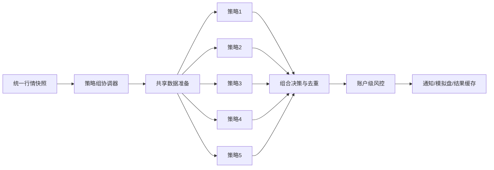

# 五策略并行运行优化方案

日期：2026-10-19  
设计基线：`feat/strategy-quality-upgrade@2ed85de195d11a0f00f988f3d7d5541557c6d068`  
应用版本：`0.4.9`（本地方案不手工递增版本）

文档状态：本文件保留原始设计目标。阶段1—3已按
[实施记录](implementation.md)落地；阶段4的配置/状态API、前端编组和多租户任务
尚未实现。性能目标和完整交易日指标仍是验收门槛，不是当前实测结论。

## 1. 结论

推荐新增一个轻量的 **StrategyGroupCoordinator（策略组协调器）**：

1. 一次行情更新只产生一个不可变快照；
2. 5个策略共享同一份当前行情、历史窗口和市场矩阵；
3. 策略求值可以有界并行，但数据准备、组合决策、风险预算和下单必须单路确定性执行；
4. 同一股票被多个策略命中时只形成一个账户决策，保留全部策略归因，不叠加仓位；
5. 新快照到来时只保留最新待算快照，不形成无界积压；
6. 任一策略失败或快照过期时，默认禁止本轮新开仓，但继续处理存量退出和待卖意图。

**不能把 `strategy_run_all_workers` 直接改成5。** 当前源码已有有界线程池，但默认值为1。
项目内实测表明，Polars内部已经并行，外层4线程运行41个策略时发生CPU超订，
总耗时299.6秒且慢于串行；渐进式策略页也明确采用单飞队列，避免两份
Polars/Numba重计算同时运行导致卡死或崩溃。

因此，本方案中的“并行”首先表示 **5个策略同时处于运行状态、使用同一快照完成同一轮求值**，
而不是强制启动5个线程或5个进程。物理并发度由基准测试在1和2之间选择；
即使最终并发度为1，也能通过共享计算、快照合并和统一账户决策达到稳定的五策略并行运行语义。

## 2. 范围与假设

### 2.1 首版支持

- 每个策略组包含1—5个唯一策略；
- 同一资产类型、周期、日期和股票池；
- 首版为股票日线策略；
- 支持现有 `polars_expr`、`filter_history` 和 `matrix_native` 执行路径；
- 观察、通知和模拟盘运行；
- 单账户统一资金、仓位、待成交占用和退出意图；
- 单机模式与多租户Cell模式保持同一领域契约。

### 2.2 首版不支持

- 日线与分钟策略混跑；
- 叠加策略的实时执行；当前代码已经明确对 `composite` 实时监控 fail-closed；
- `research_only` 草稿；
- 五个独立进程各自加载一份全市场矩阵；
- 同股多策略命中后自动放大仓位；
- 真实券商自动下单；
- 行业额度、相关策略组额度和账户回撤自动降档。

分钟和叠加策略应在后续按独立数据时钟、撮合时点和容量模型建设，不能为了满足“5个”
而绕过当前能力门控。

## 3. 设计时能力与缺口

下表记录实施前的代码基线，用于解释方案来源；阶段1—3完成后的实际状态以
[实施记录](implementation.md)和当前源码为准。

| 领域 | 当前已具备 | 主要缺口 |
| --- | --- | --- |
| 批量选股 | `StrategyEngine.run_all`支持共享上下文、共享矩阵及可选线程池 | 默认串行；渐进式路径逐策略调用；没有策略组生命周期 |
| 页面渐进计算 | 单飞队列、相同请求搭车、快策略先返回、逐策略落缓存 | 全局一次只跑一个批次；策略组状态和快照身份不完整 |
| 实时监控 | 多条策略规则可同时启用；矩阵策略同轮共享实时矩阵快照 | 规则仍逐条执行；同一策略多规则可能重复求值；非矩阵策略历史窗口可重复加载 |
| 行情 | 一次全市场快照；监控在取数锁外执行 | 监控仍运行在行情工作线程，重计算会延长下一轮取数 |
| 模拟盘 | 账户锁、持仓/待买占用、总敞口、T+1、待卖重试 | 不同自动规则可对同一预留标的各下一单；缺组合级冲突裁决 |
| 多租户 | 按租户租约、指纹、无网络计算容器和事务提交 | 五策略应在一个租户任务内共享计算，不能拆成5个容器任务 |
| 状态发布 | 策略实时结果采用临时容器后原子替换 | 缺完整策略组周期状态、部分失败和丢弃快照指标 |

关键源码依据：

- [`backend/app/strategy/engine.py`](../../backend/app/strategy/engine.py)：`run_all`、
  共享矩阵和有界线程池；
- [`backend/app/services/strategy_run_queue.py`](../../backend/app/services/strategy_run_queue.py)：
  单飞队列、渐进返回和历史耗时排序；
- [`backend/app/strategy/monitor.py`](../../backend/app/strategy/monitor.py)：
  多规则评估、实时矩阵共享和结果原子替换；
- [`backend/app/services/quote_service.py`](../../backend/app/services/quote_service.py)：
  行情快照、监控、通知和模拟盘调用链；
- [`backend/app/strategy/paper_auto.py`](../../backend/app/strategy/paper_auto.py)：
  自动规则排序、配仓、订单和退出意图；
- [`backend/app/multitenancy/runtime.py`](../../backend/app/multitenancy/runtime.py)：
  多租户快照、计算容器、租约和事务提交。

## 4. 目标架构



架构分三层：

1. **共享输入层**：行情、历史、指标、证券状态和市场矩阵只准备一次；
2. **策略求值层**：最多5个只读策略任务，禁止修改共享上下文；
3. **组合执行层**：统一去重、冲突裁决、风险预算、订单幂等和结果发布。

组合执行层必须保持单线程或单事务。它是账户正确性的串行化点，不是性能瓶颈。

## 5. 运行时设计

### 5.1 策略组定义

新增内部版本化契约，不建设通用插件框架：

```json
{
  "schema": 1,
  "id": "primary",
  "enabled": true,
  "strategy_ids": ["s1", "s2", "s3", "s4", "s5"],
  "asset_type": "stock",
  "timeframe": "1d",
  "scope": {"kind": "all"},
  "mode": "shadow",
  "priority": ["s1", "s2", "s3", "s4", "s5"],
  "same_symbol_policy": "single_position",
  "conflict_policy": "exit_wins",
  "complete_cycle_required_for_entry": true,
  "max_positions": 8,
  "max_total_exposure_pct": 60
}
```

约束：

- `strategy_ids`长度1—5且不重复；
- 顺序是确定性优先级的一部分，不对ID排序后丢失语义；
- 所有策略必须支持相同资产、周期和作用域；
- 禁止 `research_only`；
- 首版拒绝分钟和叠加策略；
- 配置保存时解析所有策略依赖，缺数据能力立即拒绝，不到运行时静默跳过。

现有 `strategy_monitor_ids` 保持读取兼容。迁移时：

- 0—5个旧ID可生成默认策略组；
- 超过5个时不截断、不偷偷选前5个，明确要求用户调整；
- 原监控规则和历史告警保留，策略组只接管运行编排。

### 5.2 不可变周期身份

每一轮生成 `StrategyCycle`：

```text
cycle_id =
  tenant/account + group_id + asset_type + timeframe
  + quote_sequence + captured_at + data_release_id + plan_hash
```

`plan_hash`至少包含：

- 有序策略ID；
- 策略定义哈希；
- 参数、override和入场政策；
- 公共过滤、评分方向和作用域；
- 数据release、证券状态generation和矩阵profile；
- 协调器规则版本。

同一周期内所有策略必须共享：

- `as_of`和北京时间行情序列；
- 同一 `current` DataFrame；
- 同一历史窗口；
- 同一市场矩阵及计算缓存；
- 同一证券状态与股票池版本。

任何配置在计算途中发生变化，本轮结果按旧 `plan_hash`完成但不得提交为最新；
下一快照用新计划重算。

### 5.3 最新快照邮箱

协调器使用容量为1的 latest-only mailbox：

- 没有任务运行：立即取最新快照；
- 有任务运行：新快照覆盖尚未开始的旧待算快照；
- 不取消已进入Polars/Numba临界区的计算；
- 不回放过期买入信号；
- 队列永远不随行情轮次增长。

行情线程只负责复制不可变引用并入队，不执行策略重计算。这样行情拉取、落盘和SSE
不会被5策略评估阻塞。

### 5.4 三阶段执行

#### 阶段A：共享准备

一次性完成：

1. 解析5个策略依赖并求并集；
2. 读取最大历史预热窗口；
3. 注入公共自定义信号和指标；
4. 构建一份共享矩阵；
5. 创建只读 `StrategyDataContext`；
6. 记录准备耗时、行数、列数、矩阵字节数和输入哈希。

#### 阶段B：策略求值

- 每个唯一策略每周期只执行一次；
- 多条通知规则复用同一 `StrategyOutcome`，再分别应用通知事件和冷却；
- 矩阵策略共享矩阵及有界compute cache；
- 历史策略共享历史Frame，不重复读Parquet；
- 叠加策略后续应消费已完成子策略结果，不递归启动线程池。

首版并发策略：

| 环境 | 默认物理并发度 | 说明 |
| --- | ---: | --- |
| M4/16GB本地 | 1 | 共享计算优先，避免Polars超订和Swap放大 |
| 独立计算容器 | 1 | 每组一个容器，不按策略拆5容器 |
| 有基准证据的服务节点 | 2 | 同时降低Polars线程预算；只在P95、RSS均改善时启用 |
| 5 | 禁止默认 | 只作诊断实验，不能以“5策略”推导“5线程” |

#### 阶段C：组合决策与发布

所有结果到齐后按固定顺序处理：

1. 退出意图；
2. 买卖冲突；
3. 同股买入去重；
4. 持仓与待成交额度；
5. 账户级风险；
6. 订单幂等；
7. 策略结果与事件原子发布。

## 6. 同股冲突与组合风险

当前自动跟单按规则去重，不同规则仍可对同一预留标的各生成一笔订单。
五策略共享账户后必须增加组合级 `PortfolioDecision`。

| 场景 | 默认处理 |
| --- | --- |
| 同股同时卖出和买入 | 卖出优先，买入记为冲突拒绝 |
| 多策略同时买入同股 | 只保留一笔；保存全部命中策略归因 |
| 多策略同时卖出同股 | 合并为一个退出意图 |
| 已持仓再次出现买入 | 默认不加仓 |
| 有待卖意图又出现买入 | 禁止买入 |
| 策略失败或结果缺失 | 本轮不新开仓，成功策略结果仍可观察 |
| 快照超过15秒 | 不产生新买单；存量退出继续推进 |

不能直接比较不同策略的原始评分。候选排序采用两级规则：

1. 先按预先冻结的策略优先级或风险预算；
2. 再按该策略内部的评分百分位；
3. 同分时按证券代码稳定排序。

同股多策略命中不代表概率相加，也不自动提高仓位。

### 6.1 持仓归属

每个持仓周期冻结：

- `primary_strategy_id`：负责该仓位退出；
- `attribution_strategy_ids`：本次共同命中的全部策略；
- 入场策略定义、参数、风控和数据版本；
- 组合决策版本；
- `cycle_id`和订单幂等键。

后续其他策略命中只能增加归因记录，不能改写原止损、最长持有期或退出所有者。

### 6.2 账户预算

风险检查按以下顺序：

1. 账户总仓位与现金；
2. 当前持仓和待买订单；
3. 单股敞口；
4. 策略预算；
5. 单笔入场风险；
6. 申报单位、费用、T+1和涨跌停。

待卖单在成交前不释放现金、仓位或风险额度。未知价格的待买单继续按最保守方式占用
剩余额度。现有模拟盘账户锁和`portfolio_budget`继续作为事实源，不另建平行账本。

## 7. 结果、缓存与状态机

### 7.1 周期状态

```text
queued → preparing → evaluating → arbitrating → publishing → succeeded
                   ↘ partial / stale / failed / interrupted
```

- `partial`：至少一个策略失败；
- `stale`：计算完成时行情已超过有效窗口；
- `interrupted`：进程重启或租约失效；
- 任何非`succeeded`周期默认不得新开仓；
- 退出意图不依赖新周期成功，继续重试。

### 7.2 原子发布

策略页和监控消费者始终读取“上一完整周期”或“本轮完整周期”，不读取半完成结果。

发布内容：

```json
{
  "cycle_id": "...",
  "plan_hash": "...",
  "snapshot": {"sequence": 1, "captured_at": 0, "age_ms": 0},
  "state": "succeeded",
  "results": {
    "s1": {"state": "success", "total": 3, "elapsed_ms": 20},
    "s2": {"state": "no_signal", "total": 0, "elapsed_ms": 18}
  },
  "decisions": [],
  "metrics": {"prepare_ms": 0, "evaluate_ms": 0, "publish_ms": 0}
}
```

缓存键必须包含策略组、有序策略ID、配置哈希、作用域、资产、周期、数据release和快照序列。
策略参数或数据版本变化只失效受影响策略和策略组结果，不清空无关历史。

## 8. 单机与多租户部署

### 8.1 单机

- 协调器作为 `QuoteService`之外的后台组件；
- `QuoteService`只提交快照，不直接等待策略计算；
- 复用进程内 `StrategyEngine`和只读仓库；
- 策略组最新完整结果通过现有事件/SSE刷新页面；
- 文件存储采用原子替换，运行状态可重建，订单和退出意图必须持久化。

### 8.2 多租户Cell

- 一个租户的5策略在一个`monitor`计算任务中执行；
- 不拆成5个容器，避免5倍矩阵、启动和IPC成本；
- 沿用租户指纹、scheduler租约和事务提交；
- 计算容器继续无网络、无凭据；
- 同一租户同一时刻最多一个策略组周期；
- 不同租户由现有 `worker_concurrency`和调度器有界并行；
- 提交前再次验证租约、配置指纹、授权版本、routing epoch和数据release；
- 源Cell停写后才能切换目标Cell，保持单写原则。

## 9. API与界面

建议新增薄API，不把计算放在路由层：

| 接口 | 作用 |
| --- | --- |
| `GET /api/strategy-groups/primary` | 读取策略组配置 |
| `PUT /api/strategy-groups/primary` | 保存并校验1—5个策略 |
| `POST /api/strategy-groups/primary/start` | 启动观察或模拟盘 |
| `POST /api/strategy-groups/primary/stop` | 停止新周期；存量退出不取消 |
| `GET /api/strategy-groups/primary/status` | 返回最新周期、策略状态、延迟和错误 |

前端复用现有策略池和监控页面：

- 策略池增加“运行组 3/5”计数；
- 使用复选框选择策略，达到5个后禁用新增并给出明确提示；
- 提供排序菜单调整策略优先级；
- 使用分段控制选择“仅观察 / 模拟盘”；
- 每个策略显示等待、运行、完成、无信号、错误；
- 顶部显示行情序列、结果新鲜度、周期耗时和降级原因；
- 页面继续显示上一完整周期，后台重算时不闪空。

不新增营销式页面，也不复制策略列表或独立缓存。

## 10. 可观测性与容量

### 10.1 必须采集

- `snapshot_age_ms`、`queue_wait_ms`、`prepare_ms`、`evaluate_ms`、`publish_ms`；
- 每策略耗时、命中数、异常；
- 历史加载次数、矩阵构建次数、矩阵字节数、cache hit/miss；
- 收到快照数、合并丢弃数、过期周期数；
- 冲突买卖数、同股去重数、账户风险拒绝数；
- CPU、RSS、Swap变化、线程数；
- 周期状态计数和连续失败次数。

日志必须包含 `cycle_id/group_id/plan_hash/snapshot_sequence/strategy_id`，不得记录凭据和完整私有配置。

### 10.2 初始验收目标

以下是实现前冻结的目标，不是当前已测结果：

| 指标 | 目标 |
| --- | --- |
| 策略结果一致性 | 新旧串行路径逐策略结果100%一致 |
| 快照一致性 | 5策略全部引用同一 `cycle_id`和数据release |
| 行情线程入队P95 | ≤20ms |
| 待算队列 | 最大1个快照，无持续增长 |
| 五策略周期P95/P99 | ≤5s / ≤10s；超过15s不得新开仓 |
| 共享数据 | 每周期历史读取≤1次、矩阵构建≤1次 |
| 进程内内存 | 峰值不超过单个最重策略共享矩阵基线的1.35倍 |
| 确定性 | 相同快照重复100次，结果、排序、订单意图完全一致 |
| 订单 | 同账户、同周期、同股票、同方向最多1笔新订单 |
| 隔离 | 租户/账户/策略组之间0串读、0串写 |
| 稳定性 | 完整交易日0崩溃、0死锁、0未解释过期买单 |

若5秒P95未达标，系统仍保持逻辑五策略运行，但自动降级为：

- `max_parallelism=1`；
- latest-only快照；
- 观察模式或更低评估频率；
- 不通过扩大队列或使用陈旧行情“补算”。

## 11. 实施步骤

### 阶段0：基准与契约（1—2人日）

状态：**部分完成**。行为契约和失败测试已补齐；并发度1/2的P95、RSS、Swap基准未完成。

- 选择5个负载代表策略：2个矩阵型、1个历史窗口型、2个表达式型；
- 记录当前串行耗时、CPU、RSS、矩阵构建和历史读取次数；
- 冻结策略组、周期、组合决策和状态契约；
- 增加未修复前会失败的重复订单、行情线程阻塞和重复求值测试。

### 阶段1：协调器与快照合并（3—4人日）

状态：**已完成**。通用规则逐快照，只有策略纯计算进入latest-only协调器。

- 新增内部`strategy_group.py`或`strategy_group_runtime.py`；
- 将实时策略计算移出行情线程；
- 实现容量1邮箱、周期状态和原子结果发布；
- 首先保持物理并发度1，验证行为完全等价。

### 阶段2：共享计算与有界并发（4—6人日）

状态：**共享计算已完成**。每策略唯一求值、共享历史/矩阵已接入；物理并发仍为1。

- 统一求依赖并集、最大历史窗口和共享矩阵；
- 每个唯一策略每周期只算一次；
- 多条规则消费同一结果；
- 对比并发度1/2以及Polars线程预算；
- 只有实测改善才开放2，不默认开放5。

### 阶段3：组合决策与模拟盘（4—5人日）

状态：**已完成代码与相关回归**。真实完整交易日和单租户灰度仍未执行。

- 新增组合级同股去重、买卖冲突、持仓归属和幂等键；
- 全局预算先于单规则预算；
- 部分失败和陈旧快照禁止新开仓；
- 存量退出、T+1、跌停待卖和重启恢复保持原契约。

### 阶段4：API、界面与多租户（3—4人日）

状态：**未开始**。下列接口与界面仍是目标设计，不得当作现有API。

- 接入配置、状态API和现有策略池；
- 补多租户文档存储、计算任务和事务提交；
- 增加周期指标、健康检查和运行状态；
- 完成窄屏/桌面、浅色/深色及失败状态联调。

开发工作量估计为15—21人日，不含真实交易日观察和后续分钟/叠加策略支持。

## 12. 测试矩阵

### 12.1 功能

- 0、1、5、6个策略；
- 重复ID、未知ID、草稿、混合资产/周期、缺能力；
- 同一快照5个策略结果与逐策略串行结果一致；
- 同策略多规则只执行一次；
- 多策略无信号、部分有信号、全部有信号。

### 12.2 并发

- 快照在准备、求值和发布阶段到达；
- 100次相同请求搭车，不重复算；
- 队列始终≤1；
- 配置更新使旧周期提交失效；
- 进程重启标记`interrupted`，不重放旧买入。

### 12.3 组合与交易

- 五策略同时命中同股只产生一单；
- 一买一卖时退出优先；
- 多卖出信号只生成一个退出意图；
- 待买计现金和敞口，待卖不提前释放；
- 已持仓不加仓；
- T+1、涨跌停、停牌、买单过期和费用；
- 主要策略退出政策不被次要策略改写；
- 部分失败、快照过期时无新买单，退出继续。

### 12.4 数据与缓存

- 五策略使用同一股票池、日期、证券状态和原始/复权价格口径；
- 历史读取和矩阵构建各一次；
- 参数、数据release、策略源码变化精确失效；
- 结果原子替换，前端不读半成品。

### 12.5 多租户与故障

- 两租户同策略组数据隔离；
- 租约过期、配置指纹变化、授权撤销、Cell迁移；
- 计算容器超时/崩溃、平台重连、PostgreSQL短暂不可用；
- 无网络/无凭据计算容器仍可执行；
- 源端停写、目录切换、目标启用的单写迁移。

### 12.6 性能

按同一输入依次测试：

1. 当前逐策略串行；
2. 策略组串行但共享所有输入；
3. 外层并发2并限制Polars线程；
4. 外层并发5，仅诊断超订，不作为默认。

数据规模至少覆盖1,000、5,224只股票以及20/60/120根历史窗口。
输出P50/P95/P99、CPU、RSS、Swap、缓存命中、快照丢弃和订单决策指标。

## 13. 灰度与回滚

1. **影子对照**：同一快照同时跑旧串行和新协调器，只比较结果，不发通知/订单；
2. **观察模式**：新路径独立发结果和指标，不自动下单；
3. **单模拟账户**：启用组合去重和账户风险；
4. **单租户灰度**：完整交易日；
5. **扩大启用**：按租户和策略组开关逐步放量。

回滚开关：

- 停止接受新周期和新买单；
- 保留并继续处理存量退出意图；
- 切回现有逐策略监控/渐进式选股；
- 不删除策略组配置、持仓策略快照、订单和告警；
- 多租户切换遵循源端停写后目标启用，不允许双写。

## 14. 完成标准

以下全部满足才可称“支持5策略并行运行”：

- 五策略使用同一不可变快照；
- 每个策略每周期最多计算一次；
- 共享历史和矩阵，不产生5份全量数据副本；
- 行情线程不等待策略计算；
- 同股多策略命中只形成一个账户决策；
- 买卖冲突、账户预算、订单幂等和退出归属有确定规则；
- 失败、陈旧、重启和配置更新均 fail-closed；
- 单机和多租户行为一致；
- 定向测试、前端构建、Ruff、`git diff --check`通过；
- 完成至少一个真实完整交易日的影子与模拟盘验收；
- 未将物理线程数等同于策略数，最终并发度由实际基准决定。
