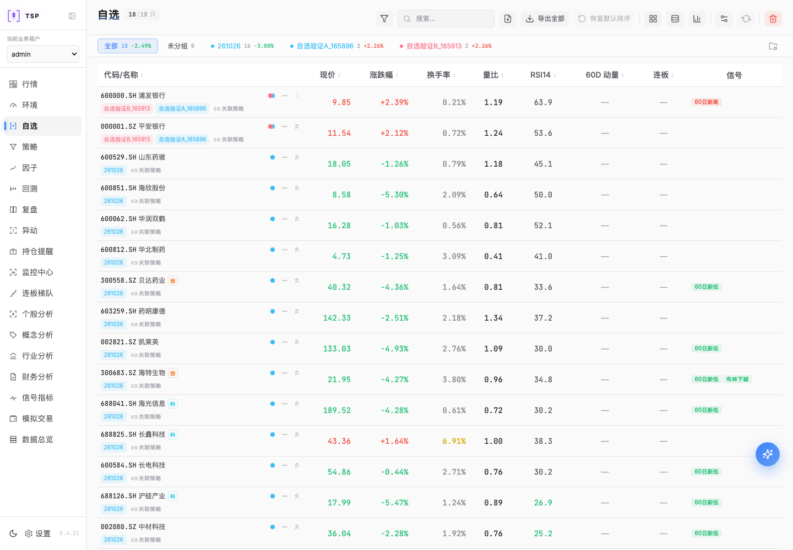
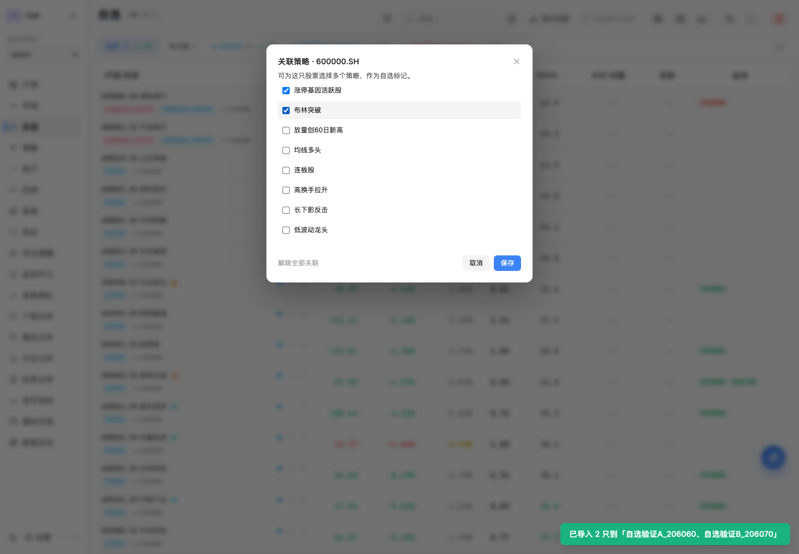
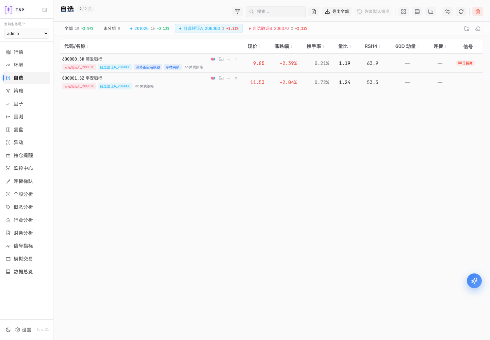
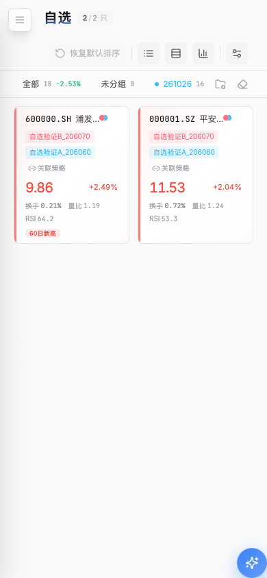

# 自选功能本地更新与验证

2026-10-27。用户授权：“先本地环境更新验证”。

本地已更新并通过真实页面、真实接口和数据库验证，入口为
[自选页面](http://127.0.0.1:3021/watchlist)，后端为`127.0.0.1:3028`。
当前运行目录为`$TSP_LOCAL_ROOT/releases/local-watchlist-20261027`；
基于既有v0.4.31运行副本应用自选补丁，应用版本仍0.4.31，补丁身份另存`.local-patch.json`。
工作区源码版本仍0.4.32；本次没有提交、推送或更新ECS。

## 更新范围

23个自选相关源码及测试文件，随后追加页面刷新回归测试，共24个文件纳入本地补丁清单。
包含一股多组直接展示、恢复默认排序、全部代码CSV导出、多策略保存及展示，
以及此前CSV导入保序和管理分组移除导入控件。
前端API只移入自选字段和方法，其他未集成K线修改未带入这个本地候选。
继承运行副本已有数据总览文案；Compute继续匹配v0.4.31基线。

启动控制器的ROOT已切换到新目录，`tspp-dev start`后续也使用该候选。
旧发布目录保留。所有8个本地角色（Platform、Compute、API、前端和4个Worker）
在验证后均存活，API健康检查`ready=true`，六类functions采样均就绪。
这不表示历史行情覆盖或研究效果另经认证。

## 备份与数据保留

更新前管理员`admin`登录成功，原自选16只、分组1个，没有运行或排队的数据任务。
通过既有控制器正常退出后，对`tspp_control`和`tspp_business`分别生成完整备份，
在两个独立临时数据库实际恢复并对账，验证后删除临时库。
备份约40KB和1.86MB，私有业务备份含16条自选、1个分组、16条组关系、67份documents。
受控备份位于`$TSP_LOCAL_STATE/backups/local-watchlist-20261027`，
凭据、完整业务数据及导出文件不写入本报告。

真实验证临时添加2只股票、2个分组；每次失败及成功结束均在finally中删除测试项，
并逐项对比原清单的顺序、加入日期、备注、分组、策略。最终恢复原16只、1组。
只保留正常操作产生的审计、revision及登录/运行记录。
`.env`和secrets文件散列未变；preferences仅更新`last_fetch_ms`和`financial_sync_times`
运行时间字段，其余设置、管理员及SMTP配置保持。没有恢复旧时间戳。

## 发现与修复

真实环境暴露了初次隔离验证未覆盖的快速刷新问题：
双策略PUT保存及服务端GET均正确，但立刻刷新后页面没有再次GET自选清单，
读取到浏览器持久缓存的旧空关系。缓存写入有2秒节流，清单30秒内仍被视为新鲜。

新增`Watchlist.test.tsx`回归：播种新鲜但过时的缓存，挂载后必须读取服务端并展示双策略。
测试先失败（watchlistList未被调用），增加自选查询`refetchOnMount: 'always'`后通过。
工作区和本地候选同步修复；不清空用户缓存。真实复验看到刷新后的GET增加，
策略标签及服务端关系保持，更新前后对比见截图。

## 自动验证

| 范围 | 结果 |
| --- | --- |
| 实际候选前端自选5个测试文件 | 最终20通过，含快速刷新回归 |
| 实际候选backend自选存储/API/CSV/增强查询 | 71通过，显式PYTHONPATH指向候选，避免共享venv加载工作区 |
| 实际候选真实临时PostgreSQL关系/导入 | 25通过 |
| 工作区完整前端测试 | 80文件、391通过 |
| 工作区和实际候选最终生产构建 | 均通过，保留既有ECharts大包提示 |
| 工作区完整及候选自选相关ESLint | 最终均通过 |

备份恢复和后台就绪使用真实环境；临时SQL测试使用独立库/角色。
详细浏览器结果见[browser-result.json](browser-result.json)，实际路径和配置对账见
[runtime.json](runtime.json)。仓库文档、版本及差异检查另以最终`make check`验证。

## 真实浏览器验证

Chrome，1440×1000和390×844；Browser工具不可用，使用已安装Playwright和Chrome。
全程无API拦截。

| 行为 | 结果 |
| --- | --- |
| 实际3021登录、页面标题/内容、无Vite错误覆盖层 | PASS |
| CSV导入2只股票按文件顺序保存，同时加入2个组 | PASS |
| 全部一股票一行直接显示两个组名 | PASS |
| 双策略保存、立即刷新后名称及API关系保持 | PASS |
| 字段排序后恢复默认、保持当前组筛选 | PASS |
| 当前组仅2行时导出全部18条，BOM/CRLF/代码单列及原序 | PASS |
| 窄屏解除策略保存、卡片关系和编辑入口、无页面溢出 | PASS |
| 管理分组没有CSV导入控件 | PASS |
| 临时记录清理、原清单逐项保持、健康检查 | PASS |

页面运行错误0；控制台记录了既有外部GitHub版本查询403和下载CORS失败。
它们来自应用/上游更新检测，未影响本地自选读写或本轮验证；没有伪造外部成功结果。
没有验证其他浏览器或线上环境。

## 截图

快速刷新修复前（服务端关系正确，缓存标签未重读）：

真实桌面双策略选择与关系展示：

窄屏弹窗及卡片（使用临时验证记录）：

