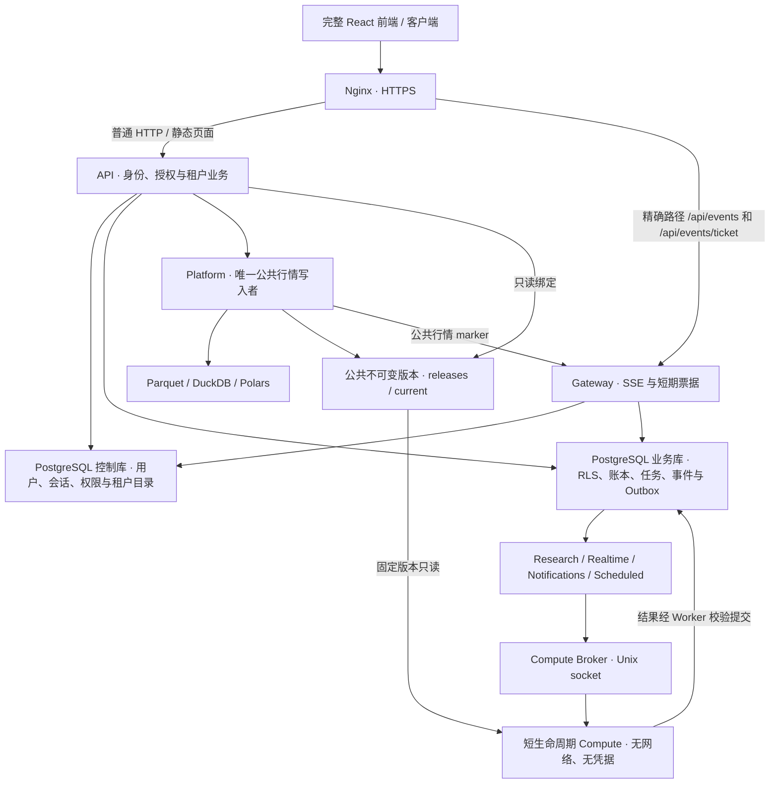

# TSP 最新单机多租户技术方案

更新日期：2026-10-18。本文基于实际源码、镜像产物和验收记录，区分主线能力、待集成改动与历史生产状态。

## 1. 版本与交付状态

| 对象 | 版本身份 | 当前状态 |
| --- | --- | --- |
| 最新远程主线 | v0.4.8，`bb8ea7045b613f189159e7ebd84162567ffb09e5` | 已核对；CI 和多架构镜像构建成功 |
| 当前线上版本 | v0.4.8，`9b4bc2c5edbda34b1d9330ba95ab68be0b6b87ba`，schema v6 | 2026-10-18 已在火山引擎 ECS 完成迁移和切流 |
| 单机容器化候选 | `feat/single-host-compose` / `9b4bc2c5` | 已完成线上候选验证；尚未合入主线 |
| 上一线上版本 | `d06acc1d8fe27f263f8e7d63fe5093b03e62ae9f`，schema v5 | 已由最终 v5 备份和系统盘快照保留 |

当前生产固定产物为：

```text
Runtime: sha256:37ecf4b093387f4eb40602c1571be26dd1a974e3f4d7deabc571dbf90823616d
Compute: sha256:2b8da7515d6ca7de6d753591027de6a26a9427c6d402e4877d867af94a8ac9e6
Source tree: a44841a8ae07fb29d222cbf90e65a4e80bb8363ac3a0ffbd3194628d50105290
```

部署固定提交和 digest，不使用 `latest`。Compute 已在 AMD64 服务器按冻结锁构建，
并通过 `backtest/vectorbt`、原生 rustdx、无网络和文件清单验证。该产物来自尚未合入
主线的容器化候选，不能冒充主线 GHCR 镜像的一部分。

## 2. 总体架构

采用“一台服务器、单 Cell、按职责分离的完整产品”，继续使用 Docker Compose，不引入 Kubernetes、Redis 或额外任务事实源。



模块化业务引擎继续复用策略、因子、回测、监控、模拟盘和复盘实现。拆分的是运行职责和资源预算，不复制第二套产品或计算算法。单机容器化仍共享宿主、磁盘与 PostgreSQL 故障域，不具有节点故障高可用。

## 3. 服务职责与运行边界

| 服务 | 主要职责 | 约束 |
| --- | --- | --- |
| Edge | HTTPS、静态/HTTP 代理、SSE 精确路由 | 校验证书、关闭流缓冲；迁移前保存旧配置 |
| Platform | 行情采集、指标、分钟、盘口、竞价、盘后与公共版本发布 | 唯一写入者；不加载旧账号或租户私有任务 |
| API | 完整前端、登录注册、RBAC、业务读写、管理员代理 | 公共行情与平台配置只读；进程数按连接和内存预算设置 |
| Gateway | 一次性票据、公共 marker、私有事件、断线补放和撤权 | 单进程；不挂载行情、配置或计算 socket |
| Research | 持久研究队列、任务租约、取消与结果提交 | 有界发现与领取；计算期间不占数据库事务 |
| Realtime | 租户监控、模拟盘、告警及自动模拟交易 | 行情时间、配置版本、租约和权限有效后才提交 |
| Notifications | 租户通知 Outbox、重试与投递 | 最小渠道权限；有限超时与退避；不能保证外部邮件绝无重复 |
| Scheduled | 租户复盘和周度研究任务 | 固定周期标识、持久状态与幂等；盘后任务依赖完整发布标记 |
| Broker / Compute | 控制计算入口、镜像、并发、资源与公共挂载 | 只有 Broker 有 Docker 权限；Compute 无网络、UID 10001、只读根目录与行情 |
| PostgreSQL 16 | 身份、租户业务、账本、任务、事件事实源 | 控制/业务角色独立、非 owner、非超级用户、无 BYPASSRLS |

当前生产已运行七种应用角色及统一 Broker；Worker 进程监督、可配置宿主预算和日志轮转
仍属于待合入主线的容器化候选。新候选以调度循环实际进展检测停滞，研究、实时、通知、
调度阈值分别为 120、420、120、660 秒；只续租不计作调度前进。监督器先终止，再限时
强制回收，结合 Compose 重启恢复。

## 4. 数据与金融计算契约

公共行情继续经过 Provider → 标准化 → Repository → Parquet → enriched → 业务服务。默认 rustdx，各数据集可独立配置 TickFlow 或符合现有协议的自定义 Provider；上层不绑定供应商字段，能力失败不静默跨源替换。

技术指标使用前复权价格；涨跌停和成交约束使用原始价及交易日规则。日线日期与交易时段统一北京时间，分钟时间使用北京时间墙钟。选股信号与成交模拟分开，保留 T+1、费用、滑点、停牌、涨跌停、公司行为与资金/可卖占用约束。

行情分区和 generation 使用原子发布。完整多租户模式另由 PublicPublisher 构建不可变公共版本，原子切换 `current`；API 和研究任务绑定具体版本，避免执行期间输入漂移。原全局 release manifest 是追溯元数据，不能与冻结实际文件的公共版本混为一谈。公共发布排除账号、私有策略、环境文件及数据源凭据。

私有策略、参数、因子、研究、报告、告警和模拟盘按显式租户上下文访问 PostgreSQL，使用 FORCE RLS。账本为追加事实，订单、成交、现金/持仓投影、告警和必要 Outbox 在领域事务中提交；分页读取长历史，重放用于对账。

历史证券状态采用 SCD2；首次有效采集前的历史保持未知。受控压测种子缺少部分历史上市日期、股本与风险状态，不能证明严格历史资格完整性。当前计算负载明确关闭相关资格和附加 MA 过滤，仅验证真实价格输入、计算、撮合和结算链路；产品默认策略不变。

## 5. 身份、前端与事件

保留完整 `main.tsx / router.tsx / Layout / Dashboard`，不使用简化 CellApp 替换产品。管理员可访问数据及全部设置；租户访问授权业务与账户页，服务器独立拒绝管理越权。新用户完成注册口令、邮箱验证、可恢复建租户后进入现有看盘首页，不初始化全站行情。

会话保存在控制库，浏览器使用 HttpOnly、Secure Cookie，写动作验证 Origin。用户、租户与权限版本参与前端私有缓存范围；切换身份时取消旧请求、断开订阅并拒绝迟到响应。管理员密码初始化幂等，升级不会重置已经修改的密码。

`/api/events/ticket` 先核验权威身份，再签发 60 秒一次性票据。Gateway 本地验签，专用 PostgreSQL direct/session LISTEN 连接接收撤权及私有事件唤醒，不能经过事务型连接池。私有事件先持久化，再按游标补扫；客户端续票并携带 `Last-Event-ID` 恢复。广播失效由硬 TTL 收敛，慢消费者通过 reset 重新读取权威 REST 状态。

公共行情只推送更新 marker，业务 API 按版本按需读取。长连接数、HTTP RPS、活跃用户数和后台计算并发分别度量，不按在线用户数为每人建立 Provider 或数据库连接。

## 6. 资源预算与验收

本地持续候选位于 ARM64、约 8 GiB Docker VM；下列限额是正在验收的配置，不是已签收的线上容量建议。

| 组件 | 内存上限 MiB | 并发/CPU |
| --- | ---: | --- |
| Platform | 1536 | 2 CPU，Polars 2 线程 |
| API | 768 | 2 CPU，1 HTTP 进程 |
| Gateway | 384 | 1 CPU，1 流进程 |
| Research | 256 | 1 CPU，1 任务 |
| Realtime | 384 | 1 CPU，1 任务 |
| Notifications | 192 | 0.5 CPU，1 任务 |
| Scheduled | 256 | 1 CPU，1 任务 |
| PostgreSQL / Broker / Edge | 384 / 128 / 64 | 独立限额 |
| 短生命周期 Compute | 1024 | 1 CPU，全机 1 个 |
| 服务与 Compute 合计 | 5376 | CPU 限额可时间共享 |
| 主动负载与两个观察器 | 640 | 运维验收开销 |

API 每进程、Gateway、Research/Notifications/Scheduled 的每库连接池上限分别为 4、4、4，Realtime 为 2；本配置六个相关进程的双库池合计最多 44 条。Gateway LISTEN、Observer 探针、迁移和管理连接另计，PostgreSQL 上限为 80；这些是配置预算，不能替代实际峰值。

正式验收时间均为北京时间：

- 100 独立账号主动负载：2026-10-18 08:21:11 → 2026-10-21 08:21:11。
- 服务就绪、镜像身份、重启与磁盘观察：2026-10-18 08:21:15 → 2026-10-21 08:21:15。
- 完整交易日：2026-10-19 09:15 → 15:40，另留 20 秒落盘等待。

每用户每 20 秒进行自选写入/回读及日线请求，持续保持一条 SSE；每分钟私有探针、每 15 分钟轮换用户真实回测。按完整时长、持续活跃、HTTP 错误率 <0.1%、轻请求 P95 ≤2 秒、每用户 SSE 可用率 ≥99%、零隔离违规、探针送达和真实计算评估；72 小时还要求全员收到公共行情事件并参与计算。

5 分钟预检通过 6,554 次请求、零错误、37 笔真实回测交易。截至 09:55 的正式记录已观察约 94 分钟，100 活跃用户、100 流、7 次回测成功，零隔离违规和探针超时。完整交易日与 72 小时均未到终态，不能宣布最终通过。详见 [验收启动记录](./readiness.json) 与 [持续验收报告](../../.tools/worktrees/single-host-compose/reports/single-host/continuous-acceptance.md)。

## 7. 升级与恢复

本次已将最后记录的线上 schema v5 双库迁移到 v6。控制库 v6 仅追加版本记录；业务库扩展 research 调度、四个研究槽位、历史订单索引、任务唤醒与到期回填，并恢复 FORCE RLS。迁移校验了全部既有 SQL checksum，在各库内事务执行；两库没有跨库原子提交保证，因此迁移期间暂停了相关写入。

升级按“记录现状 → 独立候选与恢复验证 → 旧写入者排空 → 最终一致备份和对账 → 双库迁移 → 单一新写入者与深度就绪 → 路由切换 → 业务验收”推进。Edge 精确路由、平台配置、公共版本、两个数据库、私有产物、Broker、旧镜像和 Cell 目录 URL 一起留档。

旧代码启动时严格检查 schema，因此不能直接让 v5 代码连接 v6 数据库。回退必须先保留上线后增量、停写、核对数据库及目录兼容性，再选择配套恢复或经过验证的兼容修复；禁止简单恢复旧 dump 丢弃新账号和新交易记录。

本次已通过临时、固定指纹的 SSH 身份完成升级，HTTPS 验证使用既有本地根 CA。
最终 v5 备份位于
`/opt/tsp-full/backups/final-v5-pre-v048-20261018T134639+0800`，火山引擎系统盘快照
`snap-3xescmpkka2wua8mwan6` 已可用并永久保留。生产指针、Compose 和发布元数据已经
原子固化；临时 SSH 公钥和本地临时密钥材料已清理，未重启 ECS。完整结果见
[线上升级结果](./deployment-result.md)。

## 8. 下一阶段

线上迁移与 AMD64 产物验证已经完成；仍需完成真实交易日、72 小时终态、完整注册及页面
回归，才能签收单机百用户容量。容器化候选还需独立复审、CI 和合入主线，不能把一次
生产切流成功替代长期稳定性结论。

规模继续按 1,000 → 10,000 → 50,000 → 100,000 活跃用户形成曲线；后续按瓶颈引入多节点、数据库高可用、对象存储、集中观测、消息分发与更强计算隔离。PostgreSQL 保持业务事实源，Parquet/DuckDB 保持行情底座。多 Cell 搬迁执行源停写与 fencing → 可信目录切换 → 目标启用，始终单写。当前没有万人容量、节点故障不停机或跨区灾备达标结论。
