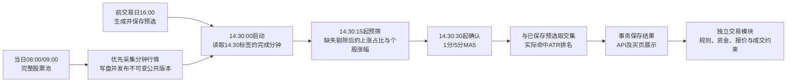

> 脱敏历史正文副本；执行日期、版本和测试计数沿原记录。原始附件及用户文件保持，本次统一发布的验证与部署另行签收。

# S02上涨占比缺失剔除及14:30买入链路判定清单

按用户最新更新：**取消缺失1%限制，直接剔除无法计算涨幅的股票后，重新计算上涨占比。**
以下其余异常只梳理现状与建议，不据此自动调整业务标准。

## 已确定的上涨占比口径

完整当日股票池仍为 `scope_only_v3`，包含符合股票范围及ST/停牌状态条件的全部股票；
流通市值、价格、换手率、昨日涨幅等数值条件用于预选，不缩小完整池。

设完整池股票数为N，缺少有效14:30价格或精确前交易日昨收的股票数为M，
有效股票数为U=N−M，上涨股票数为P，则：

**上涨占比 = P ÷ U × 100%。**

缺少指定分钟、指定分钟重复、价格为空/非有限/不大于零、没有可用昨收的成员，
在广度计算中剔除，不编造涨幅，不产生该股票的买入信号。缺失多少均不单独阻断；
U=0时比例未知，无法作市场条件判断，保留数据不足。上游日线定版/来源冲突校验
仍独立执行，不能把已发现的矛盾证据当作普通缺记录略过，见A03。

完整池名单及N仍保存；结果增加U、缺失名单/比例和`available_members_v1`口径标记。
上涨占比按有效集合精确计算，完整池上下界只保留为旧口径证据，不参与本次通过/拒绝。
页面显示完整池、有效数量及剔除数量。旧归档没有新字段时仍按原数据展示。
手动扫描及本次定向归档保留完整质量字段；常规监控的精简结果映射目前未透传
`entry_data_quality`，因此其后续归档可能缺少这段说明。广度计算仍使用新规则；
该展示通道限制已核实并记录，不据此改动其他买入异常标准。

11月4日实际输入为完整池3,049只、剔除1只（601326.SH缺少精确11月3日昨收）、
有效3,048只、上涨2,337只，新比例为 **76.6732283464567%**，超过保存阈值60%。
原完整池下界为76.64808133814365%，两者分母不同。
该缺失股票不在346只预选中；原6只实际买入信号名单不因本次数值口径变化而改变：
新乡化纤、石大胜华、永太科技、航锦科技、无锡振华、索通发展。
本次定向重算11月4日并更新该日质量说明；其余日期及历史冻结记录保留。
11月2日/3日的旧待确认记录未按本次规则重跑，不能把旧缺失提示视为新规则的执行结论；
11月4日卖页仍继承11月3日旧买入归档的状态，与本次6只买入确认分开。

## 当前计算链路与时钟

实际触发依赖新鲜行情快照、监控轮次、任务排队及公共数据发布。
14:30:15和14:30:30是允许进入相应计算阶段的最早时钟，不保证恰在该秒完成；
页面每秒查询只读取结果，不能代替后台计算。
现有买页“触发时间”展示的是14:30启动分钟标签；确认可用时点另存为
`entry_evaluated_at=14:30:30`，两者在本次实际Compute结果中均已核对。

当前两端尾盘参数：14:30:00启动、延迟30秒（内部0.5分钟）、个股涨幅0.8%～4%、
股票池上涨占比下限60%、1分钟MA5连续7个值上升、5分钟MA5连续4个值上升。
一分钟MA5需14:20～14:30共11根连续完成分钟；5分钟MA5需14:30、14:25等8根5分钟K，
其基础分钟为13:51～14:30共40根。相邻MA值差严格大于1e−10才算上升。
确认期间仍读取14:30启动分钟，不改用14:31价格，也不以更晚公告缩小当时股票池。

当前预选使用沪深主板、不含ST/已确认停牌，精确前交易日价格4～150元、
涨幅0.5%～6%、换手率1%～11%、流通市值50～500亿元；实际命中按ATR14÷昨收降序，
同值按触发涨幅降序及代码升序。ATR为精确T−1之前连续15个交易日日K的14个TR简单均值。
卖沿精确下一交易日早盘清仓，价格相对原始昨收上下6%、10:30常规截止、10:45兜底。
“卖”页来自同策略精确前交易日的成功买入归档，不等于实际成交。
当前源码声明的最多5仓、T+1和资金约束由交易模块执行，买页列出全部信号；
本次未修改账户资金、费表、仓位或卖出参数。
14:31～14:35的五分钟容量买入窗口属于现有连续资金研究执行路径；
普通实时自动跟单是否下单仍由账户规则决定，不能把研究窗口冒充已部署自动分片交易。

## 待用户判定的异常清单

“等待”表示没有足够证据确认；“失败”表示该轮任务/扫描不能正常完成；
“淘汰”表示证据完整但条件不满足。以下没有把三者混成成功零命中。

| 编号 | 阶段与异常 | 当前处理及影响范围 | 供判定的建议 |
| --- | --- | --- | --- |
| A01 | 当日完整股票池不存在、范围输入不可读或池为空 | 广度无法计算，该信号无买入；保留池/入场错误 | 继续阻断，不能用预选或最终命中替代完整池 |
| A02 | 缺精确交易日历，无法确定T−1或ATR的15个交易日 | 日期解析抛错；可能使整次扫描失败 | 继续阻断，不能按自然日或旧行情猜测 |
| A03 | 上游昨收定版证据错误：日线重复、无效价格、日期不符、接收时钟冒充定版、原始日K与15:00分钟不一致、不同来源昨收冲突 | `validate_daily_close`/`require_final_daily_rows`或`previous_closes`先抛错；可在广度容错之前终止整轮 | 建议继续阻断矛盾证据；是否对单股坏记录隔离，需要另定标准 |
| A04 | 所有股票被广度计算剔除，U=0 | 数据不足，比例未知，无买入；不会除以零或把比例设为0% | 继续等待；这是没有任何可计算对象的边界 |
| A05 | **任意涨幅候选缺1分/5分完整MA5窗口**，包括缺分钟、重复分钟、空值/无效价格，以及所需窗口跨午休导致历史不足 | **目前整批等待**，不会只剔除该股票；且此检查先于预选交集，**未进入预选的池内候选也能阻断买入** | 重点判定：是否改为只剔除坏窗口股票，或只校验预选内候选 |
| A06 | MA5窗口完整但均线持平或下降 | 单股不满足信号，正常淘汰；不是数据错误导致停机 | 保持正常淘汰；缺窗口与持平应分别显示 |
| A07 | **实际命中的一只股票ATR所需日K缺根、重复、价格无效** | **目前整次S02扫描失败**；预选页面的可选ATR缺值隔离并不能放宽买入校验 | 重点判定：是否只剔除ATR不可计算股票，再给其余股票排名 |
| A08 | 缺该日已保存预选，或预选目标日/精确源日期不符 | 买入待确认，选页错误；禁止当日临时补选 | 建议继续阻断，先恢复正确的原预选 |
| A09 | 分钟分区完全缺失/不可读、必需字段或时间类型错误 | 通常保留预选并标买入数据不足，或本轮失败；还有`history.is_empty()`直接返回空结果的分支，需区分真空候选与读数失败 | 重点判定：全部缺分钟应明确等待，不能与成功0命中混淆 |
| A10 | 早盘卖出模板共用前置校验失败：没有持仓上下文、昨收或评估时钟不可用 | 出场评估先于尾盘列注入，异常可能连带使当次买入扫描失败；截止兜底只在模板内部独立 | 重点判定：买与卖的数据失败是否彻底隔离 |
| A11 | 自定义信号定义缺失、格式非法、未知参数、所需信号列未生成，或策略与资产/周期/执行协议不兼容 | 执行或注入失败；当前分钟引用缺列通常抛错。显式关闭的合法信号仅无命中 | 建议阻断错误定义；关闭与失败分别标记 |
| A12 | 源码执行异常、ATR输出缺有效score、多交易日混入一个单日排名窗口 | 整次策略失败，监控捕获日志后跳过该轮；不应当成没有买点 | 继续失败并保留错误，修复输入或源码 |
| A13 | 监控关闭/服务未运行、无启用规则；快照非当日、不在交易时段、超过15秒或序号未更新 | 本轮不启动计算；排队/发布迟到会使实际确认晚于14:30:30 | 建议继续拒绝旧快照，标注停用、等待新数据或延迟原因 |
| A14 | 行情源能力缺失、网络/采集失败、分钟写盘或公共版本发布失败 | 采集层保留错误并重试；优先桥不可用保留普通采集。只要读到的有效子集还能计算，广度按新规则继续；不可读的整份文件仍失败 | 单股缺失已放宽；整份无法读取不能伪装成完整成功 |
| A15 | Compute排队超时、取消、进程异常/OOM、公共版本加载失败、Worker租约失效 | 本次任务失败/中断，通常等待后续有效轮次；不是选股条件不满足 | 保留失败/重试；另定允许迟到确认的最晚时间 |
| A16 | 计算期间策略/规则/账户授权改变、策略删除世代改变、较早任务晚完成 | 提交守卫拒绝写入，或保留更新任务的结果；不会让旧结果覆盖新配置 | 建议继续拒绝旧任务，按当前配置重新计算 |
| A17 | 数据库事务/归档失败、热缓存或API查询/页面请求失败 | 不能宣布已保存；查询失败影响展示，未必影响此前成功计算 | 归档失败需重试，保留最后成功结果；展示失败单独提示 |
| A18 | 剔除后上涨占比低于60%、个股涨幅不在0.8%～4%、不在预选、同股票同信号时点已有出场冲突 | 正常市场拒绝或单股淘汰；买入可以成功0命中。出场冲突仅限同一时点，不禁止全天再次入场 | 保持正常淘汰，不作为需要“容错继续”的异常 |

另外，**有买入信号也可能没有委托/成交**：自动跟单未启用或未匹配、重复/冷却、
未完成退出待办、已有组合持仓、仓位上限、现金/敞口不足导致可买量为0、
参考价缺失或超时、风险快照不完整、订单拒绝、涨跌停/停牌/容量限制等。
当前提交前再次核对15秒新鲜度；过期时不允许新开仓。
这些属于交易执行层，对单股/账户下单生效，不应反过来把成功买入信号改成待确认。
专用`momentum_capacity_v1`/`overnight_capacity_v1`的自动分钟分片协议明确拒绝；
当前名为s02的`custom_mvxxcp88`为通用分钟信号策略，须按实际账户规则区分。

## 源码核对范围

本次同时读取根目录代码、两端已安装代码候选与受控S02源定义；现场存在比工作区较新的
运行实现，安装只叠加本次4个文件，未把整个工作区覆盖到运行环境。

- 广度及MA5（受控原始附件）
- 引擎及预选交集（受控原始附件）
- 预选（受控原始附件）
- 行情上下文（受控原始附件）
- 日线定版校验（受控原始附件）
- 精确ATR窗口（受控原始附件）
- 分钟优先采集（受控原始附件）
- 租户监控及事务/新鲜度守卫（受控原始附件）
- 结果归档（受控原始附件）
- 交易规则与跳过原因（受控原始附件）

## 验证与安装记录

候选已通过两端各158项定向后端测试，另4项此前已确认的旧回放夹具失败按原记录排除，
不宣称全仓测试全部通过。新增广度用例在旧实现19项失败、修改后25项聚焦回归通过；
新前端缺失说明在旧实现3项失败，覆盖旧归档与有效集合/全缺失状态。
两端各55项前端测试及构建通过；前端lint为0错误、2项既有警告，
后端增量lint没有新问题（原25项、当前23项）。
镜像内14/15/29/30秒门闸及缺失20%仍计算均已验证。

两端已安装并保持运行版本0.4.52。本地8个角色、线上7个应用角色及Compute均运行；
源码、实际运行镜像及构建manifest核对通过。安装前双业务库及控制库备份恢复到
隔离数据库验证通过，30秒、策略源和受控配置保持。
线上预检曾因60秒上限超时，确认服务未切换后按180秒上限完成；
初次归档提交遇公共发布版本切换而被守卫拒绝，重新冻结当前版本后通过，
没有越过守卫使用旧输入。

11月4日实际Compute重算及SQL回滚演练通过，仅该日归档质量说明发生变化；
6只买入的全部字段保持，346只预选、同日卖页、11月5日6只卖/41只买及其他原记录保留。
本地59份、线上28份原始归档的数量保持。完整股票池、账本、账户、
策略定义/配置及回测任务列表均核验保留；页面验收后再次检查通过。
两端上涨占比质量字段与6只买入行完全相同；346只预选成员相同，
其中4只股票既有`vol_ma5/vol_ma10/vol_ratio_5d`冻结值有差异，本次各自保留，
它们不参与当前S02的上涨占比或ATR买入排序。

真实浏览器覆盖两端1440/390尺寸、11月4/5日卖/选/买，各12种状态，共24种。
使用此前已记录的Browser MCP不可调用原因，沿真实Playwright交互完成验证，
并目视检查新说明的桌面与窄屏排版。
本次为信号重算和规则安装，没有新增资金回测或实际委托。

本地核验（受控原始附件） · 线上核验（受控原始附件） ·
两端对照（受控原始附件） · 附件哈希（受控原始附件）

本地桌面（受控原始附件） · 本地窄屏（受控原始附件） ·
线上桌面（受控原始附件） · 线上窄屏（受控原始附件）

前述4项旧回放夹具的基线失败记录见
[上一轮核验](../s02-breadth-fix-20261107/report.md)。根目录`make check`通过，
工作区源版本0.4.46、运行产物0.4.52分别核对，未递增版本、提交或推送。
