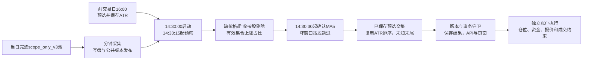

> 脱敏历史正文副本；执行日期、版本和测试计数沿原记录。原始附件及用户文件保持，本次统一发布的验证与部署另行签收。

# S02与尾盘建仓：按股跳过MA5缺口、复用盘后ATR及18类异常

用户最新要求：候选缺完整MA5分钟窗口，跳过该股票继续计算；实际命中的ATR日线窗口
有问题也继续计算。上涨占比继续采用此前已确定的“直接剔除缺数据股票，不设1%限制”。

## 当前规则与重复ATR依赖的原因

旧实现的`enrich_selection`已在前交易日16:00计算、保存预选股票的ATR，但分钟买入
`filter_minute_history`再次调用ATR日线入口，并重新校验15个连续交易日日K。
这造成重复计算，也使一只实际命中的股票日K缺口能够终止整轮扫描。
新实现直接读取当日已保存预选的`atr14`、`atr14_previous_close`及`atr_reference_date`，
买入阶段不再计算ATR或要求该15日日K窗口；盘后预选计算保持原精确窗口。

ATR缺失的股票仍保留符合条件的买入信号，排在已知ATR之后，ATR指标、顺位与分数
标为未知，不把未知分数编成0。已知ATR股票按比率降序排序，同值依触发涨幅降序、
代码升序；只对已知ATR集合线性映射0～100分，单只50。
当全部ATR未知时，信号仍保留，按触发涨幅和代码确定显示次序。

这是源码显式声明`selection`的信号分区分钟策略才使用的可选协议；其他策略的
日线历史和有效score校验保持原规则。S02仍需要精确前交易日昨收计算涨幅和市场广度，
那是价格基准依赖，与买入阶段重复计算ATR的15日日线依赖分开。

MA5所需1分或5分窗口缺分钟、重复、价格无效时，跳过该股票并保存
`ma_skipped_symbols`及warning；其他候选继续。不在预选中的坏窗口候选也不能阻断
预选内股票。窗口完整但持平/下降仍为正常淘汰。
MA5跳过只影响该股信号，不再次从广度分母剔除已拥有有效14:30价格及昨收的股票。
常规监控现在也透传`entry_data_quality`，避免计算时的质量说明在归档映射中丢失。

完整池仍为`scope_only_v3`，范围及状态决定入池，数值条件仅用于预选。
设完整池N、缺有效指定分钟价格/昨收的股票M、有效U=N−M、上涨P：
上涨占比=P/U×100%；缺多少均继续，U=0才保留比例未知。

## 14:30链路及当前策略参数

启动14:30:00，确认延迟30秒（保存0.5分钟）；确认仍读取14:30启动分钟已完成数据。
实际完成时间受采集发布、监控轮次和Compute排队影响，不保证恰好14:30:30返回。
上涨占比下限60%，个股涨幅0.8%～4%，1分钟MA5连续7个值上升，
5分钟MA5连续4个值上升；分别需要14:20～14:30共11根分钟K，以及
13:51～14:30共40根基础分钟构成的8根5分钟K。

预选沿精确前交易日：沪深主板、排除ST/已确认停牌，价格4～150元、
涨幅0.5%～6%、换手率1%～11%、流通市值50～500亿元。流通市值不参与完整池入池。
卖出仍沿下一交易日早盘清仓，原始参考昨收上下6%、10:30常规截止、10:45兜底。
交易模块最多5仓、T+1及资金约束保持；买页6只表示6个信号，不等于6笔成交。
14:31～14:35容量买入窗口属于现有研究执行路径；普通实时跟单下单依实际账户规则。
本次没有改仓位、资金、费表或卖出参数，也没有新增资金回测、真实委托。

## 18类异常的现行处理与建议

“等待”表示不足以判断；“失败”表示这轮不能完成；“淘汰”表示条件不满足。
本次授权调整已在A05/A07标明，其他建议仅供用户判定。

|编号|异常|当前处理|建议|
|---|---|---|---|
|A01|完整当日池缺失、为空或范围不可读|无法算广度；该信号待确认/有池错误|保持阻断，先恢复完整池|
|A02|精确交易日历缺失，无法确定T−1|日期解析失败，可能终止本轮；买入已移除ATR的额外15日解析|保持阻断，禁止按自然日猜测|
|A03|昨收定版或来源证据矛盾：重复、非法价格、日期/时钟不符、原始日K与15:00分钟不一致、不同来源冲突|上游校验可在广度剔除前终止整轮|建议对能定位到单股的坏记录隔离；不能定位的全局冲突继续阻断。此隔离尚未实现|
|A04|广度剔除后U=0|比例未知，无买入，保留数据不足|保持等待，有有效数据再算|
|A05|候选缺完整1分/5分MA5窗口|**已改为只跳过坏窗口股票，其余继续；记录名单和warning**|按用户标准保持；所有候选均被跳过可为0命中，需保留原因|
|A06|MA5完整但持平或下降|仅该股正常淘汰|保持|
|A07|命中股票ATR日K缺根/重复/非法，或已保存ATR缺失|**已移除买入时重读日K及计算ATR；用盘后保存值。ATR未知仍保留信号，未知指标/分数排末尾**|按用户标准保持；盘后可补算指标，不在买入轮次中追加依赖|
|A08|当日已保存预选缺失或目标日/源日期不符|买入待确认，禁止临时当日补选|恢复正确盘后预选后重算|
|A09|整份分钟分区缺失/不可读、字段或时间类型非法|可能数据不足或本轮失败；既有空history直接返回空结果分支尚存|建议统一显示等待/失败，区分读数失败和成功0命中|
|A10|早盘卖模板的共用前置校验失败：持仓上下文、昨收、评估时钟不可用|出场注入先执行，异常仍可能连带终止当次买入扫描|建议买卖计算隔离，各自记录错误；尚未实施|
|A11|自定义信号缺定义、参数非法、必需列未生成、执行协议/周期不兼容|注入或执行失败；合法关闭仅无命中|错误定义继续阻断；关闭与失败分开|
|A12|源码异常、非法输出/非有限score、多交易日混入单日排名|策略失败，本轮被监控跳过并记错误；S02保存ATR协议允许空score|保持失败，修复根因；不得把任意源码错误吞成零命中|
|A13|监控关闭、服务停止、无规则、快照非当日/过15秒/序号未更新、非交易时段|本轮不启动；新数据发布或队列迟到会推迟实际确认|继续拒绝旧快照；显示停用、等待、延迟原因|
|A14|数据源能力/网络/采集、分钟写盘、公共发布失败|采集记录错误并重试；可读有效子集按新广度继续，整份不可读仍失败|单股缺失继续容错，整份不可读明确失败|
|A15|Compute超时、取消、崩溃/OOM、公共版本不可用、租约失效|本次任务失败/中断，等待后续有效轮次|保留失败并重试；另定允许迟到确认的最晚时点|
|A16|运行中配置/授权/策略世代改变，较早任务晚返回|提交守卫拒绝旧输入，不能覆盖更新结果|保持守卫，重新冻结当前输入再算|
|A17|事务/归档失败，或缓存/API/页面请求失败|写库失败不能宣布保存；展示失败不等于此前计算失败|归档重试并核验落库，保留最后成功结果；展示故障单独处理|
|A18|广度不足60%、涨幅不在0.8%～4%、不在预选、同一信号时点出场冲突|正常市场拒绝或单股淘汰；可成功0命中|保持，不作数据异常放宽|

买入信号之后的自动跟单开关、重复/冷却、退出待办、已有持仓、现金/敞口、
最多持仓、参考报价新鲜度、停牌/涨跌停/容量、订单拒绝等属于账户交易执行层。
这些可以阻止委托或成交，不应把已经成功生成的信号改成计算失败。

## 上次“写入失败”的后续

上次11月4日第一次提交遇公共数据发布版本切换，被提交守卫拒绝。
随后重新冻结当前发布版本、重新计算并完成两端事务保存及回滚演练，
两端页面已显示6只买入和76.67%上涨占比。此前没有及时把成功结果回告，是交付遗漏；
不能把第一次被拒绝的尝试当成最终状态。

那次有效集合为N=3,049、M=1、U=3,048、P=2,337，上涨占比
76.6732283464567%；剔除601326.SH（缺精确11月3日昨收）。
6只信号为新乡化纤、石大胜华、永太科技、航锦科技、无锡振华、索通发展。
11月2日/3日旧待确认记录未在本次批量重刷，不能冒充按本次标准执行的结果。

本次策略源码变化会产生新的逻辑版本。11月4日的新计算须按真实新身份保存，
旧归档、原预选及原始ATR保留，不把历史结果换标签后伪装成新计算。

## 验证证据

新增回归先在旧实现出现4项失败，修改后聚焦20项通过；
两端安装候选各161项定向后端测试通过，4项已记录的旧回放夹具按原记录排除，
不宣称全仓所有测试通过。增量lint未增加问题。前端本次没有改动。
每个修复镜像内验证：MA5窗口缺口仅跳过a、b/c继续，广度仍60%；
空日线输入下已保存ATR照常排序，未知ATR保留为第三个信号且score为null；
构建manifest全部文件一致，应用版本仍0.4.52。

安装预检发现并行的`paper-rule-edit-20261108`更换了两端镜像。
预检均在写入前拒绝旧父镜像；核对本次4个后端文件未被并行任务修改后，
重新基于实际父镜像构建，只叠加本次文件，保留并行更新及其前端产物。
本次不覆盖整个工作区到运行环境，不手动递增版本、不提交或推送。

两端最终安装、真实Compute、事务归档、页面及保护核验详见同目录
`local-verification.json`、`online-verification.json`与附件哈希；
桌面1440及窄屏390截图展示11月4日买页。

## 最终生效与11月4日写入结果

本地8个服务、线上7个应用角色及Compute已恢复运行，均保留0.4.52。
安装前双业务库/控制库备份恢复到隔离数据库验证通过；实际父镜像保留并行更新。
策略源码经现有API验证并保存，名称、预选过滤、信号参数、仓位及卖出设置保持。

两端真实Compute均使用原346只已保存预选，6只命中ATR与原保存指标逐项一致，
6只完整买入行及质量字段在两端完全相同。11月4日按新的真实策略逻辑版本归档成功，
各新增1份当前版本结果；本地59份、线上28份原始归档逐条保持，
其他日期、原预选、完整股票池、账本及账户保持。SQL回滚演练通过。
写入验证脚本初次因在写事务中另开读连接造成自身锁等待超时；
改为复用当前事务后完成提交守卫、回滚和最终保存，没有绕过守卫。

当前结果：完整池3,049只，剔除1只，有效3,048只，上涨2,337只，
上涨占比76.6732283464567%，阈值60%，买入信号6只：
新乡化纤、石大胜华、永太科技、航锦科技、无锡振华、索通发展。
日期2026-11-04，参考日2026-11-03；这是信号重算，没有新增资金回测或实际成交。

真实浏览器覆盖两端1440/390买页，均显示“买·6”及76.67%，无页面脚本错误；
验收后再次核对源码、实际镜像、配置、原归档与账本通过。
Browser MCP此前已核实不可调用，沿本会话记录的真实Playwright回退完成。
根目录`make check`通过，源工作区0.4.46与运行产物0.4.52分别核对，未手动加号。

本地核验（受控原始附件） · 线上核验（受控原始附件） ·
两端对照（受控原始附件） · 附件哈希（受控原始附件）

本地桌面（受控原始附件） · 本地窄屏（受控原始附件） ·
线上桌面（受控原始附件） · 线上窄屏（受控原始附件）
