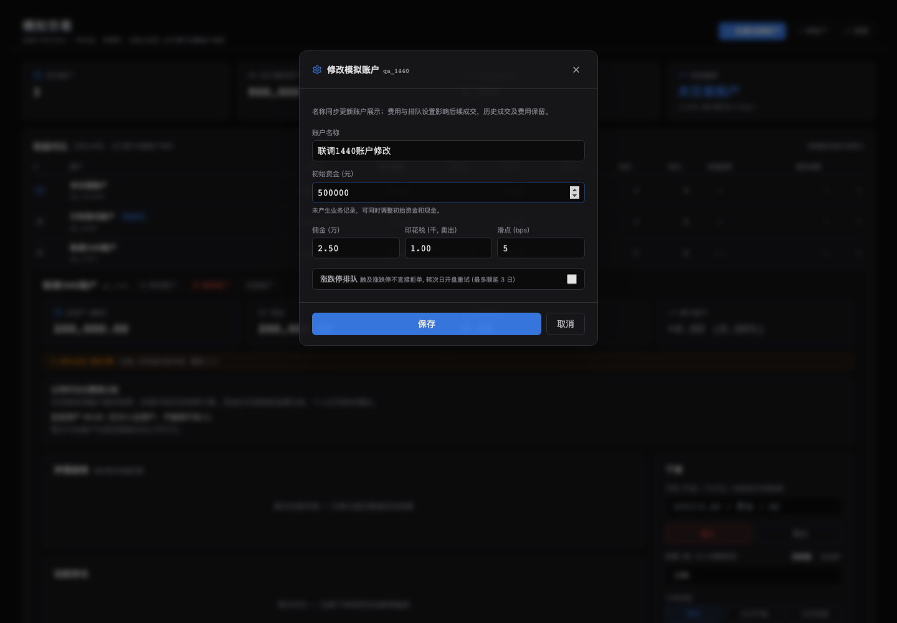
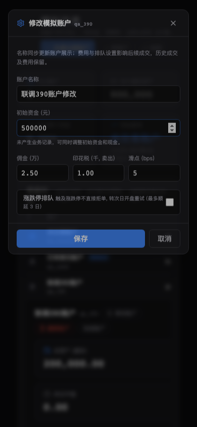

# 模拟账号修改与删除验证记录

2026-11-03。源码位于独立工作目录 `TSP-paper-account-lifecycle-20261103`，
分支 `feat/paper-account-lifecycle-20261103`，基线 `4453ecc4`，应用版本保持 `0.4.46`。
未提交、推送、合并、安装或部署；没有修改用户实际账号、数据库、配置或策略，没有运行回测。

## 当前行为

模拟页展开账号后可使用“修改账户”“删除账户”。

- 修改名称、佣金、印花税、滑点和涨跌停排队。账号 ID 保持稳定；
  费用影响后续成交，历史成交、权益、费用和收益统计保持原事实。
- 无任何委托（含撤销/过期）、成交、持仓或净值记录的账号可修改初始资金，
  同时修改现金和总资产；已有业务记录或损坏的持仓记录会禁用/拒绝改本金。
- 删除必须确认，清理该账号的订单、成交/权益账本、持仓、净值、自动规则、
  事件回执、退出待办/归档、风控、跳过记录及可识别的提醒/通知队列。
  Full 模式同时删除该账号的导入原件及事件回放中的相关提醒。
- 保留共享策略、监控规则和其他账号/租户。旧提醒没有账号标识时保留，
  不根据相似名称推断归属。
- 列表、概览、对比图、提醒同步刷新；旧请求被取消，目标账号缓存被删除，
  最后一户删除后显示空态。SSE 断线丢失事件时重新校验模拟账号查询。

选股、买入、卖出和仓位规则没有改动。继续使用原策略/自动规则，
整百股、T+1、资金和待单占用、原价限价、50只持仓上限及最多3交易日顺延。
默认佣金万2.5、最低5元、卖出印花税千1和5bps滑点保持，
只有用户保存修改时才改变对应账号后续成交设置。

## 接口与数据

新增 `PUT/DELETE /api/paper/account?account=<id>`，原创建/费用/冻结接口兼容。
概览增加可选 `initial_cash_editable`；修改字段整体校验，
未知字段422、非法业务值400、不存在404，文件删除失败409并恢复账号。

文件操作与撮合/结算共用写锁，读取不创建目录，迟到写入/提醒不能复活已删除账号。
删除前检查目录边界、符号链接和完整恢复副本；可捕获异常下恢复账号，
进程硬终止或停电仍依赖维护备份。

Full 模式要求双库 schema 8。订单/成交/净值外键增加账号删除级联，
专属文档、提醒、通知和回放在租户事务内处理；受限触发器删除账号原件。
运行角色仍无单独修改/删除成交行或任意原件的权限，强制 RLS 保持。
旧schema明确拒绝账号删除；API不自动迁移。
部署时需先备份双库、迁移至8，再同步API/Worker及前端和schema配置。

## 实际验证

先运行新增领域、API、页面和事件用例，确认旧代码缺少操作接口/按钮、
未清理账号缓存/导入原件/迟到提醒等按预期失败，再实现并复测。

| 检查 | 结果 |
| --- | --- |
| 19个后端测试文件：paper领域/API/自动跟单/公司行为/风险、提醒、事件、真实PG、网关与部署守卫 | 234通过，3跳过，1条既有Polars warning |
| 独立 PostgreSQL 16.2 临时双库和非owner运行角色 | 迁移至8、重复迁移、RLS、成交禁止单独改删、回滚、并发、其他租户、通知和导入原件通过 |
| Paper、共享SSE、账号会话4个前端测试文件 | 39通过 |
| TypeScript、Vite生产构建 | 通过；已有Browserslist数据与大图表chunk提示保留 |
| 本次后端文件和新增测试Ruff、前端ESLint | 通过；alert_store既有1条无效noqa已与HEAD对照，未新增告警 |
| 文档、版本、diff检查 | 文档37文件、8需求模块通过；版本0.4.46一致；diff无空白错误 |
| Browser插件真实界面交互 | 名称/资金修改、已有委托本金禁用、删除和最后账号空态通过 |
| 1440×1000桌面与390×844窄屏补充浏览器检查 | 修改、取消、删除、弹窗边界通过，控制台无错误 |

3项跳过均为 `test_full_compose_config.py` 的Docker Compose CLI检查，
原因是本机未安装该工具。没有用跳过替代真实PostgreSQL验证。
浏览器仅操作独立样例数据，初期联调入口的模块路径及缺失样例端点已修正后重测。

## 交付边界

本地功能和适用验证已完成。运行环境尚未安装本变更；
删除本身无法通过回退代码恢复，需匹配备份。
未执行Docker镜像构建、线上迁移或生产通知发送，旧未知归属提醒保持原样。

## 界面证据

以下均为独立样例账号，非用户运行数据。

桌面：

窄屏：

