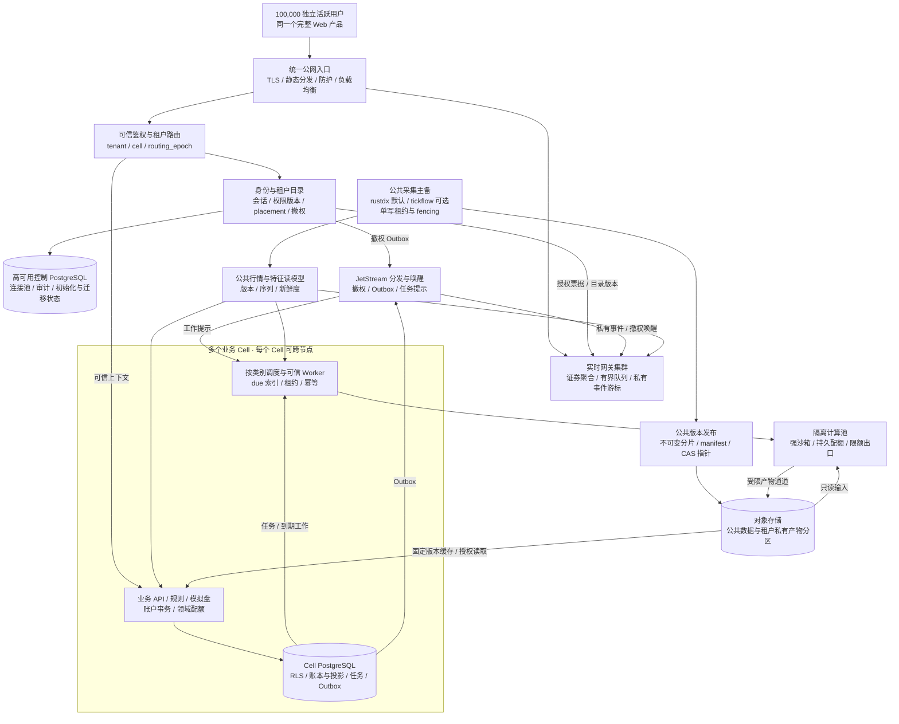

# TSP 二期架构分析：单机迭代、万人并发与远期十万扩展

日期：2026-10-16。性质：技术分析与建议方案，待实施、待容量验证。

本文补充 [多租户两期方案](../../docs/multitenant-roadmap.md)，沿用其产品、角色权限和租户隔离基线。按用户最新安排，执行顺序为单机关键迭代 → 单机支持 100 个独立账号全部同时活跃 → DFX 与万人并发，详见 [三步实施计划](../../docs/phase2-implementation-plan.md)。十万活跃用户为远期扩展目标；下文相应容量预算不作为第二步门槛。

生产状态依据现有 [414cc483 发布记录](../deployment-20261015-414cc483/release.md)，源码依据本次本地阅读；没有执行新的生产探测或二期压测。

## 1. 架构判断与证据边界

**推荐延续一个完整产品，以独立实时网关、共享公共数据服务、多个业务 Cell 和隔离计算池作为二期主体。实施先消除随用户数增长的重复工作，再建立单 Cell 多节点高可用，随后引入多 Cell 路由与迁移。**

相对于此前讨论的 core/ext 分层，当前方案在租户数据隔离、任务持久化、账本一致性和部署职责上已有更具体的实现基础；core/ext 则主要回答核心与扩展怎样组织。两者可以结合：应用内部保留核心与扩展边界，运行层通过 Cell、公共数据和计算池实现资源与故障隔离。不能凭组件数量或拓扑复杂度宣布整体“更先进”。

| 证据类别 | 本次可以确认的内容 | 不能据此推出的结论 |
| --- | --- | --- |
| 已有实施与发布记录 | 一期完整多租户产品、100 个独立身份验收；414cc483 发布及隔离数据库恢复记录 | 十万活跃用户容量、多节点故障不停机 |
| 本地源码事实 | RLS、显式租户上下文、routing epoch、SQL 调度、受限计算容器、事件和发布链路 | 所有二期契约已接线或已经在线启用 |
| 当前阶段与远期目标 | 单机百账号/百人活跃、万人并发与 DFX；十万独立活跃用户的远期预算 | 实测性能、采购配置或现成 SLA |
| 本文建议 | 实时网关、授权票据、账户增量投影、多 Cell 迁移、对象发布协议 | 已完成实现、兼容性验证或故障演练 |

二期保留全部授权业务、管理员与租户的角色差异、中文注册口令及租户数据隔离。扩容不能通过减少功能、共享测试账号或把活跃用户改成空连接来达标。[S1](#s1)

## 2. 现有链路的八项扩容障碍

| 项目 | 源码证据与现状 | 放大机制 | 二期改造方向 |
| --- | --- | --- | --- |
| 1. 实时与事件热路径 | 每个 API 进程的 EventHub 每 0.5 秒按订阅租户读取事件；SSE 循环每秒调用 `verify_live_access`；公共事件只发送更新标记。[S2](#s2) [S3](#s3) | 无私有事件也轮询；长连接持续访问控制库；更新标记随后可能带来 HTTP 拉取 | 独立网关、证券聚合订阅、按变化触发私有事件读取、本地验证短票据 |
| 2. 身份与请求前置成本 | 会话和权限通过 SQL 获取；中间件对有租户上下文的请求加载 `custom_factors`；登录含全局与 IP 限流。[S3](#s3) [S4](#s4) | 高频公共读取仍带身份/租户查询；无关接口加载私有因子；登录集中计数成为共享热点 | 公共读模型独立预算、因子按业务需要与版本加载、身份分层缓存及分布式限流 |
| 3. 租户绑定锁范围 | `business_transaction(write=True)` 对 tenant binding 使用 `FOR UPDATE`，读使用 `FOR SHARE`，并检查 epoch。[S5](#s5) | 同一租户的不同业务写入竞争同一绑定行；长操作扩大等待 | 迁移保护锁与领域锁分工，正常操作共享绑定锁，账户/对象分别加写锁 |
| 4. 研究任务发现 | research 每轮列出本 Cell 全部活跃租户，再逐租户 claim；循环约 0.5 秒。[S6](#s6) | 空租户参与发现；按固定租户顺序争抢有限槽位 | 扩展到期索引调度，按任务类别和租户公平领取；保留 SQL 事实源 |
| 5. 长台账模拟盘 | `fills()` 全量读取账户成交；成交现金与 `_materialize()` 再次重放台账。持仓已有 SQL 存储。[S8](#s8) | 单次成交工作量随账户历史增长；锁持有时间随之增长 | 账户事务内增量更新现金、批次、占用与持仓；重放留给对账和恢复 |
| 6. 公共数据复制与发布 | 每 API 进程每秒取全市场快照；传输为 JSON 包装 base64 的未压缩 Arrow；发布在锁内遍历、复制并切本地符号链接。[S9](#s9) [S10](#s10) | API 副本增加会重复传输/解码；文件增多延长发布扫描与复制 | 网关共享实时读模型；不可变分片和 manifest；本地缓存按版本装载 |
| 7. 计算配额范围 | Broker 的 semaphore 与 `active_tenants` 在单机内存；计算容器限制网络、CPU、内存等。[S11](#s11) | 多 Broker 无法共同执行每租户/平台配额；宿主故障影响本机执行 | SQL 持久配额租约与执行 fencing，宿主池独立扩容，强沙箱验证 |
| 8. 多副本健康与故障范围 | Worker 健康记录以 `(cell_id, kind)` 为主键；readiness 把数据库、行情、计算、四类 Worker 等全部硬绑定。[S12](#s12) | 同类副本覆盖状态；研究或通知故障可能将所有 API 摘流 | 按实例记录、按服务能力聚合；流量就绪与功能降级分开 |

这些是代码结构上的扩容风险，不是本次测得的瓶颈排名。最终优先级还需结合 SQL 次数、CPU、锁等待、出口流量和队列年龄确定。

例如，若十万个不同租户各有一个订阅，且都在对应 EventHub 中参与两次/秒轮询，名义上产生约二十万次租户读取轮次/秒。线程池、延迟和重复订阅会改变实际循环速率；该数字用于说明增长方向，不能当作数据库已经承受的 QPS。

已有 `cell.scheduler` 使用有界 SQL claim/finish，完整实时 Worker 也调用该链路。因此第 4 项针对研究调度，不应概括成“所有 Worker 都遍历十万租户”。[S7](#s7)

## 3. 一张目标拓扑

下图为建议目标。Cell 是业务状态、资源预算和故障隔离单元；Cell 内的 API 可以有多个副本，Cell 本身不等于一台服务器。

关键关系是：行情由平台统一采集，业务由固定 Cell 承载，重计算由独立宿主池承载。消息服务负责分发和唤醒；控制库与 Cell PostgreSQL 仍分别保存各自的权威状态。

图中对象存储与消息服务也需要独立的故障域和容量预算，不能因为它们是共享组件就默认高可用。监测、密钥管理、备份和发布治理贯穿所有角色，不在图中重复画成第二套业务链路。

## 4. 实时链路：两种数据，两种恢复语义

### 4.1 公共行情：最新状态可以合并

网关按证券汇总本机连接的订阅，向公共服务订阅证券集合或分片；按订阅证券和字段裁剪下行。用户增加不增加数据源连接，API 副本增加也不重新采集全市场。

每批包含发布 epoch、行情序列、采集时间、服务发送时间和数据版本。首次连接先取得订阅范围快照，再从对应版本/序列接增量；发生缺口、主备切换或协议不兼容时显式重同步。

慢消费者采用有界内存和最新值覆盖，必要时降频或断开；隐藏页面按产品策略降频。单连接缓冲不能持续积累每秒历史行情。热门证券共享编码结果，但不同订阅组合仍会产生组装与发送成本。

已有 SSE 可以作为第一步兼容入口。只有双向订阅变更、二进制载荷或实测成本确有收益时再引入 WebSocket；协议切换必须同时验证鉴权、Origin、断线恢复、代理超时和客户端兼容性。

行情展示的 latest 合并与历史归档、规则计算、模拟撮合分开定义。要求完整过程的数据必须走独立归档/持久流；集合竞价秒级归档不应被网关背压删除。撮合记录采用的行情版本、时间与价格口径，不能默认为下行展示流可还原完整市场过程。

### 4.2 私有业务事件：已提交状态必须可追溯

订单、成交、告警和任务状态在业务事务内同时写领域状态及 Outbox。分发者确认消息送达后更新投递状态；崩溃与确认丢失可能造成重复，由稳定事件 ID 和消费者幂等处理。

网关按已授权租户接收提示，从 Cell 事件读模型追赶；无消息时不逐租户高频查库。消息丢失或总线暂时中断时，有界补扫 Outbox/到期工作保证重新发现，不以“没有收到提示”推导“没有任务”。

行情允许覆盖旧值；业务通知不能静默覆盖成最新一条。私有缓冲满时明确断开/重同步，客户端携带游标恢复。事件保留期到期后返回明确的 reset 和权威状态快照入口；台账仍按独立保留策略保存。

当前事件 `sequence` 不是可直接假定连续的每租户序号。建议使用 `(tenant_id, stream_epoch, tenant_sequence)` 或有明确水位的 opaque cursor；不能用共享序列的跳号推断本租户丢事件。迁移时必须携带事件游标映射和保留水位。[S2](#s2)

JetStream 的基础语义是至少一次投递；Core NATS 为至多一次。JetStream 的去重/确认能力不能扩展成 SQL、对象存储和外部邮件之间的端到端恰好一次承诺。[O3](#o3)

## 5. 身份、权限与可信路由

### 5.1 从每秒数据库复核转向短票据与撤权

浏览器继续使用受保护的同源会话 Cookie。身份服务在建立连接/刷新时核验权威会话和权限，签发短期、限定用途的授权票据；票据可由可信入口内部转交网关，避免把长期会话放入 URL。

票据绑定 user、tenant、允许动作、auth/policy version、cell、routing epoch、audience、签发和过期时间。接收方校验签名、用途与过期，按用户/租户维护本地撤权水位；私有读取缓存也必须包含租户和权限版本。

撤权事务写控制库状态与 Outbox，广播使网关停止旧流并使 API 缓存失效。常规连接撤权目标 ≤60 秒，因此硬 TTL 必须覆盖广播丢失时的最坏期限；TTL、时钟偏差和接收方容差之和不得超过该目标。续期必须重新核验权威状态。

撤权通道中断不能无限续期，票据到期后拒绝私有访问。敏感写每次通过可信身份服务核验最新版本，身份不可核验时拒绝执行；行情缓存可按授权与新鲜度策略继续提供。

必须明确敏感写与撤权的有效时点。若要求“撤权响应成功后，原权限的在途写也不得再提交”，需授权读锁/执行许可配合撤权写屏障，锁覆盖到业务提交；控制库与业务库之间的先查后写并不自动原子化。该强语义的延迟和故障成本应单独压测，不能只用 JWT 宣称已解决。

### 5.2 路由不能信任客户端声明

可信目录维护 `tenant_id → cell_id + routing_epoch + 状态`。入口先授权用户选择的 tenant，再生成内部上下文；Cell 验证内部服务身份、目标 Cell、epoch 和本地 binding。

客户端的 `x-tenant-id` 只表示选择请求，不能授予身份或改变 placement。`X-Cell`、用户 ID、权限等内部头必须在边缘剥离并由可信服务重建。公共缓存不缓存私有响应。

当前 `AccountIdentity.context()` 会拒绝其他 Cell，尚未提供透明跨 Cell 路由。第一步可通过薄路由适配保留现有业务接口与前端；不要求用户输入 Cell 地址。[S4](#s4)

登录保护拆为 IP/账号/全局速率及密码计算并发预算，集中限流可选择 Redis，但身份与权限事实仍在 PostgreSQL。分布式实现必须处理 NAT 用户、热点 key、重试退避和服务不可用策略。

当前全局登录上限为 1,000 次/分钟。保持该限制时，十万次登录仅按全局上限计算也至少需要 100 分钟；这不是数据库实测极限。二期必须区分首次登录与持有效会话重连，并给出允许的恢复曲线和有界拒绝策略，而不是简单删除保护。[S4](#s4)

## 6. 多 Cell 迁移：单写是上线条件

正常 placement 保持稳定，根据容量与大户资源分配 Cell，不对每次请求做随机数据库路由。租户迁移以一个持久 migration ID 编排；控制面和两个 Cell 的更新不具有天然跨库原子性。

| 状态 | 操作与完成条件 | 中断后的安全行为 |
| --- | --- | --- |
| PREPARE | 目标 binding 禁用；建立一致初始副本，复制私有对象引用；记录源 epoch 与复制水位 | 源仍为唯一写入位置；目标不接受业务写 |
| DRAIN | 暂停该租户新工作领取，停止旧计算续租；源事务获取 binding 独占锁，等待已有共享保护事务结束 | 不能跳过未排空写入；重试继续同一迁移 |
| SOURCE_FENCED | 在源库提交 binding 禁用，记录最终账本/事件/任务水位；增量复制及对账完成 | 两端可暂时都不可写，禁止目标提前开启 |
| DIRECTORY_SWITCHED | 控制库 CAS 校验旧 Cell、旧 epoch 和 migration ID，切为目标与递增 epoch | 源仍禁用；过期目录只会失败，不能写回源 |
| TARGET_ENABLED | 目标核验冻结证明、目录版本和最终水位，启用新 epoch；发布路由失效与事件恢复信息 | 重试幂等；只有目标允许新版本写 |
| VERIFY / RETIRE | 核验账本、对象、幂等记录、任务/Outbox、事件游标；保留源冻结副本至观察期结束 | 清理受保留规则约束，不能提前删源 |

顺序要求是**先源端 fencing，再目录 CAS，最后目标启用**。不依赖缓存 TTL 达成单写：缓存可能陈旧，存储端仍必须拒绝旧 binding 和旧 epoch。

binding 保护建议改成正常读写均持共享锁，迁移持独占锁；领域写使用账户/订单/对象自己的锁。这只有在全部 API、Worker、初始化、定时任务和恢复写路径都遵守保护协议后才安全，不能仅改 `lock = "SHARE"` 一行。[S5](#s5)

账户操作按稳定顺序获取领域锁，避免跨账户死锁；恢复旧快照的节点不能绕过启动/提升 fencing 检查重新服务。跨 Cell 计算必须同时验证任务 attempt、执行 epoch、routing epoch 和授权版本后才接收结果。

切换前可撤销迁移并恢复源，但仍需排空和版本核验；目标接受新写后，回退也是一次新的迁移，必须带回增量并继续递增 epoch。禁止简单恢复源快照或两端双写。

迁移允许该租户出现有界写暂停，不承诺无停顿；暂停时长、读取策略和页面提示需成为独立验收指标。迁移过程中保留幂等键，重复下单不能因位置变化变成新订单。

## 7. 任务、规则与隔离计算

SQL 保存提交参数、任务状态、attempt、执行 epoch、租约、取消状态与产物引用。Outbox/JetStream 只唤醒调度，Worker 必须从 SQL 领取；消息重复不新建第二个任务。

研究、挖掘、AI、规则、模拟撮合、通知分别配置并发、到期索引和队列预算。研究任务复用现有有界 `scheduler.claim/finish` 模式，通过受限 SQL 函数发现跨租户工作，不给通用 Worker 增加 BYPASSRLS 或任意全表读取权限。[S6](#s6) [S7](#s7)

公平性使用按套餐/租户的加权轮转、等待年龄和资源额度；限制提交速率、积压量与同时运行量。不能仅 `SKIP LOCKED` 后按租户 ID 顺序领取就宣称公平；长任务与短任务需要各自保留槽位。

规则按证券及表达式依赖组织，公共特征按行情版本共享；规则参数、冷却、告警和私有因子继续按租户隔离。只注册实际启用规则，空租户不触发常驻策略进程。

持久配额租约覆盖租户、Cell、计算池全局额度；宿主执行前占用、执行中续租、提交结果时验证，租约失效后拒绝旧结果。宿主本地 semaphore 保留作最后一道资源保护，不能承担跨节点总额度。

租户代码执行池与 API/账本数据库分离宿主资源。建议优先验证 gVisor，若 Numba/Polars/Arrow、系统调用或性能不适配，再比较 microVM/等效隔离；当前普通容器的资源限制应保留，但不等同于完整恶意代码隔离。[S11](#s11) [O4](#o4)

计算环境不持平台凭据、数据库凭据或其他租户文件；输入固定公共版本，产物通过受限通道上传。校验产物大小、解压后规模、类型和归属后才登记 SQL 引用；孤儿对象由清理任务处理。

通知受供应商速率和失败重试约束；外部调用有明确超时、退避和死信处置。队列年龄必须可见，不把“提交成功”表示成“已经完成/已经送达”。

## 8. 账户投影与公共文件发布

### 8.1 模拟盘：每账户事务保持一致

一次领域事务持账户锁，校验幂等键，读取账户投影，更新订单/现金/持仓批次/占用，追加不可变成交或企业行动账本，并写 Outbox。记录最后应用的账本序号和投影版本。

日常读使用投影和分页历史，单次成交增量处理受影响证券与批次。T+1 可卖量必须随交易日和结算更新，不能只在成交时缓存；费用、涨跌停、企业行动、撤单、退出重试和风险口径保持既有契约。

全量重放用于离线对账、修复和算法升级。定期比较现金、持仓批次、占用、费用和账本水位；重建投影在受控切换点提交，避免覆盖并发新成交。

当前账户已有持仓投影，因此改造应集中在现金/持仓增量维护及账户锁，复用原领域规则。以长台账、并发下单、重复请求和结算作为验证重点，不能用几个空账户的延迟代替。[S8](#s8)

### 8.2 公共发布：对象存储采用显式提交协议

现有 hard link、目录 rename 和 `current` symlink 是本地文件系统协议；对象存储不能直接照搬该原子边界。[S10](#s10)

建议过程：采集生成一致分片 → 以不可变键上传并核验内容哈希/大小 → 上传完整 manifest → 在目录中 CAS 更新 release 指针。manifest 包含交易日、复权/特征版本、schema、分片清单、内容哈希与采集 epoch。

读者先固定 release，再加载所需分片；本地缓存按 release 与 hash 管理。只引用已核验完整的 manifest，缺分片时明确失败或继续上一有效版本，禁止混合新旧分片。

采集正常单写，主备共享租约并递增 fencing epoch；发布目录拒绝旧 epoch 的 CAS。仅“抢到锁后继续写”不足以挡住失联旧主。

任务与报告保存输入 release 引用；垃圾回收同时考虑活跃读者租约、任务/报告持久引用、回滚与恢复保留期。私有对象键、下载授权和加密上下文绑定 tenant，公共目录不得包含私有配置或凭据。

## 9. 数据库连接与可靠性

### 9.1 PgBouncer：减少后端连接，保持事务语义

控制库和各 Cell 库分别配置 PgBouncer 与小型应用池。用户连接数不等于 PostgreSQL 连接数；按全部 API/Worker 副本与任务类别汇总池预算，并观察等待时间。

现有事务内 `set_config(..., true)` 与 RLS 思路适合事务池，但必须验证事务开始、回滚、异常清理和同一连接跨租户复用。任何租户上下文不得依赖 session 级 `SET`。

事务池不支持依赖会话的 LISTEN、会话 advisory lock 等特性；若未来事件桥使用 LISTEN，应给专用 session/direct 连接并保留漏唤醒补扫。协议级 prepared statement 支持需要非零 `max_prepared_statements`，还需验证实际 psycopg/PgBouncer 版本与迁移后失效行为；SQL `PREPARE/DEALLOCATE` 不可混为同一支持范围。[O1](#o1)

### 9.2 高可用需要明确状态与确认策略

API、网关、身份和 Worker 跨节点；数据库通过受控选主和旧主隔离恢复。若签收 AZ 故障，副本、法定多数和同步确认必须布局在独立 AZ，不能把同宿主多容器算成多故障域。

关键账本 RPO=0 的条件是：确认给客户端前 WAL 已在承诺接管的同步副本持久化，故障提升只选择满足该水位的副本；对应 `synchronous_commit=on` 和实际同步配置。异步复制默认可能丢已确认提交，`remote_write` 也不等于副本落盘保证。[O2](#o2)

同步副本不可用时可阻塞/拒绝关键写，或明确切换为较弱的恢复承诺；不能自动降异步后仍声明 RPO=0。该取舍影响可用性，需要把失败率与写等待一起验收。

| 故障 | 预期业务行为 | 必须验证的恢复条件 |
| --- | --- | --- |
| API/网关节点退出 | 新请求转移，长连接分批重连与恢复游标 | 剩余节点有余量，避免同时重连压垮身份服务 |
| Cell 数据库主库退出 | 该 Cell 有界写暂停，其他 Cell 继续 | 旧主 fencing、同步水位、幂等重试、投影一致 |
| 身份/目录不可用 | 已授权只读按硬 TTL 提供；敏感写/续期拒绝 | 恢复后撤权水位补齐，陈旧目录不能改变单写 |
| JetStream 不可用 | 私有推送延迟，任务/通知积压；SQL 事实保留 | Outbox 与 due 补扫，重复投递不重复业务写 |
| 采集或源端故障 | 显示行情年龄与状态；相关撮合按新鲜度策略暂停 | 旧采集主不能发布，源延迟与内部延迟分开 |
| 研究/AI/通知池故障 | 相关任务排队/延迟，行情和基本业务继续 | 配额租约回收、旧结果拒绝、队列年龄恢复 |
| 对象存储不可用 | 热缓存与已有业务按能力继续；冷读/新产物明确失败 | 已提交引用无损，未登记产物可补偿/清理 |
| AZ/区域故障 | 按跨 AZ 或跨区策略恢复，清楚标识降级 | 身份目录、账本、任务、对象与密钥联合对账 |

服务 liveness 只判断进程可工作；readiness 判断该实例承担的请求是否安全；能力状态报告研究、AI、通知及数据新鲜度。健康记录增加 instance ID、租约/时间戳与容量，通过聚合决定服务可用，避免单个 Worker 故障摘除整个 API 集群。[S12](#s12)

既定目标：核心业务月度可用性 99.95%；节点/AZ RTO ≤5 分钟；关键已确认账本条件 RPO=0；区域灾难 RPO ≤5 分钟、RTO ≤60 分钟。以上均需演练签收；WAL/PITR、对象版本、目录和密钥的联合恢复不能由单库恢复替代。[S1](#s1)

## 10. 容量预算：按工作量分项计算

### 10.1 远期十万用户验收输入

| 指标 | 设计输入/目标 | 需要明确的条件 |
| --- | --- | --- |
| 独立活跃用户 | 100,000 | 独立身份，前台活跃，实际行情和业务操作 |
| 行情连接 | 100,000 基线，150,000 余量 | 标签页、设备数、重连及连接驻留成本 |
| 轻 HTTP 请求 | 稳态 20,000 RPS；短时 50,000 RPS | 公共查询、私有读写、身份/目录等请求比例 |
| 集中轻查询 | 100,000 用户同时发起，全部目标 ≤30 秒 | 有界排队、成功率、分位数、突发持续时长 |
| 行情订阅 | 平均 20 只/用户，每秒 1 批；高档 50 只 | 实际字段、编码、变化率和热门证券分布 |
| 延迟与错误 | 稳态轻 API P95 ≤300ms、P99 ≤1s；有效请求 5xx/超时 <0.1% | 单独列出拒绝、降级与后台队列，不隐藏容量拒绝 |
| 持续运行 | 完整交易日与 72 小时连续负载 | 开盘/收盘/竞价、后台任务、备份和故障同时覆盖 |

这些来自既有二期的十万用户设计基线，不是本次新测成绩。当前第二步百账号/百人活跃与第三步万人并发的门槛见 [三步实施计划](../../docs/phase2-implementation-plan.md)。[S1](#s1)

### 10.2 公式、推导与限制

- 行情纯载荷：`B = U × S × f × b`，单位 bytes/s。U 为活跃用户，S 为平均订阅证券数，f 为每秒更新批数，b 为每证券每批实际编码字节数；多标签页按实测有效订阅副本另计。
- 以待校准 `b=96 bytes` 计算：`100000×20×1×96 = 192 MB/s = 1.536 Gbps`；50 只时为 `480 MB/s = 3.84 Gbps`。使用十进制 MB/Gb，仅是载荷预算，TLS、协议、重连快照和复制另计。
- 出口使用实际变化率、压缩与协议测量得到有效字节，不假定上述预算自动降为零。聚合减少上游工作，不消除每客户端下行出口。
- 首次快照：`B_snapshot = 重连数 × 每连接快照字节 / 恢复窗口秒数`；需加入持续行情与恢复身份请求，采用抖动退避和接入限速。
- 网关内存：`M = 连接数 × 每连接实测驻留内存 + 共享订阅/编码缓存 + 有界缓冲`。文件描述符、TLS、event loop CPU、发送队列与出口分别定容。
- SQL 工作：`Q_SQL = Σ(各类请求率 × 每请求SQL次数) + 事件/调度/后台SQL`。去掉每秒鉴权不代表私有写无需授权；连接池不能替代减少无效查询。
- HTTP 并发：平均在途量可用 `L≈λ×W` 辅助估算，W 使用实测平均驻留时间；不能把 P95 直接代入当准确并发，也不能据此覆盖十万同时请求洪峰。
- 计算槽位：`并发需求≈任务到达率×平均服务时间/目标利用率`；按类别分布、CPU、RSS、扫描字节和服务时间尾部校准，不由在线人数直接推断。
- 业务 Cell 数：均衡情况下 `N_base=ceil(U/C_safe)`，C_safe 是在约定混合负载下实测的安全容量；再验证最大节点/AZ/Cell 故障后的总剩余容量与 placement。单 Cell 状态默认不会因别的 Cell 空闲而自动转移。
- 成本按连接小时、实际出口 GB、数据库与复制、对象存储/请求、本地缓存、计算分钟、日志和 AI/通知用量汇总；没有生产用量、供应商配额和报价前不列采购结论。

十万同时轻查询在 30 秒内完成，单看算术至少要求平均完成约 3,333 个/秒；如果还有稳态流量必须叠加。该平均数不能保证尾延迟，仍需有界队列、请求成本分布和逐请求结果记录。

### 10.3 量测清单

首轮应收集：独立身份与租户分布、标签页/设备比、平均及高档证券数、行情字段与编码字节、有效变化率、客户端出口与网关 RSS/CPU、各接口 SQL 与锁等待、长账户台账规模、启用规则量、任务服务时间/扫描量、通知/AI 配额。

同时测首次快照和重连恢复、登录密码计算、撤权最坏期限、对象冷读、发布分片扫描及上传、同步复制写延迟。容量报告附版本、硬件配额、源端限制、场景曲线和错误分类；空连接容量只作为子项。

## 11. 组件选择与分阶段推进

保留 Python/FastAPI、原策略引擎、PostgreSQL、Polars/Arrow/Parquet 和完整前端。实时网关先独立服务与协议契约，再依据 CPU/内存/出口压测决定是否需要 Go/Rust；更换语言本身不证明容量。

新增组件限定职责：PgBouncer 管数据库连接；JetStream 管需要持久恢复的跨节点分发；对象存储管不可变数据与产物；Redis 可承担集中限流/可重建热点缓存。避免让任务状态同时由 SQL、Redis 和消息各自裁决。

多节点验证阶段可用受控 VM/容器部署建立正确性；当副本调度、跨 AZ 部署、弹性与发布复杂度达到需要时引入 Kubernetes。Kubernetes 不替代单写协议、数据库选主、备份或故障余量。

| 步骤 | 范围与先后关系 | 退出证据 |
| --- | --- | --- |
| 第一步：单机关键功能迭代 | 实时网关、公共读模型、短期授权/撤权、前端接线与观测，保持单机单 Cell | 一期百人业务回归、前后热路径基准、私有事件恢复与撤权验证 |
| 第二步：单机 100 账号 /100 人活跃 | 账户增量投影、研究 due 调度、公平配额、百用户数据规模与单机资源预算 | 百用户数据及百人混合负载、长台账、完整交易日/72h、重启与联合恢复通过 |
| 第三步：DFX 与 10,000 人活跃并发 | 多节点 HA、强沙箱、集中授权、持久配额、消息/对象协议；按容量需要扩展 Cell | 万人负载、故障与撤权、安全和恢复演练；迁移始终单写；成本与剩余容量有证据 |
| 远期：50,000 →100,000 | 按相同业务口径扩展，十万时验收原连接余量、混合请求、洪峰与成本预算 | 各规模独立签收，不能用万人结果替代十万人容量证据 |

第二步签收 100 个独立账号全部同时活跃。第三步先验收万人并发；远期继续按容量曲线扩展。验证人数不要求在生产招募相同人数，也不对应固定机器数量。

每阶段都记录剩余瓶颈与成本。未通过时先修复再上一个规模，不以增加副本掩盖错误率、队列无界或账本不一致。灰度期间保留完整功能对照；目标已有新写后回退先排空与对账。

## 12. 推荐起点与尚待收敛的决策

**第一工作包选“实时网关与公共读模型 + 短票据/撤权 + 容量基线”，在单机上交付。** 账户增量投影与研究 due 调度可并行准备，纳入第二步必须完成项。多节点与多 Cell 搬迁放到第三步，并先验证单 Cell 高可用与 fencing 正确性。

进入采购和二期上线前，需要基于量测收敛以下决策：公开用户的证书信任方案；登录/重连允许恢复窗口；敏感写与撤权的有效时点；行情新鲜度与撮合暂停规则；事件/台账/对象保留期；研究/规则/AI 配额；同步复制不可用时的写入策略；多 AZ/区域基础设施与供应商额度。

这些不阻碍形成方案，但决定容量、成本与恢复承诺。当前可以评审的是三步设计与实施顺序；百人、万人与远期十万人的容量声明都必须有对应业务负载验收。

## 13. 可核查依据

源码链接基于本次阅读的工作区，行号可能随后续修改变化；正式实施需固定 commit。官方来源用于核实组件机制，各自为原始单源说明，不构成 TSP 的性能验证或独立多源交叉证明。

- **S1 · 项目基线与验收目标。** [多租户方案](../../docs/multitenant-roadmap.md)、[二期三步实施计划](../../docs/phase2-implementation-plan.md)、[一期实施记录](../../docs/phase1-implementation.md)、[414cc483 生产发布记录](../deployment-20261015-414cc483/release.md)。
- **S2 · 事件热路径与保留/恢复。** [events.py L19–27：追加与保留](../../backend/app/multitenancy/events.py#L19-L27)、[L51–65：有界队列 reset](../../backend/app/multitenancy/events.py#L51-L65)、[L112–171：按租户轮询与流循环](../../backend/app/multitenancy/events.py#L112-L171)。
- **S3 · 请求鉴权与因子加载。** [access.py L75–135：会话/上下文/因子](../../backend/app/multitenancy/access.py#L75-L135)、[L159–182：长连接权限复核](../../backend/app/multitenancy/access.py#L159-L182)。
- **S4 · 控制面查询、登录限流与路由现状。** [identity.py L87–143](../../backend/app/multitenancy/identity.py#L87-L143)、[L416–439](../../backend/app/multitenancy/identity.py#L416-L439)。
- **S5 · 租户事务、binding 锁与 epoch。** [database.py L94–118](../../backend/app/cell/database.py#L94-L118)。
- **S6 · 研究工作发现。** [research.py L303–346](../../backend/app/multitenancy/research.py#L303-L346)。
- **S7 · 已有有界调度链路。** [scheduler.py L11–24](../../backend/app/cell/scheduler.py#L11-L24)、[runtime.py L241–273](../../backend/app/multitenancy/runtime.py#L241-L273)。
- **S8 · 全量成交读取与持仓投影。** [paper_storage.py L87–125](../../backend/app/multitenancy/paper_storage.py#L87-L125)、[paper.py L758–769：重建持仓](../../backend/app/strategy/paper.py#L758-L769)、[L907–919：成交后现金/持仓重放](../../backend/app/strategy/paper.py#L907-L919)。
- **S9 · 公共快照读取与编码。** [quote_bridge.py L113–119](../../backend/app/multitenancy/quote_bridge.py#L113-L119)、[market.py L44–60](../../backend/app/multitenancy/market.py#L44-L60)、[L73–79](../../backend/app/multitenancy/market.py#L73-L79)。
- **S10 · 本地不可变文件发布。** [publication.py L59–119](../../backend/app/multitenancy/publication.py#L59-L119)。
- **S11 · 计算资源与租户并发限制。** [compute_broker.py L25–51](../../backend/app/multitenancy/compute_broker.py#L25-L51)、[L85–95](../../backend/app/multitenancy/compute_broker.py#L85-L95)。
- **S12 · Worker 健康与 readiness。** [health.py L10–65](../../backend/app/multitenancy/health.py#L10-L65)、[control_v5.sql L85–92](../../backend/app/cell/sql/control_v5.sql#L85-L92)。
- **O1 · PgBouncer 官方特性矩阵。** <https://www.pgbouncer.org/features.html>。事务池的会话功能限制，以及 protocol-level prepared statement 的配置条件。
- **O2 · PostgreSQL 16 官方流复制与同步复制。** <https://www.postgresql.org/docs/16/warm-standby.html>。异步丢失窗口、同步确认、`remote_write` 与副本持久化的差异。
- **O3 · NATS 官方 JetStream 概念。** <https://docs.nats.io/nats-concepts/jetstream>。Core 与 JetStream 的投递语义、持久化和恢复能力。
- **O4 · gVisor 官方文档。** <https://gvisor.dev/docs/>。用户态内核/runsc 的隔离思路及兼容性、性能验证需求。
