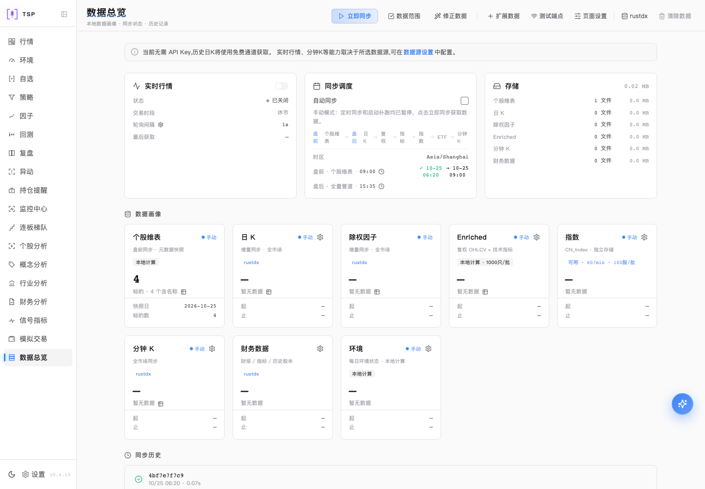
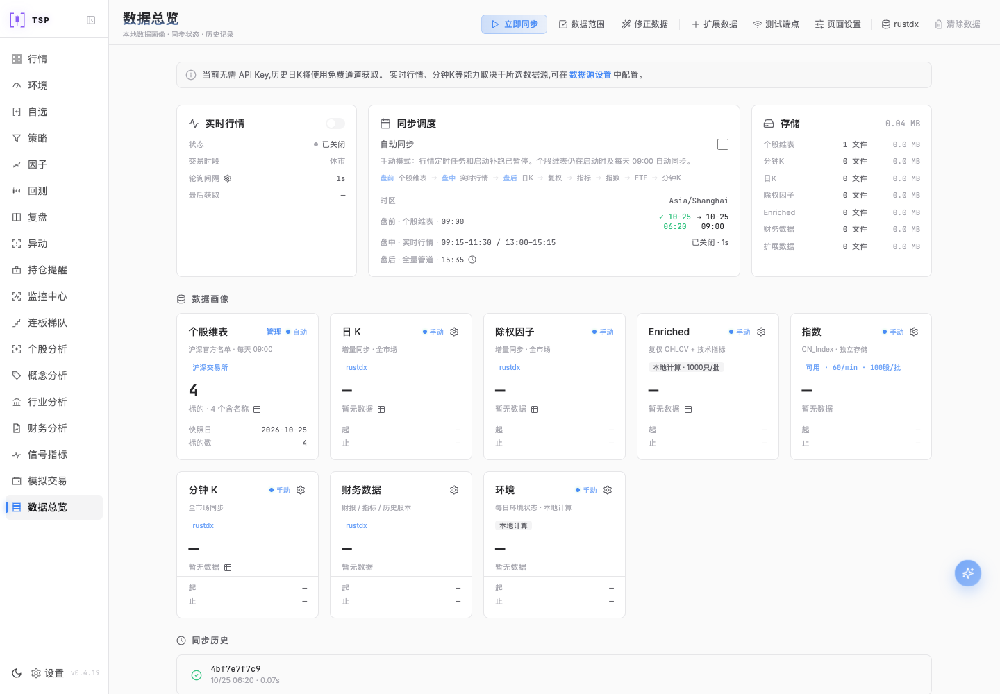
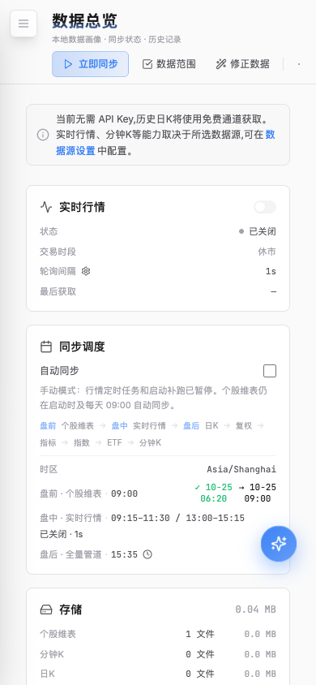
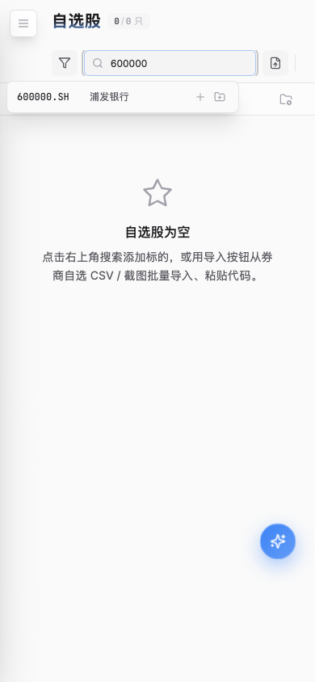
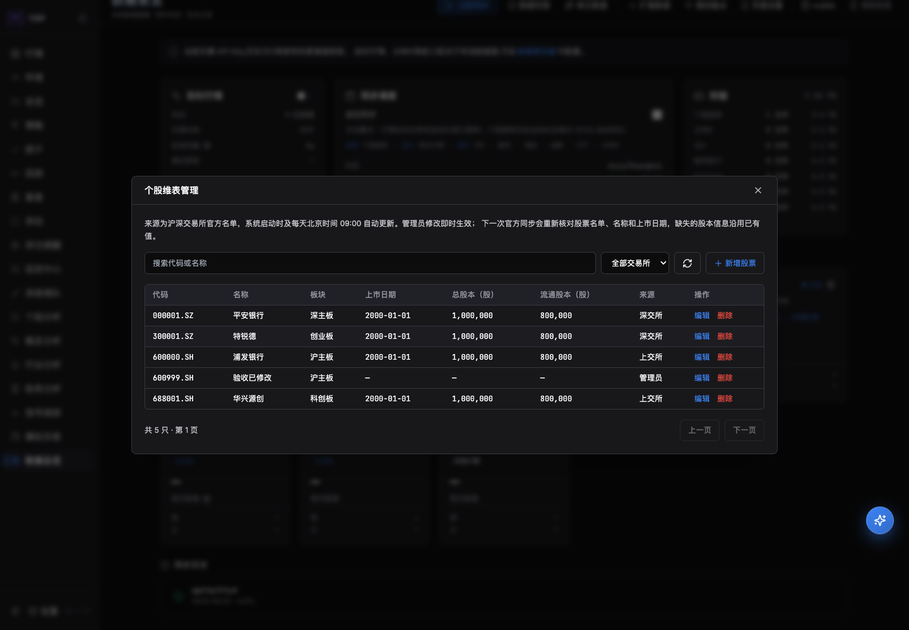
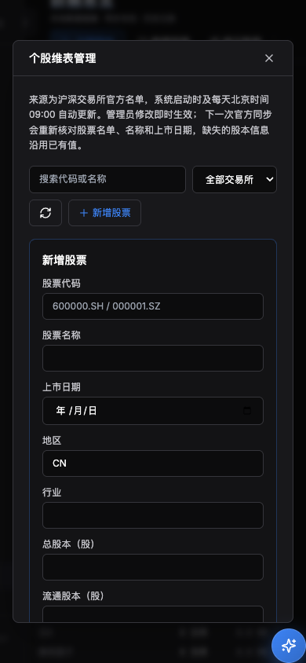

# 2026-10-25 生产工程基线整合

本轮按生产系统职责核对目录，整合全部有效本地变更，同步需求、方案、开发、测试、
运营和运维。冻结起点为 `31cf1a553dbc806aac6e6f93f30f4f41b646aa3e`（0.4.19），
分支 `chore/production-baseline-20261025`。起始快照含58个新增或修改文件；
之后的工程与文档增量列入[逐文件清单](file-inventory.tsv)，其中记录重命名前后路径。
版本仅由合入main后的CI分配。提交前逐个比较起始文件的SHA-256，未发现后续并行变更。

## 范围与目录

当前生产工程采用模块化单体，七运行角色复用后端；前端、MCP、原生桥接、部署、
打包、工具、测试、规范和证据按发布单元与职责归属。
完整树与责任边界以[工程布局](../../docs/reference/engineering.md#layout)为准。

| 调整 | 原位置 | 当前归属及兼容 |
| --- | --- | --- |
| HTTP联调示例 | docs/examples/custom-data-source的README、Python和YAML | 统一移至examples/custom-data-source；更新运行命令和协议链接 |
| 示例导航 | 两处目录分别查找 | examples/README.md统一说明用途、前置条件和真实数据边界 |
| 源码恢复 | 工作区外一次性工具 | scripts/release/source_recovery.py；工具测试在tests/tooling |
| 股票目录 | 原日线Provider/SDK目录取数 | official_stock_catalog接入→instrument_sync/catalog服务→instruments API→data组件 |
| 顶栏 | 页面内分散布局 | PageHeader与公共样式；自选搜索弹层在工具栏滚动区域之外展示 |

主启动器、前后端包路径、SQL迁移、部署入口和运行数据目录保持现有契约；
未为尚未实现的ClickHouse、Kafka/Flink、Ray等目标创建占位服务。

## 业务行为与六类文档

| 变更 | 需求 | 方案与开发 | 验证重点 | 运营与运维 |
| --- | --- | --- | --- | --- |
| 官方个股目录及管理 | FR-DATA-04/05/08、FR-ADMIN | 两市四板完整校验；目录写锁与仓库写锁；SCD2和发布/缓存链 | 两市总数/重复/空数据、管理员CRUD与成员拒绝、同日删除、写入失败恢复历史 | 启动及每天北京时间09:00执行，休市日也执行；失败保留旧表；旧调度偏好不再生效 |
| 管理员个人空间 | FR-ENTRY、FR-ADMIN、NFR-09/20 | 复用容量锁、预留任务、双库初始化和事件授权变更 | 并发、失败重试、容量、停用保护、租户隔离与已有选择保留 | 有效管理员缺空间时自动创建；失败保留管理登录，私有业务等待空间就绪 |
| 顶栏与数据总览 | FR-UI-05、FR-DATA-07 | PageHeader、集中查询键和真实状态；数据首排1:2:1 | 桌面/窄屏、浅深色、长操作区、搜索弹层、目录表单 | 标题统一；盘前/盘中/盘后调度与七项存储可见，空数据保持可解释 |
| 工程与文档 | NFR-01/04/06/10 | 单一规范入口、examples统一、目录门禁 | 链接/锚点/围栏、204编号、样例路由、最终diff | 原203编号保留，新增FR-UI-05；邮件未配置不可用，避免默认账号与邮件可用性混淆 |
| 源码恢复 | NFR-08/10 | 只读Git选取已合入的版本，临时生成后完整校验 | 六版本、未打标签/非祖先、损坏/越界/重复、旧目录保护 | 保留最新+5源码，Git历史和标签不变；生产数据与依赖独立备份 |

六类主入口：
[需求](../../docs/requirements.md)、
[方案](../../docs/architecture.md)、
[开发](../../CONTRIBUTING.md)及[二开](../../docs/secondary-development.md)、
[测试](../../docs/testing.md)、
[运营](../../docs/release-operations.md)、
[运维](../../docs/operations.md)。
使用说明同步到[操作说明书](../../操作说明书.md)，逐组映射见
[生命周期追踪](../../docs/reference/engineering.md#trace)。

## 验证记录

环境：macOS，独立worktree、Python 3.12、按uv/pnpm冻结锁安装的独立依赖。
后端设置 `TICKFLOW_ENV_FILE=/dev/null`、`MULTITENANCY_ENABLED=false`、
`SERVICE_ROLE=standalone`、一次性 `DATA_DIR`、`POLARS_MAX_THREADS=4`。
SQL验收使用隔离PostgreSQL，真实凭据不写入报告。

| 检查 | 实际结果 |
| --- | --- |
| 前端 `pnpm test` | 49文件、232项通过 |
| 前端 `pnpm lint` | 退出0；0错误、74条警告 |
| 前端 `pnpm build` | TypeScript和Vite生产构建通过；ECharts包体积警告仍在 |
| 恢复工具测试 | 18项通过，带v/不带v两种版本文件格式均覆盖真实Git临时仓库和故障路径 |
| 后端 `pytest tests -q -ra` | 4209通过、10跳过，304.04秒；含隔离PostgreSQL身份/租户链路 |
| 工具 `pytest tests/tooling -q` | 134通过，79.27秒 |
| `make check` | 87路径、31当前Markdown、版本一致性、diff空白检查通过 |
| `check_docs.py --include-reports` | 90份Markdown通过；新增本报告后的数量以CI最终检查为准 |
| 后端Ruff差异审计 | 基于同一配置从backend目录比较基线与当前：252项历史发现，0新增；两处测试修订和恢复工具单独检查通过 |
| 移动后的HTTP示例 | 真实FastAPI TestClient验证health、日线、实时三个端点，YAML解析通过 |
| 浏览器顶栏 | 20路由×桌面1440×1000/窄屏390×844；标题、最小高度、边界和无框架错误层断言通过 |
| 浏览器交互 | 个股目录新增→改名→空搜索→删除；移动表单取消/Escape关闭；自选搜索弹层可见且未被工具栏裁剪 |

10项跳过：Windows句柄语义1项、既有空日期参数化分支6项、无Docker Compose CLI
导致3项跳过。原生Rust与Linux完整环境交由PR/主线CI验证，不将本地跳过写作通过。
全量测试首次发现旧目录来源fixture和旧行schema期望未同步，修订后重跑全量通过；
未提高测试超时或放宽业务断言。

恢复工具另以真实`origin/main`执行create与verify，六个源码归档（0.4.14–0.4.19）
全部校验通过。该实跑暴露并修复了VERSION文件的`v`前缀读取问题，工具改为复用
`scripts/versioning.py`；新增前缀回归用例先复现失败，修复后工具全量通过。
合并完成后的正式恢复集合以新主线标签再次生成。

浏览器使用独立本地前后端、真实API与临时存储；官方网络输入固定为两市四板的4只样例，
关闭实时行情与行情自动同步以隔离外部副作用，官方启动任务仍执行。此设置是验收夹具，
不改变新部署自动同步默认值。Browser工具不可用，按测试技能使用已有Playwright和
独立无头Chrome。前后截图分别来自冻结基线前端和当前前端，共用同一夹具后端，
只能证明界面差异，不能用作旧版后端行为证据。

目录CRUD页面无JavaScript运行异常。控制台的GitHub最新版本查询403及下载清单CORS
错误来自外部更新检查；SSE离页取消产生ERR_ABORTED，均未影响目标流程。
没有将整个控制台声称为零错误。

界面证据见同目录：修改前后桌面数据页、窄屏数据页、自选搜索弹层及深色目录表单。

## 复审结论

作者按贡献指南检查完整差异、数据口径、SCD2、缓存发布链、管理员权限/重试、
旧数据读取、目录路径和恢复工具失败保护：未发现阻断问题，本地验证结论可合并。
未宣称独立维护者已批准；按仓库单人维护例外处理PR复审，质量检查仍须全部通过。
无性能提升主张，未进行生产规模压测；官方源持续可用性不由确定性fixture证明。

## 兼容与回退

- 当前股票池以沪深官方目录为准，不属于八项可选行情路由；不再跟随日线Provider。
  旧快照缺来源字段仍可读；官方缺股本时保留已有值与来源日期。
- 目录管理删除保留历史行情，成功官方同步可恢复仍在册证券；来源变更不倒填历史状态。
  官方目录与行情任务独立单飞，写入临界区共用锁，正常停机等待有界目录任务退出。
- 无新SQL迁移。管理员初始化不重置密码、已有租户选择或停用状态。
- 顶栏改动保留原按钮和查询；UI验证不能替代全部业务计算验收。
- 目录回退时同步恢复样例位置、引用及目录检查器。源码恢复工具不改Git引用或旧备份。
  生产回退需匹配代码、schema、公共版本、私有数据和增量水位。

## 发布与范围限制

本记录不表示生产部署或安装包发布。没有执行生产切流、真实SMTP投递、Win10真机、
完整交易日、官方源持续可用性或万人负载验收。二期第二步持续签收与第三步目标保持原状态。
合并前核对完整diff、必要CI与讨论；合并后核对CI版本提交和标签，再生成最新+5恢复清单。
