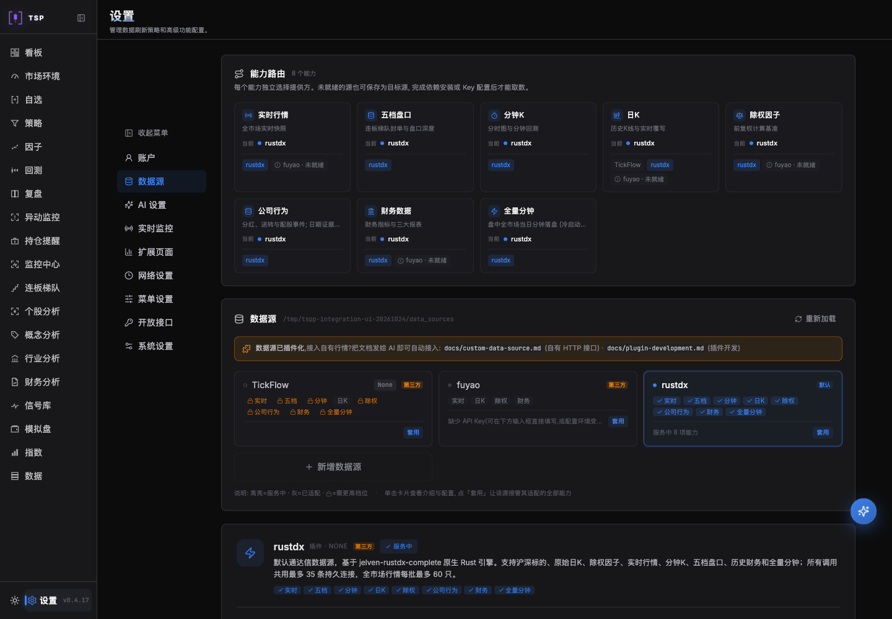
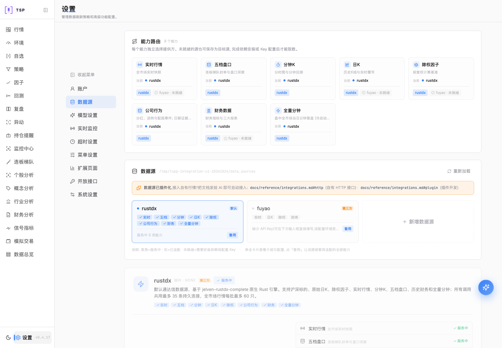
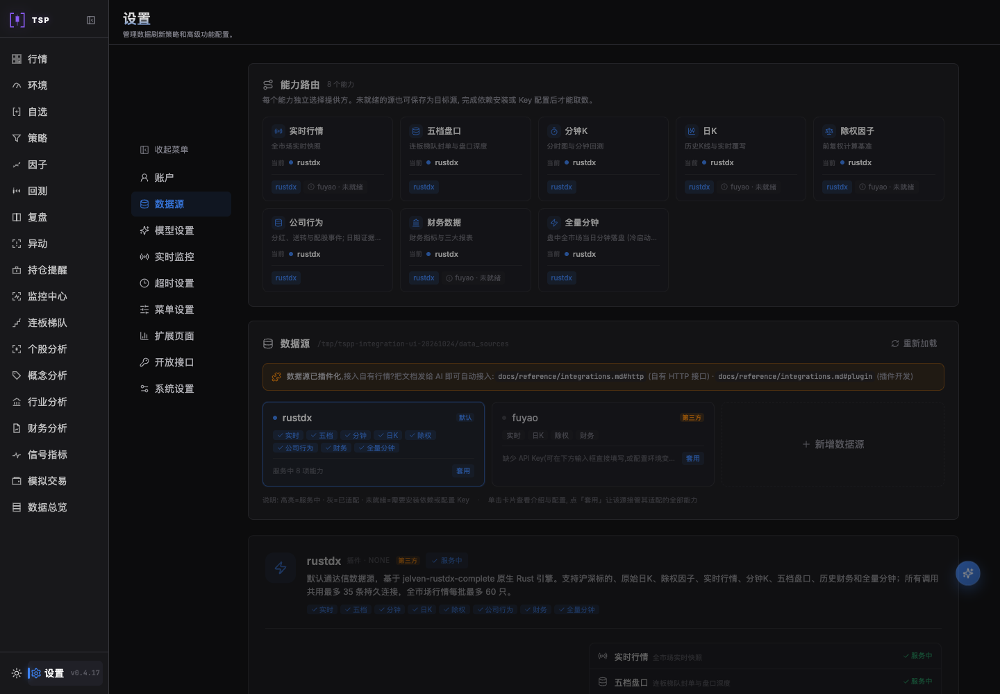
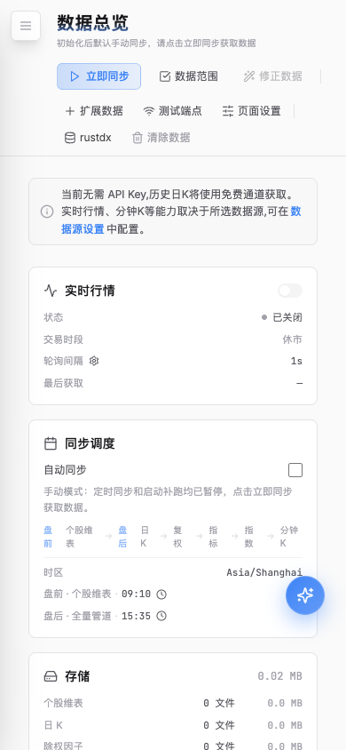

# 页面核对

环境：隔离本地API `http://127.0.0.1:3418`、生产前端构建、全新无头Chromium。
当前会话没有可调用Browser工具，使用临时Playwright脚本；桌面1440×1000、移动390×844。
API使用一次性空DATA_DIR，不调用真实行情、邮箱或AI；只写入本次测试偏好。

| 检查 | 结果与证据 |
| --- | --- |
| 页面身份/非空/框架遮罩 | 标题TSP · Quant Terminal、登录/数据总览/设置路径正确，主要控件可见，无框架错误遮罩 |
| 默认值/交互 | 新浏览器默认亮色；admin登录→跳过首次向导/获取数据弹窗→数据总览→自动同步开/关→文本及HTTP保存一致；重载后手动状态保持 |
| 数据源 | rustdx第一、fuyao第二；TickFlow不在设置卡片/选择项，八能力路由可读 |
| 主题 | 通过真实按钮切到暗色，重载仍为暗色；再切亮色 |
| 移动端 | 390px无页面横向溢出，操作区换行、手动同步开关和状态可操作 |
| 页面运行错误 | `pageerror`为0 |
| 控制台/外部网络 | 有限制：GitHub匿名版本接口返回403，Release的latest.json被CORS阻止；目标本地API交互通过，不宣称更新检查成功 |

原始观测字段见[result.json](result.json)。403来源是当前仓库/开源观察对象的GitHub
Release查询；未绕过外部限制。真实市场数据、付费源、账户跨租户联调、全部研究流程、
Windows10和安装包不在本次页面检查范围。

对照图使用`cc837b95`的原前端构建，共用当前隔离API；只证明视觉差异，不用于
旧后端行为或旧能力注册表顺序验收。用户已有主题和菜单偏好由自动化回归覆盖。

