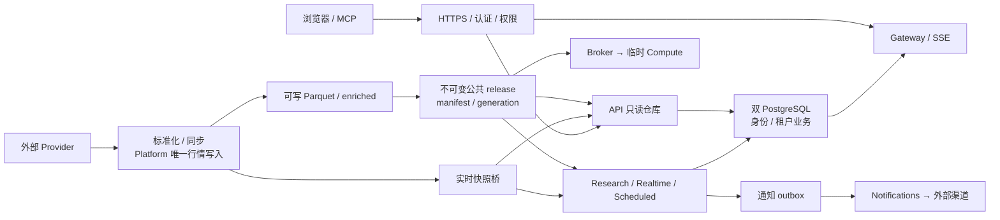
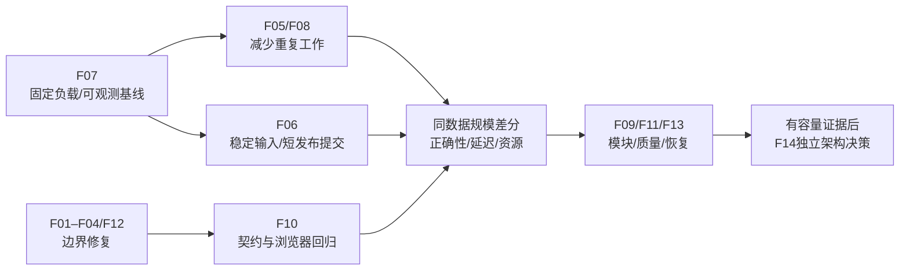

# TSP 项目分析与优化方案

评估日期：2026-10-26。评估对象：当前工作区，基线提交 `cb0eb2820f1d7e8650fb7daf92b9725557d6dd1c`，应用版本 `0.4.30`，分支 `fix/repair-missing-data-20261026`。

**建议保留现有模块化业务引擎及单机多租户拓扑，优先完成数据迁移保护、请求与任务边界、统计查询和发布锁优化，再按实际容量决定分布式建设。** 当前最有价值的工作是提高现有系统的可靠性、可解释性和维护效率。

本次已复现四类具体缺陷或边界问题：旧桌面目录迁移误放/删除旧文件、前端请求截止时间覆盖不完整、独立模式策略等待队列无上限、MCP 日 K 参数与后端不一致。另确认公共缓存冷请求会重复计算。生产性能收益尚未实测，不给出百分比提速承诺。

## 1. 评估口径与当前状态

采用全仓结构统计、关键调用链抽查、现有测试复跑、静态检查、生产构建和临时目录隔离复现。覆盖数据接入、存储/缓存、策略/监控/回测、认证/租户、API/SSE、前端、MCP、部署/备份/CI及文档。**这是一轮项目级评估，不是全部源码逐行审查、生产压测或上线放行。**

| 对象 | 本轮事实 | 结论边界 |
| --- | --- | --- |
| 源码 | HEAD 为上述提交，当前代码包含上一任务的遗漏数据修正补丁 | 不能把未提交补丁视为已合并或已部署 |
| 运行环境 | 本轮使用隔离测试目录，未连接 ECS，未触发真实行情采集/策略任务 | 当前生产 SHA、数据覆盖和延迟未重新核验 |
| 历史部署证据 | 版本基线及六周期发布记录保留升级前 v0.4.29 信息，最终交付记录另行保存 | 历史记录不能证明此刻生产状态 |
| 工作区 | 原有 18 个已修改文件及原有未跟踪文件保留 | 本任务只新增本报告目录；不修改业务代码、配置或用户数据 |
| 验证 | 前端 356 项通过；后端定向 279 项通过、27 项跳过 | PostgreSQL 实库隔离与全量后端未在本轮签收 |

证据等级：

- **已复现**：实际执行当前实现，使用临时文件、模拟网络或隔离对象断言行为。
- **代码确认**：能从调用链直接确认结构或操作，不代表生产已发生相应故障。
- **历史证据**：来自既有带日期记录，只适用于当时环境。
- **待实测**：生产延迟、容量、收益、故障频率或恢复时限仍需采集。

### 1.1 项目规模

统计来自 Git 已跟踪文件的**当前工作区内容**，不包含依赖目录、运行数据和生成产物；行数包括注释与空行，不代表复杂度或测试覆盖率。

| 范围 | 文件数 | 行数 |
| --- | ---: | ---: |
| 后端 `backend/app` Python | 329 | 120,561 |
| 前端生产 TS/TSX，排除 `.test.*` | 270 | 81,994 |
| 后端测试 Python | 425 | 86,473 |
| 前端 `.test.*` | 75 | 8,008 |

另有本地新文件 `backend/app/services/kline_gaps.py`，200 行，未纳入已跟踪文件统计。当前已经是需要明确领域边界的中型系统。

主要维护热点：

| 文件/函数 | 当前规模 | 优化含义 |
| --- | ---: | --- |
| `frontend/src/lib/api.ts` | 5,030 行 | 类型、端点和领域操作汇集在一个文件，契约修改容易波及多处 |
| `frontend/src/pages/backtest/StrategyBacktest.tsx` | 3,272 行 | 页面承担较多参数、任务、结果与图表编排 |
| `backend/app/backtest/matrix.py` | 4,736 行 | 矩阵模型、加载、缓存和特征计算集中 |
| `backend/app/tickflow/repository.py` | 2,783 行 | 存储初始化、视图、缓存、实时递推及查询集中 |
| `StrategyBacktestService.run` | 757 行 | 输入准备、执行分支、归因和结果组装需要逐步划分 |
| `jobs/daily_pipeline.run_now` | 721 行 | 同步阶段、发布、缓存及失败处理的改动耦合较强 |

文件长只是定位信号。拆分必须沿职责和测试边界进行，避免机械切文件产生更多跨模块状态。

## 2. 已有能力与应保留的设计

项目具备较好的领域基础，优化应复用以下能力：

| 领域 | 当前已存在的措施 | 本轮判断 |
| --- | --- | --- |
| 数据源 | 七项能力路由、Provider 标准化、插件加载与能力矩阵 | 保留；不在上层硬编码某个供应商 |
| 行情存储 | Parquet、DuckDB/Polars、独立资产/周期分区、generation | 适合现阶段单机分析和只读共享 |
| 发布 | 公共不可变版本、校验和、原子 current、只复用旧不可变文件硬链接、容量保护 | 正确性设计应保留；缩短操作期间的写锁占用 |
| 金融口径 | 原始价成交约束、复权指标、T+1、费用、历史状态未知标记、公司行为日期门禁 | 继续把口径正确性放在性能之前 |
| 策略 | 动态目标解析、统一执行契约、共享矩阵、稳定身份、持久历史和有界热缓存 | 不再建立第二套策略结果或候选池 |
| 多租户 | 双 PostgreSQL、强制 RLS、非 owner/非 BYPASSRLS 运行角色、租户事务 | 边界较完整；本轮未复跑真实数据库验收 |
| 计算隔离 | 单主机 Broker、无网络/无凭据 Compute、资源硬限、普通租户一个任务槽 | 保留；独立模式仍需补齐等待准入 |
| 前端 | 页面 lazy、共享查询、集中 query key、账户范围校验、部分列表虚拟化、共享 Modal | 已有优化不能重新包装为“待建设” |
| 实时恢复 | SSE 票据轮换、退避重连、私有事件 reset、REST 恢复 | 保留；完善请求取消和连接故障自动化验证 |
| 工程 | 锁文件、全量 CI、增量 Ruff、开放契约快照、同 revision 产物、恢复验证脚本 | 补足边界测试与语义漂移检查 |

此前用户要求的多组自选、全部去重、引用保护、监控重读目标、统一弹窗和全量/遗漏修正，当前已有相应实现或本地补丁。本方案不重复发起这些功能；后续优化须保留它们的回归用例。

## 3. 系统地图与责任边界

### 3.1 当前完整多租户数据流



独立模式由一个 API 主进程持有调度、事件和部分任务状态；它不能通过直接增加 Uvicorn worker 扩容。完整多租户模式已有角色拆分，但 Broker、行情写入和公共版本仍以单主机协议为边界。

信任边界：

1. 外部行情在 Provider 入口转换代码、单位、时区和空值，内部服务消费标准字段。
2. 浏览器/MCP 在认证和权限层进入系统；工具展示 scope 不能替代后端权限判断。
3. 私有状态进入带租户上下文的事务；公共缓存只保存公共结果。
4. 用户计算进入 Broker 的无网络、无凭据沙箱。独立模式自定义 Python 属于本机受信扩展，不能把同一承诺直接用于远程多用户环境。
5. 公共 release 是可复现研究的输入边界；源数据、派生指标和模拟交易账务必须保持各自身份。

### 3.2 领域责任图

责任暂以维护路径表示，具体人员由项目维护者分配。

| 领域 | 模型/语言 | 上游与关系 | 下游与关系 | 转换边界 | 责任/检查路径 |
| --- | --- | --- | --- | --- | --- |
| 接入与同步 | 标准 OHLCV、因子、财务、公司行为 | 外部供应商：防腐层 | 仓库：供应者；质量治理：协作 | 字段、单位、北京时间、资产类型 | `data_providers/`、`services/kline_sync.py`、Provider 契约测试 |
| 存储与发布 | Parquet schema、generation、release | 同步：客户/供应者 | 研究/行情：供应者 | 可写数据转不可变版本 | `tickflow/repository.py`、`multitenancy/publication.py`、`test_full_platform.py` |
| 身份与租户 | account、权限、租户、auth/routing epoch | 客户端：受控访问 | 私有业务：上游权威 | 身份映射到事务权限与 RLS | `cell/database.py`、`multitenancy/access.py`、实库身份测试 |
| 策略与研究 | 参数、目标池、逻辑版本、结果身份 | 行情：遵循契约；私有配置：客户 | 回测/监控：共享金融规则；归档：供应者 | 动态成员转执行快照，信号转结果 | `strategy/`、`services/strategy_results.py`、目标/历史测试 |
| 回测与模拟账务 | 信号时间、成交时间、数量、现金、权益 | 策略/行情：遵循契约 | UI/归档：供应者 | 复权信号转原始价成交，事件转账本 | `backtest/`、`strategy/paper*`、正确性/公司行为测试 |
| 实时与通知 | 快照序列、告警、outbox、租约 | 行情/策略：客户 | Gateway/通知渠道：供应者与防腐层 | 同一事件转显示通知及独立交易意图 | `quote_service.py`、`multitenancy/runtime.py`、监控/通知测试 |
| 前端与开放客户端 | API DTO、query key、账户范围、图表 | API：遵循契约 | 使用者：展示与显式操作 | DTO 转显示单位与交互状态 | `frontend/src/lib/`、共享组件、`mcp-server/` |

## 4. 优化清单与优先级

优先级 **A** 为首批处理，**B** 为第二批，**C** 为达到明确条件后建设。这里的排序是实施价值，不等同于仓库 PR 缺陷严重级别。工作量是一个熟悉项目的开发者的初步工程日估算，不是承诺工期。

| ID | 优先级 | 项目 | 证据 | 主要收益 | 初估 |
| --- | --- | --- | --- | --- | --- |
| F01 | A | 旧桌面迁移保护 | 已复现 | 防止配置误放和旧文件丢失 | 1–2 日 |
| F02 | A | 请求截止时间与取消 | 已复现 | 避免持续加载、释放切页/取消请求资源 | 0.5–1.5 日 |
| F03 | A | 独立策略等待队列有界化 | 已复现 | 防止不同任务积压占内存 | 1–2 日 |
| F04 | A | MCP/API 参数一致性 | 已复现 + 签名核对 | 避免工具参数静默无效 | 0.5–1 日 |
| F05 | B | 公共缓存单飞与统计投影 | 已复现 + 代码确认 | 减少冷请求重复聚合与历史扫描 | 2–4 日 |
| F06 | B | 公共发布缩短写锁 | 代码确认，耗时待测 | 降低发布对行情写入的影响 | 3–5 日 |
| F07 | A，持续 | 生产观测基线与超时结案 | 代码确认 + 历史证据 | 准确定位瓶颈和验证收益 | 2–3 日接线 + 实际观察窗口 |
| F08 | B | 按需加载私有因子定义 | 代码确认，收益待测 | 减少无关请求数据库工作 | 1–2 日 |
| F09 | B | 分领域客户端与热点拆分 | 结构统计 | 降低修改耦合和升级冲突 | 每个热点 1–3 日 |
| F10 | B | 浏览器、类型与客户端契约门禁 | CI/配置确认 | 减少跨层和渲染回归 | 2–4 日 |
| F11 | B | 数据覆盖和研究可信度可见化 | 代码确认，历史覆盖待核验 | 区分可用、完整和严格历史时点可得 | 2–4 日 |
| F12 | A | 运行模式与发布状态文档去漂移 | 代码/文档不一致 | 降低安装与支持误判 | 0.5–1 日 |
| F13 | B/C | 备份恢复指标及保留成本 | 脚本确认，线上指标待测 | 明确恢复能力、停写窗口和容量 | 1–2 日量测；改造另估 |
| F14 | C | 十年历史及多人容量扩展 | 明确后续需求 | 支撑真实大型负载 | 通过容量决策后单独设计 |

### F01：旧桌面目录迁移需要先保护数据

证据：`DataStore._migrate_legacy_data_dir`，见 [E01](#证据索引)。

触发条件为冻结桌面运行、旧目录存在、新目录没有 Parquet/JSONL。新目录即使已有 JSON、SQLite 或其他配置，也会被视为可迁移。两个明确路径：

- 同名目录执行 `move(item, dest/item.name)`，例如旧 `user_data/preferences.json` 被放到新 `user_data/user_data/preferences.json`。
- 同名普通文件直接 `item.unlink()`，旧文件被删除，没有冲突备份。

临时目录复现中，旧偏好确实落入嵌套目录、冲突旧文件确实被删除。**这证明实现边界存在问题，不说明某位真实用户已经丢失数据。**

建议：先生成迁移计划和文件清单，将任何持久业务/配置文件都视为实质数据；遇到冲突保留双方并给出可定位状态。只迁移明确无冲突的路径，验证结构/文件摘要后再完成迁移。无需建设通用迁移框架。

验收：空目标、目标已有配置/数据库、同名目录、同名文件、跨盘/权限失败、迁移中断重启均保留原文件；偏好、身份和策略仍在当前读取路径；不重置用户密码或 SMTP。

### F02：请求 timeout 只覆盖到响应头，传 signal 时还会失效

证据：`frontend/src/lib/api/client.ts:30–92`，见 E02。

当前 `fetch()` 返回后即清除 timer，随后才执行 `response.text/json()`。当服务器先返回头部、正文长期未结束时，整个请求没有剩余截止时间。另外，调用方传入 `signal` 时不创建 timeout controller。

本轮用当前请求函数、模拟 fetch 与 timer 执行，确认正文仍 pending 时 timer 已为零；传入 signal 时没有创建截止时间 timer。账户范围的前后校验已经存在，**本问题不等于账户数据串读**。

建议：组合外部取消信号与内部截止时间，覆盖 fetch 和正文读取全程；区分主动取消、超时和普通网络错误。领域 API 可接受 request options，TanStack Query 的 `signal` 沿调用链传入。事件流保留专用心跳/重连机制，不套普通 JSON 请求期限。

验收：响应头前超时、正文延迟、带 signal 超时、主动取消、204、错误正文、账户切换迟到响应；取消不弹误导性失败提示，所有 timer/listener 都被释放。

### F03：独立策略批跑的执行有界，等待准入无界

证据：`StrategyRunManager` 和 `_run_all_progressive`，见 E03。

相同 key 会搭车，计算串行且任务执行受预算控制，这是已有保护。但 `_queue` 为 `queue.Queue()`，`maxsize=0`；不同日期、策略集合或参数对应不同 handle，可以不断进入队列。临时对象接受了 40 个不同 key，本轮未启动任何真实策略计算。

建议：在创建 handle/保留执行闭包之前做等待准入，队列满返回现有 429 语义；同 key 继续搭车。显示排队/运行/取消状态，过期排队任务可取消并释放捕获对象。复核数据 generation 改变时的同任务身份，避免只按参数搭车。

不建议让前端静默覆盖已经接受的用户研究任务。latest-only 只用于明确的实时刷新语义。完整多租户的持久 SQL 任务及 Broker 已有另一套准入，本修改应限定独立路径。

验收：持续不同 key 不超过上限；同 key 无重复执行；满队列和取消无悬空 handle；关停不接受新任务；配置降低不破坏已准入任务。

### F04：MCP 日 K 工具的参数不会按说明生效

证据：`mcp-server/.../server.py` 的 `get_kline` 发出 `{symbol, limit}`；`api/kline.get_daily` 接收 `days/start_date/end_date/freq`，没有 `limit`，见 E04。

例如工具传 `limit=30`，后端仍采用默认 `days=120` 窗口。这个请求可以成功，因此仅检查 HTTP 200 或握手不能发现偏差。

建议：先明确工具表达“日期回溯窗口”还是“返回根数”。采用与 API 相同的 `days/start/end` 语义，或由明确适配层实现最后 N 根；不要把自然日天数和交易日根数混同。变更时保留已公开工具的兼容解释，并统一北京时间日期边界。

现有 smoke 脚本只实际调用搜索、市场总览和环境，不测日 K；当前 CI 也未运行 MCP 契约测试。新增离线参数映射及真实隔离 API 响应断言即可，不需要真实 Token 或外部服务。

### F05：数据总览需要减少冷聚合，并逐步采用统计投影

证据：`PublicQueryCache.get`、`api/data._safe_aggregate`，见 E05。

已有 TTL、按表失效和跨数据根隔离，但 fetch 在锁外执行，未设置同 key 计算者。两个同时进入的冷请求会各执行一次 fetch，本轮已复现。

此外，统计 SQL 包含全视图 `count/min/max/count distinct`，分钟等大表通过较长 TTL 减少频率，但冷填充或数据更新后仍需要完整聚合。这是扫描结构事实，本轮未测真实历史规模耗时。

分两步实施：

1. 同 namespace/key/generation 只保留一个计算者，计算在全局锁外执行；等待者有截止时间，异常不缓存，失效后旧计算不得重新安装旧值。
2. 每次分区提交后记录小型统计投影，API 主要读取投影。每分区行数可加总；全局标的数必须使用集合/维表或校验聚合，不能把各分区 distinct 数相加。投影身份包括数据根、表、周期和 generation。

提供低频核对/重建入口并标记投影陈旧，保留现有聚合作为校验或恢复路径。只给公共数据使用此缓存，私有结果继续使用租户和 revision 身份。

验收：同数据规模下冷并发 fetch 次数下降、读行/字节减少；投影与原查询数值一致；删除、遗漏补采、局部覆盖和发布换代均正确失效。

### F06：公共发布的写锁覆盖历史扫描、复制和校验

证据：`PublicPublisher.publish → _publish`，见 E06。

当前在 `write_lock` 内核对覆盖、遍历全部公共目录、创建版本、复制变化文件、校验哈希、再次遍历并替换 current。已有五分钟发布间隔、旧不可变文件硬链接、容量保护，但临界区工作仍随文件数/变化字节增长。

建议先用已有 `public.publish_wait/public.publish` 指标量测，再改为“捕获稳定输入 → 锁外准备 → 短提交”。关键条件：

- 写入必须遵守统一原子替换协议，冻结输入具有可验证身份。
- 不把仍可改写的源文件直接硬链接为公共版本。
- 锁外复制期间若源变更，拒绝该候选，不发布混合版本。
- 提交阶段复核输入身份、原子切换 current，旧版本与活动研究引用继续保留。

如果无法证明输入可冻结，就先做脏分区清单/缓存 inventory，保留锁内复制正确性。**不能只把锁移走而没有快照协议。**

验收：相同历史数据与写入负载比较写锁 P95/P99、发布总耗时和行情停顿；故障/磁盘不足保留旧 current；每个校验和可重读，活动研究输入不被回收。

### F07：先建立能定位瓶颈的生产基线

证据：进程内 HTTP/阶段指标、数据库池统计、历史自选超时调查，见 E07。

已有请求 ID、低基数 HTTP 分位数、认证/租户/发布阶段指标及 `pool_stats()`。不足在于这些大多是进程快照，重启清零，多 API 进程需要分别观察。不能把一次请求落到某进程的 `/api/observability` 当作全系统指标。

历史调查已证明一次五秒业务池获取超时，尚未证明连接泄漏、具体 I/O 调用或永久根因。快照切换约两秒延迟是当时证据，不能单独解释夜间较长停顿。

建议：

- 按服务角色/进程聚合计数和直方图，保留滚动时间窗；不能平均各进程 p95。
- 同步记录池等待、事务持有时间、公共发布锁、容器 CPU/RSS、主机 I/O PSI、行情源时间/接收时间。
- 请求 ID 用于日志关联，不作为指标标签；不采集真实授权信息、请求正文或 SQL 文本。
- 用固定混合负载比较“看盘 + 分区发布 + 一个受限研究任务”的冷热指标。
- 保留故障发生前后现场，使连接池/数据库/主机等待能形成同一时间线。

首轮建议沿用现有小档目标：常用热页面 P95 ≤200 ms，采集和统计按需求文件各自指标量测。这些是**建议目标**，不是本轮通过结果或供应商 SLA。定位前不通过扩大连接池/延长超时宣称修复。

### F08：部分无关业务请求也全量读取私有因子定义

证据：`multitenancy/access.py:179–187` 对有租户 context 的请求调用 `documents.values("custom_factors")`；`records` 读取 namespace 内完整 value，见 E08。

这保证请求内因子隔离，但自选分组等不消费因子表达式的操作也可能承担读取与反序列化成本。历史超时调用链同样经过这一步，**不意味着它就是连接池超时根因**。

建议先建立“哪些路由确实需要因子 registry”的明确集合或领域依赖，在使用处获取因子定义。必要缓存按租户、集合 revision、授权版本隔离；权限仍逐次验证，写入/撤权可使缓存失效。

验收：无因子需求的路由零因子全量查询；策略/因子路由保持原行为；双账户/租户切换、撤权、更新和旧请求迟到均不复用错误范围。

### F09：按领域降低大文件耦合

建议保留 `lib/api.ts` 作为兼容出口，逐步将实现移入 `lib/api/<domain>`，共享 `client.ts`、DTO和 query key；不一次修改全部调用方。开放 API 的稳定模型可生成 TS 类型，动态扩展字段继续使用有定义的扩展结构。

前端先拆回测页：参数草稿、任务 hook、结果阅读、图表。后端先拆回测执行编排和矩阵加载/缓存，保持公开入口与状态所有权。涉及原始价、T+1和跨日账户状态的执行内核不随意拆散。

拆分前先用现有测试固定行为；每个 PR 只处理一个职责。优先减少跨层导入、共享可变状态和多处参数转换，行数下降不是验收目标。

### F10：CI 已有质量门，下一步补边界覆盖

本轮前端 75 文件/356 项测试、ESLint、TypeScript 构建通过。后端 CI 已有全量测试、临时 PostgreSQL、原生桥接、开放契约和隔离 Web HTTP 验收。

应补强的明确缺口：

- 前端 CI 运行 Vitest/jsdom 和构建，未运行真实浏览器核心流程。HTTP 验收不能覆盖焦点、portal、布局及页面切换。
- MCP 工具参数映射未进入 CI。
- 后端 mypy 当前只检查 `public_query_cache.py`，动态字典边界和任务 DTO 仍需逐步扩大。
- 本轮全 `backend/app` Ruff 为 1,330 项，其中 Unicode 文案规则和无效 noqa 占较多；F/B 合计 62 项，也需逐条区分框架惯例、误报和真实风险。它们不是 1,330 个运行缺陷。

保留现有“不引入新告警”门：本轮相对 HEAD 的六个 Python 变更文件基线/当前均为80项，新增为零。逐模块处理历史告警、明确局部例外，避免功能 PR 全仓格式化。

浏览器最小集：登录/退出、账户切换、被引用自选组不可清空、监控开启重读、六周期/空值/根数控制、全量/遗漏修正、嵌套 Modal、SSE 换票/恢复。分别覆盖桌面与窄屏，用隔离服务和明确测试数据。

### F11：数据“存在”与研究“可信”分层展示

`data_quality` 已有最新分区覆盖、异常价格/成交量、历史输入信息，并明确 `historical_pit_verified=false`。历史证券状态、上市边界和公司行为门禁也已存在。

后续重点是让使用者在同一处看到：资产/周期/日期范围、应有/已有记录、未补齐、来源时钟是否可证、历史状态是否未知，以及当前任务执行完成和数据覆盖完成的区别。

遗漏补采应继续使用当前 `kline_gaps` 的证券/时间键，只补缺失；“字段为空或异常”属于另一类修正，不能混入缺记录判断。没有交易日/上市/停牌证据时应展示未知，而不是虚构完整度。

回测结果绑定策略/参数/目标池/输入版本及质量限制；涉及历史公告与修订、历史 ST 或退市覆盖的严格研究，按已有门槛拒绝或明确降级。不得将最新目录快照用于全历史分母。

### F12：文档检查还需要验证业务事实

`make check` 已通过目录、链接、需求和版本一致性，但不能检测所有语义冲突。

当前 README 说 macOS/Linux 桌面保留免登录；`Settings` 默认非 Windows 开启多租户，架构文档也说明默认多租户、显式关闭才免登录。需要区分源码默认、冻结产物配置、历史 Release和实际安装模式。

建议维护一份可读的模式矩阵：Windows 原生/桌面、macOS/Linux 源码/桌面、旧独立 Compose、完整多租户；列出认证、数据库/平台依赖、单写约束与检查命令。默认值从实际配置/启动器测试，产物覆写从相应构建清单核对。

源码 SHA、自动标签、正式 Release和生产 SHA/digest 继续独立记录。减少在多个手册顶部累积不同批次的“当前”说明，改为固定入口链接到最新可验证记录。

### F13：备份已经验证恢复，应进一步量测恢复时限和容量

脚本已有七角色停写、双库备份、恢复临时库比对、业务摘要、文件摘要、原子完成标记和恢复服务。不是“没有备份”。

目前备份窗口覆盖完整复制和恢复验证，数据增长会增加停写时间；本轮未读取生产备份位置或实际时限，不能判断是否超标。

先记录最新成功备份年龄、停写时长、双库恢复时间、文件恢复时间、抽样登录/账务核对和日增容量。RPO/RTO由业务目标确定；保留活动公共版本和研究引用，按真实日增长制定保留预算。

如果停写时长超过确定目标，再考虑在一致性捕获后恢复服务、对已捕获副本做离线验证，以及 PostgreSQL WAL/外部备份。跨双库和公共文件的一致恢复点必须证明，不能仅以各自备份成功替代。

### F14：分布式能力按真实瓶颈触发

需求已经列出十年历史、分层筛选、规模化回测及万人目标，且明确为后续建设。它们不能由单机百用户历史证据、页面数量或单条查询速度外推完成。

建议顺序：

1. 先证明现有小档/百用户混合负载与完整交易日行为。
2. 大型历史查询确实超出列式本地查询预算时，评估分析数据库和对象存储；新旧路径在相同真实输入上核对结果。
3. 跨主机计算确有需求时，再设计持久任务、输入引用、分块状态、配额、取消和幂等提交。
4. 多 Gateway/高可用前，先解决票据/游标/撤权共享、主备 fencing、Cell 单写迁移和恢复。

Kafka/Flink/ClickHouse/Ray等组件按既有远期目标做独立决策。当前不能通过直接增加副本或提升所有上限实现这些承诺。

## 5. 架构决策记录

以下均为**建议，尚未实施**。

### ADR-A：维持模块化引擎，先优化现有运行边界

决策问题：本轮应重构为更多服务，还是在当前拓扑内解决主要问题？

| 约束/驱动力 | 原因 |
| --- | --- |
| 统一金融口径与用户数据兼容 | 信号、成交、历史状态、账务和缓存身份不能在重构中分叉 |
| 桌面与单机服务并存 | 新依赖会提高安装、调试及恢复成本 |
| 容量证据有限 | 本轮没有证明跨主机扩容的实际必要性 |
| 现有隔离已经存在 | 多租户已有 API/Gateway/Platform/四 Worker/Broker |

| 方案 | 结论 | 收益/代价 |
| --- | --- | --- |
| 完全维持现状，只加机器/重试 | 不选择 | 改动小，但保留已复现边界和不必要计算 |
| 保留拓扑，强化准入/投影/短提交与领域模块 | **建议选择** | 复用现有契约；仍需维护单主机容量和失败边界 |
| 立即引入分布式数据/计算/消息体系 | 本轮不选择 | 可扩展性更强，但迁移、顺序、幂等、撤权和运维成本明显增加 |

决策：优先实施 F01–F13，保留现有模块化引擎与角色分工；F14由容量和可用性证据触发。

正面结果：部署依赖保持可控、问题可逐项验证、财务规则兼容和回滚成本较低。负面结果：单主机故障域与容量上限仍在，需要如实声明。

可逆性：多数准入、客户端、单飞及模块拆分属于可逆选择；新增持久投影要有 schema/version 和重建路径。跨数据库、跨节点和账务迁移属于高成本选择，应另立 ADR。

重新决策条件：同一实际负载在完成本轮优化后持续超出预算；明确需要单主机故障下继续服务；或不同领域确实需要独立发布/扩容。

责任：项目维护者 + 相关模块作者；检查路径为第7节架构约束和现有 CI/验收脚本。

### ADR-B：以可重建投影服务列表，发布采用稳定输入和短提交

决策问题：如何降低大历史数据对在线统计和发布边界的影响？

| 约束/驱动力 | 原因 |
| --- | --- |
| 多次查询不应重复扫描同一代数据 | 列表和画像是派生统计，输入版本明确 |
| 行情不能长时间等待历史文件工作 | 发布和实时写入共享临界区 |
| 不允许半成品与混合版本 | 公共版本供研究和多进程只读消费 |
| 需要可恢复 | 投影丢失或陈旧时要能重建/回退 |

| 方案 | 结论 | 收益/代价 |
| --- | --- | --- |
| 增大 TTL、降低发布频率 | 作为短期缓解 | 简单，但冷扫描/锁占用仍在，陈旧时间更长 |
| 同 key 单飞 + 分区统计投影 + 稳定输入准备/短提交 | **建议分步选择** | 降低重复工作，增加投影一致性与快照协议测试 |
| 立即切换外部分析库/消息平台 | 达到 F14 条件再评估 | 能支持更大负载，但增加双写/迁移/恢复与运行依赖 |

决策：先单飞和量测，再投影；发布改造必须先证明输入冻结协议。证明不了时保留正确性锁，优化 inventory与变化清单。

交互方式：HTTP 读取有界小投影，SSE 仅通知版本/状态变化，批处理构建派生数据，查询缓存复用当前代；重任务通过既有任务入口，避免页面读取触发全历史计算。

正面结果：同一代输入更少重复计算，列表读取不随历史量直接增长；发布提交更短。负面结果：投影成为需要版本校验的派生状态，快照准备增加磁盘与失败处理成本。

可逆性：保留原聚合作为校验/重建路径，投影可丢弃重建；发布可用独立开关回到现有协议。成本为额外读取/重建，不涉及私有账务迁移。

重新决策条件：投影更新成本反而大于查询成本；写入方式不满足稳定输入；或分析规模实际超出现有读/存储预算。

责任：仓库/发布模块作者；检查路径 `test_public_query_cache.py`、`test_full_platform.py`、数据画像测试和真实混合负载记录。

## 6. 依赖与可运维性

| 依赖/选择 | 诊断与维护入口 | 变更/替换条件 | 故障降级/退出路径 |
| --- | --- | --- | --- |
| rustdx/其他 Provider | 能力矩阵、provider audit、原生桥接检查、池统计、标准化契约测试 | 同输入/单位/时钟核对后显式切路由；桥接依赖按锁定 revision构建 | 保留最后有效结果并显示不可用/陈旧；严格计算拒绝，不静默跨源 |
| Parquet/DuckDB/Polars | 数据版本、分区/扫描计划、字节数、RSS、缓存计数、并发回归脚本 | 大型查询真实超预算后评估新的只读分析路径 | 回到已发布版本或一致备份；新路径可回到原路径；不猜测填补错误金融数据 |
| 双 PostgreSQL | pool stats、阶段耗时、活动等待、schema/RLS检查、隔离恢复 | 先定位等待；连接预算逐角色核算；代理/HA另行设计 | 核心私有写拒绝；保存可诊断状态；按配套代码/schema/数据恢复 |
| Broker/Docker Compute | 实际沙箱健康检查、资源/等待额度、退出码、受限 stderr尾部 | 跨主机并发需持久配额/输入引用/幂等协议 | 任务有界重排或明确失败；公共看盘可降级，不把计算失败变成成功 |
| AI/通知 | usage/取消、通知 outbox、任务状态、协议适配 | 显式配置替换，确保输出/副作用边界仍受控 | 生成/投递失败与核心行情解耦；重试幂等，不恢复已失效确认动作 |
| React/图表/MCP | 类型构建、浏览器核心流程、实际工具/API契约测试 | 锁文件升级、产物体积与行为一起验证 | 显示明确加载/错误/未知状态，保留有效数据；客户端参数不能静默忽略 |

依赖治理应检查实际锁定版本、许可证和可用性，并为版本升级单独复跑相关测试。本轮没有执行联网漏洞审计，不对依赖安全状态下结论。

## 7. 可执行的架构约束与指标

“已有测试”指当前仓库存在；“拟新增”不表示已经实现。所有延迟阈值属于建议验收值，需按实际环境固定。

| 属性 | 指标/规则 | 数据来源/本地检查路径 | 频率 | 失败响应 |
| --- | --- | --- | --- | --- |
| 依赖方向 | 通用策略/回测不直接绑定供应商；前端页面不直接拼第二套请求/缓存 | Provider测试 + 拟新增 AST/import规则，允许清单明确例外 | 每PR | 拒绝新越界依赖，回到标准入口 |
| 契约兼容 | Tier A schema/路径不无意识变化；MCP参数必须被对应API消费 | 已有 `test_openapi_contract.py`；拟新增 MCP映射/响应断言 | 每PR | 阻止契约漂移，按兼容策略更新 |
| 数据迁移 | 冲突双方零丢失、路径结构正确、失败可重试 | 拟新增桌面迁移临时目录测试 | 每次迁移改动/平台发布 | 不完成有风险迁移，保留原始目录 |
| 请求生命周期 | timeout覆盖正文；外部signal与timeout均有效；timer/listener零残留 | `api/client.test.ts` + 拟新增边界 | 每PR | 阻止共享客户端回归 |
| 队列容量 | 接受任务数≤配置上限；满队列明确429；取消释放handle | `test_strategy_run_queue.py` + 拟新增压力/取消测试 | 每PR；运行持续观察 | 拒绝新任务，保留已接受任务 |
| 公共缓存 | 同key/generation一次计算；换代旧值不重新安装；公共/私有隔离 | `test_public_query_cache.py` + 拟新增并发测试 | 每PR | 拒绝候选缓存或重读权威数据 |
| 数据画像 | 投影值等于原聚合；修正/删除后generation一致 | 拟新增投影差分；已有数据画像/周期测试 | 每PR；低频实库核对 | 标记陈旧，重建/回退原查询 |
| 在线读延迟 | 固定小档热页面P95≤200ms；冷读与错误率单独报告 | HTTP直方图/固定混合负载，`stress_online_timeout.py` | 优化前后；发布候选 | 未达标先定位阶段，不宣称提速 |
| 发布与写入 | 无混合版本；锁P95/P99、行情停顿及丢轮按同负载改善 | 阶段指标、`test_full_platform.py`、实际交易日 | 每PR；候选持续观察 | 保留旧current，回退发布优化 |
| 金融正确性 | 单位、空值、信号/成交时间、T+1、费用、权益守恒 | Provider/分钟/回测/模拟账务现有测试 | 每PR | 不生成严格结果/停止相关账务 |
| 租户隔离 | 用户停用/撤权/切换不能复用旧权限与私有缓存 | 临时PostgreSQL full identity/targets/history测试 | CI；每次权限/存储变化 | 阻止发布；本轮跳过不算通过 |
| 恢复能力 | 成功备份年龄、RPO/RTO达确认目标；双库/文件/账务匹配 | backup_age、实际恢复与关键业务复验 | 每次备份；定期演练 | 备份标记不合格，排查并完成恢复验证 |
| 产物身份 | Runtime/Compute/桌面固定同已验收SHA；应用版本仅main CI递增 | ci-revision、构建清单、版本/工作流工具测试 | 每次发布 | 不提升产物、不擅自修改版本 |

## 8. 分阶段实施方案

各阶段用独立聚焦 PR 验收，不能把多个领域重构、依赖升级和功能修复合成一次提交。工程日仅用于粗排；交易日观测和跨平台验收不由编码天数替代。

### 阶段一：边界修复与可测基线

范围：F01–F04、F12；并启动 F07。初估约5–8工程日，生产观察另计。

交付：迁移冲突/结构保护；正文/外部signal截止时间；有界独立等待准入；MCP日K参数及测试；运行模式矩阵；固定负载和指标采集计划。

出口：四类隔离复现转为回归测试并通过；已有自选/目标/弹窗/遗漏修正测试保持；前端构建与静态门、相关后端和客户端契约通过；所有已接受任务有清晰状态。

### 阶段二：降低重复工作

范围：先 F05单飞、F08，再统计投影和 F06发布边界。初估约6–12工程日，依赖阶段一的可测基线。

出口：同真实数据规模下记录冷/热请求、聚合读取行/字节、计算次数、RSS和发布锁尾延迟；结果数值与原路径一致；真实行情/研究混合负载未退化。达不到收益或输入冻结条件，保留正确性路径并调整方案。

### 阶段三：维护成本与回归防线

范围：F09–F11、F13量测。每次只拆一个领域或补一类门禁。

出口：共享客户端公开调用不变、DTO与工具契约可校验、核心真实浏览器流程进入CI、历史告警按模块有明确处理、数据覆盖/未知状态可理解、备份恢复时限有实际记录。

### 阶段四：大型历史与高并发

范围：F14，另立设计和容量决策。

入口：前述阶段完成，同一固定负载仍超出预算，或明确的跨主机/可用性要求成立。

出口：按真实数据和独立用户逐档验证，不以合成压缩率、单机短时测试或一个代表策略代替完整验收。

实施依赖：



## 9. 风险登记与回退

| 风险 | 可能性/证据 | 影响 | 缓解与回退 | 责任/记录 |
| --- | --- | --- | --- | --- |
| 旧桌面迁移丢失/误放配置 | 触发条件可复现，真实用户发生率未知 | 高 | 冲突保留、迁移计划、摘要验证；恢复原目录和匹配代码 | 桌面/仓库作者，迁移测试与产物验收 |
| 发布缩锁破坏一致性 | 改造风险，尚未实施 | 高 | 稳定输入协议、差分/故障测试；回到既有发布实现 | 发布作者，F06/ADR-B |
| 私有因子缓存越权/串租户 | 新优化风险，尚未发现实际漏洞 | 高 | 按租户/revision/auth隔离，权限继续验证；停用缓存 | 身份/因子作者，实库隔离证据 |
| 重构改变金融执行口径 | 热点耦合较强 | 高 | 固定信号/成交/费用/权益数值；逐职责拆分；代码与账务备份配套回退 | 策略/回测作者，正确性记录 |
| 积压与取消状态不一致 | 无界队列已复现 | 中至高 | 准入和handle创建原子化；关停/取消测试 | 任务作者，F03 |
| 延迟/容量目标被误当实测 | 本轮生产未量测 | 中至高 | 每条结论注明负载/版本/时间/输入；结果差分和错误率齐全 | 维护者，固定基线记录 |
| 备份停写时间随数据增长 | 操作结构确认，耗时未知 | 高 | 量测捕获/复制/验证/恢复时长；超过目标才设计离线验证 | 运维，F13 |
| 文档与实际运行模式漂移 | 已确认一处冲突 | 中 | 模式测试及不可变交付记录；源码/产物/生产分别标记 | 发布/支持，F12 |

本轮未授权实现、提交、推送或部署。以上回退是后续实施方案，不表示已执行生产操作。

## 10. 本轮实际验证

### 10.1 测试与构建

后端统一使用：

```bash
env TICKFLOW_ENV_FILE=/dev/null \
  DATA_DIR="$TSP_WORK_TMP/tspp-audit-20261026-tests" \
  MULTITENANCY_ENABLED=false SERVICE_ROLE=standalone POLARS_MAX_THREADS=2 \
  backend/.venv/bin/python -m pytest <以下对应文件> -q
```

| 验证 | 结果 | 实际范围 |
| --- | --- | --- |
| 后端第一组 | **109通过、27跳过、3告警** | 公共缓存、策略队列、HTTP/阶段指标、full identity、数据质量、K线修正、回测正确性、矩阵计算缓存 |
| 后端第二组 | **170通过、13告警** | 公共发布/读代理、Broker、策略历史、动态目标、资源预算、rustdx契约、分钟时区/复权、备份调度、开放契约 |
| 前端 `pnpm test` | **75文件、356通过** | 当前全部 Vitest测试 |
| `pnpm exec eslint . --format json` | **0错误、0告警** | 当前前端 |
| 前端生产构建，含 `tsc -b` | **通过** | 实际产物写入忽略的 `frontend/dist` |
| `ruff check backend/app --output-format json` | **非零：1,330项** | 全后端应用历史/当前告警；不是通过 |
| `check_ruff_delta.py --base HEAD` | **无新增；80→80** | 当前六个Python变更文件，包含未跟踪遗漏检测文件 |
| 原生桥接模块检查 | **通过** | rustdx1.12.2/source9dfc024，bridge0.1.1；未连接行情服务器 |
| `make check` | **通过** | 87个必需路径、31个主Markdown、8模块需求、版本及diff |

第一组 PostgreSQL相关测试因未配置 `TSP_TEST_POSTGRES_DSN` 跳过。本次没有使用业务数据库。告警主要包含 Polars旧streaming参数、`datetime.utcnow()`弃用，不是测试失败。

第一组文件清单：

```text
backend/tests/test_public_query_cache.py
backend/tests/test_strategy_run_queue.py
backend/tests/test_runtime_observability.py
backend/tests/test_observability.py
backend/tests/test_observability_percentiles.py
backend/tests/test_full_identity.py
backend/tests/test_data_quality.py
backend/tests/test_repair_kline.py
backend/tests/backtest/test_strategy_backtest_correctness.py
backend/tests/backtest/test_matrix_compute_cache.py
```

第二组文件清单：

```text
backend/tests/test_full_platform.py
backend/tests/test_full_compute.py
backend/tests/test_strategy_result_history.py
backend/tests/test_strategy_targets.py
backend/tests/test_resource_budget.py
backend/tests/test_rustdx_contracts.py
backend/tests/test_minute_timezone_contract.py
backend/tests/test_minute_adjust.py
backend/tests/test_scheduled_full_backup.py
backend/tests/test_openapi_contract.py
```

最初一次后端测试命令误写不存在的 `test_strategy_results.py`，没有执行测试；修正为真实文件清单后得到上述结果。构建命令尝试通过脚本额外参数指定临时目录，但参数未生效，实际成功构建到 `frontend/dist`；报告按实际路径记载。

### 10.2 隔离复现

| 场景 | 方法 | 观测 |
| --- | --- | --- |
| 桌面迁移 | 临时新/旧目录，直接调用当前迁移方法 | 冲突旧文件删除；偏好写入嵌套目录；真实数据未访问 |
| 公共缓存 | 两线程同key冷读，以屏障保证并发 | 2请求执行2次fetch；无生产耗时推算 |
| 策略队列 | 临时manager，禁用启动worker，仅提交不同key | maxsize=0，接受40任务/handle；未运行策略 |
| 请求截止时间 | 当前TS函数转译执行，依赖/fetch/timer模拟 | 正文pending时timer=0；外部signal路径不创建deadline |
| MCP映射 | 当前工具函数调用模拟HTTP，对照当前API AST签名 | 发出limit=30；API没有limit、接受days |

这些小型边界样本用来证明逻辑，不是性能压测数据。结构化结果见 [evidence.json](evidence.json)。

### 10.3 构建体积与优化限制

本次生产构建输出：

| 产物 | 压缩前 | gzip |
| --- | ---: | ---: |
| 主入口 JS | 302.98 kB | 94.57 kB |
| ECharts独立chunk | 659.65 kB | 219.47 kB |
| Backtest页面chunk | 160.79 kB | 49.26 kB |

ECharts已按需注册，并单独拆chunk；页面也已懒加载。659.65kB产生Vite体积提示，但不能由此认定首屏一定慢，或把全部lazy产物求和当首屏下载量。

后续量测各常用路由实际下载、解析/渲染时间和交互延迟，再决定进一步拆分绘图库/长页面。不能通过调高warning阈值宣称性能优化。

### 10.4 未完成的验证边界

- 全量后端和真实PostgreSQL多租户隔离，本轮未执行。
- 当前ECS身份、数据覆盖、连接池异常现场与完整交易日/持续窗口，本轮未重新核验。
- Windows10、macOS/Linux正式安装包迁移/启动，本轮未验证。
- 生产冷热/混合负载、RPO/RTO及备份保留成本，待实测。
- 联网依赖漏洞审计、第三方服务实时可用性、数据许可，不在本轮事实结论内。

## 证据索引

行号按本轮读取的当前工作区，后续修改可能移动；链接使用仓库相对路径便于保存和复核。

| 编号 | 来源与位置 | 支持的判断 |
| --- | --- | --- |
| E01 | [repository.py](../../backend/app/tickflow/repository.py)，178–234 | 桌面迁移判断、嵌套move、冲突unlink |
| E02 | [API client](../../frontend/src/lib/api/client.ts)，30–92；[客户端测试](../../frontend/src/lib/api/client.test.ts) | timeout清理时点、signal分支、现有测试范围 |
| E03 | [策略队列](../../backend/app/services/strategy_run_queue.py)，134–178；[批跑入口](../../backend/app/api/screener.py)，734–955 | 无界等待、单飞、独立路径与执行准入 |
| E04 | [MCP实现](../../mcp-server/src/tsp_mcp_server/server.py)，get_kline/run_backtest；[日K API](../../backend/app/api/kline.py)，393–420；[smoke](../../mcp-server/smoke_test.py) | limit/days偏差、工具测试缺口与日期语义 |
| E05 | [公共缓存](../../backend/app/services/public_query_cache.py)，17–49；[数据统计](../../backend/app/api/data.py)，26–83 | 缓存fetch未单飞、全视图统计 |
| E06 | [公共发布](../../backend/app/multitenancy/publication.py)，75–112、154–224、循环调度 | 写锁、全inventory、复制/校验、原子切换及既有保护 |
| E07 | [观测](../../backend/app/services/observability.py)；[数据库](../../backend/app/cell/database.py)，pool_stats；[历史超时调查](../online-timeout-20261021/watchlist-pool-investigation.md) | 进程指标、池计数、尚未确认的永久根因 |
| E08 | [访问中间件](../../backend/app/multitenancy/access.py)，179–187；[私有文档](../../backend/app/multitenancy/documents.py)，records/values | 请求内全量私有因子读取及隔离机制 |
| E09 | [前端路由](../../frontend/src/router.tsx)；[query keys](../../frontend/src/lib/queryKeys.ts)；[共享查询](../../frontend/src/lib/useSharedQueries.ts)；[自选](../../frontend/src/pages/Watchlist.tsx)，846–879、useVirtualizer | 现有lazy、共享/批量缓存和虚拟化 |
| E10 | [前端ECharts入口](../../frontend/src/lib/echarts.ts)；[Vite配置](../../frontend/vite.config.ts) | 已有按需注册与chunk分割 |
| E11 | [策略历史](../../backend/app/services/strategy_results.py)；[矩阵](../../backend/app/backtest/matrix.py)；[回测](../../backend/app/backtest/engine.py) | 持久历史、byte缓存、现有执行规则与热点 |
| E12 | [数据质量](../../backend/app/services/data_quality.py)；[遗漏检测](../../backend/app/services/kline_gaps.py)；[历史数据契约](../../CONTRIBUTING.md) | PIT未知、覆盖与遗漏补采边界 |
| E13 | [CI](../../.github/workflows/ci.yml)；[Windows CI](../../.github/workflows/windows-native.yml)；[ESLint](../../frontend/eslint.config.mjs)；[Ruff增量](../../scripts/check_ruff_delta.py) | 已有质量门及类型/浏览器/MCP缺口 |
| E14 | [配置默认](../../backend/app/config.py)，179–215；[README运行模式](../../README.md)；[架构桌面](../../docs/architecture.md) | macOS/Linux认证说明不一致 |
| E15 | [完整Compose](../../deploy/full/compose.yml)；[16GiB预算](../../deploy/full/production-16g.env)；[计算Broker](../../backend/app/multitenancy/compute_broker.py) | 七角色、只读/单写、资源/等待保护 |
| E16 | [调度备份](../../backend/scripts/operations/scheduled_full_backup.py)；[双库备份恢复](../../backend/scripts/operations/backup_full_host.py) | 已有停写/恢复验证，窗口增长风险 |
| E17 | [需求性能目标](../../docs/requirements.md)，878–953；[架构目标](../../docs/architecture.md)，目标章节 | 建议阈值与分布式后续需求，不是现有实测 |
| E18 | [版本基线](../../docs/version-baseline.md)；[六周期发布记录](../kline-release-20261026/verification.md) | 源码/产物/生产与历史证据必须分开 |

建议第一批从 F01–F04 的确定性边界修复开始，同时启动 F07 的生产基线采集。随后用同输入、同负载验证 F05/F06 的实际收益，再推进模块拆分和大型容量建设。
