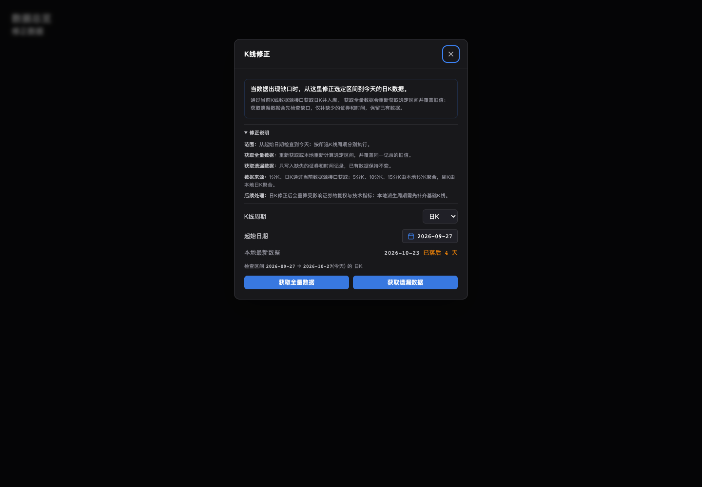
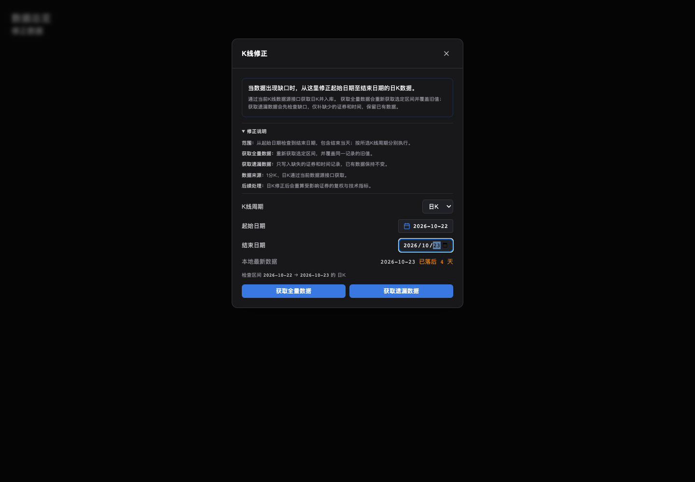
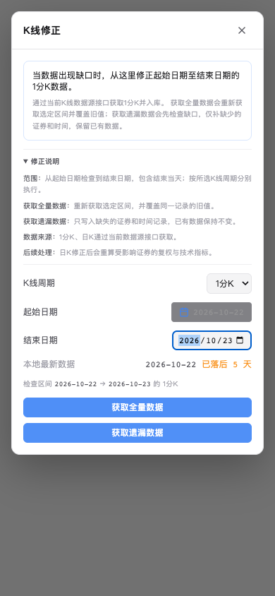
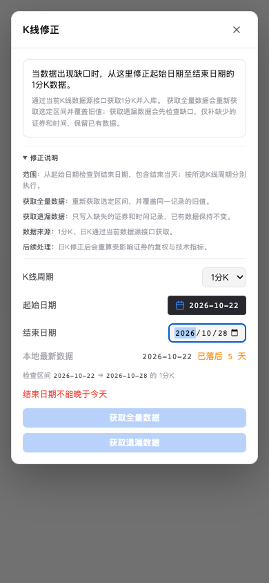

# 数据总览修正日期范围验证

日期：2026-10-27。源码基线：`4da5f30c` / `0.4.32`。
状态：工作区源码已修改并验证；未提交、未更新独立本地运行副本或部署线上。

## 需求与结果

| 用户要求 | 结果与证据 |
| --- | --- |
| K线周期只保留1分K和日K | `RepairDailyPanel`只渲染1m/1d，默认日K；组件测试与真实浏览器均核对恰好两个选项 |
| 结束时间支持输入 | 原生日期输入框默认今天，可直接填写或使用系统日历；浏览器实际键盘把2026-10-23改为2026-10-22 |
| 所选结束日期实际生效 | full/missing请求都携带end_date；服务和日K管道使用所选闭区间，包含结束当天 |

前端拒绝空日期、结束早于起始或晚于今天；后端在能力检查和建任务前拒绝非法结束日期。
1分钟真实样本入库覆盖选定两天，并保留前后日期的旧值；即使Provider返回超范围数据，也不会覆盖范围外分钟记录。
日K复用既有管道，股票/指数/ETF及因子请求使用同一日期范围；
只清理范围内的股票Enriched及历史ETF实时残留，不附带分钟采集或全库自愈删除。
复权链与技术指标保留原依赖重算，可能更新范围外派生指标。

旧调用未传end_date仍修正到北京今天；后台六周期API、自动盘后流程保持兼容。
应用版本未加号，用户行情与管理员、口令、SMTP配置未操作。

## 自动验证

Python测试使用一次性数据与配置目录，不连接用户业务库或真实行情源。
先在隔离工作目录验证，复制后又对工作区修正代码执行了新鲜的126项回归。

| 命令范围 | 实际结果 |
| --- | --- |
| `python -m pytest backend/tests/test_repair_kline.py backend/tests/test_data_integrity.py backend/tests/test_pipeline_beijing_today.py -q` | 126 passed，复制回工作区后12.54秒，12条既有警告 |
| 周期服务/API、历史进度、Enriched完整性/旧价、自动拉取开关、容量、首次同步、数据发布共9个相关测试文件 | 159 passed，23.47秒，40条既有警告 |
| 前端 `pnpm test` | 77个文件、379项测试全部通过，10.12秒 |
| 前端 `pnpm build` | TypeScript与生产构建通过；保留既有大chunk提示 |
| 前端 `pnpm lint` | 通过 |
| `python scripts/check_ruff_delta.py --base HEAD`，使用现有Ruff | 增量0；既有基线与当前均85项，见[结果](ruff-delta.json) |
| `python scripts/check_docs.py` | 31个维护Markdown、8个需求模块及需求基线检查通过 |
| `python scripts/check_version.py` | 0.4.32一致 |
| `git diff --check` | 通过 |

相关9个后端文件为`test_kline_periods.py`、`test_kline_periods_api.py`、
`test_kline_sync_progress.py`、`test_enriched_partial_partition.py`、
`test_enriched_stale_price_partition.py`、`test_pipeline_pull_types.py`、
`test_pipeline_capacity.py`、`test_initial_sync.py`及`test_data_release.py`。
需求、架构、二开、测试、用户操作、运营、运维、版本基线及工程映射同步更新。

RED证据：旧组件仍有六选项且无结束日期输入；旧客户端丢弃第4参数；
旧API忽略结束日期（非法日期进入能力门控返回403）；旧日K管道缺少override_end_date；
旧分钟服务取数到今天，旧清理helper不接受end。新增用例先检出这些缺失行为，再实现并通过。
最初API非法日期用例的TestClient后台取消干扰已改为缺能力fixture，确认失败原因是日期校验未生效。

## 浏览器验证

环境：Chrome，已安装Playwright；Browser插件不可用。
URL：`http://127.0.0.1:3199/`，仅运行真实`RepairDailyPanel`、`SettingsModal`、
`DatePicker`及对应Router/Query上下文，拦截业务API。没有提交真实修正任务。

| 检查 | 结果 |
| --- | --- |
| 页面身份、非空、无框架错误覆盖层 | 通过 |
| 控制台与运行时 | 无页面异常；唯一503来自故意模拟的数据源失败 |
| 周期与日期 | 两个选项、默认日K/今天，实际起始日历及原生日期键盘编辑通过 |
| 全量失败→重试 | 弹窗保留错误，重试携带2026-10-22至2026-10-23并收到任务ID |
| 1分K遗漏 | 切换1m后携带同一起止日期及missing，收到任务ID |
| 空/反向/未来、同日范围 | 非法日期禁止两个按钮并显示原因；同日范围可提交 |
| 运行中/数据源不可用 | 获取按钮禁用；运行中周期和结束日期输入禁用 |
| 1440×1000暗色、390×844浅色 | 无横向溢出；窄屏面板16px至374px，内容宽度356px |

最终交互和请求记录见[result.json](result.json)。
测试脚本起初误拦截源码的`lib/api/`导入，已收窄为仅`/api/`业务URL；
随后补齐缺能力徽章所需Router上下文。最终整轮通过，未改动产品来适应测试夹具。

## 工作区保留与边界

基于25个候选文件的SHA-256检查，确认共享工作区无并行变化后才复制20个本任务文件。
此前离线生成的17个修改先完整带入隔离目录，叠加本次最小差异；
其中6个非本任务文件原字节保留。文件清单及最终散列见[sync-manifest.json](sync-manifest.json)。
既有研究报告与其他未跟踪文件保留，临时脚本、服务与测试目录不加入源码。

未验证线上或独立运行副本的加载状态、真实Provider历史覆盖、其他浏览器及跨平台原生日期UI。
本记录不等同主线合并、部署或预置行情全部完成。

## 截图

修改前（默认结束到今天）：

修改后（可输入结束日期）：

窄屏浅色：

窄屏非法结束日期：

