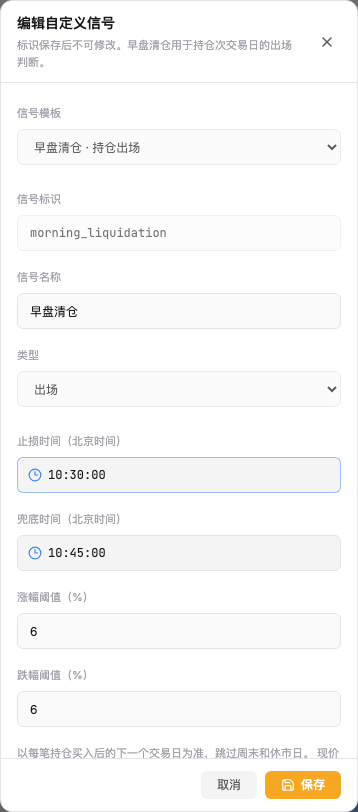
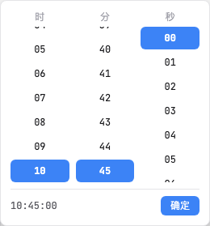

# 早盘清仓公共时间控件验收

2026-11-02，止损时间和兜底时间已统一使用公共 `TimePicker`，
以24小时制 `HH:mm:ss` 显示和保存，弹层提供时／分／秒三列。
本次在当前本地v0.4.45上生效，应用版本未递增，未提交、推送或部署ECS。

## 当前配置及交互

| 参数 | 当前值 | 本次变化 |
| --- | --- | --- |
| 止损时间 `time` | 10:30:00 | 公共秒级控件 |
| 兜底时间 `fallback_time` | 10:45:00 | 公共秒级控件 |
| 涨幅阈值 `rise_pct` | 6% | 参数值保持 |
| 跌幅阈值 `fall_pct` | 6% | 参数值保持 |

选择时分秒后点“确定”更新表单草稿，点“保存”才写入信号。
Escape只取消当前时间弹层并返回触发按钮，未确认值不写入，外层编辑弹窗保持。
重开读取当前已保存秒值；秒级模式传入旧 `HH:mm` 时补齐 `:00`。
时间范围仍为北京时间09:30:00～11:30:00，兜底须晚于止损。
实时监控支持秒，连续资金分钟回测仍要求整分钟。

公共组件新增可选 `showSeconds`，缺省false。
日K周期同步实测仍显示 `16:00`，弹层只有时／分两列；
周期同步和扩展数据拉取仍保持原 `HH:mm` 输入／保存契约。

## 策略与收益边界

本次只调整两处时间控件，选股、买入、卖出、仓位、资金及费用参数保持。
沿用已核实的当前自定义s02：沪深主板，排除ST、上市不足60天及已知停牌；
完整当日池只再应用流通市值50～500亿元。其他价格、涨跌幅及成交额条件仍用于选股。
买入仍引用14:30尾盘走强信号。

卖出仍在买入后的下一交易日按现价相对精确前交易日原始昨收判断，
涨6%或跌6%提前清仓；10:30:00无条件触发，10:45:00再次处理余股。
真实容量、停牌、T+1及缺行情约束保持。已有研究输入的最多5只、
总仓位100%和等权配置保持；单票20%是该历史研究输入的目标比例。
完整策略说明沿用[上轮双阈值／双时间记录](morning-liquidation-dual-time-20261102.md)。
本次没有新跑真实行情收益回测，不将旧研究结果认作本次新结果。

## 实际验证

| 项目 | 结果 |
| --- | --- |
| 新能力先红后绿 | 新增8例：实现前6失败、2既有能力通过；实现后全部通过 |
| 相关前端回归 | 19项控件／表单／日期／信号动作＋23项设置／同步／扩展，共42项通过 |
| 代码与构建 | 受影响ESLint、TypeScript／Vite构建、目录／版本／差异空白检查通过 |
| 实际浏览器 | 1440×1000、390×844；两个三列弹层均在视口内，无横向溢出 |
| 确认／取消 | 秒级确认、Escape焦点返回及取消未保存值通过 |
| 实际保存／重开／刷新 | 10:15:32与10:50:15保存重开通过，已恢复10:30:00／10:45:00 |
| 非法关系 | 兜底等于止损时页面拦截且不落盘 |
| 原时分控件 | 日K16:00、两列选择及Escape通过，未保存周期同步配置 |
| 运行源与Compute | 662条镜像清单自检、661条本地映射匹配，1865个后端文件保持 |
| 本地切换／恢复 | 任务空闲后切换，八角色源目录匹配；两库备份实际恢复20／35表 |
| 配置及重启 | 受控配置、登录、时间参数、策略及同步配置保持；11组重启前后签名一致 |

本次未重跑上一轮后端229／SQL51／Compute127项测试；
采用后端文件及Compute非静态清单不变作为本次前端改动的兼容证据。
React Router未来选项和Vite分包大小提示仍存在。
浏览器最初误选名称相近的数据卡片，改为精确定位“日 K”后通过，
最终结果均来自实际UI交互，没有用接口结果替代控件操作。
Browser工具核验导航；受控登录和保存由本地Playwright执行，凭据不进入工具参数或报告。

切换时11组用户状态保持。核验期间另有1条成功研究记录于23:32:08进入历史；
本次控件验证未提交研究任务，原有研究记录逐行签名保持，新增记录保留。
目标信号的保存revision因实际往返验证更新，参数已恢复；其余9组签名保持。
API／Compute ready，Platform ready=true；既有最近一次Pipeline失败提示使其status仍为degraded。

## 源码、文档及交付

正式基底为v0.4.45和提交 `4c3ad9b694da0ec2b5ac6f3118e8b86d7cd2ebeb`。
本次补丁SHA256为 `135bf3f4228beff1ade6eb85a544134b0d12d045abc7d235949745e3226866de`，
Compute为 `sha256:851a485d26383b21f97f66fd6b1e13450ffe6ac9caec862c8807b689ad305cdf`。
运行目录为 `v0.4.45-4c3ad9b694da-timepicker-seconds-local`。
主工作区v0.4.44及既有参数展示改动保持；实现和文档在独立工作目录维护。

六类文档分别同步需求、系统方案、CONTRIBUTING、测试、发布运营、运维，
并更新二次开发和版本基线。附[本次14文件增量补丁](timepicker-seconds-20261102/source.patch)，
以已验证的上轮双阈值／双时间源码为基底；不是直接应用到未合入上轮修改的旧主线。
[验证JSON](timepicker-seconds-20261102/verification.json)及图片仅含本次必要的脱敏证据。

